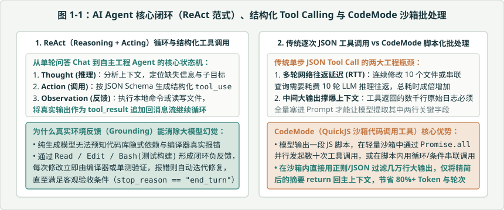
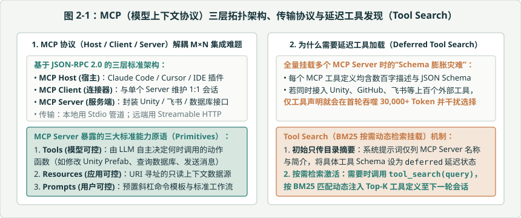
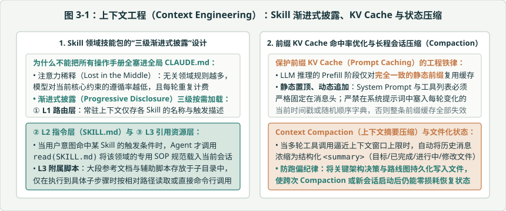
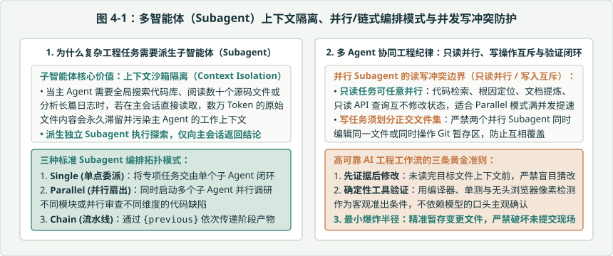

本文从现代工程级 AI Coding Agent（如 Claude Code、Pi Coding Agent、Cursor Agent）的实际运行底座（Agent Harness）出发，系统拆解将大语言模型从“单轮文本问答器”转化为“可自主读写代码库、操作外部系统并闭环验证的工程智能体”的四大核心架构模块：**ReAct 循环、结构化工具调用与 CodeMode 沙箱编排**、**MCP（Model Context Protocol）协议架构与按需工具发现（Tool Search）**、**上下文工程（Skill 渐进式披露、前缀 KV Cache 保护与状态压缩）**、**多智能体（Subagent）上下文隔离与分治编排纪律**。

---

## 第 1 章：ReAct 循环、结构化工具调用与 CodeMode 沙箱编排

### 1.1 从单次推理到 ReAct（Reasoning + Acting）环境反馈闭环

纯大语言模型（LLM）本质上是一个无状态的自回归概率预测函数 `P(next_token | context)`：它既无法直接感知本地磁盘上的最新代码，也无法获知一段代码能否通过编译。工程级 Agent 的核心是由宿主运行底座（**Agent Harness**）驱动的一个 **`while` 状态机循环（ReAct 范式，Yao et al. 2022）**：

```text
while (response.stop_reason == "tool_use") {
    1. Thought（推理规划）：模型结合当前上下文输出思考链，拆解下一步待验证假设或待执行动作；
    2. Action（结构化调用）：模型输出符合 JSON Schema 约束的 tool_use 块（指定工具名 name 与参数对象 input）；
    3. Observation（环境执行与反馈）：Harness 拦截生成流，在本地或远端真实执行该工具，捕获 stdout/stderr 或文件返回内容，封装为 tool_result 消息追加回对话历史，再次发起下一轮模型推理；
}
// 当模型判定目标已全部达成并验证通过时，输出 stop_reason == "end_turn"，结束循环交付用户。
```



- **为什么真实环境反馈（Environment Grounding）能从根源上抑制代码幻觉**：
  在开环问答中，模型一旦猜错某个 API 签名，后续生成的所有代码都会沿着错误假设发散；而在 ReAct 闭环中，每次 `Edit` 修改文件后立即跟随一次确定性的验证工具调用（编译器类型检查、`pytest / unittest` 单元测试、无头浏览器 DOM 像素边界测量），真实的报错堆栈会作为强负反馈信号（`is_error: true`）迫使模型在下一轮修正根因，直至所有客观测试通过。
- **原子工具集最小正交原则**：
  宿主内置的核心工具集并非越多越好，而是遵循 Unix 哲学设计为 **4 个正交原子原语**：**`read`**（按行号区间精确读取文件或图像）、**`edit`**（基于唯一上下文匹配的局部精确替换，禁止全文件盲目重写）、**`write`**（新建或完整覆写文件）、**`bash`**（执行构建、测试、`git`、`rg` 搜索等系统命令）。

---

### 1.2 传统逐次 JSON 工具调用 vs CodeMode（沙箱脚本编排）

当面对“批量检查并修复全站 50 张 SVG 配图的文字边界”或“依次读取 8 个配置文件并汇总差异”这类多步批处理任务时，传统的逐次 JSON `tool_use` 存在两大显著工程瓶颈：
1. **多轮推理往返延迟（Round-Trip Latency）**：若每调用一次工具就必须等待一次云端大模型流式生成，串行调用 20 次工具就需要经历 20 次 LLM 首字延迟（TTFT）与网络往返。
2. **中间原始大输出污染主上下文**：若某个查询工具返回了 `20,000` 行 JSON 日志，传统模式下必须将这 `20,000` 行全量塞进主对话上下文，才能让模型从中挑出 3 行错误记录，瞬間耗尽上下文窗口。

- **CodeMode（以代码作为工具调用胶水层）**：
  Harness 提供一个内嵌轻量级 JavaScript 引擎（如 **QuickJS 无网络隔离沙箱**）的 `codemode` 工具，将所有底层工具映射为沙箱内的异步函数 `await tools.<name>(args)`：
  - **并发批处理（Fan-Out）**：模型只需在单轮输出一段几行的 JS 脚本，通过 `await Promise.all([tools.edit(...), tools.edit(...)])` 在一轮对话内并行完成十几个文件的精准修改。
  - **沙箱内过滤与计算（In-Sandbox Filtering）**：模型可在 JS 脚本内调用工具获取数万行输出，直接在沙箱内用正则表达式或 `JSON.parse` 过滤聚合，最后仅将提炼出的几十字节最终结果 `return` 回主模型上下文，将 Token 消耗与推理轮次同时降低 **80% 以上**。

---

## 第 2 章：MCP（Model Context Protocol）架构与按需工具发现

在 MCP 出现之前，若要让 `M` 种 AI 客户端（Claude Desktop、Cursor、自研 Agent）接入 `N` 种外部业务系统（飞书文档、Unity 编辑器、GitLab、PostgreSQL、逆向分析器），需要重复编写 `M × N` 个私有适配插件。Anthropic 开源的 **MCP（模型上下文协议）**通过标准化的 **JSON-RPC 2.0** 消息层，将其解耦为 **`M + N`** 的统一标准协议。



### 2.1 Host / Client / Server 三层拓扑与三大能力原语

| 架构层级 / 原语 | 角色与控制主体 | 核心职责与通信机制 |
| :--- | :--- | :--- |
| **MCP Host（宿主）** | AI 应用程序进程本身 | 管理用户交互界面、维护主 LLM 对话循环、统筹权限审批与多个 Client 实例 |
| **MCP Client（客户端）** | 宿主内部的协议连接器 | 与单个 MCP Server 维持 **1 对 1 有状态会话**，负责协议版本协商、能力发现（`tools/list`）与路由请求（`tools/call`） |
| **MCP Server（服务端）** | 独立运行的轻量级工具进程 | 封装具体领域 API（本地通过 **`Stdio` 标准输入输出管道**通信，零网络端口开销；远端通过 **Streamable HTTP / SSE** 通信） |
| **原语 1：`Tools`** | **模型可控（Model-Controlled）** | 暴露给 LLM 自主决定何时调用的可执行函数（含副作用，如操作 Unity 场景节点 `manage_gameobject`、发飞书消息） |
| **原语 2：`Resources`** | **应用可控（Application-Controlled）** | 类似 REST GET 的只读数据源（由 `file://` 或自定义 URI 标识），由宿主按需挂载为上下文附件 |
| **原语 3：`Prompts`** | **用户可控（User-Controlled）** | 服务端预定义的高质量提示词模板（常映射为宿主界面中的 `/slash` 斜杠快捷指令） |

---

### 2.2 Schema 膨胀问题与 `tool_search`（BM25 延迟工具动态加载）

随着开发者在本地挂载的 MCP Server 越来越多（例如一个全栈工作站同时挂载了 Unity MCP 30 个工具、飞书套件 40 个工具、逆向工程 REA 35 个工具、浏览器自动化 20 个工具），如果每次对话启动时都把这 **120+ 个工具的完整名称、长篇描述与嵌套 JSON Schema 参数定义**全部塞进模型的 `tools` 数组中：
1. **首轮 Token 巨额浪费**：仅工具定义本身就会占用 **25,000 ～ 50,000 个输入 Token**。
2. **工具选择准确率下降**：面对上百个相似参数结构的工具，模型的注意力被高度分散，极易选错工具或填错字段名。

- **Deferred Tool Loading（延迟工具加载 + `tool_search` 按需检索）**：
  现代 Agent Harness 将非核心的外部 MCP 工具默认标记为 **`deferred`（延迟暴露）**状态：
  1. **初始上下文仅注入百字目录**：系统提示词的 `<mcp_servers>` 块中仅列出已连接的 MCP 服务器名称及一句话功能摘要，**完全不下发具体工具的 JSON Schema**。
  2. **BM25 按需动态检索激活**：当用户提出“帮我检查 Unity 里的 UI 预制体层级”时，模型看到 `<mcp_servers>` 中有 `mcp__unityMCP`，于是先调用轻量内置工具 `tool_search({ query: "unity prefab hierarchy" })`。
  3. Harness 使用 **BM25 全文检索算法**在本地延迟工具元数据索引中匹配出最相关的 Top-K 个工具（如 `mcp__unityMCP__prefab_nav`），仅将这几个命中工具的完整 JSON Schema 动态注入到下一轮请求中供模型调用，实现 **零冗余上下文开销与无限工具库扩展**。

---

## 第 3 章：上下文工程：Skill 渐进式披露、KV Cache 与状态压缩

即使现代前沿大模型拥有 `200K ~ 1M` 的上下文窗口，**“塞得下”也绝不等于“用得好”**。随着上下文长度增长，Transformer 自注意力机制不仅面临二次方计算开销，还会出现显著的 **“中间迷失（Lost in the Middle）”注意力退化**。**上下文工程（Context Engineering）**的核心目标是在任意时刻只让模型看到**信噪比最高**的最小必要信息集。



### 3.1 Skill（领域技能包）的三级渐进式披露（Progressive Disclosure）

在日常工程中，开发者有许多特定场景的标准操作规程（SOP，例如：如何操作内网 Linux 云服务器、如何通过 CLI 操作飞书多维表格、如何对 Office 文档排版巡检）。如果把这十几套 SOP（每套数千字）全部硬编码写进全局 `CLAUDE.md` 或 `AGENTS.md`，每一次写普通 C++ 代码时模型都要被迫阅读数万字的飞书与运维手册。

**Skill 机制**将领域知识组织为按需加载的三级金字塔结构：
1. **L1 路由索引层（常驻系统提示词，每项仅占 ~50 Token）**：
   在 `<available_skills>` 列表中仅保留每个技能的 `name`、`description`（明确写出 **TRIGGER 触发条件**与不负责边界）以及本地 `SKILL.md` 的绝对路径。
2. **L2 核心指令层（命中意图时按需 `read(SKILL.md)`）**：
   只有当用户的当前任务匹配某个 Skill 的描述时，Agent 才主动调用一次 `read` 工具加载对应的 `SKILL.md` 正文，获取该领域的命令格式、鉴权约定与红线禁忌。
3. **L3 附属脚本与参考资料层（子按需加载）**：
   复杂的 API 字段字典、模板文件或自动化 Python/Bash 脚本存放在该 Skill 目录下的 `references/` 或 `scripts/` 子目录中；`SKILL.md` 仅提供索引说明，Agent 仅在用到特定子功能时才按需读取对应子文件或直接通过命令行调用脚本。

---

### 3.2 前缀 KV Cache（Prompt Caching）命中率优化铁律

在多轮 Agent 循环中，每一轮请求都会把前面所有轮次的系统提示词、工具定义与历史对话重新发送给大模型推理端。为了避免每轮重复计算数万 Token 的注意力矩阵，现代模型服务商普遍提供**前缀键值缓存（Prefix KV Cache / Prompt Caching，缓存命中的输入 Token 成本降低 75%～90%，首字延迟降低 80%）**。

由于 Transformer 的因果注意力掩码（Causal Mask）要求每个位置的 Key/Value 向量严格依赖于其**前面的所有 Token 序列**，哪怕前缀中第 100 个 Token 改变了 1 个字符，从第 100 个 Token 往后的全部 KV Cache 都会立即失效重算！因此 Agent Harness 必须遵守三条**缓存友好的上下文构造纪律**：
1. **严格静态前缀置顶**：将 `System Prompt` → `固定工具声明列表（按确定性字典序排列）` → `全局项目规范 CLAUDE.md` → `技能路由表` 严格固定在消息序列最前端。
2. **禁止在静态前缀中混入动态变量**：严禁在系统提示词开头插入精确到秒的当前时间戳 `new Date().toISOString()`、随机 UUID 或未排序的哈希表键值；会话中途严禁动态修改系统提示词。
3. **纯追加式消息流（Append-Only History）**：所有新产生的用户指令、工具调用与环境反馈一律向消息队列尾部追加，保持历史前缀字节级 100% 恒定。

---

### 3.3 长程会话摘要压缩（Context Compaction）与文件化外部记忆

当一个持续数小时的大型开发任务历经上百次工具调用、上下文累积逼近窗口阈值（如 `160K` Token）时，Harness 会自动触发 **Context Compaction（上下文压缩）**：
- **结构化状态快照提炼**：调用一次摘要模型，将此前冗长的原始工具输出、中间排查废案与对话流水账，浓缩为一份高密度的结构化 `<summary>` 块，固定包含六个核心维度：**`Goal`（总体目标）**、**`Constraints & Preferences`（用户约束与风格偏好）**、**`Progress (Done / In Progress / Blocked)`（精确到文件路径与函数名的进度表）**、**`Key Decisions`（关键技术决策及原因）**、**`Next Steps`（下一步行动）** 以及 **`read-files / modified-files` 清单**。
- **文件系统作为外部持久化记忆（File-Backed Memory）**：为了确保跨多次 Compaction 甚至跨会话重启后绝不遗忘长期架构路线或项目规范，应将稳定的项目约定、踩坑复盘与待办大纲及时沉淀到仓库的 `CLAUDE.md`、计划文档或个人知识库 Skill 中——**对话上下文是易失的高速缓存（RAM），而代码库文件与外部文档才是持久化的磁盘（Disk）**。

---

## 第 4 章：多智能体（Subagent）上下文隔离与分治编排

### 4.1 为什么单 Agent 需要派生子智能体（Subagent）

即便有 Context Compaction，如果让主 Agent 亲自去完成“阅读全项目 30 个源码文件定位某个隐蔽 Bug”或“查阅五份外部飞书文档提炼接口规范”，这 30 个文件的原始源码（数万 Token）会瞬间塞满主 Agent 的上下文，冲淡主 Agent 对全局架构与用户约束的注意力。



- **Subagent 的本质是“上下文沙箱隔离（Context Isolation / MapReduce）”**：
  - 主 Agent（Orchestrator）作为架构师与调度者，自身只保留高层级计划；
  - 当遇到需要大量翻阅文件或独立闭环的子任务时，主 Agent 调用 `subagent` 工具派生一个拥有**全新空白上下文窗口**的子智能体进程；
  - 子智能体在自己的隔离沙箱内执行数十次 `grep / read / bash` 探索，消耗掉几万 Token 的中间过程后，最终只向主 Agent 返回一段 **几百字的高信噪比结论报告**，而子智能体庞大的中间探索上下文随进程结束直接销毁，主会话上下文实现**零污染**。

---

### 4.2 三种编排拓扑与多 Agent 读写分离工程纪律

| 编排模式 | 调用形式 | 数据流向与适用工程场景 |
| :--- | :--- | :--- |
| **1. 单点委派（Single）** | `{ agent, task }` | 将独立的高噪音子任务（如“阅读日志定位报错根因”“归档提炼飞书文档”）交由专项子 Agent 独立闭环 |
| **2. 并行扇出（Parallel）** | `{ tasks: [{agent, task}, ...] }` | 同时启动多个子 Agent 并行探索不同子系统、或从安全性/性能/规范三个维度并行 Code Review，耗时缩减为最慢单任务耗时 |
| **3. 流水线串联（Chain）** | `{ chain: [..., {task: "...{previous}"}] }` | 前一个子 Agent（如 `scout` 代码侦察员）的输出自动填入 `{previous}` 传给下一个子 Agent（如 `planner` 方案规划师 → `worker` 实现者） |

- **多智能体并行协同的三条工程铁律**：
  1. **只读任务满并发、写入任务正交隔离（Read-Parallel, Write-Disjoint）**：代码检索、问题排查、文档阅读等无副作用的只读任务可以放心地使用 `Parallel` 模式并发提速；但如果多个并行子 Agent 需要修改代码，**必须在任务指令中严格划分互不重叠的文件集合（Disjoint File Sets）**，严禁两个并行 Agent 同时编辑同一个文件或同时执行 `git commit` 抢占 `.git/index.lock`。
  2. **自包含任务契约（Self-Contained Prompting）**：子智能体无法看到主会话的历史对话！因此主 Agent 在下发 `task` 描述时，不能只写一句模糊的“把刚才那个问题修一下”，而必须显式传入**完整的目标文件路径、背景约束、期望输出格式与验收命令**。
  3. **客观验证闭环准出**：主 Agent 在收到子 Agent 的完成报告后，必须运行一次全局集成构建或自动化测试（如 `npm run build`、单元测试或无头浏览器渲染巡检），用确定性工具验证最终产物无误后再提交发布。
