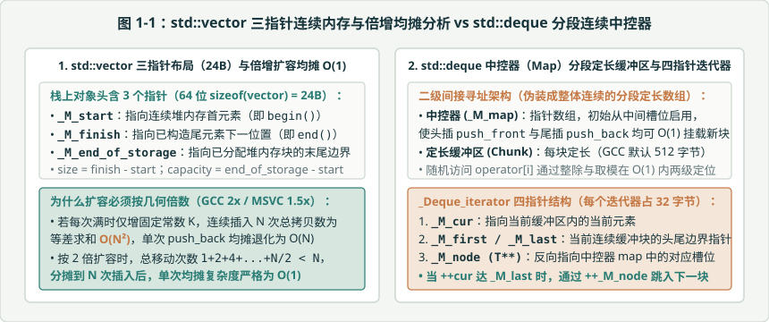
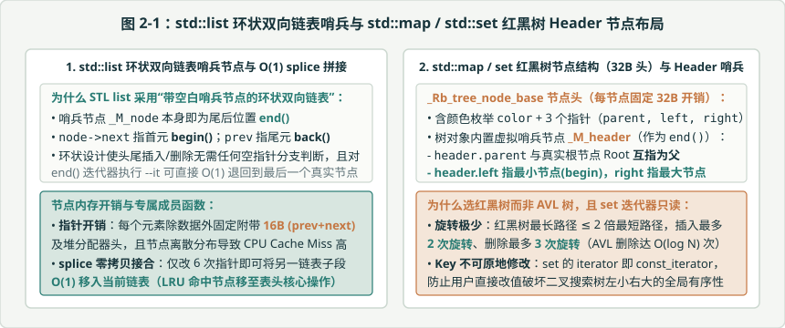
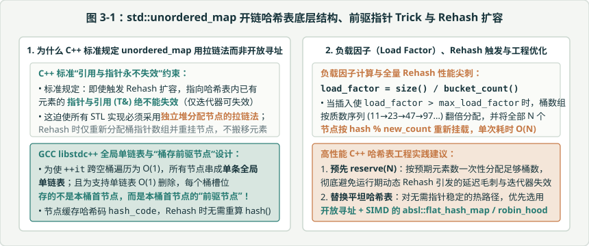
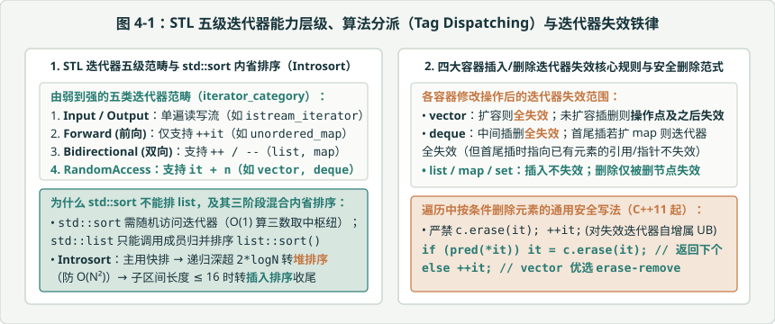

本文结合 GCC `libstdc++` 源码实现，按容器内存布局与算法复杂度将 C++ 标准模板库分为四个章节：**序列式容器底层（`std::vector` 与 `std::deque`）**、**链表与有序关联容器（`std::list` 与 `std::map / set` 红黑树）**、**无序哈希容器（`std::unordered_map` 前驱桶链表与 Rehash 机制）**、**STL 迭代器范畴、`std::sort` 内省排序与迭代器失效规则**。

---

## 第 1 章：序列式容器底层：`std::vector` 与 `std::deque`

### 1.1 `std::vector` 三指针内存布局与倍增扩容均摊分析

`std::vector<T>` 在栈上的控制块仅包含 **3 个指针**（在 64 位系统上 `sizeof(std::vector<T>)` 恒为 **24 字节**）：
- `_M_start`：指向连续堆内存块的首元素（对应 `begin()`）。
- `_M_finish`：指向当前最后一个已构造元素的下一个位置（对应 `end()`，因此 `size() = _M_finish - _M_start`）。
- `_M_end_of_storage`：指向整块已分配堆内存的末尾边界（`capacity() = _M_end_of_storage - _M_start`）。



#### 1. 为什么扩容因子必须采用几何级数倍增（GCC `2.0x` / MSVC `1.5x`）
- **若采用固定步长扩容（每次满时仅增加常数 `K` 个槽位）**：连续执行 `N` 次 `push_back` 时，在第 `K, 2K, 3K ...` 次均会触发全量元素搬移，总拷贝次数为等差数列求和 `K * (1 + 2 + ... + N/K) = O(N^2)`，分摊到每次 `push_back` 的均摊时间复杂度退化为 **`O(N)`**。
- **采用 2 倍几何扩容（Doubling Strategy）**：设初始容量为 1，插入 `N = 2^m` 个元素期间，仅在容量为 `1, 2, 4, 8, ..., 2^(m-1)` 时触发扩容搬移，总元素移动次数为等比数列求和：
  $$
  \text{Total Moves} = 1 + 2 + 4 + \dots + \frac{N}{2} = N - 1 < N, \qquad \text{Amortized Cost} = \frac{N + (N - 1)}{N} = O(1)
  $$
- **MSVC 采用 `1.5` 倍而 GCC 采用 `2` 倍扩容的原因**：在 `2` 倍扩容下，此前已释放的所有历史内存块大小之和 $1 + 2 + 4 + \dots + 2^{k-1} = 2^k - 1$ 始终**小于**下一次申请的容量 $2^k$，分配器无法复用此前释放的连续内存块；当扩容系数满足 $1 < r < \frac{1 + \sqrt{5}}{2} \approx 1.618$（如 $r = 1.5$）时，前几次释放的内存块合并后可满足后续新容量的分配需求，有利于内存复用。

#### 2. `push_back` vs `emplace_back` 与 `noexcept` 移动保证
- **`emplace_back(args...)` 原位构造**：通过可变参数模板与完美转发（`std::forward<Args>(args)...`），直接在 `_M_finish` 指向的未初始化内存上调用 placement new `new ((void*)_M_finish) T(args...)`，当传入构造参数而非现成对象时，比 `push_back` 省去一次临时对象的构造与移动/析构。
- **移动构造函数声明 `noexcept` 的原因**：`std::vector` 扩容搬移旧元素时，为满足**强异常安全保证（Strong Exception Guarantee：若搬移中途抛出异常，原容器保持不变）**，会通过 `std::move_if_noexcept` 检查元素类型 `T` 的移动构造函数是否带有 `noexcept`；若未标记 `noexcept`，`vector` 扩容时会**回退为调用拷贝构造函数**。

---

### 1.2 `std::deque` 中控器（Map）分段连续空间与四指针迭代器

`std::vector` 在头部插入/删除元素需要移动全部后续元素（`O(N)`）；而 `std::deque`（双端队列）为了同时支持 **`O(1)` 头尾插入删除** 与 **`O(1)` 随机访问 `operator[]`**，采用了**二级分段连续空间**架构：

1. **中控器（`_M_map`，类型为 `T**`）与定长缓冲区块（Chunk）**：
   - 主控数组 `_M_map` 是一小块存放指针的连续数组，其中每个槽位指向一块固定大小的连续内存缓冲区（GCC `libstdc++` 中默认每块缓冲区为 **512 字节**；若单个元素大于 512B 则每块存 1 个元素）。
   - 初始化时，中控器故意从 `_M_map` 数组**正中间的槽位**开始放置第一块缓冲区，使得前端 `push_front` 和后端 `push_back` 都有充足的空闲槽位向两侧扩展挂载新缓冲区块。
2. **四指针迭代器 `_Deque_iterator`（每个迭代器占 32 字节）**：
   为了把分段不连续的多个缓冲区块伪装成一段连续支持 `it + n` 的随机访问区间，`deque` 的每个迭代器内部必须维护 4 个指针：
   - `_M_cur`：指向当前正在访问的元素；
   - `_M_first` 与 `_M_last`：指向当前所在 512B 缓冲区块的起始地址与末尾地址；
   - `_M_node（T**）`：反向指向中控器 `_M_map` 中管理当前块的那个二级指针槽位（当 `++_M_cur == _M_last` 走到当前块尽头时，自动执行 `++_M_node` 切换到中控器的下一个缓冲区块首地址）。
3. **容器适配器（`std::stack` / `std::queue` / `std::priority_queue`）**：
   - `std::stack` 与 `std::queue` 默认均以 **`std::deque`** 作为底层容器封装接口（因为 `deque` 扩容无需搬移已有元素，且头尾增删均为 `O(1)`）。
   - `std::priority_queue` 默认以 **`std::vector`** 作为底层完全二叉树数组，配合 `std::make_heap / push_heap / pop_heap` 维护大顶堆（默认比较器为 `std::less<T>`）。

---

## 第 2 章：链表与有序关联容器：`std::list` 与 `std::map / set`

### 2.1 `std::list` 环状双向链表哨兵与 `splice` 零拷贝接合

`std::list<T>` 底层并非首尾断开的普通双向链表，而是通过一个**不存储业务数据的空白哨兵节点（Sentinel / Header Node `_M_node`）**首尾闭合构成的**环状双向链表**：
- 哨兵节点 `_M_node` 本身代表尾后位置 `end()`；
- `_M_node->_M_next` 指向头节点 `begin()`，`_M_node->_M_prev` 指向尾节点 `--end()`；
- 当链表为空时，`_M_node` 的 `next` 和 `prev` 均指向自身，从而省去链表插入与删除时对 `head == nullptr` 的空指针判断。



---

### 2.2 `std::map / set` 红黑树节点布局与 `_M_header` 哨兵机制

`std::set`、`std::multiset`、`std::map`、`std::multimap` 四大有序关联容器在底层共用同一套红黑树实现 `_Rb_tree`：

1. **红黑树节点内存开销（每节点额外 32 字节）**：
   每个树节点基类 `_Rb_tree_node_base` 包含 1 个颜色枚举 `_M_color`（红/黑，对齐至 8B）以及 **3 个指针**：父指针 `_M_parent`、左孩子 `_M_left`、右孩子 `_M_right`（共 `8 × 4 = 32` 字节，外加保存数据的 `value_field`）。
2. **`_M_header` 哨兵节点与根节点互指结构**：
   为使 `begin()`、`end()` 与 `--end()` 均达到 `O(1)` 复杂度，红黑树内部持有一个虚拟哨兵节点 `_M_header`（颜色固定为红色，代表 `end()`）：
   - `_M_header.parent` 指向红黑树的根节点 `Root`，同时根节点 `Root.parent` 指向 `_M_header`；
   - `_M_header.left` 始终指向整棵树的**最左最小节点**（调用 `map.begin()` 直接返回 `_M_header.left`，耗时 **`O(1)`**）；
   - `_M_header.right` 始终指向整棵树的**最右最大节点**。
3. **为什么 `std::set` 的迭代器不允许修改元素，而 `std::map` 只允许修改 `second`**：
   红黑树节点在树中的位置完全由键值 `Key` 的比较序决定。若允许用户通过迭代器原地修改 `Key` 值，整棵二叉搜索树的有序不变量将立即损毁。因此 `std::set<K>::iterator` 在底层直接定义为 `const_iterator`；而 `std::map<K, V>` 将节点值类型定义为 **`std::pair<const K, V>`**，从类型系统层面锁死 `Key` 不可改，仅允许修改附属值 `V`。

---

## 第 3 章：无序哈希容器：`std::unordered_map` 底层与 Rehash

### 3.1 `unordered_map` 采用拉链法而非开放寻址的原因

基于连续数组的开放寻址哈希表（Open Addressing）具有较好的缓存局部性，但 GCC、Clang（libc++）和 MSVC 的 `std::unordered_map` 均采用**独立堆分配节点的拉链法（Separate Chaining）**：
- **原因在于 C++11 标准的引用与指针稳定性（Pointer / Reference Stability）规定**：
  C++ 标准规定：`unordered_map::insert` 或 `rehash` 扩容时，允许**迭代器失效**，但**指向容器内已有元素的指针（`Value*`）与引用（`Value&`）必须保持有效**。
  若采用开放寻址连续数组，扩容搬移元素会改变已有元素的内存地址，导致外部持有的指针和引用悬空。因此标准库实现需为每个节点单独分配堆内存。



---

### 3.2 GCC `libstdc++` 的“全局单链表 + 桶存前驱指针”结构

若每个哈希桶各自维护独立链表，当负载因子较低、存在大量空桶时，对迭代器执行 `++it` 到达当前桶末尾后，需线性扫描后续空桶才能找到下一个非空桶，导致遍历耗时增加。

为兼顾 **单向链表省内存**、**跨桶 `++it` 耗时 `O(1)`** 以及 **单向链表 `O(1)` 删除桶首元素**，GCC `libstdc++` 采用如下结构：
1. **所有元素串联为单条全局单向链表**：新插入某个桶的节点直接插入全局单链表的对应区段。迭代器 `++it` 仅需执行一次 `node = node->_M_next`，无需跳过空桶，耗时 `O(1)`。
2. **桶槽位 `buckets[b]` 存储的是该桶首节点的“前驱节点指针（before-begin）”**：
   在单向链表中，要删除某个节点 `cur`，必须知道它的前驱节点 `prev` 才能修改 `prev->next = cur->next`。因此 `buckets[b]` 并不指向桶 `b` 的第一个元素本身，而是指向**全局单链表中排在桶 `b` 第一个元素前面的那个节点**（即上一个非空桶的尾节点，或全局哨兵头 `_M_before_begin`），从而在单向链表上实现了 `O(1)` 桶头插入与删除。

---

## 第 4 章：STL 迭代器范畴、`std::sort` 内省排序与迭代器失效总表

### 4.1 五级迭代器范畴与 `std::sort` 三阶段内省排序（Introsort）

STL 通过 `std::iterator_traits<Iter>::iterator_category` 提取迭代器的五种能力标签，并在编译期利用函数重载（Tag Dispatching）或 C++20 Concepts 自动分派最优算法（如 `std::advance(it, n)` 对随机访问迭代器直接编译为 `it += n`，对双向迭代器编译为 `n` 次循环自增）：



- **为什么 `std::sort` 工程实现采用混合内省排序（Introsort）**：
  单纯的快速排序在面对精心构造的数据（如大量重复元素或特定逆序）时，递归树可能严重失衡退化至 `O(N^2)` 且引发栈溢出。`std::sort` 结合了三种排序算法的优势：
  1. **主体采用三数取中快速排序（Median-of-Three Quicksort）**：取首、中、尾三元素的中间值作为枢轴 Pivot，保证极佳的 L1 Cache 顺序扫描局部性。
  2. **递归深度超限切换堆排序（Heapsort）**：当递归分割深度超过阈值 `2 * ⌊log2(N)⌋` 时，判定当前分支存在恶化风险，立即将该子区间切换为 `std::partial_sort`（堆排序），从数学上锁死最坏时间复杂度上限为 **`O(N log N)`**。
  3. **小区间收尾采用插入排序（Insertion Sort）**：当子区间元素个数小于等于阈值 **`16`** 时，停止快排递归，留到最后统一执行一趟无递归调用开销的插入排序。

---

### 4.2 全容器时间复杂度与修改操作迭代器/引用失效规则总表

| 容器名称 | 底层数据结构 | 随机访问 | 头插/头删 | 尾插/尾删 | 按值查找 | 插入时迭代器是否失效 | 删除时迭代器是否失效 |
| :--- | :--- | :--- | :--- | :--- | :--- | :--- | :--- |
| **`std::vector`** | 单段连续动态数组 | **`O(1)`** | `O(N)` | **均摊 `O(1)`** | `O(N)` | 未扩容：**插入点及之后失效**；触发扩容：**全部迭代器/指针/引用全失效** | **被删点及之后全部失效**（`erase` 返回下一有效迭代器） |
| **`std::deque`** | 中控器 `T**` + 512B 分段数组 | **`O(1)`** | **`O(1)`** | **`O(1)`** | `O(N)` | 中间插入：**全部迭代器/引用失效**；首尾插入：**迭代器全失效，但已有元素的引用/指针不失效** | 首尾删除：仅被删者失效；中间删除：**全部失效** |
| **`std::list`** | 环状双向链表（带哨兵） | 不支持 | **`O(1)`** | **`O(1)`** | `O(N)` | **绝不失效**（节点独立分配） | **仅被删节点自身失效**，其余全部有效 |
| **`std::map / set`** | 红黑树（平衡二叉搜索树） | 不支持 | — | — | **`O(log N)`** | **绝不失效**（旋转仅改指针，不改节点地址） | **仅被删节点自身失效**，其余全部有效 |
| **`std::unordered_*`** | 拉链式哈希表（全局单链表） | 不支持 | — | — | **均摊 `O(1)`**，最坏 `O(N)` | 未触发 Rehash：**不失效**；触发 Rehash：**全部迭代器失效，但指针/引用永不失效** | **仅被删节点自身失效**，其余全部有效 |

- **遍历中按条件删除元素的唯一通用安全写法（C++11 起所有容器统一支持 `erase` 返回下一有效迭代器）**：
  ```cpp
  for (auto it = container.begin(); it != container.end(); ) {
      if (shouldRemove(*it)) {
          it = container.erase(it); // 必须用返回值更新 it，严禁再对旧 it 执行 ++it
      } else {
          ++it;
      }
  }
  ```
  （补充：对于 `std::vector` 的批量条件删除，若在循环内逐个调用 `erase` 会导致后续元素反复前移产生 `O(N^2)` 开销，工程中应优先使用 **`std::erase_if(vec, pred)`（C++20）** 或 `vec.erase(std::remove_if(vec.begin(), vec.end(), pred), vec.end())` 在单趟 **`O(N)`** 内完成批量原地压缩删除。）
