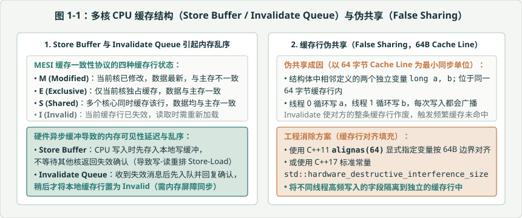
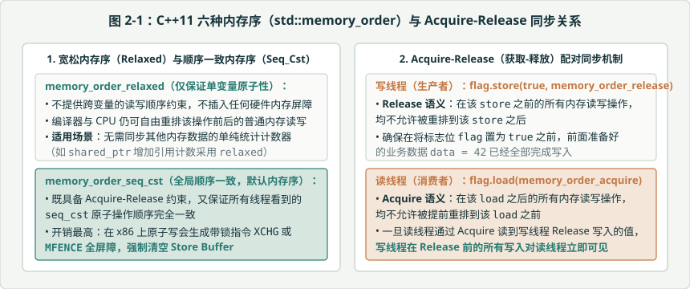
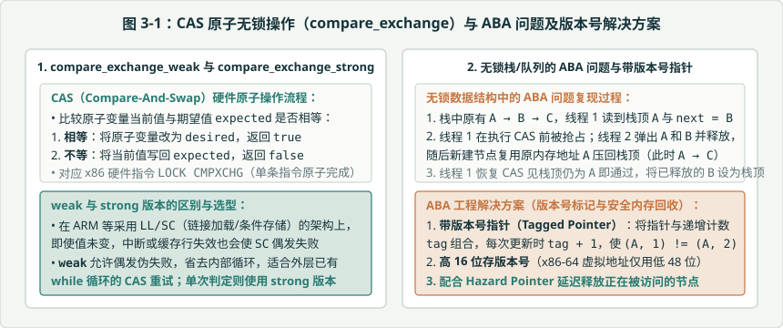
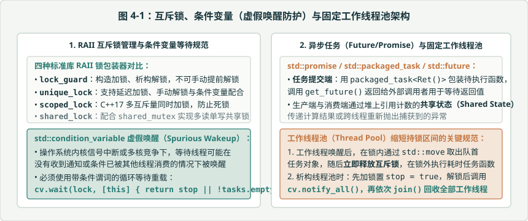

本文梳理 C++11 多线程并发与底层内存模型核心机制，共分为四个章节：**多核 CPU 缓存结构、内存乱序成因与伪共享**、**C++11 六种内存序（`std::memory_order`）与 Acquire-Release 同步语义**、**`std::atomic` 原子操作、CAS 无锁编程与 ABA 问题**、**互斥锁、条件变量（虚假唤醒防护）与工作线程池实现**。

---

## 第 1 章：多核 CPU 缓存结构、内存乱序与伪共享

### 1.1 MESI 缓存一致性协议与硬件乱序成因

现代多核 CPU 中，每个核心都拥有独立的 L1/L2 高速缓存，并以 **64 字节的缓存行（Cache Line）** 为最小单位与主存交换数据。为了保证多核缓存数据一致，硬件普遍采用 **MESI 协议**，将每条缓存行标记为以下四种状态之一：
- **M（Modified，已修改）**：当前核心已修改该缓存行，数据最新，尚未写回主存；其他核心中对应的缓存行均处于失效状态。
- **E（Exclusive，独占）**：仅当前核心缓存了该行数据，数据未修改且与主存一致；当前核心可直接写入并转为 M 状态，无需通知其他核心。
- **S（Shared，共享）**：多个核心同时缓存了该行数据，所有副本均与主存一致；任一核心修改前必须先向其他核心广播失效（Invalidate）消息。
- **I（Invalid，已失效）**：当前缓存行数据已过期，读取时必须重新从主存或其他核心加载。



虽然 MESI 协议保证了缓存最终一致，但如果核心每次写入处于 S 状态的缓存行都停下来等待其他核心返回 Invalidate 确认，CPU 流水线就会频繁停顿。为此，硬件在核心与缓存之间引入了两个异步缓冲结构，这也直接导致了**指令乱序执行与内存可见性延迟**：
1. **写缓冲器（Store Buffer）**：
   核心执行写操作时，若缓存行不在本地或处于 S 状态，CPU 先将新值写入本地的 **Store Buffer** 并立即继续执行后续指令，随后再异步向其他核心发送失效通知。这会导致**本核心的写操作对其他核心延迟可见**（典型表现为写-读重排 Store-Load Reordering：两个核心各自先写自己的变量再读对方的变量，却都读到了对方的旧值）。
2. **失效队列（Invalidate Queue）**：
   核心收到其他核心发来的 Invalidate 消息时，不会立即停下当前指令去修改缓存状态，而是先将该消息放入本地 **Invalidate Queue** 并立即返回确认，等空闲时再批量将对应缓存行标记为 I（Invalid）。这会导致**当前核心在短时间内仍可能从本地缓存读到已过期的旧数据**。

---

### 1.2 缓存行伪共享与对齐消除

- **伪共享成因**：
  由于 CPU 缓存同步的最小粒度是 **64 字节缓存行**，如果结构体中两个互相独立的变量 `a` 和 `b` 在内存上紧挨着定义，它们就会被加载到同一个 64 字节缓存行中。当线程 0 在核心 0 上高频修改变量 `a`，而线程 1 在核心 1 上高频修改变量 `b` 时，虽然两个线程在代码逻辑上访问的是不同变量，但硬件层面每次写入都会广播 Invalidate 使对方的整条缓存行作废，导致该缓存行在两个核心之间反复失效重读，读写耗时成倍增加。
- **工程消除方案（`alignas(64)` 缓存行对齐）**：
  对于多线程各自高频写入的状态字段（如线程池中每个工作线程的统计计数器、环形队列的读写游标 `head` 与 `tail`），使用 `alignas(64)` 强制让每个变量独占一条 64 字节缓存行：

```cpp
#include <atomic>

// 存在伪共享：head 与 tail 紧邻（共 16 字节），处于同一个 64 字节缓存行内
struct BadQueueCounters {
    std::atomic<uint64_t> head{0}; // 消费者线程高频更新
    std::atomic<uint64_t> tail{0}; // 生产者线程高频更新
};

// 消除伪共享：使用 alignas(64) 将生产者与消费者游标隔离到两个独立的 64 字节缓存行
struct AlignedQueueCounters {
    alignas(64) std::atomic<uint64_t> head{0};
    alignas(64) std::atomic<uint64_t> tail{0};
};
```

---

## 第 2 章：C++11 六种内存序（`std::memory_order`）与同步机制

为了在不同 CPU 架构（如强内存模型的 x86 与弱内存模型的 ARM）上编写可移植的无锁并发代码，C++11 定义了统一的抽象内存模型与六种 `std::memory_order` 枚举，用来精确控制编译器指令重排与硬件内存屏障的开销。



### 2.1 六种内存序语义与开销对比

| 内存序枚举 | 适用原子操作 | 核心读写顺序约束与硬件行为 | 典型应用场景 |
| :--- | :--- | :--- | :--- |
| **`memory_order_relaxed`** | 读 / 写 / 读改写 | **仅保证当前变量自身的原子性**，不限制前后任何内存读写的重排，无内存屏障开销。 | 单纯递增统计计数器、`std::shared_ptr` 引用计数递增。 |
| **`memory_order_acquire`** | 读（`load`） | **获取语义**：保证该 `load` **之后**的所有普通或原子内存读写，绝不会被重排到该 `load` **之前**。 | 消费者线程读取就绪标志位、自旋锁加锁（`lock`）。 |
| **`memory_order_release`** | 写（`store`） | **释放语义**：保证该 `store` **之前**的所有普通或原子内存读写，绝不会被重排到该 `store` **之后**。 | 生产者线程发布就绪标志位、自旋锁解锁（`unlock`）。 |
| **`memory_order_acq_rel`** | 读改写（`fetch_add` / CAS） | 同时包含 Acquire 与 Release：前置读写不可后移，后置读写不可前移。 | 包含读写双重语义的原子交换、`shared_ptr` 引用计数递减。 |
| **`memory_order_consume`** | 读（`load`） | 仅保证后续**直接依赖该原子变量值**的计算表达式不被提前重排（编译器通常直接按 `acquire` 实现）。 | 极少直接使用，一般用 `acquire` 替代。 |
| **`memory_order_seq_cst`** | 读 / 写 / 读改写（**默认**） | **全局顺序一致**：在 Acquire-Release 基础上，保证所有线程看到的所有 `seq_cst` 操作顺序完全一致。 | 默认安全选项；多生产者多消费者严苛顺序同步。 |

---

### 2.2 Acquire-Release（获取-释放）配对同步实战

当线程 A 对原子变量 `flag` 执行 `store(..., std::memory_order_release)`，且线程 B 对同一个原子变量 `flag` 执行 `load(std::memory_order_acquire)` 并读到了线程 A 写入的值时，线程 A 的 `store` 与线程 B 的 `load` 之间即建立起 **Synchronizes-With（同步）关系**：
- 线程 A 在执行 `flag.store(true, release)` **之前**写入的所有普通非原子变量（如业务数据缓冲区 `g_payload`），在线程 B 执行 `flag.load(acquire)` 读到 `true` **之后**，保证对线程 B **100% 可见**。

```cpp
#include <atomic>
#include <cassert>

struct Message {
    int id = 0;
    double value = 0.0;
};

Message g_msg;                              // 普通非原子业务数据
std::atomic<bool> g_ready{false};           // 原子同步标志位

// 写线程（生产者）
void Producer() {
    g_msg.id = 1001;                        // 1. 先写入普通业务数据
    g_msg.value = 3.14;
    // 2. 使用 release 发布标志：保证上面对 g_msg 的写入绝不会重排到此行之后
    g_ready.store(true, std::memory_order_release);
}

// 读线程（消费者）
void Consumer() {
    // 1. 使用 acquire 读取标志：保证下面对 g_msg 的读取绝不会提前到此行之前
    while (!g_ready.load(std::memory_order_acquire)) {
        // 等待生产者就绪
    }
    // 2. 一旦循环退出，必然能读到 Producer 在 release 之前写入的完整数据
    assert(g_msg.id == 1001 && g_msg.value == 3.14);
}
```

- **x86-64 与 ARM64 硬件指令差异**：
  - 在 **x86-64（TSO 强内存模型）** 下，硬件天然保证普通加载（`MOV`）具备 Acquire 语义、普通存储（`MOV`）具备 Release 语义（仅允许 Store-Load 重排）。因此在 x86 上使用 `acquire` 与 `release` **不会生成任何额外的 CPU 硬件屏障指令**，仅禁止编译器在编译期重排指令；而使用默认的 `seq_cst` 写操作则会生成带总线锁的 `XCHG` 或 `MFENCE` 指令以强制刷新 Store Buffer。
  - 在 **ARM64（弱内存模型）** 下，硬件允许任意方向的读写重排，编译器会将 `acquire` 翻译为 `LDAR`（Load-Acquire）指令，将 `release` 翻译为 `STLR`（Store-Release）指令。

---

## 第 3 章：`std::atomic` 原子操作、CAS 无锁编程与 ABA 问题

### 3.1 `std::atomic` 约束与 CAS（Compare-And-Swap）操作

1. **可实例化 `std::atomic<T>` 的类型要求**：
   模板参数 `T` 必须是**平凡可拷贝类型（`std::is_trivially_copyable_v<T> == true`）**，即可以用 `memcpy` 直接按字节复制、没有自定义拷贝构造函数或虚函数。可通过 `atomicObj.is_lock_free()` 检查该类型在当前平台上是否直接由 CPU 原子指令实现（通常大小不超过 8 字节的整型、指针和结构体均为无锁实现；超过 16 字节的大结构体内部会退化为使用自旋锁保护）。
2. **`compare_exchange_weak` 与 `compare_exchange_strong`**：
   CAS 是无锁数据结构的核心原语，其函数签名为 `bool compare_exchange_weak(T& expected, T desired, ...)`，执行逻辑如下：
   - 原子地比较当前值与 `expected`：
     - **若相等**：将原子变量修改为 `desired`，并返回 `true`；
     - **若不相等**：**自动将原子变量的当前最新值写回引用参数 `expected` 中**，并返回 `false`。



   - **`weak` 与 `strong` 的选型准则**：
     在 ARM / PowerPC 等使用 **LL/SC（Load-Linked / Store-Conditional，链接加载/条件存储）** 指令对实现 CAS 的处理器上，即使变量的值没有被其他线程修改，上下文切换或同一缓存行的其他写入也可能导致 `SC` 指令偶发失败（称为**伪失败 Spurious Failure**）。
     - `compare_exchange_weak` 允许发生伪失败并直接返回 `false`，省去了底层额外的重试跳转指令。由于无锁编程中 CAS 本身就写在 `while` 循环里，**凡是配合 `while` 循环重试的场景，优先使用 `compare_exchange_weak`**。
     - 若不打算在失败时循环重试（仅做单次状态切换判断），则使用 `compare_exchange_strong`。

```cpp
// 使用 CAS 实现无锁单链表栈（Treiber Stack）的压栈操作
template <typename T>
class LockFreeStack {
    struct Node {
        T data;
        Node* next;
        Node(const T& val) : data(val), next(nullptr) {}
    };
    std::atomic<Node*> m_head{nullptr};

public:
    void Push(const T& val) {
        Node* newNode = new Node(val);
        newNode->next = m_head.load(std::memory_order_relaxed);
        // 若 m_head 仍等于 newNode->next，则将 m_head 更新为 newNode；
        // 若期间已被其他线程修改，compare_exchange_weak 会自动把最新 m_head 写回 newNode->next 并重试
        while (!m_head.compare_exchange_weak(
            newNode->next, newNode,
            std::memory_order_release,
            std::memory_order_relaxed)) {}
    }
};
```

---

### 3.2 无锁编程中的 ABA 问题与带版本号指针

在上面的无锁栈中，如果直接用同样的方式实现 `Pop()`（读取栈顶 `A` 及其下一个节点 `B`，然后用 CAS 将栈顶从 `A` 改为 `B`），在多线程并发弹出与压入时会触发 **ABA 问题**：
1. 初始状态下，栈内节点依次为 $A \to B \to C$。线程 1 调用 `Pop()`，读到当前栈顶为 $A$，且 `A->next` 为 $B$，正准备执行 `CAS(m_head, A, B)` 前被操作系统挂起。
2. 线程 2 连续执行两次 `Pop()`，依次弹出节点 $A$ 和节点 $B$ 并调用 `delete` 释放了它们的内存；随后线程 2 又调用 `Push()` 创建了一个新节点，内存分配器恰好复用了刚刚释放的节点 $A$ 的内存地址，并将其压回栈顶（此时栈结构变为 $A \to C$，而节点 $B$ 已被销毁）。
3. 线程 1 恢复执行 `CAS(m_head, A, B)`：由于此时栈顶地址依然是 $A$，CAS 检查通过并将栈顶修改为**已经被释放的悬空地址 $B$**，导致链表结构损坏。

- **工程解决方案**：
  1. **带递增版本号的指针（Tagged Pointer）**：
     不仅比较指针地址，还将指针与一个单调递增的无符号整型版本号 `tag` 组合在一起。每次修改指针时都将 `tag` 加 1。即使地址从 $A$ 变成其他值又变回 $A$，其版本号也已经从 $(A, 1)$ 变成了 $(A, 2)$，CAS 对比失败从而阻止错误更新。在 64 位 x86/ARM 系统中，用户态虚拟地址仅使用低 48 位，可将 **高 16 位直接用于存储递增版本号**，装入单个 `uint64_t` 原子变量中完成无锁操作。
  2. **延迟内存回收（风险指针 Hazard Pointer / 对象池索引）**：
     弹出节点后不立即归还给系统 `free/delete`，而是使用固定容量的数组对象池（用“32 位数组下标 + 32 位递增版本号”打包为 64 位整型替代裸指针），既避免了访问已释放内存，又彻底消除了 ABA 问题。

---

## 第 4 章：互斥锁、条件变量与工作线程池实现

### 4.1 互斥锁 RAII 包装器、死锁预防与条件变量虚假唤醒

#### 1. 互斥量与四种 RAII 锁管理工具
直接手动调用 `mtx.lock()` 和 `mtx.unlock()` 在遇到提前 `return` 或抛出异常时极易遗漏解锁。工程中统一使用标准库提供的 RAII 锁守卫：
- **`std::lock_guard<std::mutex>`**：最轻量的作用域锁，构造时加锁、离开作用域析构时解锁，不支持手动中途解锁。
- **`std::unique_lock<std::mutex>`**：支持延迟加锁（`std::defer_lock`）、尝试加锁（`std::try_to_lock`）、手动提前调用 `.unlock()` 缩小持锁范围，以及配合 `std::condition_variable` 使用。
- **`std::scoped_lock`（C++17）**：需要同时获取多个互斥锁时（如从账户 A 向账户 B 转账需同时锁住 `mtxA` 与 `mtxB`），直接写 `std::scoped_lock lock(mtxA, mtxB);`，内部采用免死锁加锁算法统一获取所有锁，消除因加锁顺序不一致引起的死锁。
- **`std::shared_lock<std::shared_mutex>`（C++17）**：读写锁中的共享读锁。多个读线程可同时持有 `shared_lock` 并发读取；写线程使用 `unique_lock` 获取独占写锁。



#### 2. `std::condition_variable` 与虚假唤醒防护
当消费者线程调用 `cv.wait(lock)` 进入内核休眠等待时，需要注意两个问题：
1. **信号丢失**：如果生产者在消费者调用 `wait()` 之前就已经发出了 `notify_one()`，且没有共享布尔状态变量记录就绪状态，消费者随后调用的 `wait()` 将一直阻塞。
2. **虚假唤醒**：由于操作系统信号中断或多核唤醒竞争，处于 `wait()` 状态的线程**即使在没有任何线程调用 `notify` 的情况下，也可能被操作系统意外唤醒**；或者在多个消费者同时被唤醒时，前一个线程已经取走了队列中唯一的元素。

因此，调用 `cv.wait()` 时**必须配合共享状态变量与 `while` 循环检查**（或直接使用接收 Lambda 条件函数的 `wait(lock, predicate)` 重载，其内部等价于 `while (!predicate()) wait(lock);`）。

---

### 4.2 固定大小工作线程池完整实现

下面给出一个结合 `std::thread`、`std::mutex`、`std::condition_variable`、`std::packaged_task` 与 `std::future` 的生产级固定线程数工作线程池实现：

```cpp
#include <vector>
#include <queue>
#include <thread>
#include <mutex>
#include <condition_variable>
#include <future>
#include <functional>
#include <stdexcept>

class ThreadPool {
private:
    std::vector<std::thread> m_workers;              // 常驻工作线程数组
    std::queue<std::function<void()>> m_tasks;       // 待执行任务队列
    std::mutex m_mutex;                              // 保护任务队列与停止标志的互斥锁
    std::condition_variable m_cv;                    // 唤醒工作线程的条件变量
    bool m_stop = false;                             // 线程池停止标志

public:
    explicit ThreadPool(std::size_t threadCount) {
        m_workers.reserve(threadCount);
        for (std::size_t i = 0; i < threadCount; ++i) {
            m_workers.emplace_back([this]() {
                while (true) {
                    std::function<void()> task;
                    {
                        std::unique_lock<std::mutex> lock(m_mutex);
                        // 使用带条件谓词的 wait 防止虚假唤醒：仅当停止或队列非空时才继续向下执行
                        m_cv.wait(lock, [this]() { return m_stop || !m_tasks.empty(); });

                        // 若线程池已请求停止且剩余任务已全部处理完毕，则退出工作线程
                        if (m_stop && m_tasks.empty()) {
                            return;
                        }

                        // 在锁保护下通过移动语义取出队首任务
                        task = std::move(m_tasks.front());
                        m_tasks.pop();
                    } // 离开内部作用域：立即释放互斥锁，保证耗时任务在锁外并发执行

                    task(); // 执行具体任务
                }
            });
        }
    }

    // 提交任意可调用对象与参数，返回 std::future 供调用方异步获取返回值
    template <typename F, typename... Args>
    auto Enqueue(F&& f, Args&&... args) -> std::future<std::invoke_result_t<F, Args...>> {
        using ReturnType = std::invoke_result_t<F, Args...>;

        // 将函数与参数绑定并包装进 packaged_task，用 shared_ptr 管理以便装入 std::function
        auto taskPtr = std::make_shared<std::packaged_task<ReturnType()>>(
            std::bind(std::forward<F>(f), std::forward<Args>(args)...)
        );

        std::future<ReturnType> resultFuture = taskPtr->get_future();
        {
            std::lock_guard<std::mutex> lock(m_mutex);
            if (m_stop) {
                throw std::runtime_error("Cannot enqueue task on stopped ThreadPool");
            }
            m_tasks.emplace([taskPtr]() { (*taskPtr)(); });
        }
        // 解锁后再通知唤醒一个休眠的工作线程，避免被唤醒线程立即在锁上阻塞
        m_cv.notify_one();
        return resultFuture;
    }

    ~ThreadPool() {
        {
            std::lock_guard<std::mutex> lock(m_mutex);
            m_stop = true;
        }
        m_cv.notify_all(); // 唤醒所有工作线程处理剩余任务并退出
        for (std::thread& worker : m_workers) {
            if (worker.joinable()) {
                worker.join();
            }
        }
    }
};
```
