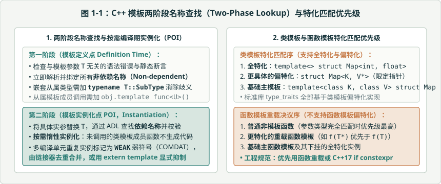
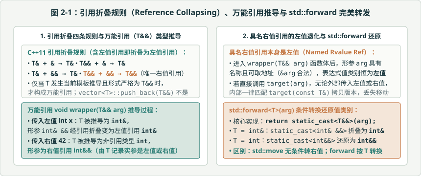
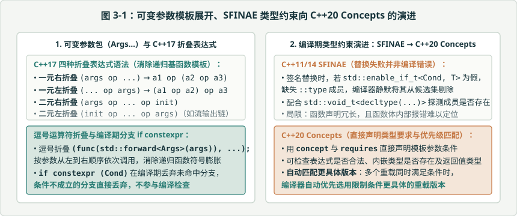
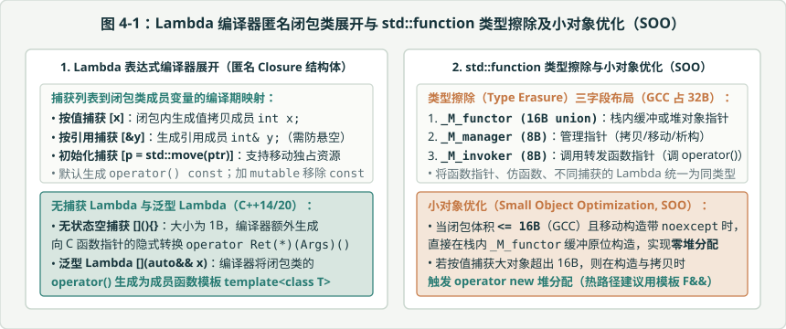

本文围绕 C++ 模板机制与现代 C++（C++11 至 C++20）泛型及函数式核心特性，分为四个章节：**函数模板/类模板、特化优先级与编译期实例化机制**、**引用折叠规则、万能引用（`T&&`）与 `std::forward` 完美转发**、**可变参数模板、折叠表达式与编译期类型约束（SFINAE / `if constexpr` / Concepts）**、**Lambda 表达式闭包类展开与 `std::function` 类型擦除及小对象优化（SOO）**。

---

## 第 1 章：模板实例化机制、全特化与偏特化

### 1.1 两阶段名称查找（Two-Phase Name Lookup）与按需实例化

C++ 模板并非简单的宏文本替换，而是由编译器执行严格类型检查与符号生成的编译期机制。编译器对模板的解析分为两个阶段：



1. **第一阶段：模板定义阶段（Definition Time）**：
   - 在尚未代入具体模板实参 `T` 时，编译器首先检查与模板参数无关的词法与语法错误（如缺少分号、未声明的全局标识符、不依赖 `T` 的 `static_assert`）。
   - **非依赖名称（Non-dependent Names）立即绑定**：凡是不依赖于模板参数 `T` 的函数调用或类型引用，在模板定义处即完成常规名称查找与绑定。
   - **`typename` 与 `template` 消歧义前缀**：
     - 当访问依赖于模板参数 `T` 的嵌套类型时（如 `T::iterator`），由于某个特化版本的 `T` 可能将 `iterator` 定义为静态整型成员变量，表达式 `T::iterator * p;` 在语法上存在“指针声明”与“乘法运算”的歧义。C++ 标准规定默认将其视为值而非类型，因此指明嵌套从属类型时必须显式添加 **`typename` 前缀**（`typename T::iterator * p;`）。
     - 同理，当通过依赖于 `T` 的对象调用成员函数模板时，为避免 `<` 被解析为小于号，需显式添加 **`template` 关键字**（`obj.template convert<int>()`）。
2. **第二阶段：模板实例化阶段（Point of Instantiation, POI）**：
   - 当编译器遇到具体的模板调用（如 `max<int>(1, 2)` 或 `std::vector<double>`）时，将模板参数 `T` 替换为具体类型，对所有**依赖名称（Dependent Names）**执行第二次查找（包含 **ADL 参数依赖查找 Argument-Dependent Lookup**），并生成对应的目标机器码。
   - **按需惰性实例化（Lazy Instantiation）**：对于类模板，编译器**仅实例化程序中实际调用到的成员函数**。未被调用的成员函数即使内部包含当前类型 `T` 不支持的操作（例如元素类型未重载 `<` 运算符，但从未调用 `sort()`），也不会引发编译错误。
   - **跨编译单元弱符号合并与 `extern template`**：模板定义通常必须放在头文件中。若多个 `.cpp` 编译单元同时实例化了 `std::vector<int>::push_back`，每个目标文件（`.o`）都会生成一份相同的函数机器码，但编译器会在符号表中将其标记为 **`WEAK`（弱符号 / COMDAT 节）**，由静态链接器在最终链接时丢弃重复副本并仅保留一份。在大型工程中，可通过 **`extern template class std::vector<MyData>;`** 抑制当前编译单元的隐式实例化，并在唯一的 `.cpp` 中使用 `template class std::vector<MyData>;` 执行显式实例化，以缩短编译与链接耗时。

---

### 1.2 全特化、偏特化与非类型模板参数（NTTP）

#### 1. 类模板特化（全特化 vs 偏特化）
类模板同时支持**全特化（Full Specialization，所有模板参数均确定为具体类型）**与**偏特化（Partial Specialization，仅固定部分模板参数，或将参数限制为指针 `T*`、引用 `T&`、顶层 `const T` 等模式）**。编译期匹配优先级由高到低依次为：**全特化 $>$ 更具体的偏特化 $>$ 基础主模板**。

C++ 标准库中的 `<type_traits>`（类型萃取）正是通过类模板偏特化在编译期匹配并剥离类型修饰符：

```cpp
// 1. 基础主模板：默认情况下直接保留原类型 T
template <typename T>
struct remove_ConstAndPointer {
    using type = T;
};

// 2. 偏特化 A：匹配任意指针类型 T*，剥离一层指针
template <typename T>
struct remove_ConstAndPointer<T*> {
    using type = T;
};

// 3. 偏特化 B：匹配指向常量的指针 const T*（比偏特化 A 更具体，优先级更高）
template <typename T>
struct remove_ConstAndPointer<const T*> {
    using type = T;
};

// 4. 全特化：针对特定类型 void* 的定制实现（优先级最高）
template <>
struct remove_ConstAndPointer<void*> {
    using type = unsigned char;
};
```

#### 2. 函数模板重载决议规则（不支持函数模板偏特化）
C++ 语法标准**不允许对函数模板进行偏特化**（仅允许主函数模板、同名重载函数模板、函数模板全特化、以及普通非模板函数）。在调用处发生重载决议时，编译器的匹配优先级如下：
1. **普通非模板函数**（若实参无需隐式转换即可精确匹配普通函数，优先调用普通函数）；
2. **更特化的函数模板重载**（通过偏序规则 Partial Ordering 判定，如 `template<class T> void f(T*)` 比 `template<class T> void f(T)` 更具体）；
3. **基础主函数模板**（若选定某个主模板，再检查该主模板下是否挂有匹配的全特化版本）。
- **工程准则**：编写函数模板定制逻辑时，应避免使用函数模板全特化（因为全特化不参与第一步的模板重载偏序竞争，容易因声明顺序改变匹配结果），优先使用**函数重载**、**类模板静态成员偏特化**或 C++17 **`if constexpr`**。

#### 3. 非类型模板参数（Non-Type Template Parameter, NTTP）
模板参数不仅可以是类型（`typename T`），还可以是**编译期常量值**（如整型 `size_t N`、枚举、指针、引用，C++20 起支持浮点数与字面量类类型）。典型应用如栈上定长数组 `std::array<T, N>`：

```cpp
template <typename T, std::size_t N>
class StaticArray {
    T m_data[N]; // 编译期确定栈内存尺寸 sizeof(T) * N，零堆内存分配
public:
    constexpr std::size_t size() const noexcept { return N; }
    T& operator[](std::size_t idx) noexcept { return m_data[idx]; }
};
```

---

## 第 2 章：引用折叠规则、万能引用（`T&&`）与 `std::forward` 完美转发

### 2.1 万能引用（转发引用 Forwarding Reference）的判定条件与引用折叠

在 C++11 中，符号 `&&` 具有两种截然不同的语义：**纯右值引用（仅能绑定右值）**与**万能引用 / 转发引用（既能绑定左值又能绑定右值，且能保留 `const / volatile` 限定符）**。



- **构成万能引用的两个严格条件**：
  1. **必须涉及当前正在进行的模板类型推导**（如函数模板参数 `template<typename T> void f(T&& x)` 或 `auto&& y = expr;`）；
  2. **参数类型形式必须严格为 `T&&`**（不能带有 `const` 修饰如 `const T&&`，也不能是嵌套类型如 `std::vector<T>&&`）。
  - *对比辨析*：在 `std::vector<T>::push_back(T&& x)` 中，当实例化 `std::vector<int>` 时，类模板参数 `T` 已经固定为 `int`，成员函数签名直接确定为 `push_back(int&& x)`，调用该函数时不发生独立的类型推导，因此 `push_back(T&&)` 是纯右值引用而非万能引用；而 `emplace_back(Args&&... args)` 拥有独立的成员函数模板参数 `Args`，故属于万能引用。

- **C++11 类型推导与四条引用折叠规则（Reference Collapsing）**：
  当把一个实参传递给万能引用 `template<typename T> void wrapper(T&& arg)` 时，C++11 规定了特殊的模板参数 `T` 推导法则与引用折叠公式：
  - **若实参为左值（如 `int a = 10; wrapper(a);`）**：模板参数 `T` 被推导为**左值引用类型 `int&`**；代入形参类型得到 `int& &&`；
  - **若实参为右值（如 `wrapper(10);`）**：模板参数 `T` 被推导为**非引用值类型 `int`**；代入形参类型得到 `int&&`。

  由于 C++ 禁止直接声明“引用的引用”，编译器内部按以下四条规则执行**引用折叠**（只要左值引用 `&` 出现一次，折叠结果即为左值引用 `&`；仅当两个均为右值引用 `&&` 时结果才为右值引用 `&&`）：

| 原始模板参数 `T` | 形参声明形式 | 折叠前组合形态 | 折叠后最终形参类型 | 实参原始值类别 |
| :--- | :--- | :--- | :--- | :--- |
| `U&`（左值引用） | `T&` | `U& &` | **`U&`（左值引用）** | 左值 |
| `U&`（左值引用） | `T&&` | `U& &&` | **`U&`（左值引用）** | **左值（万能引用接收左值）** |
| `U&&`（右值引用） | `T&` | `U&& &` | **`U&`（左值引用）** | — |
| `U` 或 `U&&` | `T&&` | `U &&` / `U&& &&` | **`U&&`（右值引用）** | **右值（万能引用接收右值）** |

---

### 2.2 具名右值引用的左值退化与 `std::forward` 实现原理

#### 1. 具名右值引用本身是左值（Named Rvalue Reference is an Lvalue）
即使外部调用者向 `wrapper(T&& arg)` 传入了右值临时对象，使得形参 `arg` 的类型被推导为右值引用 `Widget&&`，**一旦进入 `wrapper` 函数体内部，形参 `arg` 拥有了变量名且可以对其取内存地址（`&arg` 合法），因此在函数体内表达式 `arg` 本身的值类别恒为左值（lvalue）**。
这一设计是为了防止同一个具名右值引用参数在函数体内被先后传递给两个函数时，第一次调用就意外移走资源导致第二次调用访问空状态对象。但这也意味着：若在转发函数中直接写 `target(arg)`，无论外部传入的是左值还是右值，内部一律会调用 `target(const Widget&)` 拷贝重载，导致右值移动语义丢失。

#### 2. `std::forward<T>` 源码实现与 `std::move` 的本质对比
为在转发时精确恢复实参传入时的原始值类别（左值仍按左值转发，右值还原为右值转发），标准库提供了条件转换函数 `std::forward<T>`：

```cpp
// std::forward 标准库极简实现：依赖模板参数 T 中编码的左/右值信息执行条件转换
template <typename T>
constexpr T&& forward(typename std::remove_reference<T>::type& arg) noexcept {
    return static_cast<T&&>(arg);
}

// 对比 std::move 实现：无视 T 原值类别，强制剥离引用后追加 && 无条件转为右值引用
template <typename T>
constexpr typename std::remove_reference<T>::type&& move(T&& arg) noexcept {
    return static_cast<typename std::remove_reference<T>::type&&>(arg);
}
```

- **代入验证 `static_cast<T&&>(arg)` 的还原过程**：
  1. **当外部传入左值 `int x` 时**：万能引用推导出 `T = int&`。代入 `std::forward<int&>(arg)` 后，返回语句为 `static_cast<int& &&>(arg)`，经引用折叠变为 `static_cast<int&>(arg)`，**保持左值引用不变**，下游调用拷贝构造。
  2. **当外部传入右值 `42` 时**：万能引用推导出 `T = int`。代入 `std::forward<int>(arg)` 后，返回语句为 `static_cast<int&&>(arg)`，将函数体内的左值形参 `arg` **重新转换为右值引用（xvalue 将亡值）**，下游触发移动构造。

---

## 第 3 章：可变参数模板、折叠表达式与编译期类型约束（SFINAE / Concepts）

### 3.1 可变参数模板（Variadic Templates）与 C++17 折叠表达式

可变参数模板允许模板接收任意数量、任意类型的参数包（**模板参数包 `typename... Args`** 与 **函数参数包 `Args&&... args`**，可通过 `sizeof...(Args)` 在编译期获取参数个数）。



1. **C++11 递归解包 vs C++17 折叠表达式（Fold Expressions）**：
   - 在 C++11 中展开参数包必须编写一个同名递归终止基准函数，每层递归剥离首个参数 `first` 并递归调用 `rest...`，这会生成多层嵌套的实例化函数符号。
   - **C++17 折叠表达式**支持直接用二元运算符 `op` 在单条表达式内将参数包原地展开（无需递归基准函数）：

```cpp
// 1. 一元左折叠 (... + args) 展开为：((a1 + a2) + a3) + ...
template <typename... Args>
constexpr auto sumAll(Args... args) {
    return (... + args);
}

// 2. 二元左折叠 (init << ... << args) 展开为：((std::cout << a1) << a2) << a3
template <typename... Args>
void printLine(Args&&... args) {
    (std::cout << ... << std::forward<Args>(args)) << '\n';
}

// 3. 逗号运算符折叠：按从左到右顺序对每个参数依次调用处理函数（如对象池批量构造）
template <typename Func, typename... Args>
void forEachArg(Func&& f, Args&&... args) {
    (f(std::forward<Args>(args)), ...);
}
```

2. **C++17 编译期分支 `if constexpr`**：
   普通运行时 `if (cond)` 的两个分支都会被编译器完整实例化，若某个分支包含当前类型 `T` 不支持的成员调用则会直接编译报错。而 **`if constexpr (编译期布尔常量)`** 会在模板实例化时**直接丢弃条件为 `false` 的分支（Discarded Statement）**，被丢弃分支中的依赖类型表达式不会触发实质性实例化，从而可以直接在一个函数内统一处理多种类型而无需拆分多个重载模板。

---

### 3.2 编译期类型约束演进：SFINAE（`enable_if`）→ C++20 `Concepts`

在泛型库开发中，经常需要限制模板参数 `T` 必须满足特定条件（例如要求 `T` 必须是整数类型，或必须实现 `.Serialize()` 成员方法）。

#### 1. C++11/14 SFINAE（Substitution Failure Is Not An Error，替换失败并非错误）
- **机制原理**：当编译器在重载决议阶段将候选函数模板的参数 `T` 替换为实参类型以推导**函数签名（返回类型、形参类型、模板默认参数）**时，若替换产生了无效的类型表达式（例如访问不存在的内嵌类型 `::type`），编译器**不会立即报硬性编译错误**，而是静默将该函数模板从重载候选集中剔除，继续尝试其他重载。
- **`std::enable_if` 与 `std::void_t` 标准实现**：
  ```cpp
  // enable_if 源码实现：主模板为空结构体（无 ::type 成员），仅当 B == true 的偏特化才定义 type
  template <bool B, typename T = void>
  struct enable_if {};

  template <typename T>
  struct enable_if<true, T> { using type = T; };

  // 示例：仅当 T 为算术类型（整型或浮点）时启用该函数模板
  template <typename T, typename = std::enable_if_t<std::is_arithmetic_v<T>>>
  T clampZero(T val) {
      return val > T(0) ? val : T(0);
  }
  ```
- **SFINAE 的工程局限**：① 模板签名被 `enable_if_t` 和 `decltype` 污染，可读性差；② SFINAE 仅对**函数签名直接上下文（Immediate Context）**生效，若替换错误发生在函数体内部则直接报出深层实例化错误栈。

#### 2. C++20 `Concepts`（概念）与 `requires` 子句
C++20 引入 `concept` 与 `requires` 关键字，将类型约束提升为一等公民语法，在编译早期直接评估布尔谓词并输出清晰的约束不满足诊断信息：

```cpp
#include <concepts>
#include <type_traits>

// 1. 定义编译期概念 Serializable：要求类型 T 拥有返回 void 的 Serialize(Buffer&) 方法，且可移动构造
template <typename T, typename Buffer>
concept Serializable = std::move_constructible<T> && requires(T obj, Buffer& buf) {
    typename T::VersionType;                          // (a) 类型要求：T 必须定义内嵌类型 VersionType
    { obj.Serialize(buf) } -> std::same_as<void>;     // (b) 复合要求：表达式合法且返回值类型严格为 void
    { obj.GetByteSize() } noexcept -> std::integral;  // (c) 复合要求：方法承诺 noexcept 且返回整型
};

// 2. 使用 Concept 约束函数模板（直接在 template 形参列表中替代 typename）
template <typename Buffer, Serializable<Buffer> T>
void WritePacket(Buffer& buf, const T& entity) {
    entity.Serialize(buf);
}
```

- **约束包含关系决议（Subsumption）**：当存在多个重载模板且均满足实参条件时，若概念 `B` 在逻辑合取上包含概念 `A`（例如 `template<std::integral T> void proc(T)` 与 `template<std::signed_integral T> void proc(T)`，其中 `signed_integral` 定义为 `integral<T> && is_signed_v<T>`），编译器会自动判定 `signed_integral` 约束更严格并优先选用，无需像 SFINAE 那样手动编写互斥取反条件 `!is_signed_v<T>`。

#### 3. 编译期计算演进：`constexpr`、`consteval` 与 `constinit`
| 关键字 | 引入标准 | 修饰目标 | 核心编译期语义与约束 |
| :--- | :--- | :--- | :--- |
| **`constexpr`** | C++11 / 14 / 20 | 变量 / 函数 / 构造函数 | **双模执行**：若实参为编译期常量且处于常量求值上下文，则在**编译期计算**；若传入运行时变量，则退化为普通**运行时函数**执行。 |
| **`consteval`** | C++20 | 立即函数（Immediate Function） | **强制纯编译期执行**：每次调用都**必须在编译期产出常量**；若传入运行时变量则直接触发编译错误（替代宏函数与编译期哈希计算）。 |
| **`constinit`** | C++20 | 静态 / 线程存储期变量 | **强制编译期常量初始化**（变量本身运行期仍可修改）：确保全局变量在编译期完成静态初始化，消除跨编译单元的**静态初始化顺序未定义问题**。 |

---

## 第 4 章：Lambda 闭包类展开与 `std::function` 类型擦除机制

### 4.1 Lambda 表达式的编译器展开模型（匿名 Closure 类）

C++11 的 Lambda 表达式在编译期会被前端转化为一个**独一无二的匿名结构体（Closure Type，闭包类）**：



```cpp
int factor = 3;
int acc = 0;
auto lambda = [factor, &acc](int x) {
    acc += x * factor;
    return acc;
};

// ===== 编译器在底层等价生成的匿名闭包类 =====
class __Lambda_Anonymous_1 {
private:
    int  m_factor; // 按值捕获 [factor] -> 变为普通值拷贝成员变量
    int& m_acc;    // 按引用捕获 [&acc] -> 变为引用成员变量（占 8B 指针宽度）
public:
    __Lambda_Anonymous_1(int f, int& a) : m_factor(f), m_acc(a) {}

    // 默认生成的调用运算符带有 const 修饰（因此默认不可修改按值捕获的 m_factor，但可修改引用目标 m_acc）
    int operator()(int x) const {
        m_acc += x * m_factor;
        return m_acc;
    }
};
```

- **核心语义细节与工程生命周期约束**：
  1. **默认不可修改按值捕获变量的原因**：编译器生成的 `operator()(...) const` 默认是 **`const` 成员函数**。若需在 Lambda 内部修改按值捕获的副本，必须显式加上 **`mutable` 关键字**（`[factor](int x) mutable { factor++; }`，此时生成非 `const` 的 `operator()`）。
  2. **无捕获 Lambda 可转换为普通 C 函数指针的机制**：当捕获列表为空 `[]` 时，生成的闭包类不含任何成员变量（`sizeof` 为 `1` 字节），编译器会额外为其合成一个**向普通函数指针转换的隐式转换运算符**（内部返回静态无 `this` 指针转发函数 `static Ret _FUN(Args...)`）；一旦捕获了任何变量，因调用依赖闭包实例内部的成员状态，便无法再转换为普通 C 函数指针。
  3. **异步回调中的引用捕获与 `this` 悬空风险**：
     - 若将局部变量的引用捕获 `[&localVar]` 存入异步队列或定时器，当外层函数返回栈帧销毁后，闭包内的引用成员立即变为悬空引用（Use-After-Free）。
     - 在类成员函数中写 `[=]` 时，**实际上捕获的是裸指针 `this` 而非按值拷贝当前对象成员变量**；若对象在异步回调触发前已被销毁，回调内访问成员变量会引发非法内存访问。C++14 起可使用**广义初始化捕获** `[self = shared_from_this()]` 延长生命周期，或用 C++17 **`[*this]`** 显式按值拷贝整个当前对象副本。

---

### 4.2 `std::function` 类型擦除原理与小对象优化（SOO）

即使两个 Lambda 表达式的参数与返回值类型完全相同（例如两个都是 `int(int)`），编译器也会为它们生成**两个完全不同的匿名类类型**。为了将函数指针、成员函数绑定、仿函数以及不同捕获列表的 Lambda 统一存储在同一个容器或回调变量中，`std::function<Ret(Args...)>` 采用了**类型擦除（Type Erasure）**与**小对象优化（Small Object Optimization, SOO）**：

```cpp
// GCC libstdc++ 中 std::function 的核心三字段内存布局（64 位下 sizeof(std::function) == 32 字节）
template <typename Res, typename... ArgTypes>
class function<Res(ArgTypes...)> {
    // 1. 16 字节联合体存储区（Nocopy_types union）：小闭包直接原地存放，大闭包存放堆指针 void*
    _Any_data _M_functor;

    // 2. 管理器函数指针（8 字节）：负责对 _M_functor 中的未知类型对象执行 clone（拷贝）、move、destroy（析构）
    bool (*_M_manager)(_Any_data& __dest, const _Any_data& __source, _Manager_operation __op);

    // 3. 调用转发函数指针（8 字节）：将 _M_functor 强转回真实闭包类型 Callable* 并调用其 operator()
    Res (*_M_invoker)(const _Any_data& __functor, ArgTypes&&... __args);
};
```

- **小对象优化（SOO）触发边界与性能选型指南**：
  1. **栈内零堆分配快路径**：在 GCC `libstdc++` 中，本地缓冲区 `_M_functor` 大小为 **16 字节**（MSVC 中整块 `std::function` 为 64 字节，本地缓冲约 40～48 字节）。只要 Lambda 捕获的成员变量总大小 **`<= 16` 字节**（例如仅捕获 1～2 个指针或整型）且其移动构造函数标记了 `noexcept`，`std::function` 就会直接通过 placement new 在 `_M_functor` 内部原地构造闭包，**全程零堆内存分配（0 `new/delete`）**。
  2. **超出阈值退化为堆分配**：一旦按值捕获了超过 16 字节的较大结构体，每次构造或拷贝该 `std::function` 都会触发一次 `operator new` 动态堆内存分配，且每次调用 `operator()` 都存在一次通过 `_M_invoker` 函数指针的间接跳转（阻止编译器内联）。
  3. **工程选型原则**：
     - **需要持久化存储到类成员或回调队列中**（如 UI 事件监听、异步完成回调）：使用 `std::function`，并保持捕获列表精简（`<= 16B`）以命中 SOO。
     - **同步立即执行的高频热路径函数形参**（如遍历容器、自定义比较器、每帧物理/渲染回调）：**优先使用模板形参 `template<typename F> void ForEach(F&& callback)`**，既能接收任意可调用对象，又能 **100% 内联展开且零类型擦除开销**。
