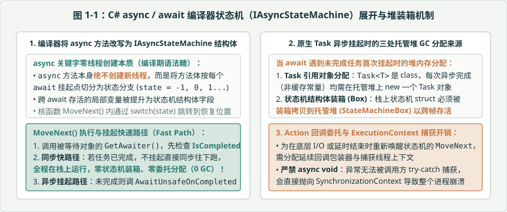
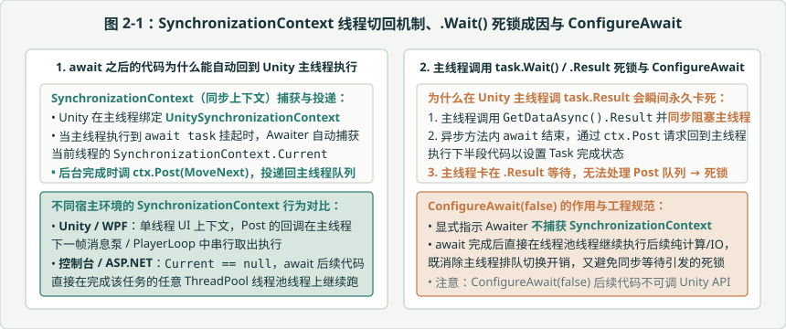
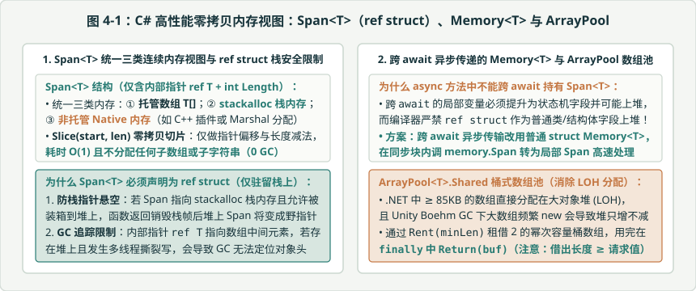

本文聚焦现代 C#（.NET / Unity）在高频异步调度与零垃圾回收（Zero-GC）高性能编程中的底层原理，共分为四个章节：**编译器 `async / await` 状态机（`IAsyncStateMachine`）底层展开与堆分配拆解**、**`SynchronizationContext` 同步上下文线程切回机制与死锁防护**、**Unity `UniTask` 全链路零 GC 原理与 `PlayerLoop` 帧生命周期驱动**、**高性能零拷贝内存原语（`Span<T>`、`Memory<T>` 与 `ArrayPool<T>`）**。

---

## 第 1 章：编译器 `async / await` 状态机展开与堆分配拆解

### 1.1 `async` 方法零线程创建本质与 `IAsyncStateMachine` 结构体

C# 中的 `async` 和 `await` 是由 Roslyn 编译器在编译期展开的**有限状态机（Finite State Machine）**。调用 `async` 方法**不会创建新线程**，在遇到第一个未完成的 `await` 挂起点之前，代码均在当前调用线程上同步执行。



当编译器编译一个 `async Task<int> FetchAndCalcAsync(int baseVal)` 方法时，会自动生成一个实现了 `IAsyncStateMachine` 接口的隐藏**值类型结构体（`struct <FetchAndCalcAsync>d__0`）**，包含以下四类核心字段：
1. **`<>1__state`（整型状态游标）**：初始值为 `-1`（运行中/未开始），`0, 1, 2...` 分别代表正挂起在第 `1, 2, 3...` 个 `await` 表达式处，`-2` 代表方法已执行完毕。
2. **`<>t__builder`（异步方法构建器 `AsyncTaskMethodBuilder<int>`）**：负责创建返回给外部调用者的 `Task<int>` 凭据，并在状态机完成或抛异常时调用 `SetResult` / `SetException`。
3. **方法形参与跨 `await` 存活的局部变量**：由于方法在 `await` 挂起时会直接 `return` 退栈，任何在 `await` 之前定义且在 `await` 之后仍需使用的局部变量，都会被编译器提升为该状态机结构体的成员变量，以便跨栈帧持久化保存。
4. **`<>u__1`（当前被等待对象的 `TaskAwaiter<T>` 字段）**：保存当前正在等待的 Awaiter 实例，以便恢复执行时调用 `GetResult()`。

---

### 1.2 `MoveNext()` 快慢路径与原生 `Task` 的三处 GC 分配来源

状态机核心方法 `MoveNext()` 内部是一个包裹在 `try-catch` 中的巨大 `switch (<>1__state)` 跳转表。当执行到 `await subTask;` 时，生成的代码遵循严格的**快慢双路径（Fast Path vs Slow Path）**：

```csharp
// 1. 获取 Awaiter 并检查是否已经同步完成（Fast Path 快速路径）
var awaiter = subTask.GetAwaiter();
if (!awaiter.IsCompleted) {
    // --- 进入异步挂起慢路径（Slow Path） ---
    this.<>1__state = 0;
    this.<>u__1 = awaiter;
    // 若状态机仍在栈上，此处触发装箱（Box）上堆，并向 awaiter 注册完成回调
    this.<>t__builder.AwaitUnsafeOnCompleted(ref awaiter, ref this);
    return; // 挂起退栈，交还当前线程控制权
}
// --- 若 IsCompleted 为 true（或异步回调再次调入 MoveNext 跳转到 Label_0） ---
int result = awaiter.GetResult();
```

- **核心结论 1（同步完成快路径零装箱）**：若被等待的 `subTask` 在到达 `await` 时已完成（如命中缓存），`awaiter.IsCompleted` 为 `true`，代码不挂起而直接顺序向下执行；**此时状态机结构体全程驻留在栈上，不发生装箱（Boxing）与委托分配**。
- **核心结论 2（原生 `Task` 发生异步挂起时的三处托管堆 GC 分配）**：
  一旦 `awaiter.IsCompleted == false` 进入异步挂起慢路径，原生 `System.Threading.Tasks.Task` 会产生三处堆内存分配：
  1. **`Task<T>` 引用对象本身**：因为 `Task` 是 `class`，每次异步操作都必须在托管堆上 `new` 一个新的 `Task` 实例（除非是 `Task.CompletedTask` 或布尔/`0~8` 小整数缓存）。
  2. **状态机结构体装箱（`AsyncStateMachineBox`）**：因为当前函数即将 `return` 销毁栈帧，原本在栈上的状态机 `struct` 必须被拷贝装箱到托管堆上（现代 .NET 将状态机装箱与 Task 合并为一个 `AsyncStateMachineBox<TStateMachine>` 堆对象，但仍需一次堆分配）。
  3. **延续回调委托与上下文包装器**：为在底层异步任务完成时重新触发 `stateMachine.MoveNext()`，需要分配回调包装对象。

---

## 第 2 章：`SynchronizationContext` 线程切回与 `.Result` 死锁

### 2.1 为什么 `await` 之后的代码能自动回到 Unity 主线程

在 Unity 的 `MonoBehaviour` 中执行 `await Task.Run(() => HeavyWork());` 时，尽管 `HeavyWork()` 在后台线程池运行，`await` 之后的代码仍会自动回到 **Unity 主线程** 执行。该机制由 **`SynchronizationContext`（同步上下文）** 实现：



1. **主线程上下文安装**：Unity 引擎初始化时，会在主线程的线程局部存储（TLS）中绑定一个自定义的 `UnitySynchronizationContext` 实例（内部维护一个线程安全的待执行委托队列 `m_AsyncWorkQueue`）。
2. **挂起时捕获上下文**：当主线程执行到 `await task` 挂起并调用 `AwaitUnsafeOnCompleted` 时，`TaskAwaiter` 会自动读取并保存当前线程的 `SynchronizationContext.Current`。
3. **完成时投递回原上下文**：当后台线程池线程跑完 `HeavyWork()` 将 `Task` 标记为完成时，发现当初捕获的 `sc != null`，于是**不在后台线程直接调用 `MoveNext()`**，而是调用 `sc.Post(MoveNextDelegate, state)` 将恢复委托塞入 `UnitySynchronizationContext` 的队列中。
4. **主线程下一帧消费**：Unity 主线程每帧在引擎 `PlayerLoop` 循环中遍历清空 `m_AsyncWorkQueue`，在主线程上调用 `MoveNext()` 执行 `await` 下半段代码。

---

### 2.2 为什么在主线程调用 `task.Wait()` 或 `task.Result` 会永久死锁

在单线程 `SynchronizationContext` 环境（Unity 主线程、WPF / WinForms UI 线程）中，若同步方法调用了未配置 `ConfigureAwait(false)` 的异步方法，并同步阻塞调用 `.Result` 或 `.Wait()`，会触发**永久死锁**：

```csharp
// 在 Unity 主线程中同步阻塞等待异步结果会导致死锁：
void Start() {
    string data = DownloadAsync().Result; // 主线程同步阻塞，等待 Task 完成
}
async Task<string> DownloadAsync() {
    await Task.Delay(100); // 1. 捕获了主线程 UnitySynchronizationContext
    return "ok";           // 2. 100ms 后需通过 ctx.Post 回到主线程执行此行，才能把 Task 设为完成
}
```

- **死锁闭环链条**：
  - **主线程**卡在 `.Result` 上休眠阻塞，等待 `DownloadAsync` 返回的 `Task` 状态变为 `RanToCompletion`；
  - **100ms 计时器到期后**，状态机的下半段代码（`return "ok"` 触发 `SetResult`）已经被 `ctx.Post` 投递到了主线程队列里，排队等待主线程下一帧唤醒执行；
  - 主线程被 `.Result` 锁死无法推进帧循环去消费 `Post` 队列，而 `Post` 队列里的 `MoveNext` 不执行就无法完成该 `Task` 唤醒主线程——双方互相等待对方先完成，形成典型的**循环等待死锁**。
- **`ConfigureAwait(false)` 的解耦作用**：在通用底层库代码（无需访问 Unity 主线程 API 的纯网络 I/O、文件读写或数据解析）中，在 `await` 后追加 `.ConfigureAwait(false)`，即可显式告知 Awaiter **忽略并丢弃当前的 `SynchronizationContext`**，当底层任务完成时直接在当前线程池线程上顺着执行状态机剩余代码，既省去了主线程排队延迟，又从根源上消除了 `.Result` 死锁。

---

## 第 3 章：Unity `UniTask` 零 GC 原理与 `PlayerLoop` 架构

在游戏开发中，每帧都可能有数十个技能等待、UI 动画过渡与资源异步加载。若直接使用原生 `Task`，频繁的堆对象分配会持续推高托管堆水位并触发 GC 卡顿；而传统 `IEnumerator` 协程每次 `StartCoroutine` 同样会产生 `new` 枚举器类与原生包装器的 GC，且无法直接返回值或使用 `try-catch`。开源库 **`UniTask`** 通过以下三大底层设计实现了 **全链路 0 GC 异步编程**：


### 3.1 值类型 `UniTask<T>` + 静态对象池 `TaskPool` + `short token`

1. **自定义 `[AsyncMethodBuilder]` 接管编译器状态机生成**：
   C# 7.0 允许在返回类型上标注 `[AsyncMethodBuilder(typeof(AsyncUniTaskMethodBuilder<T>))]`，使编译器不再使用标准库的 `AsyncTaskMethodBuilder`，而是完全交由 `UniTask` 自定义的 Builder 管理状态机生命周期。
2. **值类型凭据 + 池化状态机节点 `IUniTaskSource`**：
   - 返回给调用方的 `UniTask<T>` 本身是一个仅占十几个字节的轻量级 **`readonly struct`**，内部只持有一个 `IUniTaskSource<T> source` 接口引用、内联结果值 `T result`（同步完成时直接使用）以及一个 16 位版本号 **`short token`**。
   - 当遇到未完成任务必须异步挂起时，`AsyncUniTaskMethodBuilder` **不会每次在堆上 `new` 状态机装箱对象**，而是直接从静态无锁栈式对象池 `TaskPool<AsyncUniTask<TStateMachine, T>>` 中 **`TryPop` 租借一个现成的池化 Runner 节点**，将状态机结构体存入该节点字段中。
3. **消费即归还（`GetResult` 自动回池）与 `short token` 版本号防复用冲突**：
   - 原生 `Task` 允许被保存引用并重复 `await` 多次，运行时无法确定何时可以安全回收该实例。
   - `UniTask` 规定**每个 `UniTask` 实例仅允许被 `await` 消费一次**。当外部 `await` 结束并调用 `source.GetResult(token)` 读取返回值时，池化 Runner 节点校验 `token == this.version`，随后**清空内部状态机、将 `version++` 自增，并在 `GetResult` 返回前将自身归还至静态对象池**。若外部对该 `UniTask` 执行第二次 `await`，旧 `token` 与自增后的 `version` 不匹配，立即抛出 `InvalidOperationException`，从而实现**零堆内存分配**。

---

### 3.2 注入 Unity `PlayerLoop` 替代传统协程与线程计时器

原生 `Task.Delay(1000)` 依赖 .NET 底层的系统线程池计时器（`System.Threading.Timer`），不仅精度受操作系统时间片影响，且完全不知道 Unity 的帧率、游戏暂停（`Time.timeScale = 0`）或帧阶段顺序。

- **`PlayerLoop` 14 个注入点精准驱动**：
  `UniTask` 在游戏启动时通过 `[RuntimeInitializeOnLoadMethod]` 调用 `PlayerLoop.GetCurrentPlayerLoop()`，将自己的 `PlayerLoopRunner` 轮询队列直接插入到 Unity 主循环的各个原生子阶段中（`Initialization`、`EarlyUpdate`、`FixedUpdate`、`PreUpdate`、`Update`、`PreLateUpdate`、`PostLateUpdate` 的开头与结尾共 14 个时机）：
  ```csharp
  // 零 GC 替代 yield return null / WaitForFixedUpdate / WaitForEndOfFrame：
  await UniTask.Yield(PlayerLoopTiming.Update);
  await UniTask.WaitForFixedUpdate();
  await UniTask.Delay(TimeSpan.FromSeconds(1.5f), ignoreTimeScale: false,
                      cancellationToken: this.GetCancellationTokenOnDestroy());
  ```
- **生命周期自动绑定取消（防止销毁后空引用）**：传统 `async Task` 最危险的 Bug 是异步等待期间 `GameObject` 已被销毁，恢复执行时访问已销毁组件抛出 `MissingReferenceException`。通过传入 `this.GetCancellationTokenOnDestroy()`，当挂载的 `MonoBehaviour` 触发 `OnDestroy` 时自动激活 `CancellationToken`，在池化层直接静默拦截并回收状态机。

---

## 第 4 章：高性能零拷贝内存原语：`Span<T>`、`Memory<T>` 与 `ArrayPool<T>`

在网络拆包、二进制文件解析、字符串切分与原生插件互操作中，传统 C# 代码频繁调用 `Substring()` 或 `new byte[]` 切片会产生海量短命临时对象。C# 7.2 引入的 **`Span<T>`** 与 **`ArrayPool<T>`** 从根本上重构了 .NET 的内存操作范式。



### 4.1 `Span<T>` 统一连续内存视图与 `ref struct` 栈安全约束

`Span<T>`（以及只读视图 `ReadOnlySpan<T>`）在底层仅由两个字段构成（64 位下共 16 字节）：一个由 JIT 特殊追踪的**受管内部指针（`ref T _pointer`，ByReference）**和一个整型长度 **`int _length`**。

```text
struct Span<T> {
    internal readonly ref T _pointer; // 直接指向目标连续内存首元素的内部引用
    private readonly int _length;     // 切片元素个数
}
```

- **统一抹平三类物理内存**：同一个接收 `Span<byte>` 参数的解析函数，可以同时零拷贝接收：① **托管堆数组**（`new byte[1024]` 的任意子段）；② **线程栈分配内存**（`stackalloc byte[256]`，函数返回即刻随栈指针回退释放，0 GC）；③ **非托管原生堆内存**（`new Span<byte>(void* ptr, int len)`，如 C++ Native 插件或 `NativeArray<T>` 内存）。
- **`Slice(start, length)` 零拷贝切片**：对 `Span<T>` 或字符串 `str.AsSpan().Slice(4, 8)` 执行切片时，仅做一次指针加法 `_pointer + start` 并赋新长度，耗时 **`O(1)` 且分配 0 字节堆内存**。
- **为什么编译器强制规定 `Span<T>` 必须是 `ref struct`（严禁上堆）**：
  1. **防止栈内存悬空指针（Use-After-Free）**：因为 `Span<T>` 可以指向 `stackalloc` 分配的当前函数栈帧内存；一旦允许将 `Span<T>` 装箱为 `object`、作为普通 `class` 的成员变量、或被 Lambda 闭包与 `async` 状态机捕获到托管堆上，当当前函数返回销毁栈帧后，堆上的 `Span<T>` 就会指向已被销毁的栈地址，破坏类型安全。
  2. **避免多线程撕裂与 GC 内部指针追踪过载**：`Span<T>` 包含 16 字节双字段，在多线程并发读写堆字段时不具备原子性（可能读到新指针配旧长度导致越界）；且追踪堆上海量的数组中间内部指针会极大拖慢 GC 标记速度。因此编译器在语法层面锁死 `ref struct` **只能存在于线程栈上**。

---

### 4.2 跨 `await` 传递的 `Memory<T>` 与 `ArrayPool<T>` 桶式池化

| 内存原语类型 | 类型性质 | 能否驻留托管堆 / 跨 `await` | 底层实现字段 | 典型工程定位 |
| :--- | :--- | :--- | :--- | :--- |
| **`Span<T>` / `ReadOnlySpan<T>`** | `ref struct`（仅限栈） | **否**（不可作类字段、不可跨 `await`） | `(ref T ptr, int length)` | 同步代码块内的高速切片、解析与原地修改 |
| **`Memory<T>` / `ReadOnlyMemory<T>`** | 普通 `struct`（可上堆） | **是**（可存入类字段、可作为异步方法参数） | `(object owner, int index, int length)` | 跨 `await` 异步 I/O 传递，进入同步块后调 `.Span` 转为 `Span<T>` |
| **`ArrayPool<T>.Shared`** | 线程安全全局数组池 | 是（租借返回真实 `T[]` 数组） | 按 `2^k` 容量分桶的线程本地缓存 + 共享桶队列 | 替代 `new byte[N]`，避免大缓冲区重复分配与 LOH 碎片 |

- **`ArrayPool<T>.Shared` 使用规范**：
  1. **租借数组长度通常大于请求长度**：调用 `byte[] buf = ArrayPool<byte>.Shared.Rent(1000)` 时，数组池按 2 的幂次容量桶向上取整，实际返回的 `buf.Length` 为 **`1024`**。因此后续切片或读取时，**必须显式传入实际请求长度 `buf.AsSpan(0, 1000)`**，不能直接使用 `buf.Length`。
  2. **必须在 `try-finally` 中配对归还**：借出的数组若因异常漏掉 `Return(buf)`，虽然不会内存泄漏（最终会被 GC 回收），但会导致数组池枯竭退化回频繁 `new` 分配：
     ```csharp
     byte[] buffer = ArrayPool<byte>.Shared.Rent(requiredSize);
     try {
         int bytesRead = await stream.ReadAsync(buffer.AsMemory(0, requiredSize), ct);
         ProcessPacket(buffer.AsSpan(0, bytesRead)); // 同步解析使用 Span 零拷贝
     } finally {
         ArrayPool<byte>.Shared.Return(buffer, clearArray: false);
     }
     ```
