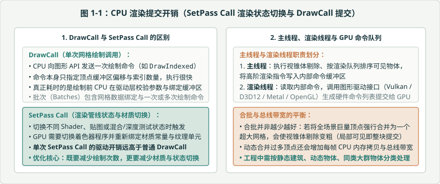
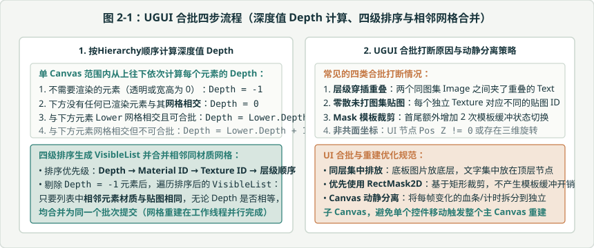
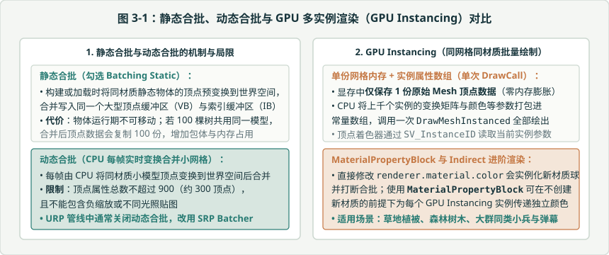
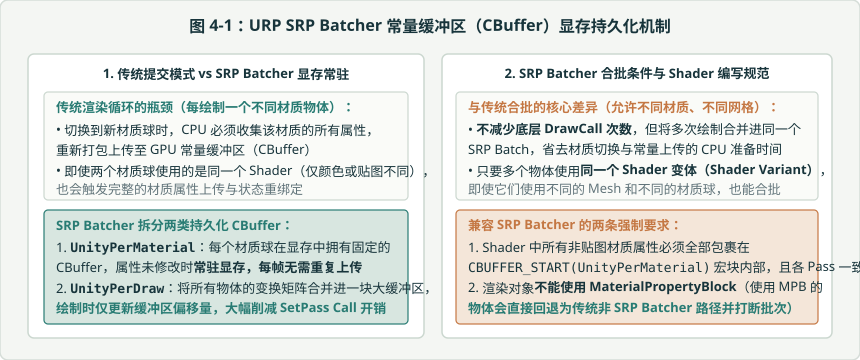

本文梳理 Unity 渲染提交阶段的 CPU 开销成因与合批优化手段，共分为四个章节：**`DrawCall` 与 `SetPass Call` 的底层区别及渲染提交流程**、**UGUI 合批规则（深度值计算、四级排序与动静分离）**、**3D 场景静态合批、动态合批与 `GPU Instancing` 多实例渲染**、**URP 管线下的 `SRP Batcher` 显存常驻机制与兼容规范**。

---

## 第 1 章：CPU 渲染提交开销（`DrawCall` 与 `SetPass Call`）

### 1.1 `DrawCall`、`Batches` 与 `SetPass Call` 的区别

在 Unity Frame Debugger 或 Stats 统计面板中，衡量 CPU 渲染提交负载的核心指标有三个：



1. **`DrawCall`（单次网格绘制调用）**：
   CPU 准备好顶点数据与材质参数后，向底层图形 API（如 Direct3D 12、Vulkan、Metal、OpenGL ES）发送一次绘制网格的命令（例如调用一次 `glDrawElements` 或 `DrawIndexedPrimitive`）。命令本身只传递顶点缓冲区偏移量与三角形索引数量，GPU 执行很快；真正消耗 CPU 时间的是每次调用前图形驱动层的参数合法性校验与状态同步。
2. **`Batches`（渲染批次）**：
   代表一次完整的顶点数据绑定加绘制提交。在传统合批中，一个 Batch 通常对应一次 `DrawCall`；而在开启 `SRP Batcher` 后，一个 SRP Batch 内部可以包含几十次共享同一 Shader 变体的独立 `DrawCall`。
3. **`SetPass Call`（渲染状态与着色器切换）**：
   当 GPU 从绘制当前物体切换到下一个使用**不同 Shader、不同贴图或不同混合/深度测试状态**的物体时，CPU 必须通知图形驱动切换着色器Pass，并重新上传材质属性常量与纹理绑定。**一次 `SetPass Call` 的 CPU 驱动层开销远高于一次普通 `DrawCall`**。因此，合批优化的核心目标不仅是减少 `DrawCall` 数量，更重要的是**减少 `SetPass Call` 状态切换次数**。

---

### 1.2 主线程与渲染线程分工及合批边界

- **主线程与渲染线程流水线**：
  开启多线程渲染后，**主线程**负责执行相机视锥体剔除、按渲染队列（不透明物体从前向后、半透明物体从后向前）排序可见渲染器，并将高层渲染指令写入引擎内部命令队列；**渲染线程**独立消费该队列，调用底层图形驱动 API 生成硬件命令列表提交给 GPU。当场景中 `SetPass Call` 与 `DrawCall` 数量过多时，渲染线程耗时超过单帧预算（如 16.6ms），主线程就会在 `Gfx.WaitForPresent` 处阻塞等待渲染线程。
- **合批并非越少越好**：
  如果将整个大场景的静态建筑全部合并成唯一一个超大网格，虽然 `DrawCall` 降到了 `1`，但会导致两个副作用：
  1. **视锥体剔除失效**：只要相机视野边缘看到该超大网格的一个角落，整块包含数十万顶点的网格都必须完整提交给 GPU 渲染；
  2. **总线带宽与内存暴涨**：单次传输的顶点与索引数据量过大，反而挤占内存与显存带宽。因此工程中应按空间区域（如九宫格区块）适度合批，而非无限制合并。

---

## 第 2 章：UGUI 合批规则与界面动静分离

UGUI 的网格合批以 **`Canvas`（画布，不含嵌套的子 `Canvas`）** 为基本单位，合批计算在引擎后台工作线程中并行执行，完整流程分为四个步骤：



### 2.1 UGUI 合批四步流程

1. **收集并过滤 `Canvas`**：
   剔除不需要渲染的画布（如 `CanvasGroup.alpha == 0`、宽高为 `0`、或完全处于 `RectMask2D` 裁剪矩形之外的节点）。
2. **按 Hierarchy 从上往下计算每个 UI 元素的深度值 `Depth`**：
   对于当前遍历到的 UI 元素 `CurrentUI`，检查在 Hierarchy 中排在它前面（即画面上处于它下层）且已计算的 UI 元素是否与它发生**网格相交（Mesh 相交重叠）**：
   - 若 `CurrentUI` 不渲染（如纯透明或被禁用），则 `Depth = -1`；
   - 若下方没有任何已渲染元素与它的网格相交，则 `Depth = 0`；
   - 若下方有 1 个元素 `LowerUI` 与它的网格相交：
     - 两者**可以合批**（材质球和贴图完全相同）：`CurrentUI.Depth = LowerUI.Depth`；
     - 两者**不能合批**（材质或贴图不同）：`CurrentUI.Depth = LowerUI.Depth + 1`；
   - 若下方有多个元素同时与它相交，则分别按上述规则算出候选深度，取其中的**最大值**作为 `CurrentUI.Depth`。
   - *包围盒分组加速*：为避免两两判断网格相交带来 $O(N^2)$ 复杂度，UGUI 源码将每 16 个 UI 元素分为一组计算外包矩形，先与组包围盒做粗略相交测试，相交时才与组内具体元素做精确测试。
3. **四级排序生成 `VisibleList`**：
   剔除 `Depth == -1` 的元素后，对画布内所有可见元素按以下四个关键字从小到大依次排序（前一项相同时比较后一项）：
   $$\text{Depth} \;\to\; \text{Material ID} \;\to\; \text{Texture ID} \;\to\; \text{Hierarchy 顺序}$$
4. **合并相邻同材质网格**：
   遍历排序后的 `VisibleList`，只要列表中**相邻的两个元素材质球与贴图完全相同**（此时不再要求两者的 `Depth` 值必须相等），就将它们的顶点合并进同一个网格批次中提交。

---

### 2.2 UGUI 合批打断原因与工程优化准则

- **常见打断合批的四种情况**：
  1. **节点层级穿插重叠**：例如底板 `Image A` 与图标 `Image B` 使用同一个图集，但在 Hierarchy 中它们中间夹了一个网格与它们重叠的 `Text`，导致三者的 `Depth` 依次递增为 `0 -> 1 -> 2`，最终拆成 3 个 `DrawCall`。
  2. **使用未打图集的零散小图**：每张独立贴图拥有不同的 `Texture ID`，无法合并。
  3. **滥用 `Mask` 组件**：`Mask` 依赖 GPU 模板缓冲区，在进入子物体前与绘制完子物体后需要额外各提交 1 次模板写入 `DrawCall`（共增加 2 个 `DrawCall`），且不同 `Mask` 外部无法跨层级合批。
  4. **三维旋转或 `Pos Z != 0`**：当 UI 节点的局部 Z 坐标不为 `0` 或存在绕 X/Y 轴旋转时，不再处于同一二维平面，无法与前后元素合批。
- **工程优化准则**：
  1. **同类组件分层摆放**：在制作 UI 预制体时，尽量将所有同图集的 `Image` 节点集中放在上层，将所有 `Text` / `TextMeshProUGUI` 文本节点集中放在下层，避免图文交替穿插重叠。
  2. **用 `RectMask2D` 替代 `Mask`**：滚动列表（`ScrollRect`）等矩形裁剪区域统一使用 `RectMask2D`。它在 CPU 端通过矩形坐标对比直接剔除界外元素，不占用额外 `DrawCall`，且多个 `RectMask2D` 内部使用相同图集的控件仍可跨面板合批。
  3. **`Canvas` 动静分离**：同一个 `Canvas` 内只要有任何一个 UI 元素的顶点、颜色或位移发生变化，整个 `Canvas` 就需要重新标记脏状态并重建网格。应将高频变动的控件（如每帧移动的伤害飘字、小地图光点、技能冷却倒计时）单独放入一个子 `Canvas` 中，与静态背景框隔离。

---

## 第 3 章：静态合批、动态合批与 `GPU Instancing`

针对 3D 场景中的网格渲染器（`MeshRenderer`），Unity 提供了三种基于网格合并或硬件实例化的合批方案：



### 3.1 静态合批、动态合批与 `GPU Instancing` 全面对比

| 特性维度 | 静态合批 | 动态合批 | 多实例渲染（`GPU Instancing`） |
| :--- | :--- | :--- | :--- |
| **要求网格相同** | 不要求（不同形状的静态建筑可合批） | 不要求（不同形状的小模型可合批） | **必须使用完全相同的 Mesh** |
| **要求材质相同** | 必须使用同一个 Material | 必须使用同一个 Material | 必须使用同一个 Material（支持 `MPB` 传参） |
| **是否允许移动** | **不允许**（运行期固定不动） | 允许每帧移动旋转 | **允许每帧独立移动、旋转、缩放** |
| **顶点数量限制** | 单批次上限 64000 顶点 | **顶点属性总数 $\le 900$**（约 300 顶点内） | 无上限（单次调用最多绘制 1023 个实例） |
| **主要性能代价** | **内存与包体膨胀**（重复模型顶点被复制多份） | 每帧占用 CPU 将顶点变换到世界空间 | 需 Shader 声明实例化宏，不支持烘焙光照贴图 |
| **典型适用场景** | 城墙、地面、互不重复的静态建筑群 | 极少使用（现代管线基本已被取代） | **漫山遍野的草地、树木、弹幕、同类小兵** |

---

### 3.2 `GPU Instancing` 与 `MaterialPropertyBlock` 实战

当场景中有 500 棵使用相同模型和材质的树木时，如果勾选 `Batching Static` 启用静态合批，内存中会把这棵树的顶点复制 500 份；而改用 **`GPU Instancing`** 时，显存中**只保留 1 份树木网格**，CPU 仅把 500 个变换矩阵打包成数组一次性传给 GPU，在顶点着色器内通过硬件实例编号 `SV_InstanceID` 读取对应矩阵。

如果希望这 500 棵树在共用同一个材质球的前提下各自呈现不同的叶片颜色，**切忌直接访问 `renderer.material.color`**（这会在内存中克隆出 500 个独立材质球并彻底打断合批），应当使用 **`MaterialPropertyBlock`** 搭配 Shader 中的 `UNITY_INSTANCING_BUFFER`：

```csharp
using UnityEngine;

public class TreeColorVariation : MonoBehaviour
{
    private static readonly int BaseColorId = Shader.PropertyToID("_BaseColor");
    private static MaterialPropertyBlock s_propBlock;

    public Color InstanceColor = Color.green;

    private void Awake()
    {
        if (s_propBlock == null)
        {
            s_propBlock = new MaterialPropertyBlock();
        }

        MeshRenderer renderer = GetComponent<MeshRenderer>();
        // 通过 MaterialPropertyBlock 写入当前实例颜色，不克隆新材质球，保持 GPU Instancing 合批
        s_propBlock.SetColor(BaseColorId, InstanceColor);
        renderer.SetPropertyBlock(s_propBlock);
    }
}
```

对应的 Shader 中需要声明实例化属性缓冲区：

```hlsl
#pragma multi_compile_instancing

UNITY_INSTANCING_BUFFER_START(Props)
    UNITY_DEFINE_INSTANCED_PROP(float4, _BaseColor)
UNITY_INSTANCING_BUFFER_END(Props)

// 在片元着色器中读取当前实例的颜色：
float4 col = UNITY_ACCESS_INSTANCED_PROP(Props, _BaseColor);
```

---

## 第 4 章：URP 管线下的 `SRP Batcher` 显存常驻机制

### 4.1 `SRP Batcher` 的底层工作机制

在传统渲染管线中，每当绘制一个使用不同材质球的物体，CPU 都必须收集该材质球的所有属性并重新上传到 GPU 常量缓冲区。但在实际游戏场景中，往往有上百个角色、装备或道具使用**同一个标准 Lit Shader**，只是各自材质球上的贴图和颜色参数不同。

**`SRP Batcher`** 正是针对这种“**不同网格、不同材质球，但共用同一个 Shader 变体**”的场景设计的底层提速机制：



1. **材质常量缓冲区（`UnityPerMaterial` CBuffer）显存常驻**：
   `SRP Batcher` 为每个材质球在 GPU 显存中分配一块独立的、持久化的常量缓冲区。只要运行期没有通过 C# 代码修改该材质球的参数，这块 `UnityPerMaterial` 数据就一直驻留在显存里，**CPU 每帧渲染时无需再向 GPU 重复上传任何材质属性**。
2. **物体变换缓冲区（`UnityPerDraw` CBuffer）大块合并上传**：
   每个物体的模型矩阵（`unity_ObjectToWorld`）、逆矩阵、光照贴图偏移等内置参数，会被引擎统一收集写入一块大型的 `UnityPerDraw` 显存缓冲区中。
3. **仅切换显存偏移量**：
   在渲染循环中，只要连续绘制的多个物体使用的是**同一个 Shader 变体**，渲染线程只需要绑定一次 Shader Pass（仅 1 次 `SetPass Call`），随后每次绘制新物体时只需修改显存中 `UnityPerMaterial` 和 `UnityPerDraw` 的绑定偏移地址并调用 `DrawCall`，从而省去了绝大部分 CPU 驱动层准备时间。

---

### 4.2 编写兼容 `SRP Batcher` 的 Shader 与合批打断排查

要让自定义 Shader 完整支持 `SRP Batcher`（可在材质球 Inspector 面板或 Frame Debugger 中查看 `SRP Batcher: compatible` 状态），必须满足两条规则：

1. **所有材质属性必须声明在 `CBUFFER_START(UnityPerMaterial)` 内部**：
   除了纹理采样器（`TEXTURE2D` / `SAMPLER`）之外，凡是在 Shader `Properties` 块中公开的数值、向量、颜色以及纹理缩放偏移变量（`float4 _BaseMap_ST`），在 HLSL 代码中**必须全部放进 `UnityPerMaterial` 常量缓冲区内**，且同一个 Shader 内的所有 Pass（如 `UniversalForward`、`ShadowCaster`、`DepthOnly`）中该 `CBUFFER` 的内存布局必须完全一致：

```hlsl
// 必须引入 URP 核心库以使 CBUFFER_START 宏生效
#include "Packages/com.unity.render-pipelines.universal/ShaderLibrary/Core.hlsl"

TEXTURE2D(_BaseMap);
SAMPLER(sampler_BaseMap);

// 所有数值、颜色与贴图 ST 属性必须严格包裹在 UnityPerMaterial 常量块内
CBUFFER_START(UnityPerMaterial)
    float4 _BaseMap_ST;
    half4  _BaseColor;
    half   _Smoothness;
    half   _Metallic;
CBUFFER_END
```

2. **开启 `SRP Batcher` 的物体禁止使用 `MaterialPropertyBlock`**：
   - 在内置渲染管线（Built-in）或 `GPU Instancing` 中，常使用 `MaterialPropertyBlock` 修改单个物体的颜色；
   - 但在 URP 的 `SRP Batcher` 下，由于 `SRP Batcher` 依赖每个材质球固定不变的 `UnityPerMaterial` 显存块，**一旦某个 `Renderer` 挂载了非空的 `MaterialPropertyBlock`，该物体就会立即退出 `SRP Batcher` 合批**，回退为传统的逐物体上传路径。
   - **选型建议**：
     - 对于树叶、草丛、大量同模型小物体：勾选材质的 `Enable GPU Instancing` 并配合 `MaterialPropertyBlock`（在 URP 中，只要材质开启了 `GPU Instancing` 且实际触发了多实例合批，或对节点挂载了 `MaterialPropertyBlock`，可走 `GPU Instancing` 路径）；
     - 对于主角、NPC、不同外观的建筑与常规场景道具：保持 `SRP Batcher` 激活，如果只有少数几种固定颜色变化，直接创建几个共享同一 Shader 的独立材质球即可（在 `SRP Batcher` 下多个材质球共用同一 Shader 变体依然能够合并在同一个 SRP Batch 内高效提交）。
