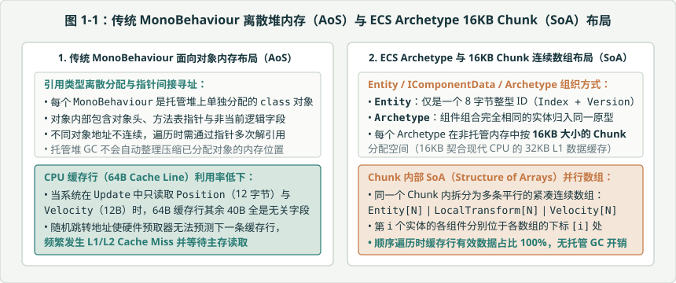
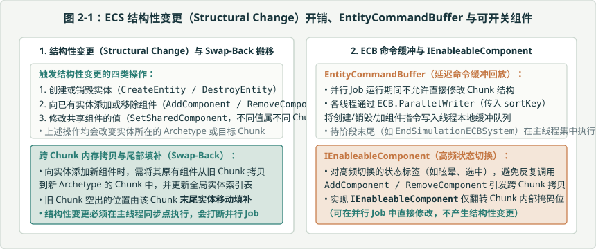
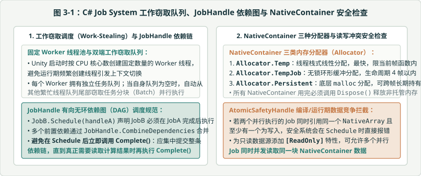
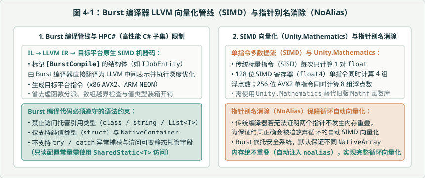

本文梳理 Unity DOTS（Data-Oriented Technology Stack，数据导向型技术栈）的底层内存模型与多线程并行架构，共分为四个章节：**传统 MonoBehaviour 内存布局（AoS）与 ECS Archetype 16KB Chunk（SoA）机制**、**`ISystem` / `IJobEntity` 编写规范、结构性变更（Structural Change）与 `EntityCommandBuffer`**、**C# Job System 工作窃取调度与 `NativeContainer` 安全检查系统**、**Burst 编译器 LLVM 向量化管线（SIMD）与指针别名消除**。

---

## 第 1 章：传统 OOP 离散内存与 ECS Archetype 16KB Chunk 布局

### 1.1 传统 `MonoBehaviour` 面向对象布局（AoS）的缓存瓶颈

在传统的 `GameObject + MonoBehaviour` 开发模式中，每个脚本组件都是托管堆（Managed Heap）上独立分配的 `class` 引用类型实例。当场景中存在数万个活动单位（如弹幕、RTS 士兵、同屏怪物）时，这种**结构体数组（Array of Structures, AoS）**加引用指针的内存布局会带来三方面开销：



1. **内存地址不连续与频繁指针解引用**：
   保存一万个 `Monster` 的 `List<Monster>` 内部存放的只是 8 字节的对象引用地址。每个 `Monster` 实例真实分配在托管堆的不同位置，且垃圾回收器（Boehm GC）不会整理移动已有对象。遍历该列表时，CPU 每次都需要先读取引用指针，再跳转到对应的堆地址读取字段，硬件预取器（Hardware Prefetcher）无法预测下一次内存访问地址，导致频繁的 **CPU 缓存未命中（Cache Miss）**。
2. **缓存行（64B Cache Line）有效载荷占比低**：
   CPU 从主存读取数据时总是以 **64 字节缓存行**为单位整块加载。一个 `Monster` 实例内部除了移动逻辑需要的 `position`（12B）和 `velocity`（12B）外，还混杂着对象头（16B）、血量、技能冷却、UI 引用等数十字节当前移动逻辑并不访问的字段，导致加载进 L1 Cache 的 64 字节中绝大部分空间被无关字段占用。
3. **虚函数表分派与托管 GC 扫描压力**：
   大量的托管对象会拉长 GC 标记阶段的扫描耗时；同时每个 `MonoBehaviour` 独立触发 `Update()` 存在 C++ 引擎层与 C# 托管层之间的跨界调用开销。

---

### 1.2 ECS 核心三要素与 Archetype 16KB Chunk（SoA）内存布局

Unity Entities（ECS）彻底将**标识（Entity）**、**纯数据（Component）**与**处理逻辑（System）**拆分开来：
- **`Entity`（实体）**：不再是包含组件的容器对象，而仅仅是一个 **8 字节的轻量级整型标识符**（由 32 位数组下标 `Index` 与 32 位用于检测实体是否已销毁复用的 `Version` 组成）。
- **`IComponentData`（组件数据）**：仅包含纯值类型字段的 `struct`（不含业务逻辑方法，不分配在托管堆上）。
- **`Archetype`（原型）与 `Chunk`（16KB 内存块）**：
  拥有**完全相同组件类型集合**的所有 Entity 会被归入同一个 **Archetype**。每个 Archetype 在 C++ 非托管堆上按固定 **16KB（16384 字节）大小的连续内存块（Chunk）** 分配空间：
  - 每个 16KB Chunk 内部采用 **数组结构体（Structure of Arrays, SoA）** 布局，为该原型包含的每一种组件分别开辟一条紧凑的平行连续数组：
    $$\text{Chunk (16KB)} = \underbrace{\text{Entity}[N]}_{\text{8B} \times N} \;|\; \underbrace{\text{LocalTransform}[N]}_{\text{32B} \times N} \;|\; \underbrace{\text{Velocity}[N]}_{\text{12B} \times N}$$
  - 第 $i$ 个实体的各项组件数据，严格对应在这个 Chunk 内各个组件数组的下标 $[i]$ 位置上。
  - 当移动系统（`MoveSystem`）只需要读写 `LocalTransform` 与 `Velocity` 时，CPU 直接顺序遍历这两个紧凑连续的 `struct` 数组，每条 64 字节缓存行内 100% 都是即将参与计算的组件数据，硬件预取器满负荷工作，且全程零托管 GC 分配。

---

## 第 2 章：`ISystem`、结构性变更（Structural Change）与 `EntityCommandBuffer`

### 2.1 非托管系统 `ISystem` 与 `IJobEntity` 并行遍历

在 Entities 1.0+ 中，推荐使用基于值类型 `struct` 的 **`ISystem`**（替代旧版托管类 `SystemBase`）配合 **`IJobEntity`** 编写业务逻辑，这样整个系统的 `OnUpdate` 调度代码与遍历逻辑均可直接由 Burst 编译器编译为原生机器码：

```csharp
using Unity.Burst;
using Unity.Entities;
using Unity.Mathematics;
using Unity.Transforms;

// 1. 定义纯值类型组件（实现 IComponentData）
public struct MoveSpeed : IComponentData
{
    public float3 Velocity;
}

// 2. 定义满足 Burst 编译条件的 IJobEntity（自动生成 Chunk 遍历代码）
[BurstCompile]
public partial struct MoveEntityJob : IJobEntity
{
    public float DeltaTime;

    // ref 表示读写访问，in 表示只读访问（等价于 [ReadOnly]）
    private void Execute(ref LocalTransform transform, in MoveSpeed speed)
    {
        transform.Position += speed.Velocity * DeltaTime;
    }
}

// 3. 定义非托管系统 ISystem
[BurstCompile]
public partial struct MoveSystem : ISystem
{
    [BurstCompile]
    public void OnUpdate(ref SystemState state)
    {
        var job = new MoveEntityJob
        {
            DeltaTime = SystemAPI.Time.DeltaTime
        };
        // 将满足包含 LocalTransform 与 MoveSpeed 的所有 Chunk 拆分到多核 Worker 线程并行执行
        state.Dependency = job.ScheduleParallel(state.Dependency);
    }
}
```

---

### 2.2 结构性变更开销、`EntityCommandBuffer` 与 `IEnableableComponent`

#### 1. 结构性变更（Structural Change）的底层代价
由于 ECS 规定同一个 Chunk 内的所有实体必须具有完全相同的组件集合（同一 Archetype），任何**改变实体组件组合或实体生命周期的操作**都称为**结构性变更**：
1. 创建或销毁实体（`EntityManager.CreateEntity` / `DestroyEntity`）；
2. 向已有实体添加或移除组件（`AddComponent` / `RemoveComponent`）；
3. 修改共享组件的值（`SetSharedComponent`，因为共享组件值不同的实体必须存放在不同的 Chunk 中）。



当对实体 $E_1$ 执行 `AddComponent<FrozenTag>()` 时，底层必须执行以下步骤：
- 查找包含原有组件加 `FrozenTag` 的目标 Archetype，并在其未满的 Chunk 中分配一个新槽位；
- 将 $E_1$ 原有的所有组件数据从旧 Chunk `memcpy` 拷贝到新 Chunk，并初始化新组件；
- 为保持旧 Chunk 内部数组紧凑无空洞，将旧 Chunk **末尾的最后一个实体 $E_{\text{last}}$ 搬移覆盖到 $E_1$ 空出的槽位上（Swap-Back）**，同时更新全局 `EntityManager` 中 $E_1$ 和 $E_{\text{last}}$ 指向的 `(Chunk*, IndexInChunk)` 索引记录。
- 此外，直接调用 `EntityManager` 执行结构性变更**必须在主线程同步点（Sync Point）完成**，会强制等待当前所有正在运行的并行 Job 结束（触发 `Complete()`），造成多核工作线程停顿。

#### 2. 使用 `EntityCommandBuffer`（ECB）合并延迟结构性变更
在多线程并行 `IJobEntity` 中不能直接调用 `EntityManager` 创建或销毁实体，而应注入 **`EntityCommandBuffer.ParallelWriter`**。各 Worker 线程先将增删指令无锁记录到各自的本地命令缓冲中（通过 `[ChunkIndexInQuery] int sortKey` 保证多线程回放顺序确定一致），待当前系统分组结束时由内置的 `EndSimulationEntityCommandBufferSystem` 在主线程集中一次性回放执行：

```csharp
[BurstCompile]
public partial struct LifetimeCheckJob : IJobEntity
{
    public float DeltaTime;
    public EntityCommandBuffer.ParallelWriter Ecb;

    // [ChunkIndexInQuery] 由 Source Generator 自动注入当前 Chunk 的唯一递增序号，作为确定性回放排序键
    private void Execute(Entity entity, [ChunkIndexInQuery] int sortKey, ref BulletLifetime life)
    {
        life.RemainingSeconds -= DeltaTime;
        if (life.RemainingSeconds <= 0f)
        {
            Ecb.DestroyEntity(sortKey, entity); // 仅记录销毁命令，不打断当前并行 Job
        }
    }
}
```

#### 3. 使用 `IEnableableComponent` 消除高频状态切换的内存搬移
如果游戏中的某个状态标签（如“是否处于受击硬直”“是否被选中”“技能是否就绪”）需要每秒频繁挂载与移除，绝不能反复调用 `AddComponent / RemoveComponent`。应当让该组件额外实现 **`IEnableableComponent` 接口**并在实体初始化时预先挂好：
- 每个 Chunk 头部为每个可开关组件维护了一个 128 位的 **Bitmask（使能位掩码）**；
- 调用 `SystemAPI.SetComponentEnabled<StunnedTag>(entity, true/false)` **仅仅是翻转该实体对应的 1 个比特位**，实体仍然留在原 Chunk 内，**不触发任何跨 Chunk 内存拷贝，且支持在并行 `IJobEntity` 中直接读写切换**；
- 当某实体的组件被设为 `false`（禁用）时，默认的 `IJobEntity` 查询会自动跳过该实体，行为与未挂载该组件完全一致。

---

## 第 3 章：C# Job System 工作窃取调度与 `NativeContainer` 安全系统

### 3.1 工作窃取队列（Work-Stealing）与 `JobHandle` 依赖图

1. **固定 Worker 线程池与工作窃取**：
   Unity C# Job System 在引擎启动时根据 CPU 逻辑核心数创建固定数量的 Worker 线程（避免业务代码自行 `Task.Run` 或 `new Thread` 造成线程数超出物理核心数引发频繁上下文切换）。每个 Worker 线程拥有一个私有的双端队列：线程自己生成的子任务从队首入队和出队（LIFO，局部缓存热度高）；当某个 Worker 线程空闲时，会自动从其他繁忙 Worker 线程的**队列尾部窃取任务块（FIFO）**代为执行，确保多核负载均衡。
2. **`IJobParallelFor` 批次粒度（Batch Count）与 `JobHandle` 调度规范**：
   - 调用 `job.Schedule(arrayLength, innerLoopBatchCount, dependency)` 时，`innerLoopBatchCount` 表示每个任务分片包含多少次循环迭代。若单次迭代计算量极小（如仅一行向量加法），`batchCount` 应设为 `64` 或 `128` 以分摊调度开销；若单次迭代计算量很大（如复杂射线检测），可设为 `1`～`8` 以提升窃取均衡度。
   - **禁止在 `Schedule()` 后立即调用 `Complete()`**：调用 `Schedule()` 只是将任务放入待执行队列，主线程还需调用 `JobHandle.ScheduleBatchedJobs()`（或等待系统自动刷新）才会唤醒 Worker。正确做法是通过 `JobHandle` 将多个前后依赖的 Job 串联成有向无环图（DAG），直到帧末或主线程真正需要读取结果前再统一调用一次 `Complete()`。



---

### 3.2 `NativeContainer` 三类内存分配器与读写冲突安全检查

由于并行 Job 运行在非托管环境且不受 GC 追踪，Job 内部读写的数据容器必须使用 `Unity.Collections` 提供的非托管容器（如 `NativeArray<T>`、`NativeList<T>`、`NativeHashMap<K,V>`、`NativeQueue<T>`）。创建容器时必须指定以下三种内存分配器（`Allocator`）之一：

| 分配器类型 | 底层分配机制 | 最大允许生命周期 | 性能特点与适用场景 |
| :--- | :--- | :--- | :--- |
| **`Allocator.Temp`** | 线程本地栈式线性指针递增 | **仅限当前帧当前函数内**（≤ 1 帧） | 分配与释放开销接近零；**不可跨帧，且不可传入异步 Job 中**。 |
| **`Allocator.TempJob`** | 跨线程无锁环形缓冲区分配 | **4 帧以内**（超出未释放会报内存泄漏警告） | 分配速度快，支持传入 Job 并在 `Dispose(jobHandle)` 中自动异步释放。 |
| **`Allocator.Persistent`** | 直接调用系统底层 `malloc / free` | **无限制（可长期跨帧持有）** | 分配耗时最高；适合存储在 System 成员变量中长期复用的容器。 |

- **`AtomicSafetyHandle` 数据竞争检测与 `[ReadOnly]` 标记**：
  在 Editor 与 Development Build 下，每个 `NativeContainer` 内部都绑定了一个 `AtomicSafetyHandle`。当调度一个新的 Job 时，安全系统会检查该容器当前是否已被其他尚未完成的并行 Job 占用：
  - 若两个并行 Job 同时访问同一个 `NativeArray`，且其中**至少有一个未标记 `[ReadOnly]`（即存在写操作）**，Unity 会在调用 `Schedule()` 时立即抛出 `InvalidOperationException` 阻止数据竞争（无需等到运行时偶发内存踩踏才发现错误）。
  - 若多个并行 Job 只需要读取同一个配置表或位置数组，只需在 Job 结构体的对应字段上添加 **`[ReadOnly]` 特性**，即可允许任意多个 Job 并发只读访问。

---

## 第 4 章：Burst 编译器 SIMD 向量化与指针别名消除

### 4.1 Burst 编译管线（LLVM）与高性能 C# 子集（HPC#）约束

普通 C# 代码即使通过 IL2CPP 转译为 C++，为了保持完整的 C# 语言语义（如虚方法表查找、托管数组每次下标访问的越界检查、引用类型空指针检查、GC 写屏障），生成的汇编指令仍然较为冗长。
**Burst 编译器**专门针对标记了 `[BurstCompile]` 的 `ISystem`、`IJob`、`IJobEntity` 和静态函数，直接将满足约束的 **HPC#（High Performance C#）** 子集通过 **LLVM 编译器后端**编译为高度优化的原生机器码：



- **编写 Burst 编译代码必须遵守的约束**：
  1. **严禁使用任何托管引用类型**：不能在 Burst 代码中声明或访问 `class`、`string`、普通托管数组 `T[]`、`List<T>` 或 `Dictionary<K,V>`，所有数据载体必须为值类型 `struct` 或 `NativeContainer`。
  2. **不支持异常抛出与捕获**：不允许包含 `try / catch / finally` 块（在 Release 构建中 Burst 可配置关闭数组边界检查以消除分支跳转）。
  3. **不可直接读写普通静态可变字段**：如需在 Burst Job 中访问全局只读配置数据，应使用 `SharedStatic<T>`。

---

### 4.2 自动 SIMD 向量化（`Unity.Mathematics`）与指针别名消除（`NoAlias`）

Burst 能够比常规 C# 快数倍至数十倍的核心原因在于两项底层硬件优化：

#### 1. SIMD（单指令多数据流）指令集映射与 `Unity.Mathematics`
现代桌面端 CPU（x86 SSE4 / AVX2）与移动端 CPU（ARM64 NEON）均配备了 **128 位或 256 位宽度的 SIMD 向量寄存器**。
- 普通标量指令（SISD）一次只能对 1 对 32 位 `float` 执行加减乘除；
- 而一条 128 位 SIMD 指令可以**在单个指令周期内同时对 4 组 `float`（即一个 `float4` 或 4 个实体的同维坐标）完成并行运算**。
- **工程准则**：在 Burst Job 中必须使用 **`Unity.Mathematics` 命名空间**下的类型（`float2`、`float3`、`float4`、`quaternion`、`float4x4`）与数学函数（`math.sin`、`math.dot`、`math.mul`、`math.select`），替代旧版的 `UnityEngine.Vector3` 和 `Mathf`。`Unity.Mathematics` 的所有函数内部均直接映射到 LLVM SIMD 内建指令，且可用三元无分支选择函数 `math.select(a, b, cond)` 替代循环内的 `if-else` 分支，防止分支预测失败打断 SIMD 向量化。

#### 2. 指针别名消除（Pointer Aliasing / `NoAlias`）
在传统 C/C++ 中，编写如下数组相加函数时：
```cpp
void AddArrays(float* out, const float* a, const float* b, int count) {
    for (int i = 0; i < count; ++i) {
        out[i] = a[i] + b[i];
    }
}
```
如果未显式添加 `__restrict` 关键字，C++ 编译器无法在编译期确定输出指针 `out` 是否与输入指针 `a` 指向了部分重叠的同一块内存（例如 `out == a + 1`，此时第 $i+1$ 次迭代读取的 `a[i+1]` 依赖第 $i$ 次迭代刚刚写入的 `out[i]`）。为了保证存在内存重叠时计算结果仍然正确，C++ 编译器往往只能放弃自动 SIMD 向量化，退化为逐个元素串行读写，或者额外生成运行时指针范围判断分支。

而在 Unity Job System + Burst 中：
- Job 的安全检查系统在调度期就已经强制保证：**同一个 Job 结构体内的不同 `NativeContainer` 字段绝不允许指向同一块可写内存**；
- 因此，Burst 编译器在生成 LLVM IR 时，会自动为 Job 的所有容器指针参数打上 **`noalias`（无指针别名）属性**（还可对自定义裸指针结构体添加 `[NoAlias]` 特性）。LLVM 优化器据此确认各个数组之间不存在任何内存重叠，从而直接将整段循环展开并编译为满宽度的 `AVX2 / NEON` 向量化汇编指令（可通过 Unity Editor 菜单 `Jobs -> Burst -> Open Inspector` 直接查看生成的目标平台汇编指令并验证是否消除了标量循环）。
