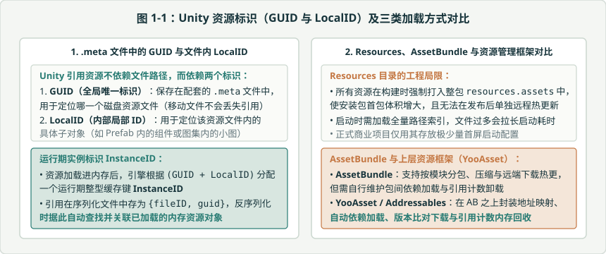
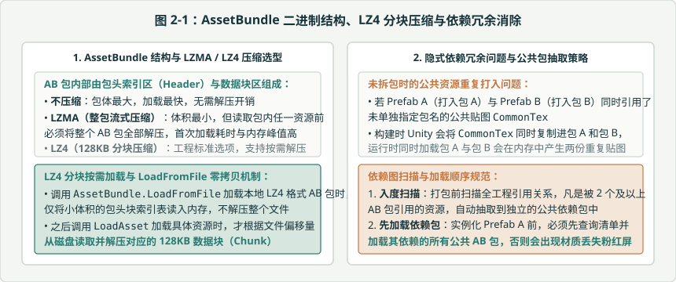
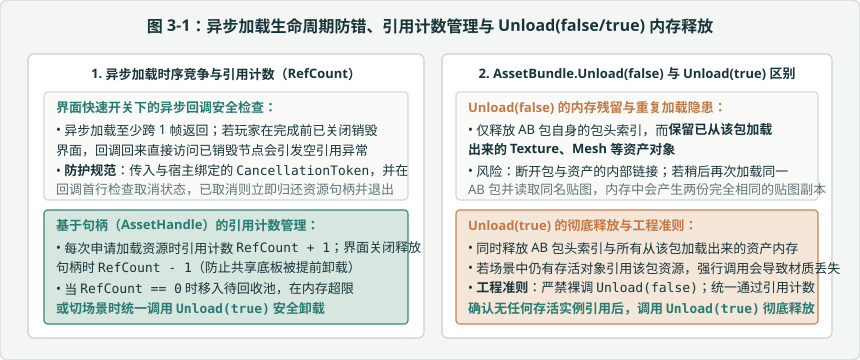
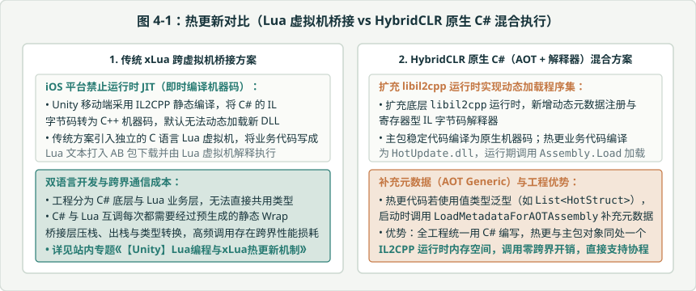

本文梳理 Unity 客户端资源加载管线与代码热更新机制，共分为四个章节：**资源唯一标识体系（`GUID` 与 `LocalID`）及加载方案演进**、**`AssetBundle` 内部结构、`LZ4` 分块压缩与依赖拆包策略**、**异步加载时序竞争防护、引用计数管理与 `Unload` 内存释放**、**热更新方案对比（Lua 虚拟机桥接 vs `HybridCLR` 原生 C# 混合执行）**。

---

## 第 1 章：Unity 资源标识体系与加载方案演进

### 1.1 `.meta` 文件中的 `GUID` 与 `LocalID`

当我们在 Unity 编辑器中把一张贴图拖给材质球、或者把一个预制体拖给脚本变量时，Unity 序列化保存的**并不是该文件在磁盘上的相对路径**，而是由 **`GUID` + `LocalID`** 组成的唯一坐标：



1. **`GUID`（128 位全局唯一标识符）**：
   每个资源文件导入 Unity 时，都会在同级目录下生成一个同名的 `.meta` 文件，其中记录了该文件的 `GUID`。只要 `.meta` 文件跟着资源一起在工程内移动或重命名，`GUID` 就不变，引用它的材质或预制体就不会丢失关联（若直接在系统资源管理器中弄丢了 `.meta` 文件，Unity 会将其视为新文件重新生成 `GUID`，导致原有引用全部断开）。
2. **`LocalID`（文件内部局部标识，序列化文本中记为 `fileID`）**：
   一个复合资源文件内部往往包含多个子对象（例如一个 Prefab 内部包含多个 `GameObject` 和 `MonoBehaviour` 组件，一张 Multiple 模式的图集纹理内部包含多个 `Sprite` 子图）。`LocalID` 用来唯一定位该文件内部的具体哪一个子对象。
3. **`InstanceID`（运行期内存实例标识）**：
   当资源被加载进内存后，引擎内部维护的持久管理器会将 `(GUID, LocalID)` 映射为一个 32 位有符号整型 `InstanceID`。运行期判断对象是否已加载、或者反序列化时恢复引用关系，均通过 `InstanceID` 查找内存对象表完成。

---

### 1.2 四类资源加载方式对比

| 加载方式 | 适用环境 | 包体与热更能力 | 核心特点与工程定位 |
| :--- | :--- | :--- | :--- |
| **`AssetDatabase.LoadAssetAtPath`** | **仅限 Unity Editor** | 无需打包 | 开发期直接在编辑器内按 `Assets/...` 路径快速加载，真机构建不可用。 |
| **`Resources.Load / LoadAsync`** | 编辑器与全平台真机 | **不可热更**，打入首包 | 所有文件强制合并进包内 `resources.assets`，启动时构建全量索引树，拖慢启动速度且增大首包体积。 |
| **`AssetBundle`（AB 包）** | 编辑器与全平台真机 | **支持分包压缩与远程热更** | Unity 底层标准热更载体，支持 `LZ4` 按需解压，但需要开发者自行维护包间依赖关系与引用计数。 |
| **`YooAsset` / `Addressables`** | 编辑器与全平台真机 | **完整工业级热更管线** | 基于 `AssetBundle` 封装，内置版本清单比对、断点续传下载、依赖自动加载与引用计数卸载。 |

---

## 第 2 章：`AssetBundle` 结构、`LZ4` 压缩与依赖冗余消除

### 2.1 `AssetBundle` 二进制布局与三种压缩格式

一个打包生成的 `AssetBundle` 文件在二进制结构上由两部分组成：**头部索引区（Header，记录包内资产名称、类型及在数据区中的字节偏移量）** 与 **数据块区（Data Blocks，存放序列化后的纹理、网格、预制体字节流）**。

打包时通过 `BuildAssetBundleOptions` 可选择三种压缩模式：



| 压缩格式 | 构建参数 | 磁盘体积 | 加载机制与内存表现 |
| :--- | :--- | :--- | :--- |
| **不压缩** | `UncompressedAssetBundle` | 最大 | 无需解压，直接按偏移读取，但包体过大不利于网络下载。 |
| **LZMA（流式整包压缩）** | 默认参数（`None`） | **最小** | 整个数据区压成一个流；读取包内哪怕 1 个小图标，都**必须先将整个 AB 包全量解压**，首次加载慢且内存峰值高。 |
| **LZ4（128KB 分块压缩）** | `ChunkBasedCompression` | 中等（比 LZMA 略大） | **商业项目统一标准**：按 **128KB** 为单位独立压缩成块（Chunk），加载哪个资源就只解压它所在的 128KB 块。 |

- **`AssetBundle.LoadFromFile` 与 `LZ4` 的零拷贝配合**：
  当使用 `AssetBundle.LoadFromFile(path)`（或异步版 `LoadFromFileAsync`）加载本地磁盘上的 **`LZ4` 格式** AB 包时，Unity **不会把整个文件读入内存**，而是仅读取文件头部的块索引表（通常仅几 KB），并保持一个指向磁盘文件的文件句柄。随后当业务代码调用 `ab.LoadAsset<GameObject>("Hero")` 时，引擎才根据头部索引定位该预制体涉及的几个 128KB 数据块，从磁盘按偏移读取并实时通过 `LZ4` 解压生成对象，内存占用极低且加载速度接近不压缩格式。

---

### 2.2 隐式依赖冗余与公共包抽取策略

- **隐式依赖引发的内存双份冗余**：
  假设工程中有两个预制体：`PanelA.prefab`（指定打入 `ui_panel_a.bundle`）和 `PanelB.prefab`（指定打入 `ui_panel_b.bundle`），它们都引用了同一张公共背景贴图 `CommonBg.png`，但开发者**没有给 `CommonBg.png` 单独指定 AB 包名**。
  - 在打包时，Unity 发现两个包都依赖 `CommonBg.png` 且它不属于任何独立包，于是会将 `CommonBg.png` 的完整像素数据**同时复制一份塞进 `ui_panel_a.bundle` 和 `ui_panel_b.bundle` 中**。
  - 更严重的是：运行时若同时打开界面 A 和界面 B，由于这两份贴图来自两个不同的 AB 包，引擎会将它们视为两个完全独立的资源实例，**在内存和显存中驻留两份一模一样的贴图**。
- **构建期引用入度扫描与运行期依赖先行加载**：
  1. **构建期自动拆包**：在打包脚本（或使用 `YooAsset` 的收集器规则）中，通过 `AssetDatabase.GetDependencies` 扫描所有入口资源的引用图，统计每个底层资产被多少个不同的入口包引用（入度）。凡是**被 2 个及以上包共同引用的贴图、材质、字体或 Shader**，自动归入独立的公共依赖包（如 `common_textures.bundle`、`common_shaders.bundle`）。
  2. **运行期先加载依赖包**：当公共资源被拆出后，在加载并实例化 `PanelA` 之前，必须先查询全局 `AssetBundleManifest` 获取 `ui_panel_a.bundle` 的所有依赖包列表，先把所有依赖包通过 `LoadFromFile` 加载进内存，最后再加载 `PanelA`，否则实例化出来的界面会出现材质或贴图丢失（显示为紫红色异常材质）。

---

## 第 3 章：异步加载时序防护、引用计数与内存卸载

### 3.1 异步加载的生命周期竞争防护

正式项目中，为防止主线程卡顿，UI 界面与角色模型均采用异步加载。由于异步加载至少在调用后的下一帧（甚至数帧后）才会触发完成回调，期间极易发生**时序竞争**：
- **典型问题**：玩家点击按钮异步加载打开“背包界面”，但在 AB 包尚未读取完成的 0.2 秒内，玩家又点击了返回键关闭该界面或切换到了新场景。当异步加载完成执行回调时，外部宿主对象已被销毁，直接在回调中实例化预制体并挂载到已销毁的父节点上，不仅会导致空引用报错，还会产生无法被回收的孤立游戏对象（内存泄漏）。
- **标准防护代码（绑定 `CancellationToken` + 句柄释放）**：

```csharp
using System.Threading;
using Cysharp.Threading.Tasks;
using UnityEngine;
using YooAsset;

public class UIWindowLoader : MonoBehaviour
{
    private AssetHandle m_handle;
    private GameObject m_instance;

    public async UniTask LoadAndShowAsync(string location)
    {
        // 获取与当前 MonoBehaviour 生命周期绑定的取消令牌（OnDestroy 时自动触发取消）
        CancellationToken token = this.GetCancellationTokenOnDestroy();

        m_handle = YooAssets.LoadAssetAsync<GameObject>(location);
        await m_handle.ToUniTask();

        // 异步等待返回后，第一时间检查宿主是否已被销毁或主动取消
        if (token.IsCancellationRequested || this == null)
        {
            // 若界面在加载期间已关闭，立即归还释放资源句柄，不执行实例化
            m_handle.Release();
            m_handle = null;
            return;
        }

        m_instance = m_handle.InstantiateSync(transform);
    }

    private void OnDestroy()
    {
        if (m_instance != null)
        {
            Destroy(m_instance);
            m_instance = null;
        }
        // 界面销毁时释放句柄，使底层 AB 包引用计数减 1
        if (m_handle != null)
        {
            m_handle.Release();
            m_handle = null;
        }
    }
}
```

---

### 3.2 引用计数管理与 `Unload(false)` / `Unload(true)` 对比



1. **共享资源的引用计数管理**：
   如前所述，公共图集包 `common_ui.bundle` 可能同时被界面 A 和界面 B 依赖。如果界面 A 关闭时直接卸载了 `common_ui.bundle`，正在显示的界面 B 上的图片会立刻变白或丢失。因此，资源管理器必须为每个已加载的 AB 包维护一个整型引用计数 `RefCount`：
   - 每当上层业务申请一个指向该包内资源的句柄（或有其他已加载的 AB 包依赖该包）时，`RefCount++`；
   - 每当业务关闭界面调用 `handle.Release()` 归还句柄时，`RefCount--`；
   - 当 `RefCount` 降为 `0` 时，不立即销毁（避免玩家马上再次打开同一界面引发重复磁盘读取），而是将其放入 **LRU（最近最少使用）闲置缓存队列**；当闲置缓存总大小超过阈值或发生场景切换时，按最久未使用顺序淘汰并卸载 `RefCount == 0` 的包。
2. **`AssetBundle.Unload(false)` 与 `AssetBundle.Unload(true)` 的底层差异**：
   - **`ab.Unload(false)`（严禁在运行期常规使用）**：
     仅释放 `AssetBundle` 自身的头部索引内存，但**保留所有已经通过该包 `LoadAsset` 加载进内存的 `Texture`、`Mesh`、`Material` 资产对象**。这会切断 AB 包与那些已加载资产之间的内部引用链：如果稍后重新加载同一个 AB 包并再次读取同名预制体，引擎无法识别内存中已有的旧贴图，会**在内存中重新创建一份完全相同的贴图副本**，造成隐蔽且难以清理的内存翻倍。
   - **`ab.Unload(true)`（配合引用计数的标准卸载方式）**：
     同时释放 `AssetBundle` 头部索引以及**所有从该包加载出来的资产对象**，内存释放干净彻底。只要严格通过引用计数保证调用 `Unload(true)` 时 `RefCount == 0`（即场景中已没有任何存活的实例在使用该包的资源），就能安全、无残留地回收全部内存。

---

## 第 4 章：代码热更新机制（`xLua` vs `HybridCLR`）

### 4.1 AOT 平台限制与两代热更新方案对比

在 iOS、主机及部分小程序平台上，操作系统出于安全策略严禁应用在运行期动态分配可执行内存页（即**禁止 JIT 即时编译**）。因此 Unity 在发布移动端时默认采用 **IL2CPP（AOT 静态提前编译）**：在打包阶段先把 C# 编译出的中间语言（IL 字节码）转译为 C++ 源码，再编译为目标平台的原生机器码（如 ARM64 汇编放入 `libil2cpp.so`）。由于原生机器码无法在运行时动态修改，默认情况下无法直接调用 `Assembly.Load(byte[])` 加载新的热更 DLL。

围绕这一限制，Unity 商业项目形成了两代主流热更架构：



| 对比维度 | 传统方案：`xLua` / `ToLua`（Lua 虚拟机） | 现代方案：`HybridCLR`（原生 C# 混合执行） |
| :--- | :--- | :--- |
| **核心实现原理** | 内嵌 C 语言编写的 Lua 虚拟机，将 Lua 脚本文本打入 AB 包下载并解释执行。 | 改造扩充 `libil2cpp` 运行时，直接内置高效的寄存器型 IL 字节码解释器。 |
| **编程语言与工程流** | **C# + Lua 双语言割裂**：底层框架用 C#，热更业务用 Lua，无法直接共享类型定义。 | **纯 C# 单语言统一**：主包与热更包均使用标准 C# 编写，共享全部 IDE 重构与静态检查。 |
| **跨界调用开销** | **高**：C# 与 Lua 互调需经过生成的静态 Wrap 代码压栈、拆箱与拷贝。 | **零跨界开销**：热更代码与主包 AOT 代码同处一个 IL2CPP 内存空间，直接互调。 |
| **内存与 GC 管理** | 同时存在 Mono/IL2CPP GC 与 Lua GC 两套独立垃圾回收器，需防跨语言引用泄漏。 | 统一由同一个 IL2CPP GC 管理，不存在双虚拟机交叉引用泄漏问题。 |

---

### 4.2 `HybridCLR` 热更新工作流与补充元数据机制

`HybridCLR` 将整个客户端代码划分为 **主包 AOT 程序集（稳定不常改的底层框架、第三方库，打包时直接编译为原生机器码）** 与 **热更新程序集（如 `HotUpdate.dll`，包含高频迭代的 UI、玩法、活动逻辑，打入 `AssetBundle` 远程下载）**。

其完整启动与热更加载流程包含以下四个步骤：

1. **下载热更 AB 包**：客户端启动后通过 `YooAsset` 与 CDN 比对版本号，将最新的热更 DLL 资源包下载到本地沙盒目录。
2. **为 AOT 泛型补充元数据（`LoadMetadataForAOTAssembly`）**：
   - 在原生 IL2CPP 中，如果热更代码写了一个值类型泛型实例化（例如 `new List<HotStruct>()`，其中 `HotStruct` 是在热更 DLL 中新定义的 `struct`），由于值类型每个字段宽度不同，AOT 编译阶段从未为 `HotStruct` 生成过对应的 `List<T>` 机器码。
   - `HybridCLR` 支持基于 IL 解释器实现任意泛型的动态实例化，但前提是解释器需要读取原主包 AOT 程序集（如 `mscorlib.dll`、`System.Core.dll`）中泛型模板的原始 IL 元数据。因此在加载热更 DLL 之前，需要先加载裁剪后的 AOT 补充元数据 DLL：
3. **调用 `Assembly.Load` 加载热更程序集**：将 `HotUpdate.dll` 的二进制字节流注册进 `libil2cpp` 运行时。
4. **跳转进入热更入口**：通过反射调用热更程序集中的启动入口函数（或挂载热更脚本的预制体），此后所有热更逻辑均以原生 C# 方式直接运行：

```csharp
using System;
using System.Reflection;
using HybridCLR;
using UnityEngine;

public class HotUpdateBootstrapper : MonoBehaviour
{
    // 需要补充泛型元数据的主包 AOT 程序集列表（由构建工具自动扫描生成）
    private static readonly string[] AOTMetaAssemblyNames =
    {
        "mscorlib.dll",
        "System.dll",
        "System.Core.dll",
        "UniTask.dll"
    };

    public void StartHotUpdate(Func<string, byte[]> loadDllBytesFunc)
    {
        // 1. 先为主包 AOT 程序集补充原始元数据，以支持热更代码中使用任意值类型泛型
        foreach (string aotDllName in AOTMetaAssemblyNames)
        {
            byte[] dllBytes = loadDllBytesFunc(aotDllName);
            LoadImageErrorCode err = RuntimeApi.LoadMetadataForAOTAssembly(
                dllBytes, HomologousImageMode.SuperSet);
            if (err != LoadImageErrorCode.OK)
            {
                Debug.LogError($"补充 AOT 元数据失败: {aotDllName}, 错误码: {err}");
            }
        }

        // 2. 加载远程热更新程序集 HotUpdate.dll
        byte[] hotUpdateBytes = loadDllBytesFunc("HotUpdate.dll");
        Assembly hotUpdateAsm = Assembly.Load(hotUpdateBytes);

        // 3. 反射获取热更主入口类并启动游戏主逻辑
        Type entryType = hotUpdateAsm.GetType("GameLogic.HotUpdateEntry");
        MethodInfo startMethod = entryType.GetMethod("StartGame", BindingFlags.Public | BindingFlags.Static);
        startMethod?.Invoke(null, null);
    }
}
```
