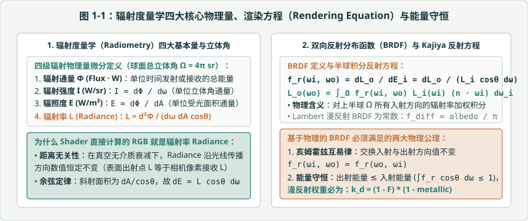
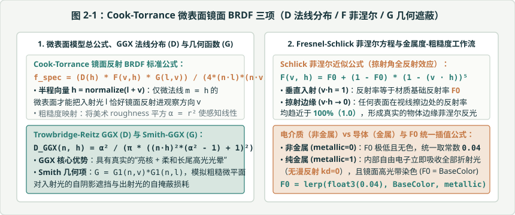
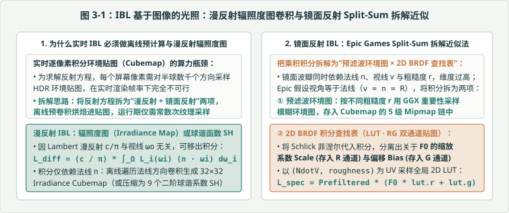
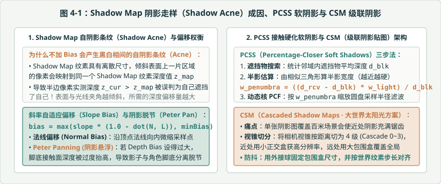

本文围绕现代实时渲染中的物理光照与阴影算法，分为四个章节：**辐射度量学基础与渲染方程**、**Cook-Torrance 微表面模型与金属度-粗糙度工作流**、**基于图像的光照（IBL）与 Split-Sum 近似**、**实时阴影技术（Shadow Map、PCF、PCSS 与 CSM 级联阴影）**。

---

## 第 1 章：辐射度量学基础、BRDF 与渲染方程

传统经验光照模型（Phong / Blinn-Phong）将漫反射与高光简单相加，不仅违反能量守恒定律（高光越强表面总亮度反而越亮，导致过曝塑料感），且材质参数在不同的环境光照下表现严重失真。**基于物理的渲染（PBR）**建立在严格的光学物理度量——**辐射度量学（Radiometry）**之上。



### 1.1 立体角与辐射度量学四大基本物理量

- **立体角（Solid Angle，$\omega$ / $\mathrm{d}\omega$）**：二维弧度定义为弧长除以半径 $\theta = l / r$（整圆为 $2\pi$ 弧度）；三维**立体角**定义为球面截取面积 $A$ 除以半径平方 **$\omega = A / r^2$**，微分立体角写为 $\mathrm{d}\omega = \mathrm{d}A / r^2 = \sin\theta\,\mathrm{d}\theta\,\mathrm{d}\phi$，单位为**球面度（Steradian, $\text{sr}$）**。整个球面的总立体角恒为 **$4\pi\text{ sr}$**，上半球总立体角为 **$2\pi\text{ sr}$**。

| 物理量名称 | 符号 | 数学定义公式 | 国际单位 | 几何与渲染物理含义 |
| :--- | :--- | :--- | :--- | :--- |
| **辐射通量（Radiant Flux）** | $\Phi$ | $\Phi = \dfrac{\mathrm{d}Q}{\mathrm{d}t}$ | 瓦特（$\text{W} = \text{J/s}$） | 光源在单位时间内发射或表面接收的**总电磁辐射能量（总功率）** |
| **辐射强度（Radiant Intensity）** | $I$ | $I(\omega) = \dfrac{\mathrm{d}\Phi}{\mathrm{d}\omega}$ | $\text{W / sr}$ | 点光源在**单位立体角**方向上发射的辐射通量 |
| **辐照度（Irradiance）** | $E$ | $E(p) = \dfrac{\mathrm{d}\Phi}{\mathrm{d}A}$ | $\text{W / m}^2$ | 表面点 $p$ 在**单位受光面积**上接收到的所有方向总辐射通量 |
| **辐射率（Radiance）** | $L$ | $L(p, \omega) = \dfrac{\mathrm{d}^2 \Phi}{\mathrm{d}\omega\,\mathrm{d}A\cos\theta}$ | $\text{W / (sr}\cdot\text{m}^2\text{)}$ | 表面在**单位垂直投影面积 $\mathrm{d}A\cos\theta$、单位立体角 $\mathrm{d}\omega$** 内发射或接收的光通量 |

- **Shader 中单条光线颜色对应辐射率 Radiance（$L$）的原因**：
  1. **沿光线传播的距离不变性**：在无雾气散射的空气或真空中，单条光线沿方向 $\omega$ 传播时，其 Radiance $L$ **不随传播距离衰减**（而点光源对表面的辐照度 $E$ 因球面积 $4\pi r^2$ 扩散而按距离平方反比 $1 / r^2$ 衰减）。因此人眼或摄像机传感器单个像素采样到的颜色值，严格等于物体表面朝向摄像机方向出射的 Radiance $L_o$。
  2. **兰伯特余弦定律（Lambert's Cosine Law）**：一束截面积为 $\mathrm{d}A_{\perp}$ 的光束以与表面法线 $\mathbf{n}$ 夹角 $\theta$ 斜射到表面上时，铺展的受光面积变为 $\mathrm{d}A = \mathrm{d}A_{\perp} / \cos\theta$，因此单位表面积接收到的微分辐照度为 **$\mathrm{d}E = L_i(p, \omega_i)\cos\theta_i\,\mathrm{d}\omega_i$**（其中 $\cos\theta_i = \max(0, \mathbf{n} \cdot \omega_i)$）。

---

### 1.2 双向反射分布函数（BRDF）与 Kajiya 渲染方程

当入射方向 $\omega_i$ 的微分辐照度 $\mathrm{d}E_i(p, \omega_i) = L_i(p, \omega_i)\cos\theta_i\,\mathrm{d}\omega_i$ 照射到表面点 $p$ 时，观察方向 $\omega_o$ 的微分出射辐射率 $\mathrm{d}L_o(p, \omega_o)$ 与入射微分辐照度之比定义为**双向反射分布函数（Bidirectional Reflectance Distribution Function, BRDF）**（量纲为 $1 / \text{sr}$）：

$$
f_r(p, \omega_i, \omega_o) = \frac{\mathrm{d}L_o(p, \omega_o)}{\mathrm{d}E_i(p, \omega_i)} = \frac{\mathrm{d}L_o(p, \omega_o)}{L_i(p, \omega_i)\cos\theta_i\,\mathrm{d}\omega_i}
$$

将上半球 $\Omega$ 所有入射方向的反射贡献累加，并加上物体自身的发光项 $L_e$，即得到计算机图形学最核心的 **Kajiya 渲染方程（The Rendering Equation，1986）**：

$$
L_o(p, \omega_o) = L_e(p, \omega_o) + \int_{\Omega} f_r(p, \omega_i, \omega_o)\,L_i(p, \omega_i)\,(\mathbf{n} \cdot \omega_i)\,\mathrm{d}\omega_i
$$

- **物理有效 BRDF 的三条约束条件**：
  1. **非负性**：$f_r(\omega_i, \omega_o) \ge 0$。
  2. **亥姆霍兹互易律（Helmholtz Reciprocity）**：交换入射方向与观察方向，BRDF 值不变：$f_r(\omega_i, \omega_o) = f_r(\omega_o, \omega_i)$。
  3. **能量守恒（Energy Conservation）**：表面向整个上半球反射的总光通量不超过入射光通量：
     $$
     \forall \omega_i, \qquad \int_{\Omega} f_r(p, \omega_i, \omega_o)\cos\theta_o\,\mathrm{d}\omega_o \le 1
     $$
     **推论（Lambert 漫反射除以 $\pi$ 的原因）**：设均匀漫反射材质的反照率（Albedo）为 $\mathbf{c} \in [0, 1]$，其常数 BRDF 为 $f_{\text{diff}}$。代入半球积分得 $f_{\text{diff}} \int_0^{2\pi} \mathrm{d}\phi \int_0^{\pi/2} \cos\theta\sin\theta\,\mathrm{d}\theta = f_{\text{diff}} \cdot \pi = \mathbf{c}$，因此 **Lambertian 漫反射 BRDF 为 $f_{\text{diff}} = \mathbf{c} / \pi$**。

---

## 第 2 章：Cook-Torrance 微表面模型与金属度-粗糙度工作流

现代实时引擎（Unreal Engine / Unity URP & HDRP）统一将表面 BRDF 拆分为**漫反射项（Diffuse，折射进入次表面经多次散射再穿出）**与**镜面反射项（Specular，直接在表面第一次接触即反射）**之和：

$$
f_r(\mathbf{l}, \mathbf{v}) = k_d \frac{\mathbf{c}}{\pi} + f_{\text{spec}}(\mathbf{l}, \mathbf{v})
$$



### 2.1 Cook-Torrance 微表面镜面 BRDF 三大核心函数（D / F / G）

微表面理论（Microfacet Theory）认为，宏观上看似平坦的粗糙表面，在微观尺度下是由无数个朝向各异的**理想镜面微平面（Microfacets）**组成的。当入射光方向为 $\mathbf{l}$、视线方向为 $\mathbf{v}$ 时，根据反射定律，**只有那些微观法线 $\mathbf{m}$ 恰好等于半程向量 $\mathbf{h} = \operatorname{normalize}(\mathbf{l} + \mathbf{v})$ 的活性微平面，才能将光线 $\mathbf{l}$ 镜面反射进眼睛 $\mathbf{v}$**。据此导出 **Cook-Torrance 镜面 BRDF 标准形式**：

$$
f_{\text{spec}}(\mathbf{l}, \mathbf{v}) = \frac{D(\mathbf{h})\,F(\mathbf{v}, \mathbf{h})\,G(\mathbf{l}, \mathbf{v}, \mathbf{h})}{4\,(\mathbf{n} \cdot \mathbf{l})(\mathbf{n} \cdot \mathbf{v})}
$$

（分母中的 $4(\mathbf{n} \cdot \mathbf{l})(\mathbf{n} \cdot \mathbf{v})$ 是从微平面局部半程立体角 $\mathrm{d}\omega_h$ 变换到宏观立体角 $\mathrm{d}\omega_o$ 时的雅可比行列式因子与投影修正项。）

#### 1. 法线分布函数 $D(\mathbf{h})$（Normal Distribution Function, NDF）：Trowbridge-Reitz GGX
- **物理含义**：统计单位宏观表面积内，微平面法线朝向恰好对齐半程向量 $\mathbf{h}$ 的微平面面积比例（决定高光光斑的形状、锐利度与拖尾）。
- **迪士尼粗糙度重映射**：美术调节的感知粗糙度为 $\text{roughness} \in [0, 1]$，若直接代入公式会导致低粗糙度区间变化过于剧烈，因此先取平方映射 **$\alpha = \text{roughness}^2$**。
- **Trowbridge-Reitz GGX 公式**（相比 Beckmann 分布具有更真实的峰值亮核与柔和长尾光晕）：
  $$
  D_{\text{GGX}}(\mathbf{n}, \mathbf{h}, \alpha) = \frac{\alpha^2}{\pi \bigl((\mathbf{n} \cdot \mathbf{h})^2 (\alpha^2 - 1) + 1\bigr)^2}
  $$

#### 2. 菲涅尔方程 $F(\mathbf{v}, \mathbf{h})$（Fresnel Equation）：Fresnel-Schlick 近似
- **物理含义**：描述电磁波照射到具有不同折射率的介质交界面时，**直接发生镜面反射的能量占比 $F$**（剩余 $1 - F$ 的能量折射进入物体内部）。
- **掠射角全反射规律**：当视线垂直于微平面观察（$\mathbf{v} \cdot \mathbf{h} = 1$）时，反射率最低，等于该材质的特征**垂直基础反射率 $F_0$**；而当视线越趋近于与表面平行的**掠射角（Grazing Angle，$\mathbf{v} \cdot \mathbf{h} \to 0$）**时，**任何光滑物体表面的反射率都会急剧攀升并趋近于 $100\%\ (1.0)$**。
- **Schlick 五次方近似公式**：
  $$
  F_{\text{Schlick}}(\mathbf{v}, \mathbf{h}, F_0) = F_0 + (1 - F_0)\bigl(1 - \max(0, \mathbf{v} \cdot \mathbf{h})\bigr)^5
  $$

#### 3. 几何遮蔽函数 $G(\mathbf{l}, \mathbf{v}, \mathbf{h})$（Geometry Function）：Smith-Schlick-GGX
- **物理含义**：在粗糙微表面上，部分微平面会被相邻微平面遮挡入射光（**自阴影 Shadowing**），或反射光被相邻微平面截挡（**自掩蔽 Masking**）。几何函数 $G \in [0, 1]$ 描述未被遮蔽的能量比例（若缺失 $G$ 项，粗糙表面在掠射角除以趋近于 $0$ 的 $(\mathbf{n}\cdot\mathbf{l})(\mathbf{n}\cdot\mathbf{v})$ 分母时会出现边缘过亮伪影）。
- **Smith 分离近似与 Schlick-GGX 公式**：将双向遮蔽拆为入射方向与观察方向两个独立单向项的乘积（直接光照下重映射参数取 $k = (\text{roughness} + 1)^2 / 8$；IBL 环境光下取 $k = \text{roughness}^2 / 2$）：
  $$
  G_{\text{Smith}}(\mathbf{n}, \mathbf{v}, \mathbf{l}, k) = G_1(\mathbf{n}, \mathbf{v}, k)\,G_1(\mathbf{n}, \mathbf{l}, k), \qquad G_1(\mathbf{n}, \mathbf{v}, k) = \frac{\mathbf{n} \cdot \mathbf{v}}{(\mathbf{n} \cdot \mathbf{v})(1 - k) + k}
  $$

---

### 2.2 导体（金属）vs 电介质（非金属）与金属度工作流能量守恒

现代渲染引擎通常采用 **`BaseColor（基础色 RGB）+ Metallic（金属度）+ Roughness（粗糙度）`** 参数化材质：
1. **电介质（Dielectrics / 非金属，如塑料、木材、石材、皮肤，$\text{metallic} = 0$）**：
   - 垂直基础反射率 $F_0$ 较低且无色（通常在 $0.02 \sim 0.05$ 之间，引擎取常数 **`float3(0.04, 0.04, 0.04)`**）。
   - 折射进入非金属内部的光线经次表面散射后重新穿出，形成带有 `BaseColor` 颜色的**漫反射（Diffuse）**。
2. **导体（Conductors / 金属，如金、银、铜、铁，$\text{metallic} = 1$）**：
   - 金属内部的自由电子会吸收折射进入内部的电磁波，因此**纯金属无次表面漫反射（$k_d = 0$）**。
   - 金属的垂直基础反射率 $F_0$ 较高（$0.5 \sim 0.98$）且具有波长选择性（有色高光）。在金属度工作流中，直接复用 `BaseColor` 贴图存储金属的有色 $F_0$。
3. **Shader 统一插值与能量守恒代码实现**：
   ```hlsl
   // 1. 根据金属度在非金属常数 0.04 与金属有色 BaseColor 之间插值得到 F0
   float3 F0 = lerp(float3(0.04, 0.04, 0.04), baseColor.rgb, metallic);

   // 2. 计算菲涅尔反射比例 F（即镜面反射拿走的能量比例 ks = F）
   float3 F = F_Schlick(max(dot(H, V), 0.0), F0);

   // 3. 严格能量守恒：折射进入内部的比例为 (1.0 - F)，且纯金属无漫反射故再乘以 (1.0 - metallic)
   float3 kd = (1.0 - F) * (1.0 - metallic);

   // 4. 最终单光源直接光照出射 Radiance
   float3 Lo = (kd * baseColor.rgb / PI + specularBRDF) * lightRadiance * NdotL;
   ```

---

## 第 3 章：基于图像的光照（IBL）与 Epic Split-Sum 拆解近似

**基于图像的光照（Image-Based Lighting, IBL）**将包围场景的高动态范围全景贴图（HDR Cubemap）视为连续球面光源，通过对环境贴图求解半球积分提供间接环境漫反射与环境镜面反射。



### 3.1 漫反射 IBL：辐照度环境图（Irradiance Map）与球谐光照（SH）

在反射方程的漫反射部分中，由于 Lambertian 项 $k_d (\mathbf{c} / \pi)$ 与入射方向 $\omega_i$ 无关（或将 $k_d$ 近似替换为粗糙度修正菲涅尔 $1 - F_{\text{roughness}}(\mathbf{n}, \mathbf{v})$），可以将其直接提取到半球积分号外面：

$$
L_{\text{diffuse}}(p, \mathbf{n}) = k_d \frac{\mathbf{c}}{\pi} \underbrace{\int_{\Omega} L_i(\omega_i)\,(\mathbf{n} \cdot \omega_i)\,\mathrm{d}\omega_i}_{\text{Irradiance Map } E(\mathbf{n})}
$$

由上式可知：**大括号内的半球积分结果仅取决于表面法线方向 $\mathbf{n}$，与视线方向 $\mathbf{v}$ 和材质粗糙度无关**。
- **离线烘焙方案 A（Irradiance Cubemap）**：在离线阶段遍历一个低分辨率（如 $32 \times 32 \times 6$）Cubemap 的每个纹素方向作为法线 $\mathbf{n}$，对原始高清 HDR 环境图执行半球余弦加权卷积积分并存入该纹素；运行时片元着色器只需以世界法线 $\mathbf{N}$ 执行 **1 次 `texCUBE(irradianceMap, N)` 采样**即可拿到全场漫反射环境光。
- **离线烘焙方案 B（二阶球谐函数 Spherical Harmonics, SH）**：由于余弦卷积后的漫反射辐照度变化平缓（主要由低频信号组成），Unity 与 Unreal 的 Light Probes 直接将其投影到前 3 阶（$l = 0, 1, 2$，共 $1 + 3 + 5 = 9$ 个基函数）**球谐函数系数**上——每个光照探针只需存储 **9 个 RGB 向量（27 个浮点数）**，运行时通过简单的多项式点积即可极速还原任意法线方向的漫反射环境光。

---

### 3.2 镜面反射 IBL：Epic Games 两部分拆解近似（Split-Sum Approximation）

与漫反射不同，镜面反射积分 $\int_{\Omega} f_{\text{spec}}(\omega_i, \omega_o)\,L_i(\omega_i)\,(\mathbf{n} \cdot \omega_i)\,\mathrm{d}\omega_i$ 中的 $f_{\text{spec}}$ 同时依赖于**法线 $\mathbf{n}$、观察方向 $\mathbf{v}$ 与粗糙度 $\text{roughness}$**，无法直接预烘焙进一张三维纹理中。Epic Games 在 UE4 中提出了工业界通用的 **Split-Sum 拆解近似法**，将乘积的积分拆解为两个独立积分的乘积：

$$
L_{\text{spec}}(\mathbf{n}, \mathbf{v}) \approx \underbrace{\left( \frac{1}{N} \sum_{k=1}^{N} L_i(\mathbf{l}_k) \right)}_{\text{第一部分：预滤波环境贴图}} \cdot \underbrace{\left( \int_{\Omega} f_{\text{spec}}(\mathbf{l}, \mathbf{v})\,(\mathbf{n} \cdot \mathbf{l})\,\mathrm{d}\omega_i \right)}_{\text{第二部分：2D BRDF 积分查找表 (LUT)}}
$$

1. **第一部分：预滤波环境贴图（Pre-filtered Environment Map）**：
   - 假设观察视角垂直于表面（$\mathbf{v} = \mathbf{n} = \mathbf{R}$，从而消除视角维度，仅剩反射向量 $\mathbf{R}$ 与粗糙度 $\text{roughness}$ 两个维度）。
   - 离线阶段利用 Hammersley 低差异序列与 **GGX 重要性采样（Importance Sampling）**，按粗糙度从 $0.0$ 到 $1.0$ 分 5 个等级对 HDR 环境图进行不同波瓣宽度的模糊卷积，依次存入 **Cubemap 的 5 级 Mipmap 链**中（`Mip 0` 为清晰镜面，`Mip 4` 为极度粗糙模糊）。
   - 运行时根据反射向量 `R = reflect(-V, N)` 与材质 `roughness * MAX_REFLECTION_LOD`，执行一次三线性 Mipmap 采样 `SampleLevel(prefilterMap, R, mip)`。
2. **第二部分：全局通用的二维 BRDF 查找表（2D Environment BRDF LUT）**：
   - 将 Schlick 菲涅尔公式 $F(\mathbf{v}, \mathbf{h}) = F_0 + (1 - F_0)(1 - \mathbf{v} \cdot \mathbf{h})^5$ 代入第二部分的积分中，可以把材质参数 **$F_0$ 完全从积分号内部剥离出来**，化为关于 $F_0$ 的一次线性函数 $F_0 \cdot \text{Scale} + \text{Bias}$：
     $$
     \begin{aligned}
     \int_{\Omega} f_{\text{spec}}(\mathbf{l}, \mathbf{v})\,(\mathbf{n} \cdot \mathbf{l})\,\mathrm{d}\omega_i &= F_0 \int_{\Omega} \frac{f_{\text{spec}}}{F}\bigl(1 - (1 - \mathbf{v}\cdot\mathbf{h})^5\bigr)(\mathbf{n}\cdot\mathbf{l})\,\mathrm{d}\omega_i + \int_{\Omega} \frac{f_{\text{spec}}}{F}(1 - \mathbf{v}\cdot\mathbf{h})^5(\mathbf{n}\cdot\mathbf{l})\,\mathrm{d}\omega_i \\[6pt]
     &= F_0 \cdot \operatorname{Scale}(\mathbf{n}\cdot\mathbf{v},\; \text{roughness}) + \operatorname{Bias}(\mathbf{n}\cdot\mathbf{v},\; \text{roughness})
     \end{aligned}
     $$
   - 其中 $\text{Scale}$ 和 $\text{Bias}$ 与具体环境贴图和 $F_0$ 无关，仅是 **$\cos\theta_v = (\mathbf{n} \cdot \mathbf{v}) \in [0, 1]$ 与 $\text{roughness} \in [0, 1]$ 的二元函数**。
   - 因此只需离线生成一张全游戏共用的 **$512 \times 512$ 双通道浮点贴图（BRDF LUT，横轴为 `NdotV`，纵轴为 `roughness`，R 通道存 `Scale`，G 通道存 `Bias`）**，运行时采样一次即可合成完整镜面环境光：
     ```hlsl
     float2 envBRDF = brdfLUT.Sample(sampler_Clamp, float2(NdotV, roughness)).rg;
     float3 specularIBL = prefilteredColor * (F0 * envBRDF.r + envBRDF.g);
     ```

---

## 第 4 章：实时阴影技术：Shadow Map、PCF、PCSS 与 CSM 级联阴影

### 4.1 Shadow Mapping 两趟原理与自阴影走样（Shadow Acne vs Peter Panning）

经典的 **Shadow Mapping（阴影映射，Williams 1978）** 算法分为两个渲染 Pass：
1. **Shadow Caster Pass（光源视角深度渲染）**：将虚拟相机放置于光源位置，将场景几何体变换到光源裁剪空间，仅向一张深度纹理（`Shadow Map`）写入离光源最近的片元深度值 $z_{\text{map}}$。
2. **Main Lighting Pass（主相机视角阴影比对）**：渲染主相机画面时，将每个片元的世界坐标 $P_{\text{world}}$ 乘以光源矩阵变换到光源空间，得到该片元距离光源的实际深度 $z_{\text{cur}}$ 以及在 Shadow Map 上的采样坐标 $(u, v)$；若 **$z_{\text{cur}} > z_{\text{map}}(u, v)$**，说明该点在光源方向上被更近的物体挡住，判定处于阴影中。



- **自阴影条纹（Shadow Acne）的成因**：
  因为 Shadow Map 的纹素分辨率有限，每个纹素覆盖场景中的一小块矩形面积；当光线倾斜照射平面时，平面上共享同一个 Shadow Map 纹素的多个屏幕片元中，有一半片元的真实深度 $z_{\text{cur}}$ 比纹素中心记录的离散深度 $z_{\text{map}}$ 稍大，另一半稍小，从而导致平面被自己遮挡、浮现出规则的明暗摩尔条纹。
- **斜率自适应偏移（Slope-Scale Depth Bias）与法线偏移（Normal Bias）**：
  光线与表面法线夹角 $\theta$ 越大（表面越陡峭），纹素跨度引起的深度误差 $\Delta z \propto \tan\theta$ 越大。因此不能使用固定常数偏移，而必须根据 $\mathbf{N} \cdot \mathbf{L}$ 动态调节偏移量：
  ```hlsl
  float bias = max(slopeScaleBias * (1.0 - dot(N, L)), minConstantBias);
  ```
  同时需控制 `bias` 上限：若深度偏移过大，物体与地面接触处的地面深度被过度减小，会导致本应在阴影中的接触面逃脱阴影判定，产生**阴影与角色脚底脱节悬浮的伪影（Peter Panning）**。Unity URP 通过结合**沿法线向内微缩采样坐标（Normal Bias）**与适度深度偏移共同消除上述两类伪影。

---

### 4.2 PCF 抗锯齿滤波与 PCSS 接触硬化软阴影

1. **PCF（Percentage-Closer Filtering，百分比渐近滤波）**：
   - **注意**：不能对 Shadow Map 的深度值直接做双线性插值后再比较（先平均深度再比较仍会得到非 0 即 1 的硬边界）。
   - **正确做法**：在当前片元对应的 Shadow Map $(u, v)$ 周围（如 $3 \times 3$ 或 Poisson Disk 圆盘采样核）采样 $K$ 个邻近纹素，**分别将 $z_{\text{cur}}$ 与这 $K$ 个深度值逐一做大小比较得到 $K$ 个 $0/1$ 可见性结果，最后对这 $K$ 个 $0/1$ 结果求加权平均**，得到平滑过渡的半影灰度值 $\text{visibility} \in [0, 1]$。
2. **PCSS（Percentage-Closer Soft Shadows，Fernando 2005）**：
   真实世界中面光源产生的阴影具有显著的**接触硬化（Contact Hardening）**现象：遮挡物（如树枝或脚底）离受影地面越近，阴影边缘越锐利清晰；离受影地面越远，半影区（Penumbra）越宽、阴影越模糊柔和。固定核半径的 PCF 无法模拟这一物理现象，PCSS 通过三步动态计算滤波核半径：
   - **第一步（Blocker Search 遮挡物平均深度搜索）**：在当前片元 $(u, v)$ 邻域内采样若干点，找出所有比当前片元深度 $d_{\text{receiver}}$ 更浅（即 $z_{\text{map}} < d_{\text{receiver}}$）的有效遮挡点，求其算术平均深度 **$d_{\text{blocker}}$**（若无任何遮挡点则直接提前终止返回完全照亮 $1.0$）。
   - **第二步（Penumbra Size 半影宽度估算）**：设面光源尺寸为 $w_{\text{light}}$，根据相似三角形比例直接算出半影区半径：
     $$
     w_{\text{penumbra}} = \frac{(d_{\text{receiver}} - d_{\text{blocker}}) \cdot w_{\text{light}}}{d_{\text{blocker}}}
     $$
   - **第三步（可变核半径 PCF 采样）**：将算出的 $w_{\text{penumbra}}$ 作为 Poisson 圆盘 PCF 的采样扩散半径，执行百分比渐近滤波。

---

### 4.3 CSM（Cascaded Shadow Maps，级联阴影贴图）与防抖动对齐

在开放世界或大尺度室外场景中，平行太阳光需要覆盖从相机前 $0.1\text{ m}$ 到远方 $500\text{ m}$ 的广阔区域。若仅用单张 $2048 \times 2048$ 的 Shadow Map 包围整个视锥体，平均每个阴影纹素在地面上要跨好几米，导致玩家眼前的角色阴影呈现严重的马赛克锯齿（**透视走样 Perspective Aliasing**）。

- **CSM 视锥分段级联原理**：
  1. **对数 + 均匀混合切分视锥体**：将主摄像机视锥体沿观察深度方向切分为 $3 \sim 4$ 个子视锥体（Cascades，例如按 $7\% / 15\% / 30\% / 48\%$ 比例切分为 $[0.1\text{ m} \sim 15\text{ m}]$、$[15\text{ m} \sim 45\text{ m}]$、$[45\text{ m} \sim 120\text{ m}]$、$[120\text{ m} \sim 300\text{ m}]$）：
     $$
     d_i = \lambda \cdot n \left(\frac{f}{n}\right)^{i / m} + (1 - \lambda)\left(n + \frac{i}{m}(f - n)\right)
     $$
  2. **独立正交包围盒渲染**：为每一级子视锥体单独计算光源方向下的紧凑正交投影包围盒，分别渲染进同一张阴影图集的 4 个象限（或 `Texture2DArray` 的 4 个 Slice，每级各享 $2048 \times 2048$ 分辨率）。这样近处 `Cascade 0` 的纹素密度极高，远景 `Cascade 3` 又能覆盖全场。
  3. **级联接缝平滑混合（Cascade Blending）**：在相邻两级 Cascade 交界处的过渡带（如 10% 宽度）内，同时采样前后两级 Shadow Map 并按距离线性插值，消除级联切换处的硬突变分界线。
- **相机移动或旋转时 CSM 阴影边缘闪烁（Shadow Shimmering）的成因与稳定化方法**：
  - **原因**：当主相机微移或旋转时，如果每帧重新根据子视锥体 8 个角点计算紧凑轴对齐包围盒（AABB），光源正交投影框的宽高尺寸和中心坐标会随帧连续微变，导致世界空间中的固定物体在 Shadow Map 纹素网格上不断错位滑动，引发阴影边缘高频闪烁。
  - **两步稳定化方法**：
    1. **使用固定半径的球体包围盒（Bounding Sphere）替代 AABB**：子视锥体对应的最小外接球半径在相机任意旋转下**恒定不变**，从而锁死光源正交投影矩阵的缩放尺寸。
    2. **世界空间纹素步长对齐（Texel Snapping）**：计算光源空间下单个 Shadow Map 纹素对应的世界宽度 $\text{worldUnitsPerTexel} = W_{\text{ortho}} / R_{\text{map}}$，将光源相机在 $XY$ 平面上的平移坐标强制向下取整对齐到纹素步长的整数倍网格点上（`pos.xy = floor(pos.xy / worldUnitsPerTexel) * worldUnitsPerTexel`），使相机移动时阴影纹素在世界空间中保持绝对静止。
