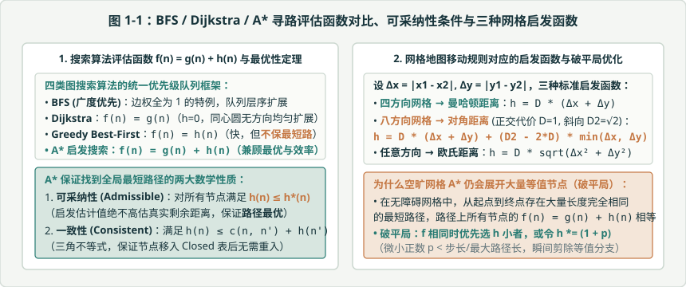
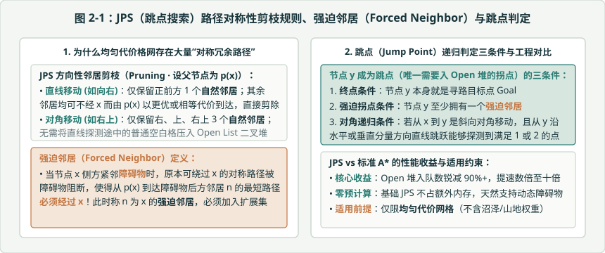
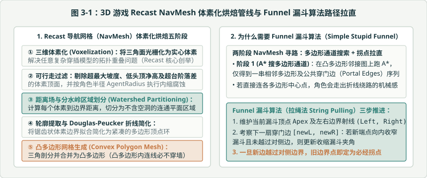
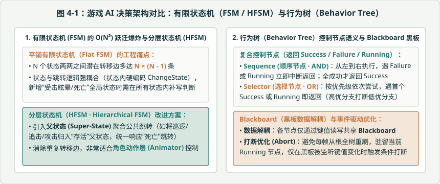

本文围绕游戏开发中的网格寻路、三维导航网格（NavMesh）与 AI 决策系统，分为四个章节：**启发式搜索框架与 A* 算法工程优化**、**JPS（Jump Point Search）跳点搜索对称路径剪枝**、**3D 游戏 Recast NavMesh 体素化构建与 Funnel 漏斗拉直算法**、**游戏 AI 决策架构：分层有限状态机（HFSM）与行为树（Behavior Tree）**。

---

## 第 1 章：启发式搜索框架与 A* 算法工程优化

### 1.1 BFS、Dijkstra、Greedy Best-First 与 A* 的统一框架

在网格或图结构上求解从起点 `S` 到终点 `G` 的路径时，四类主流搜索算法共用同一套**基于优先级队列（Open List）与已访问集合（Closed List）的边界扩展框架**，唯一的区别在于优先级评估函数 `f(n)` 的定义：



| 算法名称 | 评估函数 `f(n)` 定义 | 搜索扩展形态 | 完备性 | 是否保证最短路径 |
| :--- | :--- | :--- | :--- | :--- |
| **广度优先搜索（BFS）** | `f(n) = depth(n)`（无权图特例） | 按步数由近及远逐层均匀扩散 | 是 | 仅在所有边权相等（无权图）时保证最短 |
| **Dijkstra 算法** | `f(n) = g(n)`（起点到 `n` 的真实累积代价） | 以起点为中心按等代价同心圆向四周均匀扩展 | 是 | **保证最短**（要求边权非负），但扩展节点多 |
| **贪心最佳优先（Greedy）** | `f(n) = h(n)`（`n` 到终点的启发式预估代价） | 优先向预估代价最小的方向扩展 | 有限图是 | **不保证最短**，易陷入局部次优 |
| **A* 启发式搜索算法** | **`f(n) = g(n) + h(n)`** | 优先扩展“已付出代价 + 预估剩余代价”最小的方向 | 是 | **当 `h(n)` 满足可采纳性时严格保证最短** |

---

### 1.2 A* 算法最优性的两大数学条件：可采纳性与一致性

设 `h*(n)` 为从节点 `n` 到终点 `G` 的**真实最短剩余路径代价**，启发函数 `h(n)` 的设计决定了 A* 的正确性与效率：

1. **可采纳性（Admissibility，保证路径最优的充要条件）**：
   - 若对图中任意节点 `n`，恒满足 **`0 <= h(n) <= h*(n)`**（即启发函数**不高估**真实剩余代价），则称 `h(n)` 是**可采纳的**。
   - **为什么可采纳性保证首次从 Open 表弹出终点 `G` 时必为最短路**：反证法设首次弹出的终点路径代价 `f(G) = g(G) > 最优代价 C*`，则在当前最优路径边界上必存在某个尚未扩展的节点 `n`，满足 `f(n) = g(n) + h(n) <= g(n) + h*(n) = C* < f(G)`，这与优先级队列每次必先弹出最小 `f` 值节点矛盾。
2. **一致性 / 单调性（Consistency / Monotonicity，保证节点无需重复入队的条件）**：
   - 若对任意相邻节点 `n` 与 `n'`（边权为 `c(n, n')`），恒满足三角不等式 **`h(n) <= c(n, n') + h(n')`** 且 `h(G) = 0`，则称 `h(n)` 满足一致性（满足一致性必满足可采纳性）。
   - **工程意义**：当 `h(n)` 满足一致性时，沿任意路径扩展的 `f(n)` 值**单调非递减**。因此**节点一旦从 Open 表弹出并移入 Closed 表，其 `g(n)` 即为全局最短距离**，后续无需将节点从 Closed 表重新移回 Open 表。

---

### 1.3 网格地图启发函数选择与破平局（Breaking Ties）优化

#### 1. 严格匹配移动规则的三种距离公式
为使 `h(n)` 既不超过真实代价 `h*(n)`（保持可采纳性），又尽可能贴近 `h*(n)`（减少扩展节点数），必须根据网格允许的移动方向选择精确匹配的启发函数（设 `Δx = |n.x - G.x|`，`Δy = |n.y - G.y|`，正交步长为 `D = 1`）：
- **四方向移动（仅上下左右）→ 曼哈顿距离（Manhattan Distance）**：
  $$
  h(n) = D \cdot (\Delta x + \Delta y)
  $$
- **八方向移动（含斜向对角移动，斜向步长 $D_2 = \sqrt{2} \approx 1.414$）→ 对角距离（Octile Distance）**：
  先沿 $45^\circ$ 对角线走 $\min(\Delta x, \Delta y)$ 步，再沿水平或垂直方向走剩余的 $|\Delta x - \Delta y|$ 步：
  $$
  h(n) = D \cdot (\Delta x + \Delta y) + (D_2 - 2D) \cdot \min(\Delta x, \Delta y)
  $$
  （注：若 $D = 1,\; D_2 = 1$，即斜向移动代价也算 1 步，则退化为切比雪夫距离 $h(n) = \max(\Delta x, \Delta y)$。工程中常取整数化放大 10 倍：$D = 10,\; D_2 = 14$ 以避免浮点运算。）
- **任意角度自由移动 → 欧几里得距离（Euclidean Distance）**：
  $$
  h(n) = D \cdot \sqrt{\Delta x^2 + \Delta y^2}
  $$

#### 2. 破平局优化（Breaking Ties）与数据结构提速
- **等值路径平局问题**：在均匀无障碍网格中，两点之间存在大量长度相等的最短路径（例如从 `(0,0)` 到 `(10,10)` 共有 `C(20, 10) = 184,756` 条曼哈顿最短路径）。这些路径上所有节点的 `f(n) = g(n) + h(n)` 完全相同，导致 A* 会展开矩形区域内的全部等值节点。
- **两种破平局方法**：
  1. **二级比较键**：在二叉小顶堆比较器中，当两个节点的 `f(a) == f(b)` 时，**优先选择 `h(n)` 更小（即 `g(n)` 更大、离终点更近）的节点**。
  2. **微小放大系数**：将启发值微调为 `h'(n) = h(n) * (1.0 + p)`（其中 `p < 最小单步代价 / 最大路径总长`，例如 `p = 0.001`），在几乎不影响最短路的前提下打破等值平局，使搜索范围收窄至最短路径附近。
- **Open / Closed 表工程数据结构**：切忌使用 `List.Contains`（`O(N)` 扫描）判断节点是否在 Open/Closed 表中；应使用二叉小顶堆（Binary Heap）维护 Open 表，并在每个网格节点结构体上直接保存整型版本号 `uint searchVersion` 与状态枚举（每次新寻路仅将全局 `currentVersion++`，即可在 **零内存清零（`O(1)`）** 下重置整张地图的 Open/Closed 状态）。

---

## 第 2 章：JPS（Jump Point Search）跳点搜索对称路径剪枝

在八方向均匀代价（Uniform-Cost）大型网格地图中，Harabor 与 Grastien 提出的 **JPS（跳点搜索）** 在保持 100% 找到全局最短路径、且**不占用任何额外预处理内存**的前提下，将 A* 的运行速度提升了 **5 ～ 20 倍**。



### 2.1 路径对称性冗余与方向性邻居剪枝（Pruning Rules）

在空旷的八方向网格中，从 `(0,0)` 移动到 `(2,1)` 可以走“右 → 右上”，也可以走“右上 → 右”，两条路径长度均为 `1 + sqrt(2)`。标准 A* 会将中间所有格子全部压入 Open 二叉堆执行 `O(log N)` 排序。JPS 根据**当前节点 `x` 是从父节点 `p(x)` 沿什么方向走过来的**，制定了严格的邻居裁剪规则：

1. **直线方向进入 `x`（如水平向右 `dx = +1, dy = 0`）**：
   - **自然邻居（Natural Neighbor）**：仅保留正前方 1 个格子 `(x+1, y)`。其余 7 个方向的邻居，要么是父节点本身，要么无需经过 `x` 就能直接从 `p(x)` 以更短或相等的代价到达，因此**在无障碍时全部直接剪除**。
2. **对角线方向进入 `x`（如右上 `dx = +1, dy = +1`）**：
   - **自然邻居**：仅保留水平分量 `(x+1, y)`、垂直分量 `(x, y+1)` 与正对角前方 `(x+1, y+1)` 共 **3 个自然邻居**。

---

### 2.2 强迫邻居（Forced Neighbor）与跳点（Jump Point）递归搜索

- **强迫邻居定义**：当节点 `x` 的侧方紧挨着**不可通行的障碍物格子**时，原本可以从父节点 `p(x)` 绕过 `x` 直达障碍物后方格子 `n` 的路径被障碍物堵死，使得从 `p(x)` 到 `n` 的最短路径**被迫必须经过 `x` 拐弯**。此时，障碍物斜后方的格子 `n` 就被激活成为 `x` 的**强迫邻居**（例如向右移动至 `x`，若正上方 `(x, y+1)` 为障碍物且右上方 `(x+1, y+1)` 空旷，则 `(x+1, y+1)` 即为强迫邻居）。
- **跳点（Jump Point）判定三条件**：
  JPS 从当前节点 `x` 朝自然邻居方向一路直线或对角线向前“跳跃”扫描（途经的普通空白格**完全不入 Open 堆**），直到遇到障碍物边界返回空，或遇到满足以下任一条件的节点 `y`，才将 `y` 作为**跳点**压入 Open 堆：
  1. 节点 `y` 恰好是寻路终点 `Goal`。
  2. 节点 `y` 至少拥有一个**强迫邻居**（说明此处是绕过障碍物拐角的必经决策点）。
  3. 从 `x` 到 `y` 是**对角线移动**，且从 `y` 出发分别沿**水平分量方向**或**垂直分量方向**执行直线跳跃扫描时，能够找到满足条件 1 或条件 2 的跳点（因此对角跳跃每前进一步，必须先向水平和垂直两个子方向发射直线探测射线）。

---

## 第 3 章：3D 游戏 Recast NavMesh 体素化构建与 Funnel 漏斗算法

在真实 3D 游戏场景中，地形包含斜坡、天桥（多层垂直重叠）、楼梯与不规则建筑，二维网格无法直接表达，且网格粒度过细会导致内存爆炸。现代 3D 游戏引擎（Unity、Unreal Engine、Detour/Recast）统一采用**凸多边形导航网格（Convex Polygon Navigation Mesh, NavMesh）**。



### 3.1 Recast 体素化（Voxelization）烘焙五步管线

美术搭建的原始 3D 场景网格常常存在模型互相穿插、裂缝、非流形边等拓扑缺陷，直接在原始三角面上做几何布尔裁剪极易崩溃。开源库 **Recast** 通过将场景网格转化为**三维高度场体素（Voxel Heightfield）**解决上述拓扑缺陷：

1. **三维体素化（Voxelization）**：按指定体素尺寸（Cell Size `cs` 与高度 `ch`）将场景包围盒划分为三维网格，将所有碰撞体三角形光栅化为垂直方向上的**实心体素柱区间（Solid Heightfield Spans）**。
2. **可行走表面过滤与半径腐蚀（Filter & Erode）**：
   - 剔除法线倾角超过角色最大爬坡角 `MaxSlope` 的三角面；
   - 遍历垂直体素柱上方的空闲区间（Open Span），剔除净空高度小于 `AgentHeight` 或相邻高度差超过 `StepHeight` 的表面；
   - 计算可行走体素到最近障碍物边界的距离，将距离小于角色半径 `AgentRadius` 的边缘体素标记为不可通行（**内缩腐蚀**，使运行时可将角色视为质点进行寻路）。
3. **距离场与分水岭区域分割（Watershed Partitioning）**：基于距离场按梯度将连通的可行走体素切分为互不重叠、不含内部空洞的平面区域（Regions）。
4. **轮廓提取与道格拉斯-普克简化（Contour Simplification）**：提取每个体素区域的闭合边界，并使用 **Douglas-Peucker 算法**在误差阈值 `MaxError` 内将折线简化为关键顶点。
5. **凸多边形网格生成（Convex Polygon Mesh）**：对简化后的多边形轮廓执行三角剖分，再将相邻三角形合并为**凸多边形（Convex Polygons）**，记录顶点与邻接边关系。
   - **采用凸多边形的原因**：**凸多边形内部任意两点间的连线完全位于多边形内部**，不会穿过边界。确定多边形序列后，角色在单个多边形内可沿直线移动而无需额外避障。

---

### 3.2 Funnel 漏斗算法（Simple Stupid Funnel Algorithm 路径拉直）

在 NavMesh 上寻路分为两个阶段：
- **第一阶段（A* 搜多边形通道 Corridor）**：将每个凸多边形视为图顶点，运行 A* 找出一串从起点多边形通往终点多边形的相邻多边形序列，以及相邻多边形之间共享的**公共穿门边序列（Portal Edges，`[Left_i, Right_i]`）**。
- **第二阶段（Funnel 漏斗算法 / String Pulling）**：若直接连接各穿门边中点，路径会产生多余折线。**Funnel 算法**可在 `O(N)` 时间内从穿门边序列中计算出**最短欧氏折线拐点序列**：

```text
初始化：漏斗顶点 Apex = 起点 Start，左边界射线 Left = Portal[0].left，右边界射线 Right = Portal[0].right
遍历第 i = 1 .. K 扇门 [newLeft, newRight]：
  1. 尝试用 newRight 收窄右边界（通过二维叉积判断方向）：
     • 若向量 (newRight - Apex) 位于当前 Right 射线的内侧（左侧）：
       - 若同时越过了当前 Left 射线的外侧（右边界越过左边界）：
         a. 将当前左边界点 Left 记录为路径拐点，并令新漏斗顶点 Apex = Left；
         b. 将扫描下标 i 重置为新 Apex 所在穿门边的下一项，重新初始化漏斗继续扫描；
       - 否则（正常收窄）：更新右边界 Right = newRight。
  2. 对称地用 newLeft 尝试收窄左边界（若向内则更新 Left = newLeft；若越过 Right 则将 Right 记录为新拐点 Apex）。
```

---

## 第 4 章：游戏 AI 决策架构：分层有限状态机（HFSM）与行为树（BT）

### 4.1 平铺状态机（FSM）的跃迁爆炸与分层状态机（HFSM）

有限状态机（Finite State Machine, FSM）将 AI 行为建模为有限个互斥状态（`Idle`、`Patrol`、`Chase`、`Attack`、`Dead`），在任意时刻仅处于唯一活跃状态，包含 `OnEnter`、`OnUpdate`、`OnExit` 三个生命周期回调。



- **平铺 FSM 的局限性**：
  1. **`O(N^2)` 状态转移复杂度**：当状态数为 `N` 时，状态间的潜在跳转关系可达 `N(N - 1)` 条，状态增多后难以维护。
  2. **跨状态逻辑耦合与复用困难**：由于跳转判断通常写在具体状态的 `OnUpdate` 内部（如在 `Patrol` 中硬编码 `if (hp <= 0) ChangeState(Dead)`），一旦新增“冰冻控制”或“死亡”等高优先级全局状态，必须在所有已有状态中逐一补写跳转代码。
- **分层有限状态机（HFSM）**：
  将具有共同转移条件的子状态归纳进同一个**父状态（Super-State，本质本身也是一个小型状态机）**。例如将 `Idle / Patrol / Chase / Attack` 全部作为 `Alive（存活）` 父状态的子状态；当角色受到致命伤害时，直接由外层 `Alive` 父状态统一捕获并跳转至 `Dead` 状态，无需在任何子状态中重复编写死亡判定。

---

### 4.2 行为树（Behavior Tree）核心节点语义与 Blackboard 黑板架构

针对复杂 Boss 战、开放世界 NPC 等需要高度模块化拼装与优先级打断的场景，**行为树（Behavior Tree, BT）**将决策逻辑拆解为一棵有向树。所有节点执行 `Tick()` 后统一向父节点返回三种状态之一：**`Success`（成功）**、**`Failure`（失败）**、**`Running`（执行中，下一帧继续）**。

| 节点大类 | 典型子类名称 | 执行语义与返回值规则 |
| :--- | :--- | :--- |
| **复合控制节点（Composite）** | **顺序节点（`Sequence`，逻辑与 AND）** | 从左到右依次 Tick 子节点：若子节点返回 `Success` 则继续下一个；一旦某个子节点返回 `Failure` 或 `Running`，立即中断并返回该状态；仅当全部子节点均返回 `Success` 时才返回 `Success`。 |
| **复合控制节点（Composite）** | **选择节点（`Selector / Fallback`，逻辑或 OR）** | 按从左到右的优先级依次尝试子节点：若子节点返回 `Failure` 则继续尝试下一个备选分支；一旦某个子节点返回 `Success` 或 `Running`，立即停止并返回该状态。 |
| **复合控制节点（Composite）** | **并行节点（`Parallel`）** | 同时 Tick 所有子节点（如“边移动边开火”），根据预设策略（全部成功或任一成功）决定返回值。 |
| **装饰节点（Decorator）** | `Inverter`（取反）、`Repeater`（循环）、`Cooldown`（冷却） | 仅挂载单个子节点，用于修改子节点的返回值或限制子节点的进入频率。 |
| **叶节点（Leaf）** | **条件节点（`Condition`）** 与 **动作节点（`Action`）** | 叶节点无子节点：条件节点仅做只读判断立即返回 `Success/Failure`（绝不返回 `Running`）；动作节点执行具体移动、播放技能并返回 `Running/Success/Failure`。 |

- **Blackboard（黑板数据共享中心）与事件驱动打断（Observer Aborts）**：
  1. **为什么需要 Blackboard**：为保证每个 Action/Condition 节点可以跨不同怪物自由拖拽复用，行为树节点内部**严禁直接互相引用**，而是全部通过读写一张键值字典——**黑板（Blackboard，存储 `TargetEntity`、`AlertLevel`、`LastKnownPos` 等共享变量）**进行通信。
  2. **事件驱动打断（避免每帧全树遍历）**：朴素行为树每帧从根节点重新向下 Tick 会造成大量无意义的 Condition 轮询。现代行为树（如 Unreal Engine BT）在节点返回 `Running` 时直接缓存当前活跃执行节点指针，下一帧直接从该 `Running` 节点继续执行；同时在父级 `Selector` 的条件装饰器上注册 **Blackboard 键值变化监听（Observer Abort：`Self / LowerPriority / Both`）**，仅当黑板上的关键数据（如“感知到玩家进入警戒圈”）发生变动时，才触发事件中断低优先级的巡逻分支并切入高优先级的追击分支。
