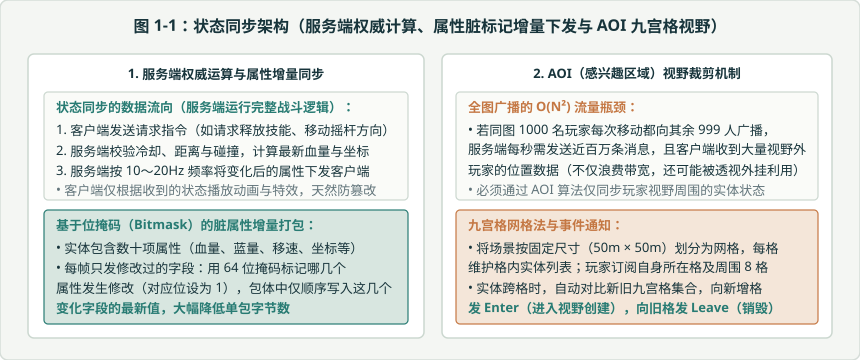
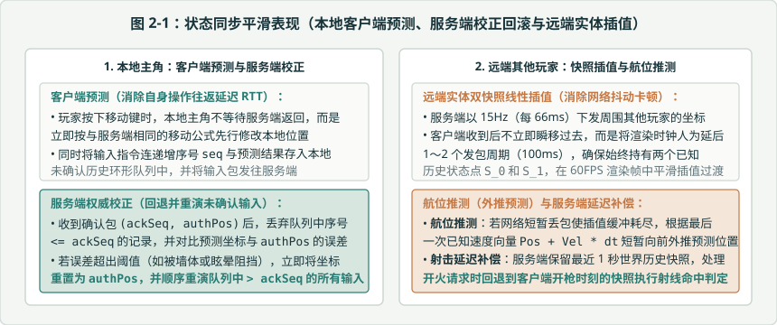
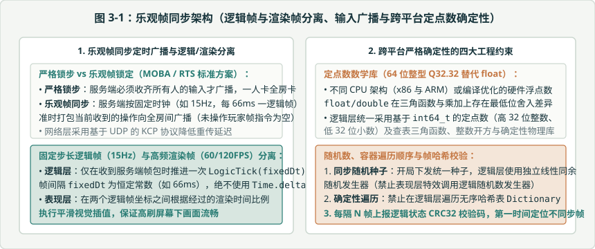
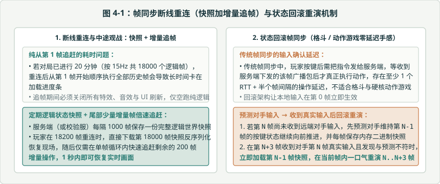

本文梳理多人实时联网游戏的两种核心同步架构，共分为四个章节：**状态同步架构（服务端权威计算、脏标记增量同步与 `AOI` 视野裁剪）**、**状态同步下的客户端平滑表现（本地预测、服务端校正回滚与远端插值）**、**乐观帧同步架构（逻辑帧与渲染帧分离、输入广播与跨平台定点数确定性）**、**帧同步断线重连（快照加增量追帧）、状态回滚重演与品类选型对比**。

---

## 第 1 章：状态同步架构、属性增量下发与 `AOI` 视野裁剪

状态同步与帧同步最核心的区别在于**核心战斗逻辑在何处执行**：
- **状态同步**：战斗碰撞、技能伤害、位移结算等核心逻辑**全部在服务端权威执行**，服务端定期将计算后的实体状态（坐标、血量、Buff）下发给客户端，客户端仅作为服务端数据的表现层。
- **帧同步**：服务端**不执行具体战斗逻辑，只按固定频率收集并转发所有玩家的操作指令**；各客户端收到相同的指令序列后，在本地独立推进完全相同的战斗逻辑。



### 1.1 服务端权威运算与位掩码增量同步

在状态同步架构下，为了防止客户端篡改内存数值（如修改移速、锁血或秒杀外挂），客户端绝不能直接上报“我移动到了坐标 $(X, Y)$”或“我对怪物造成了 $9999$ 点伤害”，而只能上报操作意图（如“我正在按住向右方向键”或“我请求释放 1 号技能”）：
1. **服务端合法性校验与结算**：
   服务端收到请求后，先检查该角色当前是否处于眩晕/沉默状态、技能冷却是否转完、法力值与施法距离是否足够；校验通过后在服务端世界内执行碰撞检测并扣除目标血量。
2. **基于位掩码的脏属性增量打包**：
   一个角色往往包含数十项属性（血量、最大血量、攻击力、护甲、移速、等级等）。如果每次同步都把所有字段全量发给客户端，带宽开销极大。工程中采用**脏标记位掩码**执行增量下发：
   - 为每个属性分配一个固定的位序号（如第 0 位代表当前血量 `HP`，第 1 位代表当前法力值 `MP`，第 2 位代表移动速度 `Speed`）；
   - 当本帧只有 `HP`（第 0 位）和 `Speed`（第 2 位）被修改时，将脏标记掩码置为 `0b00000101`（即十进制 `5`），数据包中只写入掩码值 `5` 以及 `HP` 和 `Speed` 两个字段的最新数值；
   - 客户端解析数据包时，先读取掩码，按从低位到高位的顺序检查哪几位为 `1`，再依次读取对应字段更新本地数据。

---

### 1.2 `AOI`（感兴趣区域）九宫格视野管理

在同服千人同图的大型多人在线游戏（MMO）或大逃杀大地图中，如果每个玩家每次移动都向全地图其余 999 名玩家广播，服务端每秒需要发送的消息数量将达到 $O(N^2)$ 级别（百万条/秒），且客户端收到的屏幕外远端玩家坐标还会被全图透视外挂直接读取。

为此，服务端必须引入 **`AOI`（感兴趣区域）视野裁剪机制**，最经典且高效的工程实现是**九宫格网格法**：
1. **二维网格划分**：
   根据客户端屏幕视野半径（例如玩家可见范围为周围 40 米），将整张大地图按固定边长（如 $50\text{m} \times 50\text{m}$）切分为均匀的二维网格，每个格子内部维护一个当前处于该格子内的实体链表。
2. **订阅九宫格与跨格差集通知**：
   每个玩家只需要订阅**自己所在中心格以及周围相邻 8 个格子（共 9 个格子）**内的实体状态：
   - **格内移动**：当玩家在同一个格子内部移动时，直接向当前九宫格内的所有观察者广播位置更新包；
   - **跨越格子边界**：当玩家从旧格子 $G_{\text{old}}$ 跨入新格子 $G_{\text{new}}$ 时，计算旧九宫格集合 $S_{\text{old}}$ 与新九宫格集合 $S_{\text{new}}$ 的差集：
     - 对属于 $S_{\text{old}} - S_{\text{new}}$（离开视野的 3 个旧格子）内的玩家，发送 **离开视野消息（`Leave`）**，通知客户端销毁或回收到对象池；
     - 对属于 $S_{\text{new}} - S_{\text{old}}$（新进入视野的 3 个新格子）内的玩家，互相发送 **进入视野消息（`Enter`，携带完整初始外观与属性）**，通知客户端创建角色模型。

---

## 第 2 章：状态同步下的平滑表现：客户端预测、服务端校正与远端插值

在状态同步中，如果客户端按下移动键后完全原地不动，干等指令发往服务端、服务端算完再发回客户端（耗时至少 1 个网络往返时延 `RTT`，通常 50～150ms）才开始移动角色，玩家会感到明显的操作粘滞。此外，服务端下发状态包的频率通常只有 10～20Hz（每 50～100ms 一包），而客户端画面渲染频率是 60～120FPS，直接使用原始包坐标会让画面一卡一顿。

为此，现代状态同步游戏对**本地玩家自己控制的主角**与**周围其他远端玩家**分别采用两套不同的平滑算法：



### 2.1 本地主角：客户端预测与服务端校正

1. **客户端先行预测**：
   当玩家在第 $k$ 帧按下移动键时，客户端除了将输入指令包 `(seq = k, input)` 发送给服务端外，**本地主角立即在当帧使用与服务端完全相同的移动与地形碰撞代码计算出预测新坐标 $\hat{P}_k$ 并渲染画面**，实现零延迟的操作响应。同时，客户端将 `(seq = k, input, 预测坐标)` 追加保存在本地的**未确认输入历史队列**中。
2. **服务端权威校正（回退并重演未确认输入）**：
   经过一个 `RTT` 后，客户端收到了服务端处理完第 $k$ 号输入后返回的权威状态包 `(ackSeq = k, authPos = P_k)`（此时客户端本地其实已经继续往前预测走到了第 $k+5$ 帧）：
   - 客户端首先从历史队列中移除序号 $< k$ 的过期记录，并取出第 $k$ 帧当年记录的预测坐标 $\hat{P}_k$ 与服务端返回的权威坐标 $P_k$ 进行比对；
   - **若误差极小**（$|\hat{P}_k - P_k| < \epsilon$）：说明此前的预测完全准确，直接移除第 $k$ 号记录，当前第 $k+5$ 帧的画面无需任何改动；
   - **若误差超过阈值**（例如期间服务端判定角色踩到了刚生成的减速陷阱或被其他玩家击退）：客户端立即将主角逻辑坐标**重置回服务端第 $k$ 帧的权威坐标 $P_k$**，然后在当前这一帧内遍历历史队列中剩余尚未被服务端确认的第 $k+1, k+2, \dots, k+5$ 号输入，**一口气重新顺序执行这 5 步移动逻辑**，得出修正后的最新当前坐标（再配合表现层在 3～5 个渲染帧内平滑过渡过去，避免画面生硬瞬移）。

```csharp
using System.Collections.Generic;
using UnityEngine;

public struct MoveCommand
{
    public uint Sequence;
    public Vector2 MoveDir;
    public float DeltaTime;
    public Vector3 PredictedPos;
}

public class ClientPredictionController
{
    private readonly Queue<MoveCommand> m_pendingCommands = new Queue<MoveCommand>();
    private uint m_nextSeq = 1;
    public Vector3 CurrentLogicPos;
    public float MoveSpeed = 5f;

    // 1. 本地每帧采集输入：立即预测移动并记录到未确认队列
    public MoveCommand SampleAndPredict(Vector2 dir, float dt)
    {
        CurrentLogicPos += new Vector3(dir.x, 0f, dir.y) * (MoveSpeed * dt);
        var cmd = new MoveCommand
        {
            Sequence = m_nextSeq++,
            MoveDir = dir,
            DeltaTime = dt,
            PredictedPos = CurrentLogicPos
        };
        m_pendingCommands.Enqueue(cmd);
        return cmd; // 发送给服务端
    }

    // 2. 收到服务端权威确认包时：比对历史预测，超差则回退并重演后续未确认输入
    public void OnReceiveServerAuthState(uint ackSeq, Vector3 serverAuthPos)
    {
        while (m_pendingCommands.Count > 0 && m_pendingCommands.Peek().Sequence < ackSeq)
        {
            m_pendingCommands.Dequeue();
        }

        if (m_pendingCommands.Count > 0 && m_pendingCommands.Peek().Sequence == ackSeq)
        {
            MoveCommand ackedCmd = m_pendingCommands.Dequeue();
            float error = Vector3.Distance(ackedCmd.PredictedPos, serverAuthPos);

            // 若预测位置与服务端权威位置偏差超过 0.05 米，执行回退重演
            if (error > 0.05f)
            {
                CurrentLogicPos = serverAuthPos;
                foreach (MoveCommand unacked in m_pendingCommands)
                {
                    CurrentLogicPos += new Vector3(unacked.MoveDir.x, 0f, unacked.MoveDir.y)
                                       * (MoveSpeed * unacked.DeltaTime);
                }
            }
        }
    }
}
```

---

### 2.2 远端其他玩家：快照缓冲区插值与延迟补偿

对于屏幕上看到的其他玩家，本地客户端并不知道他们下一刻会按什么键，因此主要采用**快照线性插值**，辅以少量的**航位推测（外推法）**：
1. **人为延后渲染时钟的双快照内插**：
   假设服务端每 $66\text{ms}$（15Hz）下发一次其他玩家的位置快照。客户端收到最新快照 $S_n$（时间戳 $T_n$）时，**不直接把远端角色瞬移到 $S_n$**，而是将远端实体的渲染时钟人为设定在最新包时间戳往后推迟约 1～2 个发包周期（如 $T_{\text{render}} = T_{\text{now}} - 100\text{ms}$）。
   这样客户端缓存队列中始终保有处于 $T_{\text{render}}$ 前后的两个真实服务端状态点 $S_{n-1}$ 与 $S_n$，在 60FPS 的每个渲染帧中按比例因子 $\alpha = \frac{T_{\text{render}} - T_{n-1}}{T_n - T_{n-1}} \in [0, 1]$ 对坐标与朝向做平滑线性插值：
   $$P(T_{\text{render}}) = (1 - \alpha)\,P_{n-1} + \alpha\,P_n$$
2. **航位推测与射击游戏服务端延迟补偿**：
   - **航位推测**：当网络突发抖动丢包、超出 100ms 缓冲仍未收到新快照时，根据最后已知的速度向量与加速度短暂向前外推坐标：$P(t) = P_n + V_n \Delta t$。
   - **服务端历史回退命中判定（延迟补偿）**：由于本地看到的远端玩家画面其实是 $100\text{ms}$ 前的插值历史位置，而在 FPS 射击游戏中玩家会直接瞄准屏幕上看到的人开枪。为了让玩家“指哪打哪”，服务端会在内存中循环保存过去 1 秒内每一帧所有玩家的包围盒快照；当收到某玩家附带客户端渲染时间戳 $T_{\text{shot}}$ 的开火请求时，**服务端先将全场受击框临时拨回到 $T_{\text{shot}}$ 时刻的历史位置执行射线检测**，判定是否命中后再恢复当前世界状态。

---

## 第 3 章：乐观帧同步架构与跨平台定点数确定性

### 3.1 乐观帧锁定流程与逻辑/渲染分离

早期的 RTS 局域网游戏采用**严格锁步帧同步**：服务端在每一帧必须收齐房间内所有客户端发来的操作包后才推进下一帧，只要有一名玩家网络卡顿，全房间所有人的画面都会跟着定格等待。

现代 MOBA（如《王者荣耀》）、RTS 与合作动作游戏统一采用**乐观帧同步**：



1. **服务端定时脉冲广播**：
   服务端按照固定时钟频率（通常为 **15Hz 或 20Hz**，即每 $66\text{ms}$ 或 $50\text{ms}$ 一个逻辑帧）准时推进帧号。每当定时器触发时，服务端将当前周期内收集到的各玩家输入打包为一个帧广播包（若某玩家在该周期内没有发来任何操作或网络丢包，则其在该帧的操作列表为空），立即通过 `KCP` / `UDP` 广播给房间内所有客户端。
2. **客户端逻辑帧与渲染帧彻底解耦**：
   - **逻辑层（固定步长 `FixedDeltaTime`）**：客户端仅在收到服务端下发的第 $F$ 号帧包时，才调用一次战斗逻辑更新函数 `LogicTick(frameInputs)`。逻辑层内部所有速度、冷却、位移计算使用的帧间隔**必须是写死的编译期常数（如 $\Delta t = 66\text{ms}$）**，严禁访问与机器帧率相关的 `Time.deltaTime`。
   - **表现层（高频渲染插值）**：虽然逻辑帧每秒只跳动 15 次，但渲染层在 60FPS / 120FPS 的 `Update()` 中，根据当前距离上一次逻辑帧经过的真实时间比例，在每个实体的“上一逻辑帧坐标”与“当前逻辑帧坐标”之间做平滑视觉插值，从而在保持极低网络流量的同时提供高帧率视觉体验。

---

### 3.2 跨平台严格确定性的四项工程约束

帧同步成立的前提是：**给定完全相同的初始状态与相同的每一帧输入序列，无论在 iOS（ARM64 芯片）、Android（不同厂商 ARM 芯片）还是 PC（Intel / AMD x86 芯片）上运行，第 10000 帧算出的所有单位坐标与血量必须连最后一位比特都完全一致**。稍有百万分之一的偏差，经过几百帧的寻路、暴击与碰撞放大后，就会演变成“在玩家 A 手机上英雄已经逃回塔下，而在玩家 B 手机上英雄已被击杀”的**各端逻辑状态不一致（不同步）**。

为保证跨平台严格确定性，帧同步逻辑层必须遵守以下四条硬性规则：

#### 1. 严禁使用原生 `float / double`，全面改用定点数数学库
不同 CPU 架构的硬件浮点单元（FPU）、不同的编译器优化选项（如是否合并乘加指令 `FMA`）以及不同平台的数学库函数（`Mathf.Sin`、`Cos`、`Sqrt`）在最低有效位上存在微小的舍入差异。
因此，帧同步逻辑层**严禁出现任何 `float` 或 `double` 运算**，必须全部基于 64 位有符号整型 `long`（`int64_t`）实现 **Q32.32 定点数结构体**（高 32 位表示有符号整数部分，低 32 位表示小数部分，缩放因子为 $2^{32}$ 或 $10000$），且三角函数统一使用预生成的整型查表法配合线性插值：

```csharp
using System;

// 基于 64 位长整型的 Q48.16 定点数极简示例（低 16 位表示小数，精度 1 / 65536）
public readonly struct Fixed64 : IComparable<Fixed64>, IEquatable<Fixed64>
{
    public const int SHIFT = 16;
    public const long ONE = 1L << SHIFT; // 65536 代表数值 1.0

    public readonly long RawValue;

    public Fixed64(long rawValue) => RawValue = rawValue;
    public static Fixed64 FromInt(int val) => new Fixed64((long)val << SHIFT);

    // 加减法直接对底层长整型加减（跨平台 100% 确定一致）
    public static Fixed64 operator +(Fixed64 a, Fixed64 b) => new Fixed64(a.RawValue + b.RawValue);
    public static Fixed64 operator -(Fixed64 a, Fixed64 b) => new Fixed64(a.RawValue - b.RawValue);

    // 乘法：两个放大了 2^16 的数相乘后放大了 2^32，需右移 16 位还原比例
    public static Fixed64 operator *(Fixed64 a, Fixed64 b) =>
        new Fixed64((a.RawValue * b.RawValue) >> SHIFT);

    // 除法：被除数先左移 16 位再执行整数除法，避免精度丢失
    public static Fixed64 operator /(Fixed64 a, Fixed64 b) =>
        new Fixed64((a.RawValue << SHIFT) / b.RawValue);

    public int CompareTo(Fixed64 other) => RawValue.CompareTo(other.RawValue);
    public bool Equals(Fixed64 other) => RawValue == other.RawValue;
}
```

#### 2. 独立确定性伪随机数发生器
不能使用系统自带的 `UnityEngine.Random`（因为表现层的暴击飘字、粒子特效或不同画质设置下的音效如果也调用了全局 `Random`，就会改变随机数调用次数，导致后续战斗暴击判定错位）。
正确做法是：对局开始时由服务端下发一个统一的 32 位随机种子 `Seed`，逻辑层单独实例化一个纯整数运算的**线性同余随机发生器（LCG）**：
$$X_{n+1} = (1103515245 \cdot X_n + 12345) \bmod 2^{31}$$
且规定只有战斗逻辑层允许调用该实例。

#### 3. 容器遍历顺序与排序算法确定性
- **禁止在逻辑层遍历无序哈希容器**：不同平台或不同内存地址下，无序哈希集（如 C++ `std::unordered_map` 或依赖对象哈希码的字典）的遍历顺序可能不一致；若遍历过程中包含范围伤害结算或弹射目标选择，就会引发不同步。逻辑层应使用按固定实体 ID 排序的数组或有序树。
- **使用稳定排序**：当对距离相同的多个目标排序时，不稳定的快速排序可能因分区交换顺序不同产生不同结果，比较函数中当主属性相等时必须追加比较唯一的 `EntityID` 作为兜底平局决胜条件。

#### 4. 物理碰撞与帧状态哈希校验
不能使用 Unity 自带的 PhysX 3D 物理引擎（PhysX 内部使用浮点数且受多线程调度影响，不具备跨平台严格确定性），必须使用基于定点数的确定性碰撞检测库。同时，客户端每推进 30 个逻辑帧，就将全场所有实体的定点数坐标与血量计算出一个 `CRC32` 哈希值上报给服务端；服务端一旦发现某个客户端上报的哈希值与其他人不一致，立即保存该局历史指令流并定位首次发生分叉的具体帧号。

---

## 第 4 章：断线重连追帧、状态回滚与同步方案选型

### 4.1 断线重连（快照 + 增量追帧）与状态回滚机制



1. **断线重连与中途观战加速（逻辑快照 + 尾部增量追帧）**：
   在状态同步中，断线重连只需服务端把当前时刻最新的全量属性下发给客户端即可。而在帧同步中，由于服务端默认只保存开局以来的历史操作帧序列，如果对局已经进行了 15 分钟（累计上万个逻辑帧），重连客户端从第 1 帧开始顺序重算全部历史帧会耗时数秒至十余秒。
   **工程优化方案**：
   - **纯逻辑倍速追帧**：在追帧循环中，完全关闭渲染层更新、动画状态机、粒子特效与音效播放，单帧循环内连续调用数百次纯数据 `LogicTick()`；
   - **定期状态快照 + 尾部增量追帧**：由服务端后台校验进程（或主客户端）每隔 1000 帧将当前逻辑层全部二进制数据序列化保存为一份快照。当玩家在第 12300 帧断线重连时，直接下载最近的第 12000 帧快照反序列化恢复现场，然后只需快速追赶最后 300 帧增量指令，即可在 1 秒内无缝回到实时对局。

2. **状态回滚帧同步（GGPO，格斗与硬核动作游戏方案）**：
   普通乐观帧同步中，玩家按下攻击键后需要先把指令发给服务端，等收到服务端广播的该帧数据包后才执行动作，存在至少 $1 \times \text{RTT}$ 的按键延迟。在讲究立回与帧数博弈的格斗游戏中，为了实现本地按键零延迟响应，广泛采用**状态回滚帧同步**：
   - 本地玩家按键在当前第 $N$ 帧立即执行；
   - 如果此时尚未收到远端对手在第 $N$ 帧的输入，客户端先**预测远端对手在第 $N$ 帧继续维持第 $N-1$ 帧的按键状态**，继续正常推进第 $N, N+1, N+2$ 帧的战斗逻辑，并在每一帧都将完整的游戏逻辑内存保存为一份轻量快照；
   - 当第 $N+3$ 帧终于收到了对手在第 $N$ 帧的真实输入时，若真实输入与当初的预测完全一致（绝大多数帧玩家按键状态不变），则无事发生；若发现对手其实在第 $N$ 帧按下了防御或闪避（预测失误），客户端**立即将逻辑状态回滚加载到第 $N-1$ 帧的内存快照**，填入对手第 $N$ 帧的真实输入，在当前渲染帧结束前**一口气在后台高速重演第 $N \to N+3$ 帧的4次逻辑迭代**，直接将修正后的第 $N+3$ 帧最新画面呈现给玩家。

---

### 4.2 帧同步与状态同步工程对比与选型指南

| 评估维度 | 乐观帧同步 | 状态同步 |
| :--- | :--- | :--- |
| **战斗逻辑运行位置** | 客户端（服务端仅定时收集转发操作指令，可配异步校验服） | 服务端权威计算（客户端仅发送意图并渲染表现） |
| **单局网络带宽消耗** | **极低且恒定**：仅传输按键指令，与同屏单位数量无关（哪怕同屏 500 个小兵也只需传玩家摇杆指令）。 | **随同屏单位数增长**：同屏单位越多，需要下发的坐标与属性包越大。 |
| **反外挂与防作弊能力** | **较弱**：客户端内存拥有全图全部逻辑数据，无法从根本上防御全图透视挂；数值修改需靠赛后重演校验处罚。 | **强**：服务端不给客户端下发视野外（`AOI` 之外）的敌人数据，且所有伤害与位移均由服务端裁决。 |
| **跨平台开发限制** | **严苛**：逻辑层必须全量使用定点数、确定性物理与确定性容器，后期的不同步问题排查成本高。 | **宽松**：允许客户端存在微小浮点误差，定时由服务端权威坐标覆盖修正即可。 |
| **录像回放与断线重连** | **录像文件极小**（几十 KB 即可记录整局操作）；但断线重连需依赖快照加追帧。 | **断线重连极简**（直接下发当前最新状态即可）；但录像文件需记录状态流，体积较大。 |
| **典型适用游戏品类** | **MOBA（王者荣耀）、RTS（星际争霸）、格斗游戏、同屏海量单位割草联机** | **MMORPG（魔兽世界）、大逃杀百人竞技、FPS 射击（配合客户端预测）、休闲社交游戏** |
