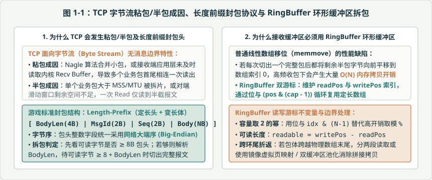
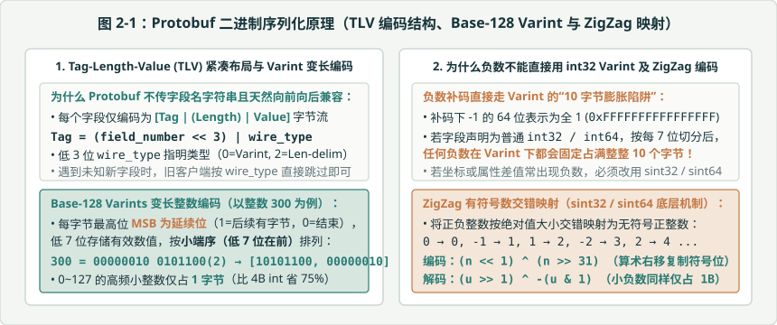
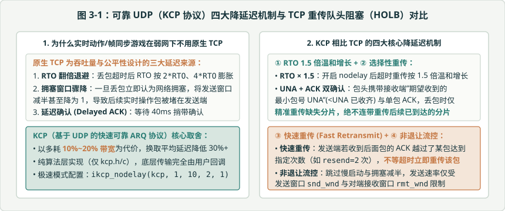
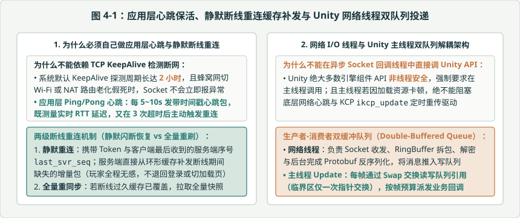

本文聚焦游戏客户端网络层的工程实现，分为四个章节：**TCP 粘包/半包处理与 RingBuffer 环形接收缓冲区**、**Protobuf 序列化底层原理（TLV、Varint 与 ZigZag 编码）**、**可靠 UDP（KCP 协议）降延迟机制**、**应用层心跳保活、断线重连状态机与双队列跨线程解耦**。

---

## 第 1 章：TCP 粘包/半包与 RingBuffer 环形缓冲区设计

### 1.1 TCP 粘包与半包的成因

UDP 是**面向报文（Message-Oriented）**的协议，操作系统内核每次 `recvfrom` 必然交付一个完整的应用层 UDP 数据报，保留天然消息边界；而 TCP 是**面向字节流（Byte-Stream）**的协议，内核套接字缓冲区只维护一段无结构的连续字节流，完全不存在“消息包边界”的概念。



- **粘包（Sticky Packets，一次 `Read` 读出多个业务包）成因**：
  1. **发送端 Nagle 算法合并**：当客户端短时间内连续调用多次 `Send` 发送几字节的小包（如移动摇杆指令）时，若未开启 `TCP_NODELAY`，TCP 协议栈会将多个小包合并为一个 TCP 报文段发往网络（**游戏客户端创建 TCP Socket 后必须第一时间设置 `socket.NoDelay = true` 禁用 Nagle 算法**）。
  2. **接收端读取不及时**：当游戏主线程因加载场景或 GC 卡顿未能及时消费接收缓冲区时，网卡先后到达的多个 TCP 段在内核 `Recv Buffer` 中首尾相接排成一列，下次调用 `Receive` 时被一次性全部读出。
- **半包（Half Packets，一个完整业务包被拆成多次 `Read` 才收齐）成因**：
  1. **超出 MSS / MTU 分片**：当应用层下发的大型协议包（如全量背包数据 `8KB`）超过 TCP 最大报文段长度（`MSS ≈ 1460B`）时，传输层必然将其拆分为多个 TCP 段独立传输，到达时间存在先后差。
  2. **对端滑动窗口不足**：当接收方通告窗口 `rwnd` 仅剩 `200B` 时，发送方只能先切出前 `200B` 发送，剩余字节等待下一轮窗口更新。

---

### 1.2 长度前缀封包协议（Length-Prefix Framing）

为在无边界的字节流上切分出完整消息，游戏工程统一采用**定长包头 + 变长包体（Length-Prefix）**封包协议：

```text
+-------------------+-------------------+-------------------+------------------------+
|   BodyLength (4B) |     MsgId (2B)    |      Seq (2B)     |   Payload (BodyLength) |
+-------------------+-------------------+-------------------+------------------------+
|<----------------- 8 字节固定包头 (Big-Endian) ------------>|<----- 变长序列化包体 --->|
```

- **各字段职责**：
  - `BodyLength（4 字节无符号整数）`：标识紧随其后的 `Payload` 字节长度（必做上限校验，如单包超过 `1MB` 直接判定为非法连接或协议错位并断开）。
  - `MsgId（2 字节无符号整数）`：消息协议号，用于查表路由到对应的 Protobuf 解码器与业务回调（`Action<IMessage>`）。
  - `Seq（2 字节单调递增序号）`：防重放攻击，并用于断线重连时的已收包序号对齐。
- **状态机拆包流程（循环消费直至不足一包）**：
  1. 检查缓冲区当前可读字节数 `ReadableBytes` 是否 `>= 8`（包头长度）；若不足 `8` 字节，说明连包头都处于半包状态，直接跳出循环等待下次网卡数据到达。
  2. 使用 **Peek（只读不移动读游标）** 读取前 4 字节解析出 `BodyLength`。
  3. 检查 `ReadableBytes` 是否 `>= 8 + BodyLength`；若小于，说明包体尚未收齐（半包），保持读游标不动并跳出循环（因此前面第 2 步必须用 `Peek` 而不能直接前进读游标）。
  4. 若大于等于 `8 + BodyLength`，则切出完整的一包交付反序列化，将读游标推进 `8 + BodyLength`，并**继续 `while` 循环**处理缓冲区内可能紧跟的下一个粘包。

---

### 1.3 RingBuffer（环形缓冲区）的零移位设计

若使用普通线性字节数组 `byte[]` 作为接收缓冲区，每次切走前面的完整包后，如果缓冲区尾部还留有半截未收齐的报文，就必须调用 `Array.Copy` / `memmove` 将尾部剩余字节搬移到数组头部 `index = 0` 处。在高频收包场景下，这种 `O(N)` 内存拷贝会造成严重的 CPU 带宽浪费。

- **RingBuffer 零移位原理**：
  分配一块容量固定为 **2 的整数次幂（如 `N = 65536 = 2^16`）** 的字节数组，维护两个单调递增的无符号游标：写游标 `writePos` 与读游标 `readPos`：
  ```text
  可读字节数：ReadableBytes = writePos - readPos
  可写空闲数：WritableBytes = N - (writePos - readPos)
  物理数组下标映射：physIndex = pos & (N - 1)   （利用 2^k - 1 位掩码替代昂贵的 % 取模运算）
  ```
- **配合 `ArrayPool<byte>` 与 `Span<byte>` 实现零 GC 拆包**：在 C# / Unity 客户端中，从 `ArrayPool<byte>.Shared` 租借底层缓冲区，拆包时通过 `ReadOnlySpan<byte>` 或 `ReadOnlySequence<byte>` 直接切片传入 Protobuf `ParseFrom(ReadOnlySpan<byte>)`，全程避免每次收包 `new byte[bodyLen]` 引发的托管堆内存分配与 GC 抖动。

---

## 第 2 章：Protobuf 二进制序列化原理（TLV、Varint 与 ZigZag）

相比 JSON / XML 等文本协议，Google **Protocol Buffers（Protobuf）** 在游戏网络通信中能够将报文体积压缩至文本协议的 `1/5 ~ 1/10`，且序列化/反序列化速度提升一个数量级，其核心源于三项底层编码设计。



### 2.1 TLV（Tag-Length-Value）无字段名紧凑结构

JSON 在每个数据包中都重复携带冗长的字段名字符串（如 `"player_hp": 100` 仅键名就占了 11 字节）。Protobuf 在 `.proto` IDL 文件中为每个字段分配唯一的正整数编号 `field_number`，序列化后的二进制流由一串紧凑的 **`[Tag | (Length) | Value]`** 组成：

$$
\text{Tag} = (\text{field\_number} \ll 3) \mid \text{wire\_type}
$$

| `wire_type` 值 | 编码方式名称 | 是否含 `Length` 字段 | 适用 `.proto` 数据类型 |
| :--- | :--- | :--- | :--- |
| **`0`** | `Varint`（变长整数） | 否（由 MSB=0 自动定界） | `int32, int64, uint32, uint64, sint32, sint64, bool, enum` |
| **`1`** | `64-bit`（定长 8 字节） | 否（固定读 8 字节） | `fixed64, sfixed64, double` |
| **`2`** | `Length-delimited` | **是（Varint 编码的字节长度）** | `string, bytes, 嵌套 message, packed repeated 数组` |
| **`5`** | `32-bit`（定长 4 字节） | 否（固定读 4 字节） | `fixed32, sfixed32, float` |

- **向前与向后兼容性**：解码器读取 `Tag` 后，右移 3 位得到 `field_number`；若旧版本客户端收到未知的 `field_number`，只需根据低 3 位 `wire_type` 确定该字段的字节长度并跳过，不影响后续字段解析；等于默认值的字段（如数值 `0`、空字符串 `""`）不写入字节流。

---

### 2.2 Base-128 Varints 变长整数编码

在游戏业务中，绝大多数整数字段（角色等级、技能槽位、状态枚举、协议号）的值都远小于 `127`。若一律使用固定 4 字节 `int32` 传输，高 3 个字节全为无意义的 `0x00`。
- **编码规则**：Varint 将每个字节的**最高位（MSB，第 8 位）作为延续标志位（Continuation Bit，`1` 表示后续字节仍属于该整数，`0` 表示当前字节是该整数的最后一个字节）**，剩余**低 7 位（`0 ~ 127`）存储真实有效位**，并按**小端序（低 7 位组放在最前面）**输出。
- **手工编码示例（编码十进制整数 `300`）**：
  ```text
  1. 原二进制表示：300 = 256 + 32 + 8 + 4 = 100101100(2)
  2. 从低位起每 7 位切分一组：
     低 7 位组：0101100
     高 7 位组：0000010
  3. 按小端序排列，除最后一组外最高位 MSB 置 1：
     第 1 字节：1_0101100 = 0xAC
     第 2 字节：0_0000010 = 0x02
  最终编码结果仅占 2 字节：[0xAC, 0x02]
  ```

---

### 2.3 负数 10 字节膨胀陷阱与 ZigZag 有符号编码

- **普通 `int32` 编码负数 `-1` 占用 10 字节的原因**：
  在计算机补码表示中，负数 `-1` 的最高符号位及所有高位全为 `1`（64 位扩展下为 `0xFFFFFFFFFFFFFFFF`，共 64 个 `1`）。若在 `.proto` 中将字段声明为普通的 `int32` 或 `int64`，Protobuf 会将其按 64 位无符号位模式每 7 位一组切分（`⌈64 / 7⌉ = 10`），导致**负数 `-1` 会固定占用 10 个字节**。
- **ZigZag 交错编码（`sint32` / `sint64`）**：
  当协议字段可能频繁出现负数（如位移增量 `Δx`、伤害扣血量 `-hp`）时，必须将其声明为 **`sint32` 或 `sint64`**。其底层先通过 **ZigZag 映射**将有符号整数按绝对值大小交错映射为无符号非负整数（`0 -> 0, -1 -> 1, 1 -> 2, -2 -> 3, 2 -> 4...`），再送入 Varint 编码：
  $$
  \begin{aligned}
  \text{ZigZag 编码（32 位）：}\quad u &= (n \ll 1) \oplus (n \gg 31) \\
  \text{ZigZag 解码（32 位）：}\quad n &= (u \gg 1) \oplus -(u \mathbin{\&} 1)
  \end{aligned}
  $$
  经过 ZigZag 映射后，`-1` 变为无符号数 `1`，Varint 编码仅占 **1 个字节**。

---

## 第 3 章：可靠 UDP（KCP 协议）四大降延迟机制

在 MOBA、FPS、动作格斗等实时强交互游戏中，一旦移动端处于丢包率 `5% ~ 10%` 的弱网环境，原生 TCP 的表现会急剧恶化，因此主流商业游戏普遍采用 **“登录/大厅/商城走 TCP（或 HTTPS），实时战斗走 KCP / ENet（可靠 UDP）”** 的双通道架构。



### 3.1 原生 TCP 在弱网实时战斗中的局限

TCP 的设计初衷是**面向大文件吞吐量与全网带宽公平共享**，而非单包极低延迟：
1. **RTO 超时指数退避（Exponential Backoff）**：当发生连续丢包时，TCP 的重传超时时间 `RTO` 按 `RTO -> 2*RTO -> 4*RTO -> 8*RTO` 翻倍增长；连续丢包时重传等待时间会迅速增加至秒级。
2. **拥塞控制主动降速**：TCP 一旦检测到丢包，立即假定网络发生全局拥塞，触发拥塞窗口 `cwnd` 减半甚至重置为 `1`，即使物理链路仍有充足带宽，发送端也会自我限流，导致后续实时帧在本地发送队列中排队等待。
3. **重传与队头阻塞（Head-of-Line Blocking）**：TCP 采用累积确认机制，且内核严格保证按序交付；第 1 号包丢失重传期间，即便第 2、3、4 号包早已抵达接收端内核，应用层也完全读不到任何数据。

---

### 3.2 KCP 协议相比 TCP 的四大核心改进

**KCP** 是一个纯算法实现的快速可靠 ARQ（自动重传请求）协议，通过在 UDP 之上构建 24 字节紧凑协议头，以比 TCP 多消耗 **`10% ~ 20%` 带宽**为代价，换取**平均延迟降低 `30% ~ 40%`、最大延迟降低三倍**：

| 核心维度 | 原生 TCP 策略 | KCP 协议（极速模式 `nodelay`）策略 | 工程收益 |
| :--- | :--- | :--- | :--- |
| **1. 超时重传步长** | `RTO` 每次超时翻倍（`× 2.0`） | 开启 `nodelay` 后每次超时仅 **`× 1.5`**，且最小 `RTO` 降至 `30ms` | 连续丢包时重传间隔不会指数级失控 |
| **2. 重传粒度** | 默认累积确认（需扩展 SACK） | **UNA（此编号前全收齐）+ 独立 ACK 双机制**，仅重传实际丢失的分片 | 避免已到达分片的冗余重传 |
| **3. 快速重传触发** | 固定收到 3 个重复 ACK 触发 | 可配置 **`fastresend` 跳包阈值**（如设为 `2`：收到后面分片的 ACK 越过本包 2 次即刻重传） | **无需等待 RTO 超时计时器到期**，跨越重传仅耗时 1 个 RTT |
| **4. 拥塞控制退让** | 丢包即执行慢启动或窗口减半 | 支持开启 **`nocwnd = 1`（关闭拥塞退让）**，发送速率仅受收发滑动窗口上限约束 | 避免弱网丢包时因主动降速阻塞实时帧 |

- **KCP 标准极速模式初始化参数**：
  ```c
  // nodelay=1(启用快速RTO), interval=10(10ms内部时钟驱动), resend=2(跨越2次即快速重传), nc=1(关闭拥塞控制)
  ikcp_nodelay(kcp, 1, 10, 2, 1);
  ikcp_wndsize(kcp, 128, 128);
  ```

---

## 第 4 章：应用层心跳、静默断线重连与网络多线程架构

### 4.1 应用层心跳（Ping / Pong）与 RTT 测量

客户端在建立 TCP 连接后，仍需在应用层每 `5 ~ 10` 秒定时发送 `Ping` 心跳包，原因如下：
1. **操作系统 TCP KeepAlive 周期过长且无法穿透代理**：TCP 协议栈自带的 KeepAlive 默认空闲 **7200 秒（2 小时）** 才发送第一次探测，且仅检测传输层连通性，无法发现服务端应用进程死锁。
2. **NAT 路由表项超时保活**：家用路由器与移动蜂窝基站的 NAT 映射表项若在 `30 ~ 60` 秒内无任何上下行流量（尤其 UDP 通道），运营商网关会静默回收该端口映射，导致连接成为“半开假死连接（Half-Open Socket）”。
3. **实时测量网络延迟（RTT）与对时**：`Ping` 包携带客户端发送时刻本地时间戳 `t_send`，服务端在 `Pong` 包中原样带回并附上服务端当前标准时间戳 `t_server`，客户端收到时刻为 `t_recv`，即可同时算出往返延迟 `RTT = t_recv - t_send` 与双端时钟偏移 `offset = t_server - (t_send + RTT / 2)`。



---

### 4.2 两级断线重连状态机：静默闪断恢复 vs 全量重同步

移动设备在网络切换或信号波动时易发生短暂断连。游戏客户端通常采用**两级重连状态机**处理断线：

1. **第一级：闪断静默重连（Session Resume，玩家无感）**：
   - 客户端与服务端各自维护一个定长**已发送消息环形缓存队列（Replay Buffer，例如缓存最近 200 条下行包）**，以及双向严格递增的已收包序列号 `client_recv_seq` 与 `server_recv_seq`。
   - 当检测到 Socket 断开或连续 3 次心跳超时，客户端网络状态机切入 `Reconnecting` 状态（界面仅在角落显示轻量旋转图标或完全静默），在后台使用指数退避间隔（`0.5s -> 1s -> 2s -> 4s`）重建 Socket 连接。
   - 握手成功后，客户端发送 `ReconnectReq { session_token, client_recv_seq }`；若服务端校验 `session_token` 未过期且 `client_recv_seq` 仍在服务端环形缓存范围内，服务端直接将 **`(client_recv_seq, current_seq]` 之间缺失的增量协议包按序补发**给客户端，客户端回放完毕即无缝恢复战斗。
2. **第二级：全量快照重同步（Full Snapshot Resync）**：
   - 若玩家断线时间过长（如超过 60 秒），缺失的包序号早已超出服务端环形缓存上限，服务端返回 `NEED_FULL_SYNC` 错误码，客户端此时才拉起 Loading 遮罩，请求当前房间/场景的最新全量状态快照重建本地实体。

---

### 4.3 网络 I/O 线程与 Unity 主线程双队列解耦

在 Unity 客户端中，Socket I/O 与反序列化通常放在独立后台线程执行，而 Unity 引擎 API 仅限主线程调用，因此需通过线程安全队列传递消息：

- **独立网络线程 + 双缓冲交换队列（Double-Buffered Queue）标准架构**：
  1. **后台网络线程职责**：独立运行 Socket 读写循环、KCP `ikcp_update` 毫秒级时钟驱动、RingBuffer 字节流拆包、AES/XOR 包体解密，并在**网络线程内直接完成耗时的 Protobuf `ParseFrom` 反序列化**（将反序列化 CPU 开销完全分摊到多核后台线程），生成强类型消息对象 `(MsgId, IMessage)` 推入 `WriteQueue`。
  2. **双队列指针极速交换（Swap）**：维护两个队列实例 `queueA`（当前供网络线程写入）与 `queueB`（当前供主线程消费）。主线程每帧在 `Update()` 开头仅加锁执行一次微秒级的**引用指针交换 `(queueA, queueB) = (queueB, queueA)`** 即可立即释放锁；随后主线程在完全无锁的状态下遍历 `queueB` 派发业务事件，网络线程也继续无阻塞地向新的写入队列追加后续网络包，锁竞争开销趋近于零。
