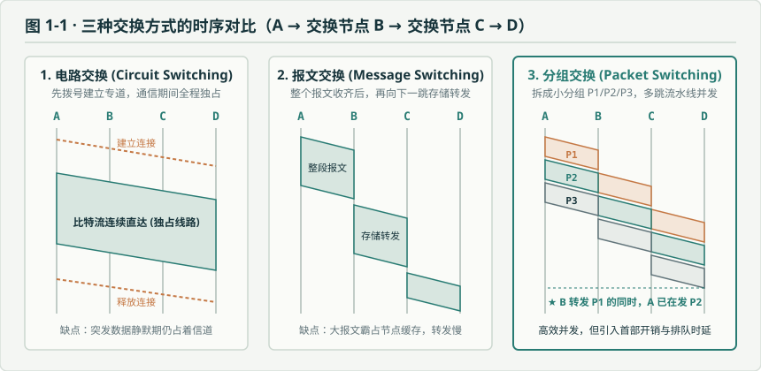

## 第一章 概述

### 1.1 三种数据交换方式

计算机网络的核心作用是实现主机之间的数据交换，交换方式经历了以下演进：

1. **电路交换（Circuit Switching）**
   - **原理**：通信前必须先拨号建立端到端的物理通路（建立连接 → 通话 → 释放连接），通信期间双方始终独占该物理链路。
   - **局限**：计算机数据具有突发性（传输一阵、静默一阵），静默期间物理线路仍被独占，信道利用率极低。
2. **报文交换（Message Switching）**
   - **原理**：无需预先建立连接，采用**存储转发**机制，以完整的应用层报文为单位在交换节点间逐跳完整接收、查表并转发。
   - **局限**：单个报文长度不限，大报文会长时间占用节点缓存与链路，转发时延大。
3. **分组交换（Packet Switching）**
   - **原理**：同样采用存储转发，但发送前先将长报文切分为固定上限的较小数据块，在每块前加上含地址等控制信息的**首部（Header）**构成**分组（Packet）**。各分组独立选路、在多跳节点间流水线并发转发，到达目的端后去首部重组。
   - **代价**：每个分组携带首部产生额外开销；分组在路由器等待转发会产生**排队时延**与**丢包**；各分组独立寻路可能导致乱序到达。

| 交换方式 | 核心机制 | 优点 | 缺点 |
| :--- | :--- | :--- | :--- |
| **电路交换** | 建立端到端物理专道，比特流直达 | 实时性强、无排队时延、按序到达 | 建立连接慢，突发数据下信道利用率极低 |
| **报文交换** | 整个报文收齐后逐跳存储转发 | 无需建立连接，动态占用链路 | 报文过长时转发时延大，占用大量节点缓存 |
| **分组交换** | 拆分为短分组，多跳流水线并发转发 | 信道利用率高、转发时延小、单点故障可自动绕行 | 首部开销、路由器排队时延、可能丢包或乱序 |

---

### 1.2 网络性能指标与四类时延

1. **速率、带宽与吞吐量**
   - **速率**：每秒传送的比特数，单位为 bit/s（bps）。通信速率中的千/兆/吉按十进制换算：1 kb/s = 10^3 bit/s，1 Mb/s = 10^6 bit/s，1 Gb/s = 10^9 bit/s。
   - **带宽**：数字信道所能传送的最高数据率（单位 bit/s）。
   - **吞吐量**：单位时间内通过某个网络或接口的实际数据量。
2. **四类时延（总时延 = 发送时延 + 传播时延 + 处理时延 + 排队时延）**
   - **发送时延（传输时延）**：主机或路由器将分组的全部比特推向通信链路所需的时间，发生在网卡发送器出口。
     `发送时延 = 数据帧长度 (bit) / 发送速率 (bit/s)`
   - **传播时延**：电磁波在信道中传播一定物理距离所需的时间，发生在物理传输媒体上（铜线约 2.3 × 10^8 m/s，光纤约 2.0 × 10^8 m/s）。提高带宽只会减小发送时延，不会改变传播时延。
     `传播时延 = 信道长度 (m) / 电磁波传播速率 (m/s)`
   - **处理时延**：主机或路由器收到分组后分析首部、检验差错、查找转发表所需的时间。
   - **排队时延**：分组在路由器输入/输出队列中等待处理和转发的时间，取决于当时的网络拥塞程度。
3. **时延带宽积与往返时间（RTT）**
   - **时延带宽积**：`时延带宽积 = 传播时延 × 带宽`，表示链路管道中正在传输的比特总量。
   - **往返时间（RTT）**：从发送方发送数据开始，到发送方收到接收方确认报文（ACK）为止所经历的总时间。

---

### 1.3 网络体系结构与五层模型

为了降低网络设计的复杂度，计算机网络采用**分层体系结构**：每一层只负责解决一类独立问题，在下一层提供服务的基础上实现本层功能，并向上一层提供服务接口。

- **OSI 七层模型**：理论参考模型（物理层、数据链路层、网络层、运输层、会话层、表示层、应用层）。
- **TCP/IP 四层模型**：工业界实际标准（网络接口层、网际层、运输层、应用层）。
- **五层协议体系结构**：综合 OSI 与 TCP/IP 的教学模型，自顶向下依次为应用层、运输层、网络层、数据链路层、物理层。

| 五层体系结构 | OSI 七层 | TCP/IP 四层 | 协议数据单元 (PDU) | 核心协议与设备 | 核心职责 |
| :--- | :--- | :--- | :--- | :--- | :--- |
| **5. 应用层** | 应用层 / 表示层 / 会话层 | 应用层 | 报文 (Message) | HTTP, DNS, DHCP | 定义应用进程交互的报文格式与规则 |
| **4. 运输层** | 运输层 | 运输层 | 报文段 (TCP) / 用户数据报 (UDP) | TCP, UDP | 通过端口号定位应用进程，提供端到端传输与可靠控制 |
| **3. 网络层** | 网络层 | 网际层 | IP 数据报 / 分组 (Packet) | IP, ICMP, ARP, OSPF（路由器） | 通过 IP 地址实现跨网段主机寻址与路由转发 |
| **2. 数据链路层** | 数据链路层 | 网络接口层 | 帧 (Frame) | Ethernet, PPP, VLAN（交换机） | 同一链路相邻节点间的帧定界、差错检测与 MAC 寻址 |
| **1. 物理层** | 物理层 | 网络接口层 | 比特 (Bit) | 双绞线, 光纤（集线器） | 屏蔽物理媒体差异，透明传输原始比特流 0 和 1 |

**数据的封装与解封装**：发送方自顶向下逐层附加本层首部（数据链路层还需附加尾部 FCS），最终转为比特流发送；接收方自底向上逐层剥离首部与尾部，还原数据交付应用进程。

---

## 第二章 物理层

### 2.1 物理层的职责与四大特性

物理层用于屏蔽底层传输媒体（双绞线、光纤、无线信道）和通信手段的差异，使上面的数据链路层只需考虑如何传输比特流。物理层接口规程包含四个特性：

1. **机械特性**：接线器的形状、尺寸、引脚数目与排列。
2. **电气特性**：接口电缆各条线上出现的电压范围。
3. **功能特性**：某条线上出现的某一电平电压所表示的意义。
4. **过程特性**：不同功能的各种可能事件的出现顺序。

---

### 2.2 交互方式、数字编码与带通调制

1. **三种通信交互方式**
   - **单工通信**：只能单向传输，无反向交互（如广播）。
   - **半双工通信**：双方均可收发，但不能同时发送（如对讲机、传统集线器共享以太网）。
   - **全双工通信**：双方可以同时发送和接收（如电话、交换式以太网）。
2. **基带数字信号编码**
   - **不归零制（NRZ）**：正电平表示 1，负电平表示 0。缺点是传输连续的 1 或 0 时无电平跳变，接收端无法提取时钟同步信号。
   - **归零制（RZ）**：每个码元中间均归回零电平，占用过多带宽。
   - **曼彻斯特编码**：将每个码元周期等分为两半，**码元中心必发生一次电平跳变**（中心向下跳变表示 1，向上跳变表示 0，或反之）。中心跳变既表示数据，又直接提供自同步时钟信号（传统 10 Mbps 以太网采用）。
   - **差分曼彻斯特编码**：码元中心同样必跳变以提供时钟同步；**码元开始边界处有跳变表示 0，无跳变表示 1**，抗干扰性更强。

3. **带通调制（数字信号转模拟载波）**
   - **调幅（ASK）**：载波振幅随基带数字信号变化。
   - **调频（FSK）**：载波频率随基带数字信号变化。
   - **调相（PSK）**：载波初始相位随基带数字信号变化。
   - **正交振幅调制（QAM）**：结合振幅（ASK）与相位（PSK）共同调制。例如 16-QAM 共有 16 种相位与振幅组合状态，每个码元可携带 `log2(16) = 4 bit` 信息。

---

### 2.3 信道极限容量：奈氏准则与香农公式

1. **奈氏准则（限制码元传输速率，防止码间串扰）**
   - 高频分量衰减会导致脉冲展宽并相互重叠，产生**码间串扰**。在带宽为 W (Hz) 的理想低通信道中，无码间串扰的最高码元传输速率为：
     `最高码元传输速率 = 2W (Baud, 码元/秒)`
   - 若每个码元有 V 种离散状态（携带 `log2(V)` 比特），则理想低通信道下的极限数据传输率为 `2W × log2(V) (bit/s)`。
2. **香农公式（受限于热噪声的信息速率绝对上限）**
   - 当信道存在随机高斯白噪声时，码元状态数 V 无法无限细分。带宽为 W (Hz)、信噪比为 S/N 的信道，其无差错极限信息传输速率 C 为：
     `C = W × log2(1 + S / N) (bit/s)`
   - **信噪比分贝（dB）换算**：`信噪比 (dB) = 10 × log10(S / N)`。例如信噪比为 30 dB 时，`S/N = 10^(30/10) = 1000`。
   - **结论**：信道带宽 W 或信噪比 S/N 越大，极限速率 C 越高；只要实际传输速率低于 C，就一定存在实现无差错传输的编码方法。

---

### 2.4 传输媒体与信道复用技术

1. **导引型传输媒体**
   - **双绞线**：两根绝缘铜线相互绞合，利用差分信号抵消外部电磁干扰并减少自身电磁辐射。
   - **光纤**：利用光脉冲在纤芯内壁发生全反射传输。**多模光纤**纤芯粗，多条光线反射前进易产生色散，适于近距离；**单模光纤**纤芯极细，光线沿直线传播无多次反射，衰减小，适于长途干线。
2. **信道复用技术**
   - **频分复用（FDM）**：将总频带划分为多个子频带，所有用户在相同时间占用不同频率带宽。
   - **波分复用（WDM）**：光的频分复用，在一根光纤上同时传输多路不同波长（频率）的光载波。
   - **时分复用（TDM）**：将时间划分为等长帧，所有用户在固定的不同时间片占用相同频带。缺点是用户无数据时对应时隙依然空置，信道利用率低。
   - **统计时分复用（STDM）**：使用集中器按需动态分配时隙（有数据才分配，时隙内附带用户地址），消除了空闲时隙。

3. **码分复用（CDM / CDMA）与正交码片计算**
   - 各用户在相同时间、使用相同频带通信，每个站点分配一个唯一的 m 位**码片序列**（将 0 记为 -1，1 记为 +1）。
   - **发送规则**：发送比特 1 时发出原码片向量 S；发送比特 0 时发出反码向量 -S。
   - **正交约束**：任意两个不同站点的码片向量 S 与 T 正交，规格化内积为 0；自身规格化内积为 +1：
     `S · T = (1 / m) × Σ(Si × Ti) = 0` ， `S · S = +1` ， `S · (-S) = -1`
   - **接收端分离计算**：设信道总叠加信号为 X，接收端想提取 S 站的数据，只需计算规格化内积 `S · X`：
     - 结果为 **+1** → S 站发送了比特 **1**；
     - 结果为 **-1** → S 站发送了比特 **0**；
     - 结果为 **0** → S 站未发送数据。

---

## 第三章 数据链路层（待更新）

- **3.1 三个基本问题**：封装成帧、透明传输（字节填充与零比特填充）、差错检测（CRC 循环冗余检验）。
- **3.2 点对点协议 PPP**：PPP 帧格式与透明传输机制。
- **3.3 广播信道与传统以太网**：CSMA/CD 协议、争用期与最短有效帧长（64 字节）。
- **3.4 以太网 MAC 层与交换机**：MAC 地址、以太网 V2 帧结构、交换机自学习与转发表、虚拟局域网 VLAN。

---

## 第四章 网络层（待更新）

- **4.1 网络层服务模型**：虚电路服务与数据报服务对比。
- **4.2 IPv4 编址演进**：分类 IP 地址、子网划分与子网掩码、无分类编址 CIDR 与路由聚合。
- **4.3 ARP 地址解析协议**：ARP 缓存与跨网段转发过程中的 IP/MAC 地址变化。
- **4.4 IP 数据报格式与分片**：20 字节固定首部、MTU 与分片偏移计算。
- **4.5 ICMP 网际控制报文协议**：差错报告报文与询问报文、ping 与 traceroute 原理。
- **4.6 路由选择协议**：自治系统、RIP（距离向量）与 OSPF（链路状态）、BGP。
- **4.7 IPv6、NAT 与 VPN**：NAPT 端口映射原理。

---

## 第五章 运输层（待更新）

- **5.1 运输层端口与 UDP/TCP 对比**：复用与分用、UDP 首部结构与检验和。
- **5.2 可靠传输原理**：停止等待协议、连续 ARQ 协议与滑动窗口。
- **5.3 TCP 报文段首部格式**：序号、确认号、标志位与窗口字段。
- **5.4 TCP 可靠传输与流量控制**：以字节为单位的滑动窗口、选择确认 SACK、持续计时器。
- **5.5 TCP 拥塞控制**：慢开始、拥塞避免、快重传、快恢复。
- **5.6 TCP 连接管理**：三次握手与四次挥手、2MSL 等待状态。

---

## 第六章 应用层（待更新）

- **6.1 域名系统 DNS**：层次域名空间、递归查询与迭代查询。
- **6.2 万维网与 HTTP/HTTPS**：HTTP 报文结构、持久连接、Cookie/Session、HTTPS 握手流程。
- **6.3 动态主机配置协议 DHCP**：发现、提供、选择、确认四步广播交互。
- **6.4 全链路串联总结**：从浏览器输入 URL 到页面显示的五层协议完整流转过程。
