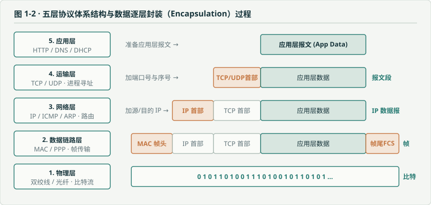
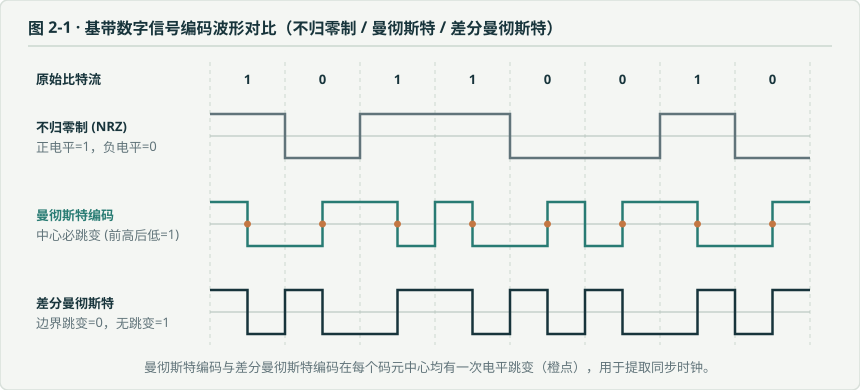
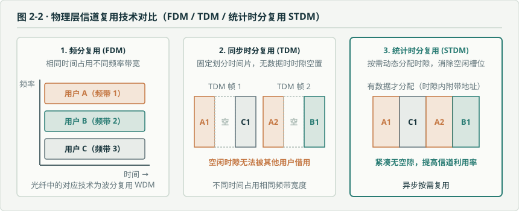

> 本篇基于谢希仁《计算机网络（第 7 版）》整理，按**五层协议体系结构**自底向上梳理每一层要解决的核心问题、协议演进原因与关键机制，作为计算机网络学科的系统复习笔记（分章节持续更新，目前已完结 **第 1 章 概述** 与 **第 2 章 物理层**）。

---

## 第一章 概述

### 1.1 计算机网络在做什么？三种交换方式的演进

计算机网络的核心任务是实现主机之间的数据交换。随着网络规模扩大，数据交换方式经历了三次演进：**电路交换 → 报文交换 → 分组交换**。

#### 1. 为什么传统的“电路交换”不适合计算机通信？

早期的电话网采用**电路交换（Circuit Switching）**，整个过程分为三步：**建立连接（拨号申请物理专道）→ 通话（全程独占这条物理链路）→ 释放连接（挂断归还链路）**。

- **问题所在**：人打电话时是一直在说话的，但计算机数据具有强烈的**突发式（Burst）**特点——例如用户打开一个网页后阅读 5 分钟，这 5 分钟内链路上没有任何数据传输。如果采用电路交换，这条物理线路在 5 分钟内被白白独占，其他人都无法使用，信道利用率极低。

#### 2. 报文交换与分组交换（Packet Switching）

为了解决独占线路的浪费，计算机网络改用**存储转发（Store-and-Forward）**机制：不预先占用整条端到端线路，而是先把数据发给相邻的路由器（交换节点），路由器存下来查表后，再转发给下一跳。

- **报文交换（Message Switching）**：以完整的应用数据（整个报文，可能几百 MB）为单位进行存储转发。缺点是单个报文太大，路由器缓存放不下，且大报文会长时间霸占某一段链路，导致后面的小消息全部卡死。
- **分组交换（Packet Switching，因特网核心采用）**：
  1. 发送端先把较长的完整报文**切分成一个个固定上限的小数据块**。
  2. 在每个小数据块前面加上包含目的地址等控制信息的**首部（Header）**，构成一个**分组（Packet，又称“包”）**。
  3. 各个分组在互联网中独立选择路由、逐跳存储转发；到达目的主机后，再剥去首部、重新拼装还原成原始报文。


#### 3. 三种交换方式的核心优劣对比

| 交换方式 | 核心机制 | 优点 | 缺点（引入的新问题） |
| :--- | :--- | :--- | :--- |
| **电路交换** | 建立端到端专道，比特流直达 | 通信实时性强、无排队时延、按序到达 | 建立连接慢；计算机突发数据下**信道利用率极低** |
| **报文交换** | 整个报文收齐后逐跳存储转发 | 无需建立连接，动态分配链路 | 报文长度无上限，**节点转发时延大**、占用巨量缓存 |
| **分组交换** | 拆分为短分组，**多跳流水线并发转发** | 高效灵活、多节点可同时并发传输同一报文的不同分组；某条链路故障可自动绕行 | ① 每个分组都要加首部，带来额外字节开销；<br>② 在路由器等待转发会产生**排队时延**与**丢包**；<br>③ 各分组独立寻路，到达顺序可能乱序 |

> **关键结论**：因特网之所以会出现丢包、乱序和延迟抖动，根源就在于底层采用了**分组交换**；而后续运输层（TCP）之所以复杂，正是为了在分组交换的基础上修补这些问题。

---

### 1.2 计算机网络的性能指标

衡量网络性能最核心的是以下四个维度，尤其需要区分**四大时延**的物理意义与发生位置：

#### 1. 速率、带宽与吞吐量

- **速率（Data Rate）**：每秒传送的比特数，单位是 `bit/s`（`bps`）。注意计算机存储容量里的 `1 KB = 2^10 B = 1024 Byte`，而网络通信速率里的千/兆/吉均按十进制计算：`1 kb/s = 10^3 bit/s`，`1 Mb/s = 10^6 bit/s`，`1 Gb/s = 10^9 bit/s`（且 `1 Byte = 8 bit`，所以百兆宽带 `100 Mb/s` 的理论下载上限是 `100 / 8 = 12.5 MB/s`）。
- **带宽（Bandwidth）**：在模拟信号中指频带宽度（Hz）；在数字信道中指**信道所能传送的最高数据率**（单位同为 `bit/s`）。
- **吞吐量（Throughput）**：单位时间内通过某个网络（或接口）的**实际数据量**，受限于链路带宽与网络拥塞程度。

#### 2. 四种时延（总时延 = 发送时延 + 传播时延 + 处理时延 + 排队时延）

1. **发送时延（传输时延，Transmission Delay）**：
   - **怎么来的**：主机或路由器把一个分组的所有比特“推”上通信链路所花的时间（从第一个比特出门，到最后一个比特出门）。
   - **计算公式**：`发送时延 = 数据帧长度 (bit) / 发送速率 (bit/s)`。
   - **发生位置**：网卡（发送器）内部。要缩短发送时延，需要换更快的网卡（提高发送速率）。
2. **传播时延（Propagation Delay）**：
   - **怎么来的**：电磁波或光信号在物理网线/光纤中跑完这段物理距离所花的时间。
   - **计算公式**：`传播时延 = 信道长度 (m) / 电磁波在信道上的传播速率 (m/s)`（真空中光速为 `3.0 × 10^8 m/s`，铜线中约为 `2.3 × 10^8 m/s`，光纤中约为 `2.0 × 10^8 m/s`）。
   - **发生位置**：物理传输线路上。**带宽再高（比如千兆升万兆），电磁波在光纤里的传播速度也不会变快**，只是单位时间内塞进光纤的比特变密了。
3. **处理时延（Processing Delay）**：主机或路由器收到分组后，检查首部差错、提取目的地址、查找转发表所花的时间。
4. **排队时延（Queuing Delay）**：分组进入路由器后，在输入队列等待处理、或在输出队列等待链路空闲所花的时间。网络拥塞时，排队时延会急剧飙升，甚至因队列满而被直接丢弃（即**丢包**）。

#### 3. 时延带宽积与往返时间 RTT

- **时延带宽积**：`时延带宽积 = 传播时延 × 带宽`。物理含义是：**如果发送端不停发送数据，在第一个比特刚刚到达接收端的那一瞬间，管道（链路）里正在飞行的总比特数**。
- **往返时间（RTT，Round-Trip Time）**：从发送方把数据发出去，到发送方收到来自接收方的确认报文（ACK）为止所经历的总时间（至少包含一来一回两次传播时延 + 中间处理与排队时延）。

---

### 1.3 为什么要把网络划分为五层体系结构？

#### 1. 分层的原因

两台主机的应用程序要完成一次通信，需要依次解决截然不同层面的问题：
1. 物理电线上怎么表示 `0` 和 `1`？
2. 怎么识别一段数据的开头结尾，电信号被干扰出错了怎么发现？
3. 全球几百亿台设备，怎么跨过无数个路由器找到目标电脑？
4. 目标电脑上开着十几个软件，数据交给哪个软件？中间丢包了怎么重发？
5. 软件拿到字节流后，怎么解析出网页、图片或聊天文字？

如果把这五件事揉在一个模块里，只要底层从网线换成 Wi-Fi，上面的网页浏览器代码就得全部重写。因此计算机网络采用**分层体系结构**：**每一层只解决一个独立问题，使用下一层提供的服务，并向它的上一层提供服务**。

#### 2. 三种分层模型对照（OSI 七层 vs TCP/IP 四层 vs 五层协议）

- **OSI 七层模型**：国际标准化组织制定的理论参考模型，概念清晰但过于繁琐（会话层、表示层在实际协议中几乎为空），未能在市场普及。
- **TCP/IP 四层模型**：工业界实际运行的标准协议栈（将物理层和数据链路层合并统称为“网络接口层”）。
- **五层协议体系结构**：《计算机网络（第 7 版）》采用的教学折中模型，既保留了底层物理层与数据链路层的区分，又去掉了多余的表示层和会话层。

| 五层协议体系结构 | OSI 七层模型 | TCP/IP 四层模型 | 该层传输单元 (PDU) | 核心代表协议 / 硬件 | 该层解决的核心问题 |
| :--- | :--- | :--- | :--- | :--- | :--- |
| **5. 应用层** | 应用层 / 表示层 / 会话层 | 应用层 | **报文** (Message) | HTTP, DNS, DHCP, FTP | 规定应用程序之间交互的数据格式与业务语义 |
| **4. 运输层** | 运输层 | 运输层 | **报文段** (TCP) / **用户数据报** (UDP) | TCP, UDP | 解决**端到端进程通信**（通过端口号定位应用进程）及可靠传输控制 |
| **3. 网络层** | 网络层 | 网际层 | **IP 数据报 / 分组** (Packet) | IP, ICMP, ARP, OSPF, BGP（路由器） | 解决**跨网段主机到主机寻址与路由选择**（通过 IP 地址跨局域网转发） |
| **2. 数据链路层** | 数据链路层 | 网络接口层 | **帧** (Frame) | Ethernet (MAC), PPP, VLAN（交换机） | 解决**同一链路相邻节点之间的帧传输**（定界、CRC 检错、MAC 寻址） |
| **1. 物理层** | 物理层 | 网络接口层 | **比特** (Bit) | RJ45, 光纤, 双绞线（集线器/中继器） | 解决**在物理媒体上传输原始比特流 `0` 和 `1`**（电平/光信号转换） |

#### 3. 数据在各层之间的封装（Encapsulation）与解封装

当应用进程发送一份数据时：
1. **应用层**生成应用层报文，交给运输层；
2. **运输层**在前面加上 `TCP/UDP 首部`（填入源端口、目的端口、序号等），封装成**运输层报文段**，交给网络层；
3. **网络层**在前面加上 `IP 首部`（填入源 IP、目的 IP、TTL 等），封装成 **IP 数据报**，交给数据链路层；
4. **数据链路层**不仅在前面加上 `MAC 帧头`（填入源 MAC、目的 MAC），还要在末尾加上 `帧尾（FCS 校验序列）`，封装成**数据链路层帧**，交给物理层；
5. **物理层**把整帧看作一串无结构的 `0/1` 比特流，转换为电信号或光脉冲送上物理链路。
6. 接收端自底向上逐层**剥离对应首部/尾部**（解封装），最终把净荷数据交给目标应用进程。



---

## 第二章 物理层

### 2.1 物理层要解决什么问题？

物理层位于体系结构的最底层。上一层（数据链路层）交给它的是 `0` 和 `1` 组成的二进制比特流，但现实中的铜线、光纤、空气只能传递电压高低、光强弱或电磁波。

因此，物理层的任务不是指代某根具体的网线，而是**定义主机/网卡与传输媒体之间的接口标准，屏蔽底层各种传输媒体的差异，让数据链路层只需要关心“发送和接收比特 `0/1`”，而不必关心底下跑的到底是双绞线、光纤还是无线电**。

物理层接口规程包含以下四个特性：
1. **机械特性**：接口接线器的形状、尺寸、引脚数目和排列（如 RJ-45 水晶头有 8 根针脚）。
2. **电气特性**：接口电缆各条线上出现的电压范围（如规定多少伏特代表高电平）。
3. **功能特性**：指明某条线上出现的某一电平的电压表示什么意义（哪根引脚负责发、哪根负责收）。
4. **过程特性**：指明对于不同功能的各种可能事件的出现顺序（时序关系）。

---

### 2.2 数据通信基础：信道、编码与调制

#### 1. 三种通信交互方式

- **单工通信（Simplex）**：只能有一个方向的通信，没有反方向的交互（如无线电广播、电视广播）。
- **半双工通信（Half-Duplex）**：通信双方都可以发送和接收信息，但**不能双方同时发送**（如对讲机、早期使用集线器 Hub 的共享式以太网）。
- **全双工通信（Full-Duplex）**：通信双方可以**同时发送和接收**信息（如电话、现代使用交换机与双绞线的以太网）。

#### 2. 基带传输与常用数字编码（为什么需要曼彻斯特编码？）

来自信源的原始 `0/1` 数字信号含有较多低频成分甚至直流成分，如果在近距离信道中直接传输数字信号（不转换为高频模拟载波），称为**基带传输**。把 `0/1` 转换为不同形态的数字脉冲波形的过程称为**编码（Coding）**：

1. **不归零制（NRZ，Non-Return-to-Zero）**：正电平代表 `1`，负电平代表 `0`。
   - **致命缺陷（为什么不能直接用）**：如果发送的数据中包含一长串连续的 `1`（如 `11111111`）或连续的 `0`，线路上的电压就会一直保持水平不变。接收端没有参考跳变，**根本数不清这到底来了 7 个 `1` 还是 8 个 `1`**（即丢失时钟同步信号），除非再单独拉一根时钟线，但这在远距离通信中成本太高。
2. **归零制（RZ）**：正脉冲代表 `1`，负脉冲代表 `0`，但每个码元中间必须归回到零电平。虽然有了同步跳变，但大半带宽被用来传归零动作，效率低。
3. **曼彻斯特编码（Manchester Encoding）**：
   - **规则**：把每一个码元（1 bit）的时间周期等分为两半，**在每个码元的正中间必须发生一次电平跳变**（例如规定：中心向上跳变代表 `0`，中心向下跳变代表 `1`，也可反过来定义）。
   - **为什么这样设计**：因为无论传多少个连续的 `0` 或 `1`，每个周期的中心**必定跳变一次**。这个中心跳变既作为数据的表示，又直接充当了接收端提取位周期的**自同步时钟信号**，传统 10 Mbps 以太网即采用此编码。
   - **代价**：每秒电平跳变次数翻倍，所占频带宽度比原始基带翻了一倍。
4. **差分曼彻斯特编码（Differential Manchester Encoding）**：
   - **规则**：同样在**每个码元中心必有一次跳变**（仅用于提供时钟同步）；而真正表示 `0` 或 `1` 看的是**每个码元开始边界处是否发生跳变**——边界处有跳变代表 `0`，边界处无跳变代表 `1`。
   - **优势**：抗干扰能力比普通曼彻斯特编码更强（即使信号线正负极接反，边界是否跳变依然不变）。



#### 3. 带通调制（把数字信号搬移到高频模拟信道）

光纤、无线电或远距离电话线无法直接传低频基带方波，必须把数字信号调制到高频正弦载波上，称为**带通调制（Modulation）**。三大基本调制方法及高阶组合：

1. **调幅（ASK，幅移键控）**：载波的振幅随二进制 `0/1` 变化（比如有载波振幅代表 `1`，无振幅代表 `0`）。
2. **调频（FSK，频移键控）**：载波的频率随二进制 `0/1` 变化（频率 `f1` 代表 `0`，频率 `f2` 代表 `1`）。
3. **调相（PSK，相移键控）**：载波的初始相位随二进制 `0/1` 变化（相位 `0°` 代表 `0`，相位 `180°` 代表 `1`）。
4. **正交振幅调制（QAM，Quadrature Amplitude Modulation）**：
   - **为什么需要 QAM**：为了在有限的码元速率（波特率）下传更多比特，现代 Wi-Fi 与 4G/5G 将**振幅（ASK）和相位（PSK）结合起来同时调制**。例如 `16-QAM` 共有 16 种不同的相位+振幅组合状态，每发送 1 个码元就能携带 `log2(16) = 4 bit` 信息。

---

### 2.3 信道的极限容量：奈氏准则与香农公式

为什么网线不能无限提高传输速率？物理层有两个决定信道速率天花板的定律：

#### 1. 奈氏准则（Nyquist's Theorem）：限制最高码元速率，防止码间串扰

任何实际的物理信道都不是理想的，高频分量通过信道时会衰减，导致矩形脉冲的边缘变圆、尾巴拖长。如果码元发得太快、挨得太紧，前一个码元的尾巴就会和后一个码元叠在一起，接收端无法分辨，这种现象叫做**码间串扰（Inter-Symbol Interference）**。

1924 年奈奎斯特推导出：在带宽为 `W (Hz)` 的理想低通信道中，为了避免码间串扰，**极限最高码元传输速率**为：

```text
最高码元传输速率 = 2W  (Baud, 波特，即码元/秒)
```

- **启发**：既然信道带宽 `W` 限制了每秒最多只能发 `2W` 个码元，那想提高比特率（`bit/s`），就只能**让每个码元携带更多的比特**（如上面提到的 QAM，若一个码元有 `V` 种离散状态，则每个码元携带 `log2(V)` 比特，极限数据传输率 `= 2W × log2(V) (bit/s)`）。

#### 2. 香农公式（Shannon's Formula）：噪声决定了信息速率的绝对上限

那么，能不能把单个码元的状态数 `V` 无限细分下去（比如从 16 种状态分到 100 万种状态），从而获得无限大的比特率？

**不能**。因为信道中永远存在随机热噪声。当状态切得太细时，两个状态之间的电压差极小，一点点背景噪声就会把状态 A 淹没成状态 B。1948 年香农推导出：在受高斯白噪声干扰的信道中，**极限无差错信息传输速率 `C`** 为：

```text
C = W × log2(1 + S / N)   (单位：bit/s)
```

- **`W`**：信道的频带宽度（Hz）。
- **`S / N`**：信道的**信噪比**（信号平均功率 `S` 与噪声平均功率 `N` 的比值，公式中代入的是无量纲比值）。
- **分贝（dB）换算（常考计算）**：题目中通常给出以分贝（`dB`）为单位的信噪比，代入香农公式前必须先换算回普通比值 `S/N`：

```text
信噪比 (dB) = 10 × log10(S / N)
```

  *示例*：若信噪比为 `30 dB`，则 `10 × log10(S/N) = 30` → `S/N = 10^3 = 1000`；若带宽 `W = 3000 Hz`，则极限速率 `C = 3000 × log2(1 + 1000) ≈ 3000 × 10 = 30 kbit/s`。
- **香农公式的核心结论**：
  1. 信道的带宽 `W` 或信噪比 `S/N` 越大，极限传输速率就越高；
  2. 只要信息传输速率低于极限值 `C`，就一定存在某种编码方法能实现无差错传输；
  3. 若带宽 `W` 和信噪比 `S/N` 已固定，无论用多少进制的码元（无论怎么提高 `V`），实际比特率都不可能突破香农极限 `C`。

---

### 2.4 物理层下面的传输媒体

传输媒体分为两大类：

1. **导引型传输媒体**（电磁波沿着固体媒体传播）：
   - **双绞线（Twisted Pair）**：把两根绝缘铜导线按一定密度**互相绞合在一起**。
     - *为什么要绞合在一起？* 因为两根线绞合后，外部电磁波对两根线产生的感应干扰电压大小相等、方向相反，在接收端做差分相减即可相互抵消；同时也减少了线对向外的电磁辐射。分为无屏蔽双绞线（UTP）和屏蔽双绞线（STP）。
   - **同轴电缆（Coaxial Cable）**：抗高频干扰好，早期有线电视网广泛使用。
   - **光纤（Optical Fiber）**：利用光脉冲在玻璃纤维内壁发生**全反射**进行传输。带宽极大、衰减小、完全不受电磁干扰。
     - **多模光纤**：纤芯较粗，多条不同入射角的光线在内部不断反射前进，传输距离远时脉冲会展宽（色散），只适合近距离（楼宇内）。
     - **单模光纤**：纤芯直径极细（接近光波波长），光线不发生多次反射而是直接沿直线向前传播，衰减小、造价高，适合几十公里以上的远距离干线传输。
2. **非导引型传输媒体**（自由空间无线传输）：无线电波、微波、红外线、激光。

---

### 2.5 信道复用技术（为什么一根干线能供成千上万人同时通信？）

如果每两台主机之间都单独铺一根光纤，成本根本无法承受。**信道复用（Multiplexing）**就是让多个独立信号共享同一条高速物理信道的技术。



#### 1. 频分复用（FDM）与波分复用（WDM）

- **频分复用（FDM，Frequency Division Multiplexing）**：将信道的总频带切分成多个互不重叠的子频带，每个用户分配一个专属频带。**所有用户在同样的时间占用不同的频率带宽资源**。
- **波分复用（WDM，Wavelength Division Multiplexing）**：就是**光的频分复用**。因为光的波长不同即频率不同，用合波器把几十路不同波长（频率）的激光合进同一根光纤传输，到接收端再用分波器拆开（密集波分复用 DWDM 可在一根光纤上同时复用上百路光载波）。

#### 2. 时分复用（TDM）与统计时分复用（STDM）

- **同步时分复用（TDM，Time Division Multiplexing）**：将时间划分为一段段等长的时分复用帧（TDM 帧），每个用户在每个 TDM 帧中占用固定序号的时间片（时隙）。**所有用户在不同的时间占用同样的频带宽度**。
  - **为什么 TDM 不适合计算机网络？** 因为时隙是固定死分给每个用户的。当用户 A 正在看网页没发数据时，属于用户 A 的那个时间片就只能轮空闲置，其他正在疯狂下载的用户 B 也不能借用，导致信道利用率很低。
- **统计时分复用（STDM，Statistic TDM，又称异步时分复用）**：
  - **怎么改进的**：使用集中器（Concentrator）收集各用户的突发数据，**不再固定分配时隙，而是谁有数据就动态给谁分配时隙**，使输出的时隙紧凑排列、没有空槽。因为时隙不再与用户序号一一绑定，每个时隙中必须额外携带一小段**用户的地址信息**。

#### 3. 码分复用（CDM / CDMA）：所有人同一时间、同一频段同时说话，怎么互不干扰？

**码分多址（CDMA，Code Division Multiple Access）**允许所有用户在**相同的时间、使用相同的频带**同时通信。它依靠**正交码片序列**区分不同用户，其工作原理与计算是物理层最核心的考点：

1. **码片（Chip）规则**：
   - 将每一个比特时间再细分为 `m` 个短间隔（通常为 64 或 128 个，题目常简化为 8 个），称为**码片**。
   - 每个站点被指派一个唯一的 `m bit` **码片序列（Chip Sequence）**（计算时将其中的 `0` 全部改写为 `-1`，`1` 改写为 `+1`）。
   - 如果站点要发送比特 **`1`**，就发送它自己的原码片序列 `S`；
   - 如果站点要发送比特 **`0`**，就发送它码片序列的反码 `-S`。
2. **核心数学约束（正交性）**：
   不同站点分配的码片向量必须**两两正交**——即任意两个不同站点的码片向量 `S` 和 `T` 的规格化内积（对应位元素相乘再求和，最后除以 `m`）严格等于 **`0`**：

```text
S · T = (1 / m) × Σ(Si × Ti) = 0
```

   而任何一个码片向量与它自己的规格化内积等于 **`+1`**，与它自己反码的规格化内积等于 **`-1`**：

```text
S · S = +1 ,    S · (-S) = -1
```

3. **叠加与分离计算实例（必考题型）**：
   - 设 A 站的码片序列为 `S = (-1, -1, -1, +1, +1, -1, +1, +1)`，B 站的码片序列为 `T = (-1, -1, +1, -1, +1, +1, +1, -1)`（可验证 `S · T = 0`）。
   - 假设同一时刻：
     - A 站发送比特 `1`，发出 `S = (-1, -1, -1, +1, +1, -1, +1, +1)`；
     - B 站发送比特 `0`，发出 `-T = (+1, +1, -1, +1, -1, -1, -1, +1)`。
   - 公共无线信道上的总信号 `X` 为两者的线性叠加（对应位相加）：

```text
X = S + (-T) = (0, 0, -2, +2, 0, -2, 0, +2)
```

   - **接收端如何从混杂的总信号 `X` 中还原出 A 站发了什么？**
     只需用 A 站的码片向量 `S` 与总信号 `X` 做规格化内积（对应位元素相乘求和，再除以 `8`）：

```text
S · X = [(-1×0) + (-1×0) + (-1×-2) + (1×2) + (1×0) + (-1×-2) + (1×0) + (1×2)] / 8
      = (0 + 0 + 2 + 2 + 0 + 2 + 0 + 2) / 8
      = 8 / 8 = +1
```

   - **判定规则**：
     - 规格化内积结果为 **`+1`** → 说明该站发送的是比特 **`1`**；
     - 规格化内积结果为 **`-1`** → 说明该站发送的是比特 **`0`**；
     - 规格化内积结果为 **`0`** → 说明该站此时没有发送数据。

---

## 第三章 数据链路层（待更新）

> **本章核心问题**：物理层只负责传 `0/1` 比特流，如何在相邻两个节点之间准确界定一帧的起止、检测传输差错，并解决多台主机共享局域网信道时的碰撞冲突？

- **3.1 数据链路层的三个基本问题**：封装成帧、透明传输（字节填充 vs 零比特填充）、差错检测（CRC 循环冗余检验模 2 除法计算）。
- **3.2 点对点协议 PPP**：PPP 帧格式与状态转换。
- **3.3 广播信道与传统以太网**：CSMA/CD 协议（先听后发、边发边听、冲突停发、二进制指数退避）、争用期与最短有效帧长（64 字节）推导。
- **3.4 以太网 MAC 层与交换机**：MAC 地址格式、以太网 V2 帧结构、交换机自学习与转发过程、虚拟局域网 VLAN。

---

## 第四章 网络层（待更新）

> **本章核心问题**：数据链路层只能解决同一个局域网内的通信，如何通过逻辑编址与路由器转发，让数据包跨越全球异构网络到达目标主机？

- **4.1 网络层设计思路**：虚电路 vs 无连接数据报服务。
- **4.2 IPv4 地址演进**：分类 IP 地址 → 子网划分与子网掩码 → 无分类编址 CIDR 与路由聚合（最长前缀匹配）。
- **4.3 ARP 地址解析协议**：同网段与跨网段通信时，IP 地址与 MAC 地址如何配合变化。
- **4.4 IP 数据报格式与分片计算**：20 字节固定首部字段解析、MTU 与分片偏移量计算。
- **4.5 ICMP 网际控制报文协议**：差错报告报文与询问报文、`ping` 与 `traceroute` 实现机制。
- **4.6 路由选择协议**：自治系统（AS）、内部网关协议（RIP 距离向量算法 vs OSPF 链路状态算法）、外部网关协议 BGP。
- **4.7 IPv6、NAT 与 VPN**：内网私有地址如何通过 NAPT 转换访问公网。

---

## 第五章 运输层（待更新）

> **本章核心问题**：网络层只把数据包送到目标主机，如何通过端口将数据交付给正确的应用程序进程，并在不可靠的 IP 层之上实现无差错、不丢失、不乱序的可靠传输？

- **5.1 运输层端口与 UDP/TCP 对比**：复用与分用、UDP 首部 8 字节结构与检验和计算。
- **5.2 可靠传输原理**：停止等待协议 → 连续 ARQ 协议与滑动窗口。
- **5.3 TCP 报文段首部格式**：序号 `seq`、确认号 `ack`、标志位（SYN/ACK/FIN/RST）与窗口字段。
- **5.4 TCP 可靠传输与流量控制**：以字节为单位的滑动窗口、选择确认 SACK、接收窗口 `rwnd` 与持续计时器。
- **5.5 TCP 拥塞控制**：慢开始、拥塞避免、快重传、快恢复的触发条件与门限 `ssthresh` 更新规则。
- **5.6 TCP 连接管理**：三次握手（为什么不是两次）与四次挥手（为什么需要 `2MSL` TIME-WAIT 状态）。

---

## 第六章 应用层（待更新）

> **本章核心问题**：端到端字节流通道建立后，各类网络应用如何定义请求与响应的报文格式及交互规则？

- **6.1 域名系统 DNS**：层次域名空间、根/顶级/权限/本地域名服务器、递归查询与迭代查询。
- **6.2 万维网与 HTTP/HTTPS**：URL、HTTP 1.0/1.1/2.0 演进、报文结构、状态码、Cookie/Session、HTTPS（TLS 混合加密握手流程）。
- **6.3 动态主机配置协议 DHCP**：局域网新主机自动获取 IP 配置的四步广播交互（Discover / Offer / Request / ACK）。
- **6.4 全链路串联总结**：从浏览器输入 URL 到页面展示，五层协议依次工作的完整数据包流转全过程。
