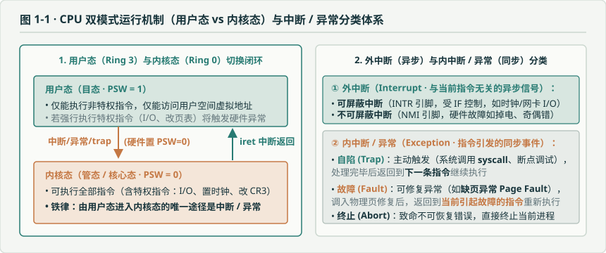
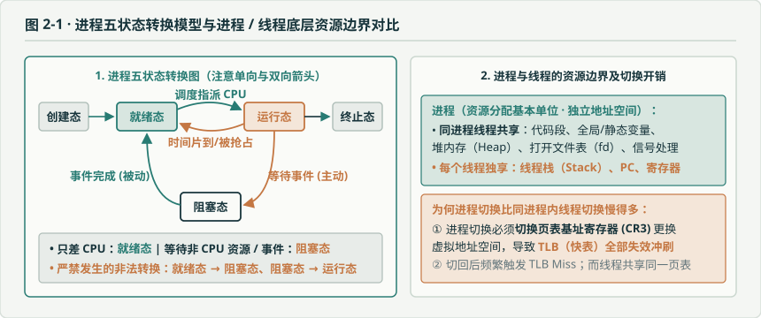
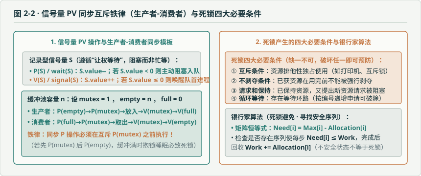

## 第一章 操作系统概述与硬件运行机制

### 1.1 操作系统的四大基本特征与内核架构

1. **操作系统的四大基本特征**
   - **并发（Concurrency，最核心特征）**：
     - **并发 vs 并行（必考辨析）**：**并发**是指两个或多个事件在**同一时间间隔（宏观上同时、微观上分时交替）**内发生（单核 CPU 即可支持并发）；**并行（Parallelism）**是指两个或多个事件在**同一时刻（微观上真正同时）**发生（必须具备多核 CPU 硬件）。
   - **共享（Sharing）**：系统中的资源可供内存中多个并发执行的进程共同使用，分为两种方式：
     1. **互斥共享**（如打印机、互斥锁、临界资源）：在一段时间内只允许一个进程访问；
     2. **同时访问**（如磁盘文件、可重入代码）：宏观上多个进程同时访问，微观上交替分时读写。
     - **并发与共享互为存在条件**：没有并发就谈不上资源共享；若不能有效管理资源共享，并发执行也无法实现。
   - **虚拟（Virtualization）**：把一个物理实体变为若干个逻辑上的对应物：
     - **时分复用技术**（如虚拟处理器：多进程分时复用单颗物理 CPU）；
     - **空分复用技术**（如虚拟存储器：利用磁盘空间扩展物理内存，为每个进程提供独立的 4GB / 64 位虚拟地址空间）。
   - **异步（Asynchronism）**：并发进程以不可预知的、走走停停的相对速度向前推进，但操作系统必须保证只要运行环境相同，多次运行的最终结果完全相同（可再现性）。
2. **宏内核（大内核）与微内核架构对比**
   - **宏内核（Monolithic Kernel，如 Linux、UNIX）**：将进程管理、内存管理、文件系统、网络协议栈、设备驱动程序全部编译在同一个内核地址空间中运行。**优点**：各模块间直接函数调用，**性能极高**；**缺点**：内核庞大，任一驱动崩溃可能导致整个内核崩溃。
   - **微内核（Microkernel，如 Mach、鸿蒙 HarmonyOS 微内核）**：内核态仅保留最核心的**中断处理、进程/线程调度与进程间通信（IPC）**，而将文件系统、设备驱动、网络协议栈全部移至**用户态**作为独立服务进程运行。**优点**：可靠性、安全性与可扩展性极高；**缺点**：用户态服务之间必须频繁通过内核 IPC 消息传递通信，**导致频繁的用户态/内核态上下文切换开销，性能略低**。

---

### 1.2 CPU 运行模式、中断与系统调用

1. **处理器双模式（用户态 vs 内核态）与两类指令**
   - **为什么要区分用户态与内核态**：防止用户应用程序有意或无意地破坏操作系统内核代码、篡改其他进程内存或独占硬件外设。硬件通过**程序状态字寄存器（PSW）**中的模式位来标识当前特权级：
     - **用户态（目态，User Mode，x86 Ring 3）**：CPU 只能执行**非特权指令**（算术运算、访存用户空间、普通跳转），严禁执行特权指令。
     - **内核态（管态 / 核心态，Kernel Mode，x86 Ring 0）**：运行操作系统内核程序，CPU 可以执行指令集中的**全部指令（包含特权指令）**。
   - **常见特权指令（在用户态下执行必触发硬件异常）**：I/O 输入输出指令、置时钟指令、开/关中断指令（`STI` / `CLI`）、清内存指令、修改页表基址寄存器（`CR3`）与修改程序状态字（`PSW`）指令。
2. **中断（Interrupt）与异常（Exception）分类体系**
   **中断与异常是 CPU 由“用户态”进入“内核态”的唯一途径**（而由“内核态”返回“用户态”则是通过执行特权指令 **`iret` 中断返回指令**恢复用户态 PSW 实现）：

| 分类 | 触发源与同步/异步属性 | 子类与典型案例 | 处理完毕后的返回断点地址 |
| :--- | :--- | :--- | :--- |
| **1. 外中断** (Interrupt) | 来自 **CPU 外部**硬件设备的信号，与当前正在执行的指令无关（**异步事件**） | • **可屏蔽中断**：通过 `INTR` 引脚进入，受关中断标志控制（如**时钟中断**、网卡收包、磁盘 I/O 完成） • **不可屏蔽中断**：通过 `NMI` 引脚进入，不可屏蔽（如电源掉电、内存奇偶校验错） | 固定返回到被中断指令的**下一条指令**继续执行 |
| **2. 内中断 / 异常** (Exception) | 来自 **CPU 内部**，由当前正在执行的指令直接引发（**同步事件**，不可屏蔽） | • **自陷 / 陷入 (Trap)**：程序预先有意安排的主动陷入（如**系统调用 `syscall` / `int 0x80`**、调试断点） • **故障 (Fault)**：由错误条件引起但可被内核修复（如**缺页异常 Page Fault**、除数为 0） • **终止 (Abort)**：致命硬件或内核错误，无法恢复 | • **Trap**：返回到**下一条指令** • **Fault（如缺页）**：修复后返回到**引发故障的当前指令重新执行** • **Abort**：不返回，直接终止进程 |

3. **中断处理与系统调用（System Call）全流程**
   - **中断响应中“硬件自动完成”与“软件内核完成”的分工边界（必考）**：
     1. **由 CPU 硬件（中断隐指令）自动完成的三件事**：① **关中断**（防止保护现场中途被打断）；② **保存断点**（将当前程序计数器 `PC` 和程序状态字 `PSW` 压入内核栈）；③ **引出中断服务程序**（根据中断向量号查中断向量表，将对应服务程序入口装入 `PC`，并切换 `PSW` 为内核态）。
     2. **由操作系统中断服务程序（软件）完成的事**：① 保护通用寄存器现场与屏蔽字；② 开中断（若允许嵌套中断）；③ 执行具体中断处理逻辑；④ 关中断、恢复通用寄存器现场；⑤ 执行 `iret` 指令恢复 `PC` 和 `PSW` 返回用户态。
   - **系统调用过程**：用户程序将系统调用号放入指定寄存器（如 `eax` / `rax`），执行**陷入指令（`syscall` / `sysenter` / `int 0x80`，注意陷入指令本身是唯一能在用户态执行的非特权指令）**主动触发内中断进入内核态，内核根据系统调用表分派执行对应内核函数，完成后返回用户态。

---

## 第二章 进程与线程、CPU 调度、同步互斥与死锁

### 2.1 进程与线程的本质对比

1. **进程（Process）的组成与 PCB**
   - **定义**：进程是程序的一次动态执行过程，是操作系统进行**资源分配（内存、文件、设备）和保护的独立基本单位**。
   - **进程的组成（进程实体 / 进程映像）**：由 **PCB（进程控制块）**、**程序段（代码段）**和**数据段（含数据、堆、栈）**三部分组成。
   - **PCB（Process Control Block，Linux 中为 `task_struct`）**：记录进程 PID、状态、优先级、CPU 寄存器现场保护区、页表指针、打开文件描述符表等全部管理信息。**PCB 是进程存在的唯一标志**（操作系统完全通过感知 PCB 来创建、调度和销毁进程；**PCB 常驻内核内存**）。
2. **线程（Thread）的引入与资源共享边界**
   - **定义**：线程是进程内部的执行流，是操作系统进行 **CPU 处理机调度和分派的基本单位**（线程自身几乎不拥有系统资源，仅拥有维持独立执行所必需的少量私有上下文）。
   - **同一进程内多个线程的“共享”与“独享”清单（高频必考）**：
     - **同进程所有线程共享的资源**：进程虚拟地址空间（**代码段 `.text`、全局变量与静态变量 `.data/.bss`、堆内存 `Heap`**）、**打开的文件描述符表（`fd`）**、进程当前工作目录、信号处理函数、定时器与用户 ID。
     - **每个线程私有独享的资源**：**线程栈（Thread Stack，存放该线程调用链上的局部变量与函数返回地址）**、**程序计数器（PC）**、**CPU 通用寄存器集合与状态字**、线程 ID（TID）与线程局部存储（TLS）。
   - **为什么进程上下文切换比同进程内线程切换慢得多（底层根因）**：
     1. 同一进程内的线程切换**共享同一个虚拟地址空间和同一张页表**，只需保存/恢复 CPU 寄存器和切换栈指针 `RSP`；
     2. 而进程切换必须**更新页表基址寄存器（x86 `CR3`）以切换虚拟地址空间**，这会强制导致 CPU 的 **TLB（地址转换快表）全部失效被冲刷（Flush）**；新进程恢复执行后的相当长一段时间内会密集触发 **TLB Miss** 和 **CPU Cache Miss**，每次都要重新走多级页表访存，带来高昂的隐性性能惩罚。
3. **线程的三种实现模型与协程（Coroutine）**
   - **用户级线程（ULT，多对一模型）**：线程管理完全由用户态线程库实现，内核意识不到线程存在。**优点**：线程切换无需陷入内核态，开销极小；**缺点**：**一个线程发起阻塞系统调用会导致整个进程的所有线程全部被内核阻塞**，且无法利用多核 CPU 并行。
   - **内核级线程（KLT，一对一模型，如 Linux `pthread`）**：每个用户线程直接对应一个内核调度实体。**优点**：一个线程阻塞不影响其他线程，可真正发挥多核 CPU 并行计算能力；**缺点**：线程切换需陷入内核态。
   - **协程（有栈/无栈用户态轻量级纤程）**：由用户程序自行显式让出（`yield`）和恢复（`resume`）的协作式调度执行流，切换仅保存几个寄存器，开销为纳秒级。

---

### 2.2 进程状态转换与进程间通信（IPC）

1. **进程五状态模型与非法转换辨析**
   - **五种基本状态**：
     1. **创建态（New）**：正在分配 PCB 和申请资源；
     2. **就绪态（Ready）**：**已具备除 CPU 以外的一切运行条件**，排在就绪队列中等候调度器指派 CPU；
     3. **运行态（Running）**：正在 CPU 上执行（单核 CPU 同一时刻最多只有 1 个进程处于运行态）；
     4. **阻塞态（等待态，Blocked / Waiting）**：因等待某个外部事件或非 CPU 资源（如等待磁盘 I/O 完成、等待信号量 `P` 操作、等待网络收包）而暂停执行；
     5. **终止态（Terminated）**：正回收内存资源与撤销 PCB。
   - **状态转换的关键方向属性（必考）**：
     - **`运行态 → 阻塞态`**：是进程自身因请求等待某种资源/事件而发起的**主动行为**；
     - **`阻塞态 → 就绪态`**：是外部等待事件完成（如外设 I/O 中断到来、其他进程执行了 `V` 操作）后由内核唤醒的**被动行为**；
     - **两条绝对不可能直接发生的非法转换**：**`就绪态 → 阻塞态`**（不在 CPU 上运行的就绪进程根本无法执行任何发起等待的指令）、**`阻塞态 → 运行态`**（阻塞唤醒后必须先进入就绪队列排队，绝不能跳过就绪态直接抢占 CPU）。

2. **五种进程间通信（IPC，Inter-Process Communication）机制对比**

| IPC 方式 | 底层实现机制 | 核心特征与适用场景 |
| :--- | :--- | :--- |
| **1. 管道 (Pipe)** | 内核维护的一块环形内存缓冲区（半双工字节流，读空阻塞、写满阻塞） | • **匿名管道 (`pipe`)**：仅限具有亲缘关系的**父子/兄弟进程**间通信 • **命名管道 (`FIFO`)**：在文件系统中创建路径名，支持任意无亲缘关系进程通信 |
| **2. 消息队列** | 内核空间中保存的消息链表（按消息类型有格式读取） | 克服了管道无格式字节流及缓冲区受限的缺点，但仍存在用户态与内核态之间的数据拷贝开销 |
| **3. 共享内存** (Shared Memory) | 将同一块物理内存页直接映射到多个进程各自的虚拟地址空间中 | **所有 IPC 方式中速度最快**（进程直接读写内存，**零内核拷贝**）；但本身不提供任何同步保护，**必须配合信号量或互斥锁使用** |
| **4. 信号 (Signal)** | 软件层面的异步事件通知机制（如 `SIGINT`、`SIGKILL(9)`、`SIGSEGV`） | 唯一异步通信方式；其中 **`SIGKILL(9)` 和 `SIGSTOP(19)` 信号不可被捕获、不可被忽略、不可被阻塞** |
| **5. 套接字 (Socket)** | 基于网络协议栈或本地 Unix Domain Socket | 既支持本机不同进程通信，又支持**跨机器网络进程通信** |

---

### 2.3 处理机（CPU）调度算法与定量指标

1. **四大定量评价指标公式（必考计算）**
   设作业 `i` 的提交（到达）时间为 `Ts`，开始执行时间为 `Tb`，完成时间为 `Tf`，需要运行的服务时间为 `Tr`：
   - **周转时间 `T`（从提交到完成的总耗时）**：**`T = 完成时间 Tf - 到达时间 Ts`**
   - **带权周转时间 `W`（≥ 1，衡量相对等待感受）**：**`W = 周转时间 T / 实际服务时间 Tr`**
   - **等待时间 `Tw`**：**`Tw = 周转时间 T - 实际服务时间 Tr`**（无 I/O 阻塞时）
   - **响应时间**：从用户提交请求到**系统首次产生响应（首次获得 CPU）**所经历的时间。
2. **六大经典 CPU 调度算法对比**

| 调度算法 | 抢占属性 | 调度准则与核心特性 | 优缺点与饥饿现象（Starvation） |
| :--- | :---: | :--- | :--- |
| **1. 先来先服务 (FCFS)** | 非抢占 | 按到达就绪队列的先后顺序分配 CPU | 公平简单；**对长作业有利，对短作业极不利**（短作业排在长作业后带权周转时间极大）；**不会饥饿** |
| **2. 短作业/短进程优先** (SJF / SPF / SRTN) | 非抢占 / 抢占 (SRTN) | 优先选择估计**运行（剩余）时间最短**的进程 | **在所有调度算法中“平均等待时间、平均周转时间”最小（最优）**；但对长作业不利，若短作业源源不断到达**会导致长作业无限期“饥饿”** |
| **3. 高响应比优先** (HRRN) | 非抢占 | 每次计算响应比并挑最大者： **`Rp = (等待时间 + 服务时间) / 服务时间 = 1 + 等待/服务`** | 综合了 FCFS 与 SJF：等待时间相同时短作业优先；随着长作业等待时间增加其响应比不断增大，**彻底克服了长作业饥饿问题** |
| **4. 时间片轮转 (RR)** | 抢占 | 按 FCFS 排队，每次分配固定时间片 `q`，用完即剥夺放回队尾 | 专为**分时系统**设计，保证良好的**响应时间**；时间片太大退化为 FCFS，太小则进程频繁切换开销占比过高；**不会饥饿** |
| **5. 优先级调度** | 非抢占 / 抢占 | 按静态或动态优先级选择最高者（系统进程 > 用户进程，**I/O 型进程优先级应高于计算型进程**） | 灵活区分紧急程度；若高优先级进程持续到达，低优先级进程**会产生饥饿** |
| **6. 多级反馈队列** (MLFQ) | 抢占 | 设多个优先级从高到低的队列：优先级越高时间片越小；新进程入第 1 级，用完时间片未完成则降入下一级，仅当上级全空才调度下级 | 集大成者：短作业在第 1 级迅速完成，长批处理作业逐级下沉也能执行，交互作业响应极快（若第 1 级持续涌入新进程**仍可能饥饿**，可通过定期优先级提升 Aging 解决） |

---

### 2.4 进程同步、互斥与信号量机制

1. **临界区（Critical Section）互斥访问的四条准则**
   1. **空闲让进**：临界区空闲时，应允许一个请求进入的进程立即进入；
   2. **忙则等待**：当已有进程进入临界区时，其他试图进入的进程必须等待；
   3. **有限等待**：对请求访问的进程，应保证能在有限时间内进入临界区（防止死等/饥饿）；
   4. **让权等待（重要考点）**：当进程不能进入临界区时，应**立即释放处理器 CPU（转入阻塞态）**，防止进程在 CPU 上空转“忙等（Busy Waiting）”。
   - **哪些互斥方法不遵循“让权等待”**：软件互斥算法（Peterson 算法）、硬件原子指令（`TestAndSet`、`Swap` / `CAS` 实现的**自旋锁 Spinlock**）以及整型信号量在等待时均在 CPU 上死循环自旋，**均不满足让权等待**（但自旋锁在多核 CPU 且锁持有时间极短时，可省去线程睡眠与唤醒的上下文切换开销）；只有**记录型信号量（互斥锁 Mutex）**在获取失败时将进程挂入阻塞队列，**满足让权等待**。
2. **记录型信号量（Semaphore）与 PV 原语**
   - **信号量结构**：包含一个整型变量 `S.value`（初值代表可用资源数）和一个阻塞等待队列 `S.L`。
   - **`P(S)` 原语（即 `wait(S)`，申请资源）**：
     1. 执行 **`S.value--`**；
     2. 若减 1 后 **`S.value < 0`**，说明资源已耗尽（此时 **`|S.value|` 的绝对值恰好等于当前阻塞队列中正在等待该资源的进程个数**），调用 `block` 原语将该进程由运行态转为**阻塞态**并挂入等待队列 `S.L`。
   - **`V(S)` 原语（即 `signal(S)`，释放资源）**：
     1. 执行 **`S.value++`**；
     2. 若加 1 后 **`S.value <= 0`**，说明阻塞队列中仍有进程在等待，调用 `wakeup` 原语从 `S.L` 唤醒一个进程由阻塞态转为**就绪态**。
   - **用信号量实现“互斥”与“前驱同步”的通用公式**：
     - **实现临界区互斥**：设互斥信号量初值 **`mutex = 1`**，进入临界区前 `P(mutex)`，退出临界区后 `V(mutex)`（必须成对出现在同一进程中）。
     - **实现前驱同步（语句 A 必须在语句 B 之前执行 `A → B`）**：设同步信号量初值 **`S = 0`**，在**前驱操作 A 之后执行 `V(S)`**（发出完成信号），在**后继操作 B 之前执行 `P(S)`**（等待信号到来，“**前 V 后 P**”）。

3. **三大经典同步问题核心模板**
   - **生产者-消费者问题（容量为 n 的有界缓冲区）**：
     - 信号量设置：互斥信号量 `mutex = 1`，空缓冲槽同步信号量 `empty = n`，满缓冲槽（产品）同步信号量 `full = 0`。
     - **死锁顺序铁律**：在同一个进程中，**实现同步的 `P(empty)` 或 `P(full)` 必须写在实现互斥的 `P(mutex)` 之前**！若颠倒为先 `P(mutex)` 后 `P(empty)`，当缓冲区满时生产者拿到 `mutex` 锁后在 `P(empty)` 处阻塞睡眠，消费者因拿不到 `mutex` 锁永远无法消费腾出空位，导致**死锁**（而两个 `V` 操作顺序可以任意互换）。
   - **读者-写者问题（允许多个读者同时读，但写者必须与其他读者和写者互斥）**：
     - **读优先实现**：引入整型计数器 `count = 0` 记录当前正在读的读者人数，配合互斥锁 `mutex = 1`（保护 `count` 变量）和读写大锁 `rw = 1`：**仅第 1 个进入的读者（`count == 0`）负责执行 `P(rw)` 加锁阻挡写者**，后续读者直接进入；**仅最后 1 个离开的读者（`--count == 0`）负责执行 `V(rw)` 解锁放行写者**。
     - **写优先（读写公平）实现**：额外增加一个排队信号量 `w = 1`，读者在 `P(mutex)` 前和后、写者在 `P(rw)` 前和后均包裹一层 `P(w) ... V(w)`，防止源源不断的读者饿死写者。
   - **哲学家进餐问题（5 个哲学家与 5 根筷子，每个人都先拿左筷子再拿右筷子会导致循环等待死锁）**：
     - **三种防死锁方案**：① 至多允许 **4 名哲学家**同时去拿左筷子；② 仅当一名哲学家**左右两根筷子同时可用时**（用互斥锁包裹同时拿两根筷子的动作）才允许他拿起筷子；③ **奇偶编号错位拿法**：奇数号哲学家先拿左筷子再拿右筷子，偶数号哲学家先拿右筷子再拿左筷子（破除循环等待）。

---

### 2.5 死锁（Deadlock）的四大条件与银行家算法

1. **死锁的定义与四大必要条件**
   - **定义**：多个并发进程因争夺资源而造成的一种互相等待对方手里资源的僵局，若无外力干涉，这些进程都将永远无法向前推进。
   - **产生死锁的四个必要条件（只要死锁发生，这四个条件必定同时成立）**：
     1. **互斥条件**：进程所申请的资源在一段时间内只能被一个进程排他性独占；
     2. **不剥夺条件（不可抢占）**：进程已获得的资源在未使用完之前，不能被其他进程强行剥夺，只能由自己主动释放；
     3. **请求和保持条件（占有并等待）**：进程已经保持了至少一个资源，但又提出了新的资源请求，而该新资源已被其他进程占有，此时请求进程阻塞但对自己已获得的资源保持不放；
     4. **循环等待条件**：存在一种进程资源的循环等待链 `P0 → P1 → ... → Pn → P0`。
2. **死锁的三种处理策略：预防、避免、检测与解除**
   - **死锁预防（静态策略：破坏四大必要条件之一）**：
     - 破坏互斥条件：如用 SPOOLing 技术将独占打印机改造为共享虚拟设备；
     - 破坏不剥夺条件：请求新资源得不到满足时，必须立即释放自己已持有的全部资源；
     - 破坏请求和保持条件：采用**静态一次性分配（AND 型信号量）**，进程在运行前一次申请完它所需的全部资源；
     - **破坏循环等待条件（工程最常用：顺序资源分配法）**：给系统中所有资源类型统一编号，规定任何进程**必须严格按照资源编号递增的顺序申请资源**（这样持有大号资源的进程绝不会回头去申请小号资源，从数学上彻底消除等待环路）。
   - **死锁避免（动态策略：安全状态与银行家算法）**：
     - **安全状态 vs 不安全状态（核心考点）**：所谓**安全状态**，是指系统能按照某种进程推进顺序 **`<P1, P2, ..., Pn>`（称为安全序列）**为每个进程分配其所需资源，直至全部进程顺利完成。**只要系统处于安全状态，就绝对不会发生死锁；若系统进入不安全状态，则可能发生死锁（注意：不安全状态不一定已经死锁，但死锁状态必定是不安全状态）**。
     - **银行家算法（Banker's Algorithm）的四个核心数据结构与手算步骤**：
       设系统共有 `n` 个进程、`m` 类资源：
       1. **最大需求矩阵 `Max[n][m]`**：每个进程对各类资源的最大总需求量；
       2. **已分配矩阵 `Allocation[n][m]`**：当前已经分配给每个进程的资源数；
       3. **最多还需矩阵 `Need[n][m]`**：核心恒等式 **`Need[i][j] = Max[i][j] - Allocation[i][j]`**；
       4. **当前可用资源向量 `Available[m]`**。
       - **当进程 `Pi` 提出资源请求向量 `Request_i` 时的检验四步**：
         ① 检查 **`Request_i <= Need[i]`**（否则报错：申请超出声明的最大需求）；
         ② 检查 **`Request_i <= Available`**（否则 `Pi` 必须等待：当前系统剩余资源不够）；
         ③ **试探性分配**（修改数值）：`Available -= Request_i` ， `Allocation[i] += Request_i` ， `Need[i] -= Request_i`；
         ④ **执行安全性检查算法**：令工作向量 `Work = Available`，反复在未完成进程中寻找满足 **`Need[k] <= Work`** 的进程 `Pk`，找到后将其加入安全序列并模拟回收其全部已占资源 **`Work += Allocation[k]`**；若全部 `n` 个进程都能进入安全序列，则正式分配资源，否则作废试分配让 `Pi` 等待。
   - **死锁检测与解除（资源分配图化简法与死锁定理）**：
     - **死锁定理**：在资源分配图中，找出一个既不阻塞又非独立的进程节点（其所有请求边都能被当前剩余空闲资源满足），消去它的所有请求边和分配边使其成为孤立点并归还资源；重复此过程，**若最终能消去图中所有的边使所有进程节点都成为孤立点，则称该图是“可完全简化的”（无死锁）；反之，不能简化的剩余状态即为死锁**。
     - **死锁预防/避免的最小资源数公式（常考秒杀题）**：若有 `k` 个并发进程，每个进程都需要申请 `m` 个同类资源才能完成任务，则**保证系统绝不发生死锁的最少资源总数 `R_min`** 为（让每个人先拿满 `m - 1` 个，再多加 1 个即可打破僵局）：
       **`R_min = k × (m - 1) + 1`**

---

## 第三章 内存管理与虚拟存储器（待更新）

- **3.1 进程虚拟地址空间与连续分配管理**：典型进程内存布局（代码段/数据段/堆/栈）、动态重定位、动态分区分配算法（FF/BF/WF）与内外碎片。
- **3.2 非连续分配：分页、分段与段页式**：逻辑地址拆分、快表（TLB）有效访问时间（EAT）计算、多级页表设计原理、段页式三次访存。
- **3.3 虚拟内存、缺页中断与写时复制（COW）**：局部性原理、请求页表四字段、缺页中断处理闭环与 `fork()` 写时复制。
- **3.4 页面置换算法与抖动**：OPT、FIFO（Belady 异常）、LRU、CLOCK（二次机会/改进型四步扫描）与工作集模型。

---

## 第四章 文件系统（待更新）

- **4.1 目录、FCB 与索引节点（inode）**：目录项与 inode 分离原理、硬链接 vs 软链接、系统级与进程级打开文件表。
- **4.2 文件物理分配与 Unix 多级混合索引**：连续分配、FAT 显式链接、Unix 混合索引（直接块 + 一/二/三级间接块）最大文件长度计算。
- **4.3 空闲磁盘空间管理**：空闲表、空闲链表、位示图（盘块号与行列号转换公式）、成组链接法。

---

## 第五章 输入/输出（I/O）与磁盘管理（待更新）

- **5.1 四种 I/O 控制方式与 I/O 多路复用**：轮询 → 中断驱动 → DMA → 通道、`select / poll` vs `epoll`（LT/ET）与零拷贝（Zero-Copy）。
- **5.2 I/O 软件层次、SPOOLing 与缓冲区定量计算**：单缓冲 `max(C, T) + M` 与双缓冲 `max(C + M, T)` 耗时计算。
- **5.3 磁盘结构与磁臂调度算法**：寻道时间 + 旋转延迟 + 传输时间、FCFS / SSTF / SCAN（电梯算法）/ LOOK / C-SCAN / C-LOOK 寻道距离计算。
