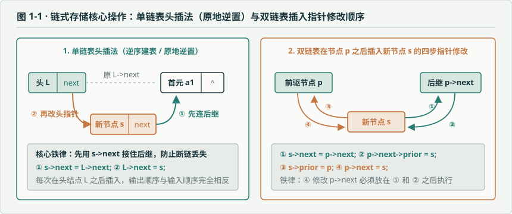
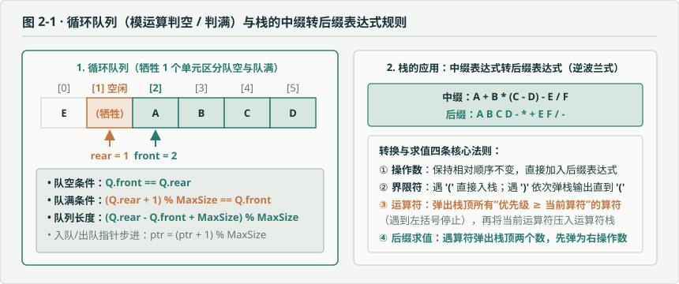
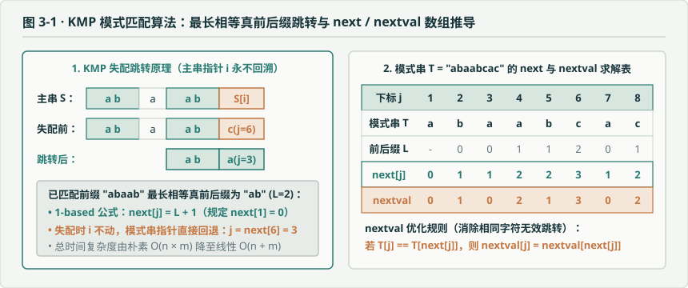
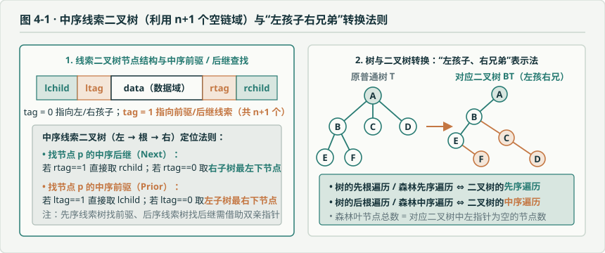
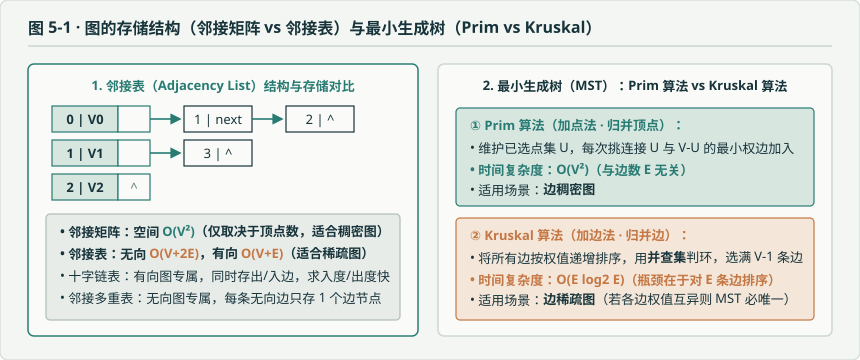
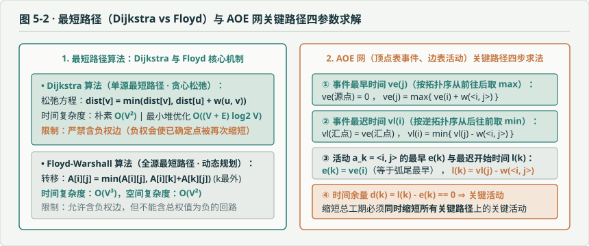
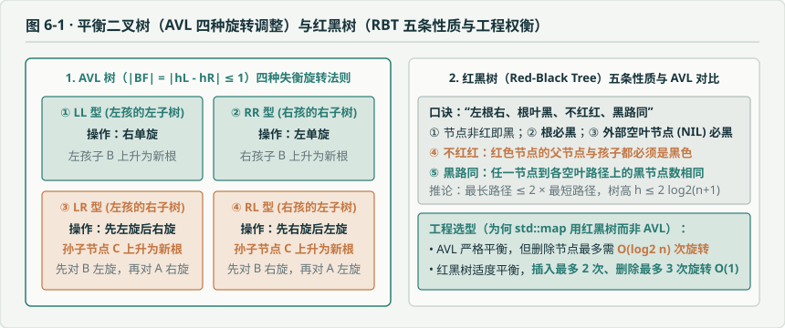
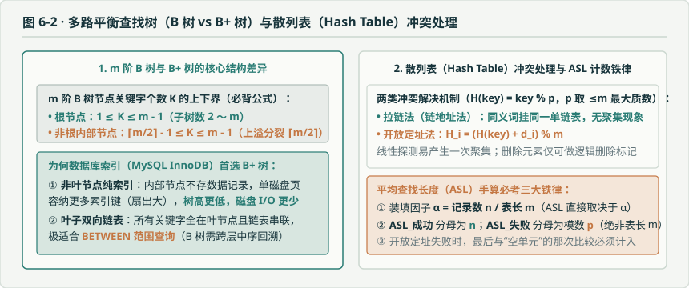
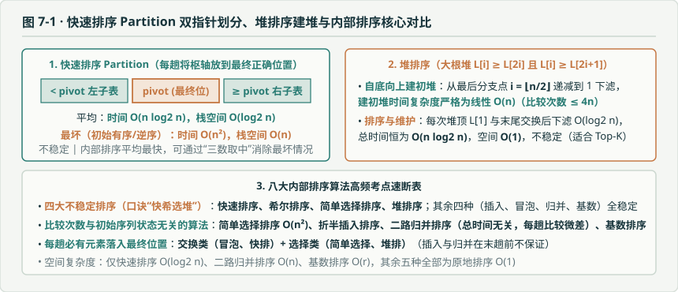

## 第一章 绪论与线性表

### 1.1 数据结构三要素与算法复杂度分析

1. **数据结构的三要素**
   - **逻辑结构（Logical Structure）**：数据元素之间的逻辑关系，与底层计算机存储无关，分为两大类四小类：
     1. **线性结构**：线性表、栈、队列、串、数组（元素间存在一对一的先后关系）。
     2. **非线性结构**：**集合**（元素间除同属一个集合外无其他关系）、**树形结构**（一对多的层次关系）、**图状结构 / 网状结构**（多对多的任意关联关系）。
   - **存储结构（物理结构，Physical Structure）**：逻辑结构在计算机内存中的具体映像实现，共四种基本方式：
     1. **顺序存储**：逻辑上相邻的元素存储在物理地址连续的内存单元中（优点：支持 `O(1)` 随机访问、存储密度为 1；缺点：插入删除需搬移大量元素、会产生外部碎片）。
     2. **链式存储**：借助指针域存放后继元素的存储地址，不要求物理地址连续（优点：插入删除只需修改指针、动态分配无外部碎片；缺点：不支持随机访问、只能顺序遍历、指针域占用额外空间导致存储密度 < 1）。
     3. **索引存储**：除存储数据元素外还建立附加索引表（关键字 → 物理地址），检索快但维护索引表有额外空间与修改开销。
     4. **散列（哈希）存储**：根据元素关键字通过散列函数直接计算出该元素的存储地址，平均查找、插入、删除时间复杂度均为 `O(1)`。
   - **数据的运算**：定义在逻辑结构上（声明运算功能），具体实现在存储结构上（确定算法步骤）。
2. **算法的时间复杂度与空间复杂度**
   - **时间复杂度 `T(n) = O(f(n))`**：衡量算法基本运算执行次数随问题规模 `n` 增长的渐进上界。
   - **常见渐进时间复杂度从小到大排序（必背）**：
     **`O(1) < O(log2 n) < O(n) < O(n log2 n) < O(n^2) < O(n^3) < O(2^n) < O(n!) < O(n^n)`**
   - **空间复杂度 `S(n) = O(g(n))`**：算法运行过程中临时开辟的**辅助空间**随问题规模 `n` 的增长率（递归算法的空间复杂度等于递归调用栈的最大深度 × 每次调用栈帧大小）。若所需辅助空间是与问题规模 `n` 无关的常数，则称该算法为**原地工作（In-place，`S(n) = O(1)`）**。

---

### 1.2 顺序表与链表

1. **顺序表（Sequential List）**
   - **地址计算公式**：设顺序表首元素 `a1`（或 `a0`）存放的起始地址为 `LOC(L)`，每个数据元素占用 `sizeof(ElemType) = d` 个字节，则第 `i` 个元素（1-based 下标）的内存地址为：
     **`LOC(ai) = LOC(L) + (i - 1) × d`**（支持 `O(1)` 随机存取）。
   - **插入与删除的平均移动次数**：
     - **插入操作**：在长度为 `n` 的顺序表第 `i`（`1 ≤ i ≤ n + 1`）个位置插入元素，需将第 `n` 至第 `i` 个元素依次后移，移动次数为 `n - i + 1`；若在每个位置插入等概率（`p = 1 / (n + 1)`），则**平均移动元素次数为 `n / 2`**，时间复杂度为 **`O(n)`**。
     - **删除操作**：删除第 `i`（`1 ≤ i ≤ n`）个元素，需将第 `i + 1` 至第 `n` 个元素依次前移，移动次数为 `n - i`；若删除每个位置等概率（`p = 1 / n`），则**平均移动元素次数为 `(n - 1) / 2`**，时间复杂度为 **`O(n)`**。
2. **单链表（Singly Linked List）**
   - **引入头结点（Head Node / Dummy Node）的两大原因**：
     1. **统一首元节点与其他节点的操作**：在链表第 1 个位置插入或删除节点时，无需专门修改头指针 `L` 本身，代码逻辑与中间节点完全一致；
     2. **统一空表与非空表的判定**：无论链表是否为空，头指针 `L` 永远非空（指向头结点），**带头结点单链表判空条件为 `L->next == NULL`**（不带头结点判空条件为 `L == NULL`）。
   - **单链表的两种建立方式（时间复杂度均为 `O(n)`）**：
     - **头插法（逆序建表 / 原地逆置）**：每次将新节点 `s` 插入在头结点 `L` 之后，核心两步指针顺序：**① `s->next = L->next;` ② `L->next = s;`**（顺序绝不可颠倒，否则丢失原首元节点地址）。头插法生成的链表元素顺序与输入顺序**完全相反**，常用于**单链表 `O(1)` 空间原地逆置**。
     - **尾插法（正序建表）**：必须维护一个始终指向当前表尾节点的**尾指针 `r`**，每次插入执行：**① `r->next = s;` ② `r = s;`**，最后令 `r->next = NULL`。



3. **双链表、循环链表与静态链表**
   - **双链表（Doubly Linked List）**：每个节点包含前驱指针 `prior` 和后继指针 `next`。
     - **在节点 `p` 之后插入新节点 `s` 的四步指针修改**：
       **① `s->next = p->next;` → ② `p->next->prior = s;` → ③ `s->prior = p;` → ④ `p->next = s;`**
       （铁律：只要保证**先用新节点 `s` 的指针接住 `p->next`，最后再修改 `p->next = s`** 即可防止断链）。
     - **删除节点 `p` 的后继节点 `q`（即 `q = p->next`）**：
       **① `p->next = q->next;` → ② `q->next->prior = p;` → ③ `free(q);`**
   - **循环链表（Circular Linked List）**：
     - **循环单链表**：表尾节点的 `next` 不为 `NULL` 而是指向头结点 `L`（判空条件：**`L->next == L`**）。若经常需要在表头和表尾同时进行操作，**仅设一个指向表尾节点的尾指针 `r` 最优**（此时找表尾是 `r`，找头结点是 `r->next`，找首元节点是 `r->next->next`，全部为 `O(1)`）。
     - **循环双链表**：头结点的 `prior` 指向表尾节点，表尾节点的 `next` 指向头结点（判空条件：**`L->next == L && L->prior == L`**）。
   - **静态链表（Static Linked List）**：借助一维结构体数组实现链式存储，利用数组下标（称为**游标 `cur`**）代替内存指针，以 `cur == -1`（或 `0`）表示表尾，适用于不支持指针的高级语言或固定容量的内存池分配。
4. **顺序表与链表的多维对比总结**

| 对比维度 | 顺序表（动态数组 `std::vector`） | 链表（单链表 / 双链表 `std::list`） |
| :--- | :--- | :--- |
| **存储分配与密度** | 连续内存空间，**存储密度 = 1**（无额外指针开销），CPU 缓存局部性（Cache Locality）极佳 | 离散内存节点，**存储密度 < 1**（每个节点需额外存储 1～2 个指针），缓存命中率低 |
| **按位查找（随机访问）** | **`O(1)`**（直接通过基址 + 偏移量计算） | **`O(n)`**（必须从头结点依次顺着指针遍历） |
| **按值查找** | 无序时 `O(n)`，**有序时可通过折半查找达到 `O(log2 n)`** | 无论有序无序均为 **`O(n)`**（链表无法在 `O(1)` 内定位中点，故不支持二分查找） |
| **插入与删除** | **`O(n)`**（平均需移动半数元素；尾部追加均摊 `O(1)`） | 已知前驱节点指针时修改指针仅需 **`O(1)`**（若需先按位查找则仍为 `O(n)`） |

---

## 第二章 栈、队列与数组

### 2.1 栈（Stack）与典型应用

1. **栈的基本性质与卡特兰数（Catalan）**
   - **定义**：只允许在固定的一端（**栈顶 Top**）进行插入（入栈 Push）和删除（出栈 Pop）操作的受限线性表，遵循**后进先出（LIFO，Last In First Out）**原则。
   - **出栈序列个数与合法性判定（卡特兰数必考公式）**：
     - 若有 `n` 个不同元素依次进栈（进栈过程中允许随时出栈），则所能得到的**不同合法出栈序列总数**由卡特兰数给出：
       **`Catalan(n) = C(2n, n) / (n + 1)`**
       （常用值：`n = 3` 时有 5 种，`n = 4` 时有 14 种，`n = 5` 时有 42 种）。
     - **出栈序列合法性判定法则**：在出栈序列中，**任意一个元素 `x` 后面所有比 `x` 先入栈（即编号比 `x` 小）的元素，必须按从大到小的逆序排列**（例如入栈顺序为 `1, 2, 3`，出栈序列中 `3` 后面的 `1, 2` 必须排成 `2, 1`，绝不可能出现 `3, 1, 2`）。
2. **顺序栈、共享栈与链栈**
   - **顺序栈**：采用数组 `data[MaxSize]` 存储，设栈顶指针 `top` 初始值为 **`-1`**（指向当前栈顶元素）：
     - **栈空条件**：`S.top == -1`；**栈满条件**：`S.top == MaxSize - 1`。
     - **入栈操作**：`S.data[++S.top] = x`（先加 1 后填入）；**出栈操作**：`x = S.data[S.top--]`（先取出后减 1）。
     - （注：若规定 `top` 初始值为 `0`，指向栈顶元素的下一个空位，则入栈为 `S.data[S.top++] = x`，出栈为 `x = S.data[--S.top]`）。
   - **共享栈（双栈共享一维数组）**：将两个顺序栈的栈底分别设置在数组的两端（`top0 = -1` 向上增长，`top1 = MaxSize` 向下增长），用于提高内存空间利用率、减少单栈上溢概率。**共享栈判满条件**：**`top1 - top0 == 1`**。
   - **链栈**：采用**不带头结点的单链表**实现，所有入栈与出栈操作均在**表头（栈顶）**进行，不存在栈满上溢问题。
3. **栈的四大经典工程应用**
   - **括号匹配检验**：扫描字符串，遇到左括号 `(`、`[`、`{` 压栈；遇到右括号时检查栈顶是否为同类型左括号（若栈空或类型不匹配则非法）；扫描结束时**栈必须为空**才算完全匹配。
   - **中缀表达式转后缀表达式（逆波兰式，Postfix）与求值**（无需括号即可唯一确定运算次序）：
     - **中缀转后缀算法（准备一个运算符栈）**：
       1. 遇到**操作数**：直接输出到后缀表达式；
       2. 遇到**左括号 `(`**：直接入栈；遇到**右括号 `)`**：依次弹出栈顶运算符并输出，直到弹出左括号 `(` 为止（括号本身不输出）；
       3. 遇到**运算符**：依次弹出栈中**优先级高于或等于**当前运算符的所有运算符并输出（若遇到 `(` 或栈空则停止），然后将当前运算符入栈；
       4. 扫描完毕后，将栈中剩余运算符依次弹出输出。
     - **后缀表达式求值算法（准备一个操作数栈）**：从左往右扫描后缀表达式，遇到操作数直接入栈；遇到二元运算符 `<op>` 时，从栈顶连续弹出两个操作数——**先弹出的是右操作数 `B`，后弹出的是左操作数 `A`**，计算 **`A <op> B`** 并将结果压回栈中。
   - **函数调用栈与递归转非递归**：每次函数调用都将返回地址、实参和局部变量压入系统调用栈；尾递归可直接改为循环，一般递归可显式维护用户栈模拟消去。
   - **单调栈（Monotonic Stack）**：栈内元素保持单调递增或单调递减，用于在 **`O(n)` 线性时间**内求解数组中每个元素左侧/右侧第一个比它大或比它小的元素（如柱状图最大矩形面积、接雨水问题）。

---

### 2.2 队列（Queue）与循环队列

1. **队列的基本性质与链队列**
   - **定义**：只允许在一端（**队尾 Rear**）进行插入（入队 EnQueue），而在另一端（**队头 Front**）进行删除（出队 DeQueue）的受限线性表，遵循**先进先出（FIFO，First In First Out）**原则。
   - **链队列**：同时带有**队头指针 `front`**（指向头结点）和**队尾指针 `rear`**（指向表尾节点）的单链表。出队时若删去的是最后一个节点，**必须同时将队尾指针 `rear` 重新指向头结点 `front`**，防止 `rear` 变成悬空野指针。
2. **循环队列（Circular Queue）与模运算（必考）**
   - **为什么需要循环队列（假溢出问题）**：在普通顺序队列中，随着元素不断入队和出队，`front` 和 `rear` 指针不断向数组高端移动；当 `rear == MaxSize` 时，即使数组低端仍有大量因出队留下的空闲单元，也无法继续入队（称为**假溢出**）。为此，通过**模运算 `% MaxSize`** 将一维数组在逻辑上首尾相连成环状，即**循环队列**。
   - **区分队空与队满的三种方案（默认采用方案一：牺牲 1 个存储单元）**：
     - 设 `Q.front` 指向队头元素，`Q.rear` 指向队尾元素的**下一个空闲位置**：



| 操作 / 判定项 | 方案一：牺牲 1 个单元（最常考） | 方案二：增设 `size` 计数器 | 方案三：增设 `tag` 标志位 |
| :--- | :--- | :--- | :--- |
| **入队指针步进** | `Q.rear = (Q.rear + 1) % MaxSize` | 同左，且 `Q.size++` | 同左，且置 `Q.tag = 1` |
| **出队指针步进** | `Q.front = (Q.front + 1) % MaxSize` | 同左，且 `Q.size--` | 同左，且置 `Q.tag = 0` |
| **队空判定条件** | **`Q.front == Q.rear`** | `Q.size == 0` | `Q.front == Q.rear && Q.tag == 0` |
| **队满判定条件** | **`(Q.rear + 1) % MaxSize == Q.front`** | `Q.size == MaxSize` | `Q.front == Q.rear && Q.tag == 1` |
| **当前元素个数** | **`(Q.rear - Q.front + MaxSize) % MaxSize`** | `Q.size` | 满时 `MaxSize`，否则同方案一 |

3. **双端队列（Deque）与单调队列**
   - **双端队列**：允许在两端都进行入队和出队的线性表（分为输出受限的双端队列和输入受限的双端队列）。
   - **单调队列**：基于双端队列实现，队头维护当前窗口最值，队尾在入队时淘汰所有比新元素更劣的旧元素，用于在 **`O(n)` 线性时间**内求解**滑动窗口最大值 / 最小值**问题。

---

### 2.3 多维数组与特殊矩阵压缩存储

1. **二维数组的行优先与列优先地址计算**
   设二维数组 `A[0 .. m-1][0 .. n-1]`（共 `m` 行 `n` 列，0-based 下标），首元素 `A[0][0]` 地址为 `LOC(0, 0)`，每个元素占 `d` 个存储单元：
   - **按行优先存储（C / C++ / C# 默认方式）**：先存完第 0 行，再存第 1 行……元素 `A[i][j]` 前面共有 `i` 整行（`i × n` 个元素）加上本行前面的 `j` 个元素：
     **`LOC(i, j) = LOC(0, 0) + (i × n + j) × d`**
   - **按列优先存储（Fortran / MATLAB 方式）**：元素 `A[i][j]` 前面共有 `j` 整列（`j × m` 个元素）加上本列前面的 `i` 个元素：
     **`LOC(i, j) = LOC(0, 0) + (j × m + i) × d`**
2. **特殊矩阵的一维数组压缩存储（1-based 矩阵下标 `aij`，`1 ≤ i, j ≤ n`）**
   - **n 阶对称矩阵（`aij = aji`）**：只存储主对角线及下三角区的 **`n(n + 1) / 2`** 个元素到一维数组 `B[0 .. n(n+1)/2 - 1]` 中（按行优先）：
     - 当 **`i ≥ j`（下三角及主对角线）** 时，前面 `i - 1` 行共有 `1 + 2 + ... + (i - 1) = i(i - 1)/2` 个元素，第 `i` 行前面有 `j - 1` 个元素，故对应一维数组 `B` 的 0-based 下标 `k` 为：
       **`k = i(i - 1) / 2 + j - 1`**
     - 当 **`i < j`（上三角区）** 时，利用对称性 `aij = aji` 互换 `i` 和 `j`：
       **`k = j(j - 1) / 2 + i - 1`**
   - **n 阶三角矩阵（下三角矩阵 / 上三角矩阵）**：除存储三角区 `n(n + 1) / 2` 个元素外，在数组末尾最后一个位置 **`B[n(n + 1) / 2]`** 额外存 1 个常数 `c`（共需 `n(n + 1) / 2 + 1` 个单元）。
   - **n 阶三对角矩阵（带状矩阵，仅 `|i - j| ≤ 1` 时非零）**：共含 `3n - 2` 个非零元素，按行优先存入 `B[0 .. 3n - 3]` 时，元素 `aij` 对应的 0-based 下标为：
     **`k = 2i + j - 3`**
3. **稀疏矩阵（Sparse Matrix）**
   - 非零元素个数远小于矩阵总元素个数且分布无规律时，仅存储非零元素的**行号、列号和值**：
     - **顺序存储**：**三元组表 `<row, col, val>`**（压缩后失去随机存取能力）。
     - **链式存储**：**十字链表（Orthogonal List）**，为每一行设一个行头指针、每一列设一个列头指针，每个非零元素节点同时挂在所在行的链表和所在列的链表上。

---

## 第三章 串与 KMP 模式匹配

### 3.1 串的存储与朴素模式匹配（BF 算法）

1. **串（String）的基本概念**
   - **子串与主串**：串中任意个**连续字符**组成的子序列称为该串的子串（注意与不要求连续的“子序列”区分）。空串是任何串的子串；长度为 `n` 的字符串（各字符互异时）共有 **`n(n + 1) / 2 + 1`** 个子串（含空串）。
2. **朴素模式匹配算法（Brute-Force，暴力匹配）**
   - 设主串 `S` 长度为 `n`，模式串 `T` 长度为 `m`（下标从 1 开始）：
   - **过程**：主串指针 `i` 和模式串指针 `j` 同步后移比较；一旦在某位置失配（`S[i] != T[j]`），**模式串整体右移 1 位**，即模式串指针重置为 **`j = 1`**，而**主串指针必须回溯到上次起始位置的下一位：`i = i - j + 2`**（0-based 下标为 `i = i - j + 1`）。
   - **缺陷与最坏时间复杂度**：当主串为 `"0000000001"`、模式串为 `"0001"` 时，每次都在模式串最后一位失配并回溯，最坏时间复杂度高达 **`O(n × m)`**。

---

### 3.2 KMP 算法与 next / nextval 数组推导

1. **KMP 算法消除主串指针回溯的核心原理**
   - 当主串 `S[i]` 与模式串 `T[j]` 失配时，主串前面刚刚匹配成功的那一段子串 `S[i-j+1 .. i-1]` 其实完全等于模式串的前缀 `T[1 .. j-1]`（这是已知信息，根本不需要把主串指针 `i` 倒回去重新比对）。
   - 只需在模式串已匹配的前缀子串 **`T[1 .. j-1]`** 中，找出其**最长的相等真前缀与真后缀**（真前后缀即不包含串本身的前缀与后缀），设其最大长度为 **`L`**，则说明模式串开头的 `T[1 .. L]` 已经与主串 `S[i]` 前面的 `L` 个字符完全重合！
   - 因此，失配时**主串指针 `i` 永远保持不动（绝不回溯）**，只需将**模式串指针 `j` 直接回退到第 `L + 1` 个位置（即 `j = next[j]`）**继续与 `S[i]` 比较即可，使总时间复杂度降至线性 **`O(n + m)`**（其中求 `next` 数组为 `O(m)`，匹配过程为 `O(n)`）。



2. **手算求 `next[j]` 数组的三步口诀（严蔚敏 1-based 标准）**
   对于模式串 `T[1 .. m]` 的第 `j` 位：
   1. **第 1 位固定为 0**：规定 **`next[1] = 0`**（表示连模式串第 1 个字符都失配时，应将主串 `i` 与模式串 `j=0` 同时加 1 后移）；
   2. **第 2 位固定为 1**：因为长度为 1 的前缀 `T[1]` 没有非空真前后缀（`L = 0`），故 **`next[2] = 0 + 1 = 1`**；
   3. **对 `j ≥ 3`**：遮住第 `j` 个字符本身，只看它前面的**前 `j - 1` 个字符组成的子串 `T[1 .. j-1]`**，找出该子串**最长相等真前缀与真后缀的长度 `L`**，则：
      **`next[j] = L + 1`**
      （注：若考题规定采用 0-based 数组且 `next[0] = -1`，则只需将上述 1-based 的整个 `next` 数组所有元素统一减 1，即 `next_0[j] = L`）。
3. **KMP 算法的进一步优化：`nextval[j]` 数组**
   - **为什么需要 `nextval` 优化**：假设模式串为 `T = "aaaaab"`，当在 `j = 4`（字符 `'a'`）处与主串 `S[i] = 'c'` 失配时，按 `next[4] = 3` 回退后，`T[3]` 依然是相同的字符 `'a'`，必然再次与 `'c'` 失配，产生一连串毫无意义的连续无效比较。
   - **`nextval[j]` 的手算与递推规则（从左往右依次填写）**：
     1. 固定 **`nextval[1] = 0`**；
     2. 对 `j = 2, 3, ..., m`，比较当前字符 `T[j]` 与它即将回退到的目标字符 `T[next[j]]`：
        - **若 `T[j] != T[next[j]]`**（回退后的字符不同，回退有效）：保持原值不变，即 **`nextval[j] = next[j]`**；
        - **若 `T[j] == T[next[j]]`**（回退后的字符相同，回退必再次失配）：直接继承目标位置的 `nextval` 值一步跳到底，即 **`nextval[j] = nextval[next[j]]`**。
4. **KMP 算法与求 `next` / `nextval` 标准 C++ 实现**

```cpp
// 1. 求模式串 T (1-based, T[1..m]) 的 next 数组
void get_next(const char T[], int m, int next[]) {
    int i = 1, j = 0;
    next[1] = 0;
    while (i < m) {
        if (j == 0 || T[i] == T[j]) {
            ++i; ++j;
            next[i] = j;          // 若求 nextval：若 T[i] != T[j] 则 nextval[i] = j;
                                  // 否则 nextval[i] = nextval[j];
        } else {
            j = next[j];          // 前缀指针利用已知 next 值回退
        }
    }
}

// 2. KMP 主串匹配过程：主串 S[1..n], 模式串 T[1..m]
int index_KMP(const char S[], int n, const char T[], int m, const int next[]) {
    int i = 1, j = 1;
    while (i <= n && j <= m) {
        if (j == 0 || S[i] == T[j]) {
            ++i; ++j;             // 继续比较后继字符（主串指针 i 只进不退）
        } else {
            j = next[j];          // 主串 i 不变，仅模式串 j 回退
        }
    }
    return (j > m) ? (i - m) : 0; // 匹配成功返回起始位置，失败返回 0
}
```

---

## 第四章 树与二叉树

### 4.1 二叉树的五个核心性质与存储结构

1. **树与二叉树的基本概念**
   - **二叉树与度为 2 的有序树的两大区别**：
     1. 二叉树允许为空树，而度为 2 的树至少有 3 个节点；
     2. 二叉树每个节点的子树**严格区分左子树和右子树**（即使某节点只有一棵子树，也必须明确它是左孩子还是右孩子）。
   - **满二叉树（Full Binary Tree）**：高度为 `h` 且含有 **`2^h - 1`** 个节点的二叉树（每一层节点数都达到最大值 `2^(k-1)`）。
   - **完全二叉树（Complete Binary Tree）**：高度为 `h`、有 `n` 个节点的二叉树，当且仅当其每个节点都与高度为 `h` 的满二叉树中编号为 `1 ～ n` 的节点一一对应（即**除最后一层外其余各层全满，且最后一层节点全部连续集中在最左侧**，度为 1 的节点只可能为 **0 个或 1 个**，且若存在必只有左孩子）。
2. **二叉树的五大必考性质**
   - **性质 1（叶子节点与度为 2 节点关系）**：对任何非空二叉树，设度为 0（叶子）、1、2 的节点个数分别为 `n0`、`n1`、`n2`，则恒有：
     **`n0 = n2 + 1`**
     （推导：总节点数 `n = n0 + n1 + n2`，总分支数/边数 `B = n - 1 = n1 + 2 × n2`，两式相减即得 `n0 = n2 + 1`；推广到普通树：`n = 1 + Σ (i × ni)`）。
   - **性质 2（第 k 层最大节点数）**：非空二叉树第 `k` 层（根为第 1 层）上至多有 **`2^(k - 1)`** 个节点。
   - **性质 3（高度为 h 的最大节点数）**：高度为 `h` 的二叉树至多有 **`2^h - 1`** 个节点。
   - **性质 4（完全二叉树的高度公式）**：具有 `n` 个节点的完全二叉树的高度 `h` 为：
     **`h = ⌊log2 n⌋ + 1`** 或 **`⌈log2(n + 1)⌉`**
   - **性质 5（完全二叉树层序编号 `1 .. n` 的父子下标关系）**：
     - 节点 `i`（`i > 1`）的双亲节点编号为 **`⌊i / 2⌋`**；
     - 节点 `i` 的左孩子编号为 **`2i`**（若 `2i > n` 则无左孩子，即 **`i > ⌊n / 2⌋` 的节点全为叶子节点**，最后一个分支节点编号为 **`⌊n / 2⌋`**）；
     - 节点 `i` 的右孩子编号为 **`2i + 1`**（若 `2i + 1 > n` 则无右孩子）。
3. **二叉树的顺序存储与链式存储**
   - **顺序存储**：按完全二叉树编号存入一维数组 `tree[1 .. n]`。仅适合**完全二叉树和满二叉树**（如堆）；若存储普通二叉树（最坏退化为单支树），高度为 `h` 需占用 `2^h - 1` 个数组单元，空间浪费极大。
   - **二叉链表（`lchild | data | rchild`）**：
     - **空链域个数公式（必考）**：在含有 `n` 个节点的二叉链表中，共有 `2n` 个指针域；除根节点外每个节点都恰好被 1 条父指针指向（共占用 `n - 1` 个非空指针域），因此必定剩余 **`2n - (n - 1) = n + 1` 个空链域**（可用于构造线索二叉树）。
     - （推广：若采用含有 `k` 个孩子指针的 **k 叉链表**存储 `n` 个节点的 k 叉树，则空链域个数为 **`k × n - (n - 1) = (k - 1)n + 1`**）。

---

### 4.2 二叉树的遍历、序列唯一还原与线索化

1. **二叉树的四种遍历方式（时间复杂度与空间复杂度均为 `O(n)`）**
   - **先序遍历（PreOrder，NLR）**：根 → 左子树 → 右子树（序列的**第一个元素必为整棵树的根**）。
   - **中序遍历（InOrder，LNR）**：左子树 → 根 → 右子树（根节点将序列**左右切分为左子树节点集合与右子树节点集合**）。
   - **后序遍历（PostOrder，LRN）**：左子树 → 右子树 → 根（序列的**最后一个元素必为整棵树的根**；后序非递归遍历栈中的剩余元素恰好构成当前节点的所有祖先路径）。
   - **层序遍历（LevelOrder）**：借助一个**队列（Queue）**，根节点入队；每次出队一个节点访问，并将其非空左孩子、右孩子依次入队，直至队空。
2. **由遍历序列唯一还原二叉树的充要条件**
   - **核心铁律**：**必须包含“中序遍历序列”**！因为先序、后序、层序只负责提供“谁是当前子树的根”，而只有**中序序列才能区分哪些节点属于左子树、哪些节点属于右子树**。
   - **可以唯一确定一棵二叉树的三种组合**：
     1. **先序序列 + 中序序列**（由先序首元素定根，在中序中切分左右子树长度，递归还原）；
     2. **后序序列 + 中序序列**（由后序尾元素定根，在中序中切分左右子树长度，递归还原）；
     3. **层序序列 + 中序序列**（由层序首元素定根，在中序中切分左右子树，递归还原）。
   - **不能唯一确定二叉树的组合**：**先序 + 后序**（当存在度为 1 的单孩子节点时，无法区分该孩子是左孩子还是右孩子；特别地，若先序序列与后序序列**完全相反**，则该二叉树每层只有一个节点，即**高度等于节点数 `n` 的单支树**）。
3. **线索二叉树（Threaded Binary Tree）**
   - **为什么引入线索化**：含有 `n` 个节点的二叉链表中存在 `n + 1` 个闲置空指针，同时在二叉链表上无法直接获知某节点在遍历序列中的直接前驱和直接后继。因此，利用这 **`n + 1` 个空链域**存放指向遍历前驱和后继的指针（称为**线索**），并增设两个标志位 `ltag` 和 `rtag`：
     - **`ltag == 0`**：`lchild` 指向左孩子；**`ltag == 1`**：`lchild` 指向遍历**前驱**。
     - **`rtag == 0`**：`rchild` 指向右孩子；**`rtag == 1`**：`rchild` 指向遍历**后继**。
   - **中序线索二叉树找后继与找前驱（无需递归栈即可 `O(1)` 空间遍历全树）**：
     - **找节点 `p` 的中序后继**：若 `p->rtag == 1`，直接返回 `p->rchild`；若 `p->rtag == 0`（有右子树），则后继必为 **`p` 的右子树中最左下角的节点**（沿右孩子的左指针一路到底）。
     - **找节点 `p` 的中序前驱**：若 `p->ltag == 1`，直接返回 `p->lchild`；若 `p->ltag == 0`（有左子树），则前驱必为 **`p` 的左子树中最右下角的节点**。



---

### 4.3 树、森林与二叉树的转换及并查集

1. **树的三种存储结构**
   - **双亲表示法（顺序数组）**：每个节点存储数据 `data` 和父节点数组下标 `parent`（根节点 `parent = -1`）。找父节点 `O(1)`，找孩子需遍历全表（**并查集底层采用此结构**）。
   - **孩子表示法（顺序 + 链式）**：把每个节点的所有孩子节点串成一个单链表（类似于图的邻接表），找孩子极快。
   - **孩子兄弟表示法（二叉链表，“左孩子、右兄弟”法则）**：
     - 每个节点设两个指针：**左指针 `firstchild` 指向该节点的第一个孩子**，**右指针 `nextsibling` 指向该节点的右侧相邻亲兄弟**。
     - 通过“左孩子、右兄弟”法则，**任意一棵普通树（或森林）都可以唯一地转换为一棵二叉树**（一棵树转换出的二叉树**根节点必定没有右子树**；森林转换时将各棵树的根视为亲兄弟依次连在右指针链上）。
2. **树、森林与二叉树的遍历对应关系（必考对照表）**

| 普通树 T 的遍历 | 森林 F 的遍历 | 转换后对应二叉树 BT 的遍历 |
| :--- | :--- | :--- |
| **先根遍历**（先访问根，再依次先根遍历各子树） | **先序遍历** | **先序遍历（PreOrder）** |
| **后根遍历**（先依次后根遍历各子树，最后访问根） | **中序遍历** | **中序遍历（InOrder）** |

   - **森林与转换后二叉树的叶节点关系**：由于普通树中的叶子节点是“没有孩子的节点”，而左指针 `lchild` 恰好代表“第一个孩子”，因此**树或森林中的叶子节点个数，严格等于其转换后对应二叉树中“左孩子指针 `lchild` 为空”的节点个数**。
3. **并查集（Disjoint Set / Union-Find）及其两大优化**
   - **作用**：高效处理不相交集合的**合并（Union）**与**查询两元素是否属于同一集合（Find）**（广泛用于 Kruskal 最小生成树判环、无向图连通分量计数）。
   - **双亲数组表示**：用数组 `S[i]` 记录元素 `i` 的父节点下标；若 `S[root] < 0`，则表示 `root` 是集合的树根，且绝对值 `|S[root]|` 记录该集合的节点总数（或树高）。
   - **两大性能优化（使单次操作均摊时间复杂度逼近常数 `O(α(n)) ≈ O(1)`）**：
     1. **按秩合并（小树合并到大树）**：`Union` 时比较两棵树的大小（或高度），始终将**节点数较少（或较矮）的小树根挂到节点数较多（或较高）的大树根下**，保证未压缩时树高不超过 `⌊log2 n⌋ + 1`。
     2. **路径压缩（Path Compression）**：在执行 `Find(x)` 查找根节点的过程中，将从 `x` 到根节点路径上的**所有节点的父指针直接改指到根节点**，将查找路径彻底拍扁。

```cpp
// 带路径压缩的 Find 与按大小合并的 Union（S[root] 初始化为 -1）
int Find(int S[], int x) {
    if (S[x] < 0) return x;
    return S[x] = Find(S, S[x]); // 递归找到根后，顺手将路径上所有节点直接挂到根下
}

void Union(int S[], int root1, int root2) {
    root1 = Find(S, root1);
    root2 = Find(S, root2);
    if (root1 == root2) return;
    if (S[root1] < S[root2]) {   // S[root] 为负数，值越小代表集合节点数越多
        S[root1] += S[root2];    // 累加节点总数
        S[root2] = root1;        // 小树 root2 挂到大树 root1 下
    } else {
        S[root2] += S[root1];
        S[root1] = root2;
    }
}
```

---

## 第五章 图的存储与核心算法

### 5.1 图的四种存储结构对比

设图 `G = (V, E)` 含有 `|V| = n` 个顶点和 `|E| = e` 条边：



| 存储结构 | 存储方式与核心特征 | 空间复杂度 | 适用图类型与优缺点 |
| :--- | :--- | :--- | :--- |
| **1. 邻接矩阵** (Adjacency Matrix) | 一维数组存顶点 + 二维数组 `A[n][n]` 存边（无向图矩阵对称，第 `i` 行 `1` 的个数即为顶点 `i` 的度） | **`O(V^2)`**<br>（与边数无关） | 适合**稠密图**；表示唯一，`O(1)` 判定任意两点是否有边，但存稀疏图严重浪费空间 |
| **2. 邻接表** (Adjacency List) | 顶点表数组 + 每个顶点的出边单链表（边节点个数：无向图为 `2E`，有向图为 `E`） | 无向图 **`O(V + 2E)`**<br>有向图 **`O(V + E)`** | 适合**稀疏图**；表示不唯一（取决于边插入顺序）；有向图中求**出度**极快，但求**入度**需遍历全表（或额外建逆邻接表） |
| **3. 十字链表** (Orthogonal List) | 邻接表与逆邻接表的结合，每个弧节点同时串在弧尾的出边链和弧头的入边链上 | **`O(V + E)`** | **仅用于有向图**；既容易求顶点的出度，又容易求顶点的入度 |
| **4. 邻接多重表** (Adjacency Multilist) | 每条无向边只用一个边节点表示，同时链接它所依附的两个顶点的边链表 | **`O(V + E)`** | **仅用于无向图**；解决了普通邻接表中一条无向边需存两个节点、删除边繁琐的缺陷 |

---

### 5.2 图的遍历：DFS 与 BFS

1. **广度优先搜索（BFS，Breadth-First Search）**
   - **机制**：类似于树的**层序遍历**，必须借助一个**辅助队列 `Q`** 和访问标记数组 `visited[V]`，由近及远逐层向外扩展。
   - **复杂度**：辅助空间复杂度为 **`O(V)`**；时间复杂度在**邻接表**下为 **`O(V + E)`**，在**邻接矩阵**下为 **`O(V^2)`**。
   - **核心应用**：
     - **求解无权图（或等权图）的单源最短路径**：由于 BFS 严格按照距离起点的边数（层数）由小到大访问顶点，**第一次访问到目标顶点时的路径必为最短路径**。
     - **BFS 生成树**：在连通图上执行 BFS 所经过的边构成一棵**高度最小**的生成树。
2. **深度优先搜索（DFS，Depth-First Search）**
   - **机制**：类似于树的**先序遍历**，借助**递归调用栈（或显式用户栈）**，沿着一条路径一直走到无路可走时再回溯到上一顶点切换分支。
   - **复杂度**：递归栈辅助空间复杂度为 **`O(V)`**（最坏单支链深度为 `V`）；时间复杂度在**邻接表**下为 **`O(V + E)`**，在**邻接矩阵**下为 **`O(V^2)`**。
   - **遍历与连通分量个数**：对任意无向图，调用 `BFS(v)` 或 `DFS(v)` 顶层函数的**次数**，严格等于该无向图的**连通分量（连通分支）个数**。

---

### 5.3 最小生成树（MST）与最短路径

1. **最小生成树（Minimum Spanning Tree，MST）**
   - **定义与性质**：在连通带权无向图 `G` 中，包含全部 `V` 个顶点、含有 `V - 1` 条边且所有边权值之和最小的极小连通子图称为最小生成树。
     - **唯一性判定**：当图中存在权值相等的边时，最小生成树的**权值之和永远唯一**，但树的形态可能不唯一；若图中**各边的权值互不相等**，则其**最小生成树必定唯一**。
   - **两大贪心构造算法对比**：
     - **Prim 算法（归并顶点 / 加点法）**：从单一顶点出发维护已选集合 `U`，每轮扫描所有连接 `U` 与 `V - U` 的横跨边，挑选权值最小的边将新顶点并入 `U`，共循环 `V - 1` 轮。时间复杂度为 **`O(V^2)`**（只与顶点数有关，与边数无关，**适合边稠密图**）。
     - **Kruskal 算法（归并边 / 加边法）**：初始将 `V` 个顶点视为 `V` 个独立的连通分量，将所有 `E` 条边按权值从小到大排序，依次取出最小权边：若该边的两个端点在**并查集**中不属于同一集合（不构成回路），则选入该边并合并两个集合，直到选满 `V - 1` 条边。时间复杂度为 **`O(E log2 E)`**（**适合边稀疏图**）。
2. **最短路径算法：BFS、Dijkstra 与 Floyd**



| 算法名称 | 求解问题类型 | 边权限制条件 | 时间复杂度 | 核心思想 |
| :--- | :--- | :--- | :--- | :--- |
| **1. BFS 算法** | 单源最短路径 | **无权图**（或各边权值相等） | 邻接表 `O(V + E)`<br>邻接矩阵 `O(V^2)` | 按层广度扩展，首次到达即最短 |
| **2. Dijkstra 算法** | 单源最短路径 | **严禁包含负权边**<br>（要求 `w(u, v) ≥ 0`） | 朴素 **`O(V^2)`**<br>堆优化 **`O((V+E) log2 V)`** | **贪心策略**：每轮从未确定点集中选出 `dist` 最小的点 `u` 锁定，并松弛 `u` 的所有出边 |
| **3. Floyd 算法** | **各顶点间（全源）**最短路径 | **允许含负权边**<br>（禁止含负权回路） | **`O(V^3)`**<br>（三重循环） | **动态规划**：依次允许以顶点 `k = 0..V-1` 作为中转点，更新 `A[i][j] = min(A[i][j], A[i][k] + A[k][j])` |

   - **为什么 Dijkstra 算法不能用于含有负权边的图**：Dijkstra 基于贪心假设——“当前未访问点中距离源点最近的顶点 `u`，其最短路径已经最终确定，不可能再通过其他未访问顶点绕路变得更短”。当图中存在**负权边**时，后续通过某条负权边绕道过来的路径总和反而可能比已锁定的 `dist[u]` 更小，导致贪心前提失效。

---

### 5.4 有向无环图（DAG）：拓扑排序与关键路径

1. **AOV 网与拓扑排序（Topological Sort）**
   - **AOV 网（Activity On Vertex Network）**：用**顶点表示活动**、用**有向边 `<u, v>` 表示活动 `u` 必须先于活动 `v` 进行**的有向无环图（DAG）。
   - **拓扑排序算法步骤（Kahn 入度表法）**：
     1. 从 AOV 网中选择一个**入度为 0（没有前驱）**的顶点并输出；
     2. 从网中删去该顶点以及所有以它为起点的有向出边（即将它所有邻接点的入度减 1）；
     3. 重复步骤 1 和 2，直到当前网为空，或网中不存在入度为 0 的顶点为止。
   - **判环充要条件**：若最终输出的拓扑序列包含全部 `V` 个顶点，则该图是无环的 DAG；**若输出的顶点数少于 `V`，则说明剩余顶点中必定存在有向回路（环）**。
   - **复杂度与DFS逆后序**：邻接表下时间复杂度为 **`O(V + E)`**，邻接矩阵下为 **`O(V^2)`**。若对无环有向图执行 DFS 遍历，在顶点递归返回前将其压栈，则**出栈顺序（逆后序）也必定是一个合法的拓扑序列**（正后序即为**逆拓扑序列**）。
2. **AOE 网与关键路径（Critical Path）**
   - **AOE 网（Activity On Edge Network）**：用**顶点表示事件（瞬时状态）**、用**带权有向边表示活动及其持续时间（开销）**的有向无环图。源点（入度为 0）表示整个工程开始，汇点（出度为 0）表示整个工程结束。
   - **关键路径与关键活动的定义**：从源点到汇点所有路径中**具有最大路径长度（总权值最大）的路径**称为**关键路径**（关键路径的长度即为**完成整个工程的最短总工期**）；关键路径上的活动称为**关键活动**。
   - **求解关键路径的四个核心参数（必考手算步骤）**：
     1. **事件 `vk` 的最早发生时间 `ve(k)`（按拓扑序从前往后递推，取最大值 `max`）**：
        决定所有以 `vk` 为起点的活动最早什么时候能开工（必须等指向 `vk` 的所有前置活动全部完成）：
        `ve(源点) = 0` ， **`ve(j) = max{ ve(i) + w(<i, j>) }`**
     2. **事件 `vk` 的最迟发生时间 `vl(k)`（按逆拓扑序从后往前递推，取最小值 `min`）**：
        在不推迟整个工程总工期的前提下，事件 `vk` 最晚必须发生的时间：
        `vl(汇点) = ve(汇点)` ， **`vl(i) = min{ vl(j) - w(<i, j>) }`**
     3. **活动 `ak = <vi, vj>` 的最早开始时间 `e(k)` 与最迟开始时间 `l(k)`**：
        - 最早开始时间等于弧尾事件的最早发生时间：**`e(k) = ve(i)`**
        - 最迟开始时间等于弧头事件的最迟发生时间减去活动持续时间：**`l(k) = vl(j) - w(<i, j>)`**
     4. **活动 `ak` 的时间余量 `d(k) = l(k) - e(k)`**：
        当 **`d(k) == 0`（即 `e(k) == l(k)`）** 时，该活动没有任何机动余量，绝不可拖延，即为**关键活动**。
   - **缩短总工期的两条高频易错结论**：
     1. 加快某一个关键活动不一定能缩短整个工程的总工期——因为一个 AOE 网中**可能同时存在多条并行的关键路径**，只有**加快包含在所有关键路径上的公共关键活动（或同时缩短每一条关键路径）**，才能缩短总工期；
     2. 关键活动耗时缩短太多后，原本的非关键路径可能变成新的关键路径，因此不能无限缩短。

---

## 第六章 查找、平衡树与散列表

### 6.1 顺序查找、折半查找与分块查找

1. **平均查找长度（ASL，Average Search Length）**
   - **定义**：在查找过程中，给定值与表中关键字进行**比较次数的数学期望**，是衡量查找算法效率的核心指标，分为**查找成功 `ASL_成功`** 与**查找失败 `ASL_失败`**：
     **`ASL = Σ (Pi × Ci)`**（等概率下 `Pi = 1 / n`）。
2. **顺序查找（Sequential Search）**
   - **无序线性表**：从表的一端向另一端逐个比较（在 `a[0]` 设置“哨兵”可省去每步循环的数组下标越界检查）：
     - **`ASL_成功 = (n + 1) / 2`**
     - **`ASL_失败 = n + 1`**（带哨兵）或 **`n`**（不带哨兵）
   - **有序线性表**：查找成功时与无序表相同（`(n + 1) / 2`）；查找失败时一旦发现当前元素大于目标值即可提前终止（共有 `n + 1` 个失败区间），故 **`ASL_失败 = n / 2 + n / (n + 1)`**。
3. **折半查找（二分查找，Binary Search）**
   - **两大适用前提（必考易错点）**：
     1. 必须采用**顺序存储结构**（数组，支持 `O(1)` 随机定位中点 `mid = ⌊(low + high) / 2⌋`）；
     2. 表中元素必须按关键字**有序排列**（**链表即使有序也绝不支持折半查找**）。
   - **折半查找判定树（Decision Tree）的性质**：
     - 是一棵**平衡二叉排序树**：若 `mid = ⌊(low + high) / 2⌋`（向下取整），则树中**每一个节点的右子树节点数减去左子树节点数恒等于 `0` 或 `1`（右偏）**；若向上取整则恒等于 `0` 或 `-1`（左偏）。
     - **树高与最大比较次数**：含有 `n` 个内部（成功）节点的判定树，其高度（即折半查找成功或失败的**最多关键字比较次数**）为：
       **`h = ⌈log2(n + 1)⌉ = ⌊log2 n⌋ + 1`**
     - **失败节点个数**：判定树共有 **`n + 1` 个外部方形叶节点（失败节点）**，查找失败的比较次数等于对应方形叶节点的上一层圆形内部父节点所在的层数。
     - **时间复杂度**：**`O(log2 n)`**。
4. **分块查找（索引顺序查找）**
   - **结构特点**：“**块内无序、块间有序**”（第 `i` 块中的所有关键字均小于第 `i + 1` 块中的所有关键字），建立一个存储每块最大关键字及块起始地址的**索引表**。
   - **查找过程与最优分块长度**：先在索引表中查找确定所在块（可顺序或折半），再在块内顺序查找。设长度为 `n` 的表均匀分为 `b` 块，每块含 `s` 个元素（`b = n / s`），若索引表和块内均采用顺序查找，则：
     **`ASL = (b + 1) / 2 + (s + 1) / 2 = (n / s + s) / 2 + 1`**
     由均值不等式可知，当每块长度 **`s = √n`** 时，平均查找长度取最小值 **`ASL_min = √n + 1`**。

---

### 6.2 二叉排序树（BST）、平衡二叉树（AVL）与红黑树（RBT）

1. **二叉排序树（BST，Binary Search Tree）**
   - **定义与中序性质**：左子树所有节点值 < 根节点值 < 右子树所有节点值。**对二叉排序树执行中序遍历，必得到一个严格递增的有序序列**。
   - **BST 删除节点 `p` 的三种情况**：
     1. `p` 为**叶子节点**：直接删除，不会破坏 BST 性质；
     2. `p` **只有左子树或只有右子树**：直接用 `p` 的唯一子树顶替 `p` 的位置；
     3. `p` **既有左子树又有右子树**：找到 `p` 在中序遍历下的**直接后继（即 `p` 的右子树中最左下角的节点 `s`）**（或直接前驱：左子树中最右下角的节点），用 `s` 的数据值覆盖 `p` 的数据值，然后转而删除节点 `s`（`s` 必无左子树，转化为情况 1 或 2）。
   - **查找效率**：最好情况（平衡树）为 **`O(log2 n)`**；最坏情况（输入序列有序，退化为高 `n` 的单支树）为 **`O(n)`**。
2. **平衡二叉树（AVL 树）**
   - **定义与平衡因子**：树上任一节点的**左子树高度减去右子树高度的值（称为平衡因子 `BF = hL - hR`）的绝对值不超过 1**（即 `BF ∈ {-1, 0, 1}`）。
   - **高度为 `h` 的 AVL 树最少节点数递推公式（必背）**：
     **`N_h = N_(h-1) + N_(h-2) + 1`**（其中 `N0 = 0, N1 = 1, N2 = 2, N3 = 4, N4 = 7, N5 = 12, N6 = 20`）。
   - **四种失衡旋转调整法则（针对离插入点最近的、`|BF| == 2` 的最小不平衡子树根 `A`）**：
     1. **LL 平衡旋转（在 A 的左孩子 B 的左子树插入）**：**右单旋**——左孩子 `B` 上升为新根，`A` 降为 `B` 的右孩子，`B` 原来的右子树作为 `A` 的左子树。
     2. **RR 平衡旋转（在 A 的右孩子 B 的右子树插入）**：**左单旋**——右孩子 `B` 上升为新根，`A` 降为 `B` 的左孩子，`B` 原来的左子树作为 `A` 的右子树。
     3. **LR 平衡旋转（在 A 的左孩子 B 的右子树 C 插入）**：**先左后右双旋**——先对 `B` 和 `C` 做一次左旋转化为 LL 型，再对 `A` 做一次右旋，最终**孙子节点 `C` 一步越级上升为新根**（`B` 为左孩子、`A` 为右孩子）。
     4. **RL 平衡旋转（在 A 的右孩子 B 的左子树 C 插入）**：**先右后左双旋**——先对 `B` 和 `C` 做一次右旋转化为 RR 型，再对 `A` 做一次左旋，最终**孙子节点 `C` 一步越级上升为新根**。



3. **红黑树（Red-Black Tree，RBT）**
   - **五条红黑性质（口诀：“左根右、根叶黑、不红红、黑路同”）**：
     1. 每个节点非红即黑；
     2. **根节点必为黑色**；
     3. **所有外部空叶节点（NIL 节点）必为黑色**；
     4. **不红红**：不存在两个相邻的红色节点（红色节点的父节点和左、右孩子都必须是黑色）；
     5. **黑路同**：从任一节点出发到达其麾下所有空叶节点（NIL）的简单路径上，**包含相同数目的黑色节点**（该数目称为节点的**黑高 `bh`**）。
   - **核心高度性质**：由性质 4 和 5 可知，从根到叶子的**最长路径（红黑交替）不会超过最短路径（全黑）的 2 倍**；含有 `n` 个内部节点的红黑树高度满足 **`h ≤ 2 log2(n + 1)`**，查找、插入、删除时间复杂度均为 **`O(log2 n)`**。
   - **AVL 树与红黑树的工程选型对比**：
     - **AVL 树**要求严格平衡（高度差 ≤ 1），适合**一次构建、极少增删、密集查询**的场景；但在删除节点时最坏需要沿祖先链一路回溯执行 **`O(log2 n)` 次旋转**。
     - **红黑树**放宽为适度平衡（最长路径 ≤ 2 倍最短路径），新插入节点默认染为**红色**（以免破坏最难维护的“黑路同”性质），通过变色与局部旋转即可恢复平衡——**任何插入最多只需 2 次旋转，任何删除最多只需 3 次旋转（旋转开销严格 `O(1)`）**，因此 C++ STL `std::map` / `std::set`、Java `TreeMap`、Linux `epoll` 与 CFS 进程调度器全部选用红黑树。

---

### 6.3 B 树、B+ 树与散列表（Hash Table）

1. **m 阶 B 树（多路平衡查找树）**
   - **节点关键字个数 `K` 与子树个数 `S` 的上下界（`S = K + 1`）**：
     - **根节点**：若非空，至少含 **`1` 个关键字（2 棵子树）**，至多含 **`m - 1` 个关键字（m 棵子树）**；
     - **除根以外的所有非叶内部节点**：至少含 **`⌈m / 2⌉ - 1` 个关键字（`⌈m / 2⌉` 棵子树）**，至多含 **`m - 1` 个关键字（m 棵子树）**；
     - **所有失败叶节点**均位于同一层，不携带任何信息。
   - **高度上下界公式**：含有 `n` 个关键字的 m 阶 B 树，其高度 `h`（不含失败叶节点层）满足：
     **`log_m (n + 1) ≤ h ≤ log_(⌈m/2⌉) ((n + 1) / 2) + 1`**
   - **B 树的插入分裂与删除合并**：
     - **插入上溢分裂**：当插入后某节点关键字数达到 **`m`** 时，从中间位置 **`⌈m / 2⌉`** 处劈开：左半部分 `[1 .. ⌈m/2⌉-1]` 留在原节点，右半部分 `[⌈m/2⌉+1 .. m]` 放入新节点，**中间第 `⌈m / 2⌉` 个关键字上移并入父节点**。
     - **删除下溢调整**：删除非终端节点关键字时，先用其**直接前驱（左子树最右下元素）或直接后继（右子树最左下元素）**替换，转化为删除终端节点；若删除后关键字数低于下限 **`⌈m / 2⌉ - 1`**：① **左/右亲兄弟够借**，则执行“**父下来、兄上去**”的旋转借位；② **左/右亲兄弟都不够借**，则将该节点、相邻兄弟以及父节点中夹在两者之间的分割关键字**三者合并为一个节点**。



2. **B 树与 B+ 树的三大核心区别（为什么数据库索引首选 B+ 树）**

| 对比维度 | m 阶 B 树（B-Tree） | m 阶 B+ 树（B+ Tree，MySQL InnoDB 索引） |
| :--- | :--- | :--- |
| **1. 关键字与子树对应关系** | `k` 个关键字对应 **`k + 1` 棵子树** | `k` 个关键字对应 **`k` 棵子树**（每个关键字是对应子树的最大值索引） |
| **2. 关键字出现位置与数据存放** | 各节点关键字互不重复，**内部节点和叶节点都存放数据记录指针**（查到即停，查询耗时不稳定） | **叶节点包含全部关键字及数据记录**，非叶内部节点**只存索引键不存数据记录**（单磁盘页扇出极大，树高更矮，磁盘 I/O 更少，每次查找均稳定走到叶节点） |
| **3. 查找方式与范围查询** | 仅支持从根节点出发的多路查找；区间范围查询需跨层反复中序回溯 | **所有叶节点通过双向指针连成有序链表**，既支持从根多路查找，又极度高效支持 **`BETWEEN` 范围扫描与全表顺序遍历** |

3. **散列表（Hash Table / 哈希表）**
   - **散列函数**：最常用**除留余数法 `H(key) = key % p`**（设散列表长为 `m`，`p` 应取**小于或等于表长 `m` 的最大质数**）。
   - **冲突解决的两大类方法**：
     1. **拉链法（链地址法）**：把所有散列地址相同的同义词存放在同一个单链表中（无聚集现象，支持直接物理删除）。
     2. **开放定址法 `Hi = (H(key) + di) % m`**：
        - **线性探测法**：`di = 0, 1, 2, ..., m - 1`（缺点：同义词与非同义词混杂抢位，导致严重的**一次聚集 / 堆积现象**）；
        - **平方探测法（二次探测法）**：`di = 0, 1^2, -1^2, 2^2, -2^2, ...`（消除一次聚集，但存在二次聚集，且表长 `m` 必须为形如 `4k + 3` 的质数才能探测全表）；
        - **双散列法（再散列法）**：`di = i × Hash2(key)`。
        - **开放定址法的删除铁律**：删除元素时**只能打上逻辑删除标记（Deleted）**，绝不能直接清空为 Empty，否则会截断后续同义词的探测查找路径。
   - **装填因子与 ASL 计算铁律**：
     - **装填因子 `α = 表中填入的记录数 n / 散列表长度 m`**（散列表的平均查找长度直接取决于 `α`）。
     - **计算 `ASL_成功`**：分母为**表中实际元素个数 `n`**；
     - **计算 `ASL_失败`**：分母永远是**散列函数模数 `p`（即 `0 .. p-1` 共 `p` 个合法初始散列入口，绝不是表长 `m`）**；在开放定址法中，向后探测直到**遇到第一个空单元（Empty）为止所比较的次数（含与空单元的那次比较）**即为该入口的失败查找长度。

---

## 第七章 排序算法体系

### 7.1 插入类与交换类排序

1. **插入类排序（基本思想：每次将一个待排记录按关键字大小插入到前面已排好序的子序列中）**
   - **直接插入排序**：
     - **最好情况（初始已正序）**：每趟只需与前一个元素比较 1 次且无需移动，比较次数为 `n - 1`，时间复杂度为 **`O(n)`**；
     - **最坏情况（初始完全逆序）**与**平均情况**：时间复杂度均为 **`O(n^2)`**；
     - **空间复杂度**：**`O(1)`**；**稳定性**：**稳定**（顺序存储与链式存储均适用，极其适合**元素基本有序或数据量较小**的场景）。
   - **折半插入排序**：仅对顺序表使用二分查找寻找插入位置，将**关键字比较次数固定降低为 `O(n log2 n)`（与初始序列状态无关）**，但元素移动次数仍为 `O(n^2)`，故总时间复杂度仍为 **`O(n^2)`**，**稳定**。
   - **希尔排序（Shell Sort，缩小增量排序）**：
     - 将相距某个增量 `dk`（`d1 > d2 > ... > dk = 1`）的元素组成子表分别进行直接插入排序，使表宏观上迅速基本有序，最后一趟以 `d = 1` 扫描全表。
     - **性质**：仅适用于**顺序存储**；空间复杂度 **`O(1)`**；平均时间复杂度约为 **`O(n^1.3)`**（优于 `O(n^2)`）；由于相同关键字可能被分到不同增量子表中发生跨越式交换，故**不稳定**。
2. **交换类排序（冒泡排序与快速排序）**
   - **冒泡排序（Bubble Sort）**：
     - 相邻元素两两比较，逆序则交换，**每趟排序必将当前无序区中的最大（或最小）元素沉到最终正确位置**。
     - **最好情况（初始有序）**：第一趟比较 `n - 1` 次且无任何交换发生，提前终止，时间复杂度 **`O(n)`**；最坏与平均时间复杂度 **`O(n^2)`**，空间 **`O(1)`**，**稳定**。
   - **快速排序（Quick Sort，所有同数量级内部排序算法中平均性能最优）**：
     - **核心原理（分治法 + Partition 双指针划分）**：在待排区间 `L[low .. high]` 中任选一个元素（通常取首元素 `pivot = L[low]`）作为**枢轴（基准）**，通过双指针交替从右往左找小于 `pivot` 的元素移到左端、从左往右找大于 `pivot` 的元素移到右端，直到 `low == high` 时将 `pivot` 填入。**每一趟 `Partition` 都必定将当前枢轴元素 `pivot` 放置到它最终排好序的绝对正确位置上**，并将原表切分为左右两个独立子区间递归处理。
     - **复杂度分析（必考）**：
       - **最好与平均情况**（每次枢轴近似平分区间，递归调用树高度为 `⌈log2(n + 1)⌉`）：时间复杂度为 **`O(n log2 n)`**，递归栈空间复杂度为 **`O(log2 n)`**。
       - **最坏情况**（**当初始序列已经基本有序或完全逆序时**，若每次仍选首/尾元素作枢轴，会导致一侧子表为空、另一侧为 `n - 1`，递归树退化为高度为 `n` 的单支斜树）：时间复杂度退化至 **`O(n^2)`**，递归栈空间复杂度退化至 **`O(n)`**。
       - **稳定性**：**不稳定**。

```cpp
// 快速排序核心：一趟双指针枢轴划分 Partition（时间 O(n)，空间 O(1)）
int Partition(int A[], int low, int high) {
    int pivot = A[low]; // 暂存首元素作为枢轴（工程上可先与 mid、high 做三数取中交换）
    while (low < high) {
        while (low < high && A[high] >= pivot) --high;
        A[low] = A[high]; // 将比枢轴小的元素移到左端空位
        while (low < high && A[low] <= pivot)  ++low;
        A[high] = A[low]; // 将比枢轴大的元素移到右端空位
    }
    A[low] = pivot;       // 枢轴落入最终正确位置 low == high
    return low;
}
```

---

### 7.2 选择类、归并排序、基数排序与外部排序

1. **选择类排序（简单选择排序与堆排序）**
   - **简单选择排序**：每趟在 `L[i .. n]` 中选出最小元素与 `L[i]` 交换。**关键字比较次数与初始序列状态完全无关，恒为 `n(n - 1) / 2`**，时间复杂度恒为 **`O(n^2)`**，空间 **`O(1)`**，**不稳定**。
   - **堆排序（Heap Sort）**：
     - **大根堆与小根堆**：将顺序数组 `L[1 .. n]` 视为完全二叉树，若满足 **`L[i] ≥ L[2i]` 且 `L[i] ≥ L[2i + 1]`**（`1 ≤ i ≤ ⌊n / 2⌋`），则为**大根堆**（堆顶 `L[1]` 为全局最大值）；若小于等于左右孩子则为**小根堆**。
     - **`O(n)` 自底向上建初堆（下滤 `HeadAdjust / siftDown`）**：从**最后一个分支节点 `i = ⌊n / 2⌋`** 开始，依次递减至根节点 `1`：若当前节点小于其左、右孩子中的较大者，则与该较大孩子交换，并继续向下检查直至满足堆性质。**建初堆的比较次数不超过 `4n`，时间复杂度严格为线性 `O(n)`**。
     - **堆的插入（上滤 `siftUp`）与排序输出**：
       - **在堆中插入新元素**：将新元素放到**数组末尾（叶节点）**，然后不断与父节点 `⌊i / 2⌋` 比较并**向上浮动（上滤）**，时间复杂度 **`O(log2 n)`**。
       - **堆排序过程**：共执行 `n - 1` 趟，每趟将**堆顶元素 `L[1]` 与当前堆尾元素 `L[i]` 交换**（最大值归位到末尾），然后将剩余前 `i - 1` 个元素从根节点 `1` 开始执行一次**下滤调整（`O(log2 n)`）**。
     - **性质**：最好、最坏、平均时间复杂度恒为 **`O(n log2 n)`**，空间复杂度 **`O(1)`**，**不稳定**（极其适合在海量数据流中用容量为 K 的小根堆筛选最大的 **Top-K 元素**）。
2. **归并排序、基数排序与外部排序**
   - **二路归并排序（2-Way Merge Sort）**：
     - 初始将 `n` 个元素视为 `n` 个长度为 1 的有序子表，每趟两两归并（双指针合并两个有序表耗时 `O(n)`），共需 **`⌈log2 n⌉` 趟**。
     - **性质**：最好、最坏、平均时间复杂度恒为 **`O(n log2 n)`**；需要 **`O(n)` 的额外辅助数组空间**；**稳定**。
   - **基数排序（Radix Sort，不基于比较的排序）**：
     - 将关键字拆分为 `d` 个位（如个位、十位、百位），基数为 `r`（如十进制 `r = 10` 个队列），按**最低位优先（LSD）**或最高位优先（MSD）依次执行 **`d` 趟“分配（`O(n)`）”与“收集（`O(r)`）”**。
     - **性质**：时间复杂度为 **`O(d × (n + r))`**，辅助空间复杂度为 **`O(r)`**（`r` 个队列头尾指针），**稳定**。
   - **外部排序（External Sorting）核心提速机制**：
     - 针对超大文件无法一次性装入内存的场景，采用**归并排序**框架，**磁盘 I/O 读写次数是最大性能瓶颈**（归并趟数 `S = ⌈log_k r⌉`，其中 `r` 为初始归并段个数，`k` 为归并路数）。
     - **三大核心组件**：
       1. **败者树（Loser Tree）**：在 `k` 路平衡归并时，用一棵含 `k` 个叶子的完全二叉树记录比赛败者（胜者向上晋级），将每选出一个极值所需的内部关键字比较次数从 `k - 1` 降低至 **`⌈log2 k⌉`**，从而允许大幅增加归并路数 `k` 而不增加 CPU 内部比较负担。
       2. **置换-选择排序（Replacement-Selection）**：利用堆在内存工作区（容量为 `w`）边输出边读入，打破初始归并段长度受限于内存容量 `w` 的限制，可生成**平均长度为 `2w`** 的初始归并段，使初始归并段总数 `r` 减半。
       3. **最佳归并树（k 叉哈夫曼树）**：当各初始归并段长度不等时，将各段长度作为叶节点权值构造 **k 叉哈夫曼树**，使总磁盘读写次数（`= 2 × WPL`）达到最小。**补虚段公式**：若初始归并段个数 `r` 不满足 `(r - 1) % (k - 1) == 0`，则必须在叶子层补充 **`u = (k - 1) - (r - 1) % (k - 1)`** 个**长度为 0 的虚段**后再开始合并。

---

### 7.3 八大内部排序算法全景对比总表



| 排序算法 | 平均时间复杂度 | 最好时间复杂度 | 最坏时间复杂度 | 辅助空间复杂度 | 稳定性 | 每趟是否有元素归位 |
| :--- | :---: | :---: | :---: | :---: | :---: | :---: |
| **1. 直接插入排序** | `O(n^2)` | **`O(n)`**（正序） | `O(n^2)`（逆序） | `O(1)` | **稳定** | 否 |
| **2. 折半插入排序** | `O(n^2)` | `O(n^2)`（比较 `O(n log2 n)`） | `O(n^2)` | `O(1)` | **稳定** | 否 |
| **3. 希尔排序** | `≈ O(n^1.3)` | - | `O(n^2)` | `O(1)` | **不稳定** | 否 |
| **4. 冒泡排序** | `O(n^2)` | **`O(n)`**（正序） | `O(n^2)`（逆序） | `O(1)` | **稳定** | **是** |
| **5. 快速排序** | **`O(n log2 n)`** | **`O(n log2 n)`** | **`O(n^2)`**（有序/逆序） | **`O(log2 n)`**（最坏 `O(n)`） | **不稳定** | **是**（枢轴归位） |
| **6. 简单选择排序** | `O(n^2)` | `O(n^2)`（比较恒定） | `O(n^2)` | `O(1)` | **不稳定** | **是** |
| **7. 堆排序** | **`O(n log2 n)`** | **`O(n log2 n)`**（建堆 `O(n)`） | **`O(n log2 n)`** | **`O(1)`** | **不稳定** | **是**（堆顶归位） |
| **8. 二路归并排序** | **`O(n log2 n)`** | **`O(n log2 n)`** | **`O(n log2 n)`** | **`O(n)`** | **稳定** | 否 |
| **9. 基数排序** | **`O(d(n + r))`** | **`O(d(n + r))`** | **`O(d(n + r))`** | **`O(r)`** | **稳定** | 否 |
