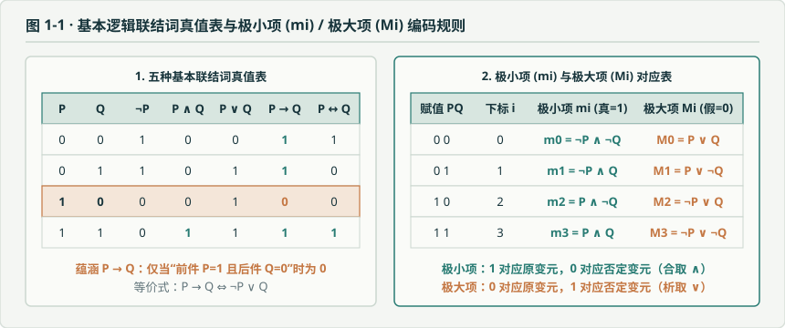
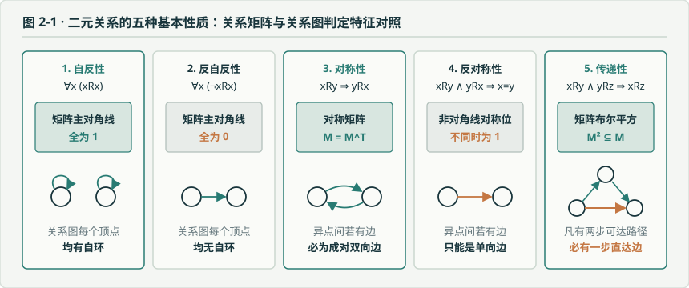
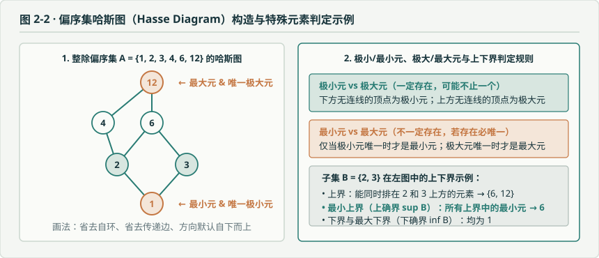

## 第一章 数理逻辑

### 1.1 命题与五种基本联结词

1. **命题（Proposition）**
   - **定义**：非真即假的陈述句称为命题。判断结果为真的称为真命题（真值记为 1 或 T），判断结果为假的称为假命题（真值记为 0 或 F）。疑问句、祈使句、感叹句以及真值随变量变化的开语句（如 x > 3）均不是命题。
   - **分类**：不能再分解为更简单命题的称为**原子命题（简单命题）**；由原子命题通过逻辑联结词组合而成的称为**复合命题**。
2. **五种基本逻辑联结词**
   - **否定（¬P）**：当 P 为 1 时，¬P 为 0；当 P 为 0 时，¬P 为 1。
   - **合取（P ∧ Q，与）**：仅当 P 与 Q **同时为 1** 时，P ∧ Q 为 1；否则为 0。
   - **析取（P ∨ Q，或）**：仅当 P 与 Q **同时为 0** 时，P ∨ Q 为 0；只要有一个为 1 即为 1（可兼或）。
   - **蕴涵（P → Q，如果 P 则 Q）**：P 称为前件，Q 称为后件。**仅当“前件 P 为 1 且后件 Q 为 0”时，P → Q 为 0**；当 P 为 0 时，无论 Q 取何值，P → Q 恒为 1（善意推定）。
   - **等价（P ↔ Q，当且仅当）**：当 P 与 Q **真值相同**（同为 1 或同为 0）时，P ↔ Q 为 1；真值不同时为 0。
   - **联结词运算优先级**（由高到低）：括号 `()` → 否定 `¬` → 合取 `∧` → 析取 `∨` → 蕴涵 `→` → 等价 `↔`。

---

### 1.2 命题公式、等值演算与主范式

1. **命题公式的三种类型**
   - **重言式（永真式，Tautology）**：在所有可能的真值赋值下，公式的真值恒为 1。
   - **矛盾式（永假式，Contradiction）**：在所有可能的真值赋值下，公式的真值恒为 0。
   - **可满足式**：至少存在一组赋值使公式的真值为 1（重言式也是可满足式；非矛盾式即为可满足式）。
2. **核心等值式定律（A ⇔ B 表示 A ↔ B 为重言式）**
   - **双重否定律**：`¬¬A ⇔ A`
   - **交换律与结合律**：`A ∨ B ⇔ B ∨ A` ， `A ∧ B ⇔ B ∧ A`
   - **分配律**：`A ∨ (B ∧ C) ⇔ (A ∨ B) ∧ (A ∨ C)` ， `A ∧ (B ∨ C) ⇔ (A ∧ B) ∨ (A ∧ C)`
   - **德摩根律（De Morgan）**：`¬(A ∨ B) ⇔ ¬A ∧ ¬B` ， `¬(A ∧ B) ⇔ ¬A ∨ ¬B`
   - **吸收律**：`A ∨ (A ∧ B) ⇔ A` ， `A ∧ (A ∨ B) ⇔ A`
   - **同一律与零律**：`A ∨ 0 ⇔ A` ， `A ∧ 1 ⇔ A` ； `A ∨ 1 ⇔ 1` ， `A ∧ 0 ⇔ 0`
   - **排中律与矛盾律**：`A ∨ ¬A ⇔ 1` ， `A ∧ ¬A ⇔ 0`
   - **蕴涵等值式（消去 → 的核心公式）**：`A → B ⇔ ¬A ∨ B`
   - **假言易位（逆否命题等值）**：`A → B ⇔ ¬B → ¬A`
   - **等价等值式（消去 ↔ 的核心公式）**：`A ↔ B ⇔ (A → B) ∧ (B → A) ⇔ (A ∧ B) ∨ (¬A ∧ ¬B)`
3. **析取范式（DNF）与合取范式（CNF）**
   - **简单析取式**：仅由命题变元或其否定通过 `∨` 构成的公式（如 `P ∨ ¬Q`）；**简单合取式**：仅由命题变元或其否定通过 `∧` 构成的公式（如 `P ∧ ¬Q`）。
   - **析取范式**：由有限个简单合取式通过析取 `∨` 组成的公式，形如 `(A1 ∧ A2) ∨ (B1 ∧ B2)`。
   - **合取范式**：由有限个简单析取式通过合取 `∧` 组成的公式，形如 `(A1 ∨ A2) ∧ (B1 ∨ B2)`。
4. **极小项、极大项与主析取/主合取范式（唯一标准形式）**
   - 设命题公式含有 n 个命题变元（共有 2^n 组赋值）：
   - **极小项（mi）**：包含全部 n 个变元的简单合取式，且**仅有对应二进制下标 i 的那一组赋值使其真值为 1**（编码规则：赋值为 **1** 的变元取**原形**，赋值为 **0** 的变元取**否定**，中间用 **`∧`** 连接）。
   - **极大项（Mi）**：包含全部 n 个变元的简单析取式，且**仅有对应二进制下标 i 的那一组赋值使其真值为 0**（编码规则：赋值为 **0** 的变元取**原形**，赋值为 **1** 的变元取**否定**，中间用 **`∨`** 连接）。性质：`¬mi ⇔ Mi`。
   - **主析取范式**：完全由**极小项**析取（`∨`）构成的公式，包含了使原公式真值为 **1（成真赋值）** 的所有极小项。
   - **主合取范式**：完全由**极大项**合取（`∧`）构成的公式，包含了使原公式真值为 **0（成假赋值）** 的所有极大项。
   - **主析取范式与主合取范式的互补转换**：若含 3 个变元（下标全集为 `{0, 1, 2, 3, 4, 5, 6, 7}`）的公式 A 的主析取范式为 `m1 ∨ m3 ∨ m5`（记作 `Σ(1, 3, 5)`），则其成假赋值下标必为剩余补集，可直接写出主合取范式为 `M0 ∧ M2 ∧ M4 ∧ M6 ∧ M7`（记作 `Π(0, 2, 4, 6, 7)`）。

---

### 1.3 命题逻辑的推理理论

设前提集合为 `{A1, A2, ..., Ak}`，结论为 `B`。若蕴涵式 `(A1 ∧ A2 ∧ ... ∧ Ak) → B` 为**重言式**，则称由前提推出结论 `B` 的推理是**有效的（正确的）**，记作 `A1 ∧ A2 ∧ ... ∧ Ak ⇒ B`。

1. **常用基本推理定律（永真蕴涵式）**
   - **附加律**：`A ⇒ (A ∨ B)`
   - **化简律**：`(A ∧ B) ⇒ A`
   - **假言推理（分离规则 MP）**：`(A → B) ∧ A ⇒ B`
   - **拒取式（MT）**：`(A → B) ∧ ¬B ⇒ ¬A`
   - **析取三段论（DS）**：`(A ∨ B) ∧ ¬A ⇒ B`
   - **假言三段论（HS）**：`(A → B) ∧ (B → C) ⇒ (A → C)`
   - **构造性二难**：`(A → B) ∧ (C → D) ∧ (A ∨ C) ⇒ (B ∨ D)`
2. **形式证明的三种方法**
   - **直接证明法**：从前提集合出发，逐步应用等值式（T 规则）与推理定律（P 规则）推导出结论 `B`。
   - **附加前提证明法（CP 规则）**：若需要证明的结论本身是一个蕴涵式 **`C → D`**，由于 `(A → (C → D)) ⇔ ((A ∧ C) → D)`，可将结论的前件 **`C` 作为附加前提**加入前提集合，然后只需推导出后件 **`D`** 即可。
   - **归谬法（反证法）**：将结论的否定 **`¬B` 作为附加前提**加入前提集合，若能推导出矛盾式 **`R ∧ ¬R`（即 0）**，则证明原推理有效。

---

### 1.4 一阶谓词逻辑

命题逻辑将原子命题视为不可拆分的整体，无法表达“凡人皆有一死，苏格拉底是人，所以苏格拉底会死”这类内部性质推理。**一阶谓词逻辑**引入了**个体词、谓词与量词**：

1. **个体词、谓词与量词符号化规则**
   - **个体词**：所研究对象（具体的称为个体常项 a, b, c；泛指的称为个体变项 x, y, z；个体变项的取值范围称为**个体域 / 论域 D**）。
   - **谓词**：刻画个体性质或个体间关系的词（如 `F(x)` 表示 x 是人，`G(x)` 表示 x 会死）。
   - **全称量词（∀x，对任意 x）与存在量词（∃x，存在某个 x）的标准符号化模板（必考）**：
     - 当使用全集个体域时，必须引入**特性谓词** `F(x)` 限定范围：
     - **全称量词 `∀x` 后面的特性谓词必须作为蕴涵式 `→` 的前件**：“所有的人都会死” 符号化为 **`∀x (F(x) → G(x))`**（绝对不能写成 `∀x (F(x) ∧ G(x))`，后者含义变成了“宇宙间万物既是人又会死”）。
     - **存在量词 `∃x` 后面的特性谓词必须作为合取式 `∧` 的合取项**：“有的人聪明” 符号化为 **`∃x (F(x) ∧ H(x))`**（绝对不能写成 `∃x (F(x) → H(x))`，否则只要宇宙间存在一个非人个体 `F(a)=0`，该式就恒为真）。
2. **一阶逻辑核心等值式与前束范式**
   - **量词否定等值式**：`¬∀x A(x) ⇔ ∃x ¬A(x)` ， `¬∃x A(x) ⇔ ∀x ¬A(x)`
   - **量词分配律**：
     - 全称量词对**合取 `∧`** 分配：`∀x (A(x) ∧ B(x)) ⇔ ∀x A(x) ∧ ∀x B(x)`（对析取 `∨` 不分配）。
     - 存在量词对**析取 `∨`** 分配：`∃x (A(x) ∨ B(x)) ⇔ ∃x A(x) ∨ ∃x B(x)`（对合取 `∧` 不分配）。
   - **前束范式（Prenex Normal Form）**：通过换名规则与量词辖域扩张，将所有量词全部移到公式最前端，且每个量词的辖域都延伸到整个公式末尾，形如 `Q1x1 Q2x2 ... Qkxk B`。
3. **量词消去与引入的四大推理规则（先后顺序约束）**
   - **全称指定规则（US）**：`∀x A(x) ⇒ A(y)` 或 `A(c)`（对所有成立，则对任意指定个体成立）。
   - **存在指定规则（ES）**：`∃x A(x) ⇒ A(c)`（**核心限制**：若同一个证明中既有存在量词又有全称量词需要指定为同一个常项 `c`，**必须先执行 ES 存在指定，再执行 US 全称指定**，因为 `c` 是使 `A(x)` 成立的特定个体，不能用之前已经出现过的常项）。
   - **全称推广规则（UG）**：`A(y) ⇒ ∀x A(x)`（要求 `y` 是任意自由个体变项，未在前提中自由出现）。
   - **存在推广规则（EG）**：`A(c) ⇒ ∃x A(x)`。

---

## 第二章 集合与二元关系

### 2.1 集合的基本运算与幂集

1. **集合的基本运算**
   - **并集（A ∪ B）**、**交集（A ∩ B）**、**差集（相对补，A - B）**：属于 A 但不属于 B 的元素集合。
   - **对称差（A ⊕ B）**：属于 A 或属于 B，但不同时属于两者的元素集合：
     `A ⊕ B = (A - B) ∪ (B - A) = (A ∪ B) - (A ∩ B)`
2. **幂集（Power Set）**
   - **定义**：集合 A 的**所有子集**所组成的集合称为 A 的幂集，记作 **P(A)**，即 `P(A) = { x | x ⊆ A }`。
   - **基数公式**：若有限集合 A 含有 n 个元素（`|A| = n`），则其幂集 P(A) 含有 **`2^n`** 个元素（`|P(A)| = 2^n`）。注意空集 `∅ ∈ P(A)` 且 `∅ ⊆ P(A)`。
3. **容斥原理（包含排斥原理）**
   - 两个有限集合并集的元素个数：`|A ∪ B| = |A| + |B| - |A ∩ B|`
   - 三个有限集合并集的元素个数：`|A ∪ B ∪ C| = |A| + |B| + |C| - |A ∩ B| - |A ∩ C| - |B ∩ C| + |A ∩ B ∩ C|`

---

### 2.2 笛卡尔积与二元关系的表示

1. **有序对与笛卡尔积（Cartesian Product）**
   - **有序对 `<x, y>`**：具有先后次序的两个元素，`<x, y> = <u, v>` 当且仅当 `x = u` 且 `y = v`。
   - **笛卡尔积（A × B）**：`A × B = { <x, y> | x ∈ A ∧ y ∈ B }`。笛卡尔积**不满足交换律，也不满足结合律**，但对并、交运算满足分配律。
   - **元素个数**：若 `|A| = m, |B| = n`，则 **`|A × B| = m × n`**。
2. **二元关系的定义与数量**
   - **定义**：笛卡尔积 `A × B` 的**任意一个子集 R**（`R ⊆ A × B`）都称为从 A 到 B 的一个二元关系；当 `A = B` 时，称 `R ⊆ A × A` 为**集合 A 上的二元关系**。
   - **关系总数**：因为 `|A × B| = m × n`，其子集个数（即幂集元素个数）为 **`2^(m × n)`**，故从 A 到 B 共有 `2^(m × n)` 种不同的二元关系（集合 A 上共有 `2^(n^2)` 种二元关系）。
   - **三种特殊关系**：空关系 `∅`、全域关系 `EA = A × A`、**恒等关系 `IA = { <x, x> | x ∈ A }`**。
3. **关系的表示与基本运算**
   - **表示方法**：集合枚举法、**关系矩阵 `M_R`**（若 `<xi, xj> ∈ R` 则 `m_ij = 1`，否则为 `0`）、**关系图 `G_R`**（有向图）。
   - **定义域 `dom R`**（所有有序对第 1 元素集合）与**值域 `ran R`**（所有有序对第 2 元素集合）。
   - **逆关系（`R^-1`）**：将 R 中所有有序对颠倒顺序，`R^-1 = { <y, x> | <x, y> ∈ R }`（对应关系矩阵转置 `M^T`，关系图所有箭头反向）。
   - **关系的右复合（`R ◦ S`）**：`R ◦ S = { <x, z> | ∃y (<x, y> ∈ R ∧ <y, z> ∈ S) }`（对应关系矩阵做布尔矩阵乘法，其中加法按逻辑或 `1 + 1 = 1` 计算）。

---

### 2.3 二元关系的五种基本性质

设 R 为非空集合 A 上的二元关系，其五种基本性质的定义及在关系矩阵 `M`、关系图 `G` 上的判定特征如下：

| 性质名称 | 逻辑形式定义 | 关系矩阵 M 的特征 | 关系图 G 的特征 |
| :--- | :--- | :--- | :--- |
| **1. 自反性** (Reflexive) | `∀x (x ∈ A → <x, x> ∈ R)` | **主对角线元素全为 1** | **每个顶点都有自环** |
| **2. 反自反性** (Irreflexive) | `∀x (x ∈ A → <x, x> ∉ R)` | **主对角线元素全为 0** | **每个顶点都无自环** |
| **3. 对称性** (Symmetric) | `∀x∀y (<x, y> ∈ R → <y, x> ∈ R)` | **对称矩阵（`M = M^T`）** | 任意两个不同顶点间若有有向边，**必为成对双向边** |
| **4. 反对称性** (Antisymmetric) | `∀x∀y (<x, y> ∈ R ∧ <y, x> ∈ R → x = y)` | 若 `i ≠ j` 且 `m_ij = 1`，则必有 **`m_ji = 0`** | 任意两个不同顶点间若有有向边，**只能是单向边** |
| **5. 传递性** (Transitive) | `∀x∀y∀z (<x, y> ∈ R ∧ <y, z> ∈ R → <x, z> ∈ R)` | 矩阵布尔平方满足 **`M^2 ⊆ M`** | 若从 x 到 y 有边且从 y 到 z 有边，则**必有从 x 到 z 的直达边** |

- **易错点说明**：
  1. “非自反”不等于“反自反”：若主对角线上既有 1 又有 0，则该关系**既不是自反的，也不是反自反的**。
  2. “对称”与“反对称”不是非此即彼的：例如**恒等关系 `IA`**（只有主对角线为 1，其余全为 0）和**空关系 `∅`**，**同时满足对称性与反对称性**。

---

### 2.4 关系的闭包（Closure）

给定集合 A 上的关系 R，若希望在 R 中**添加最少数量的有序对**，使其具备自反性、对称性或传递性，所得的新关系分别称为 R 的**自反闭包 `r(R)`**、**对称闭包 `s(R)`** 和**传递闭包 `t(R)`**：

1. **自反闭包 `r(R)`**
   - **公式**：`r(R) = R ∪ IA`
   - **求法**：将关系矩阵 `M` 的**主对角线元素全部改为 1**；关系图中为所有缺少自环的顶点补上自环。
2. **对称闭包 `s(R)`**
   - **公式**：`s(R) = R ∪ R^-1`
   - **求法**：将关系矩阵 `M` 与其转置 `M^T` 按位逻辑或（使矩阵关于主对角线对称补 1）；关系图中将所有单向边补成双向边。
3. **传递闭包 `t(R)` 与 Warshall 算法**
   - **公式**：`t(R) = R ∪ R^2 ∪ R^3 ∪ ... ∪ R^n`（其中 n = |A|）。
   - **Warshall 算法（在 n 阶关系矩阵 M 上直接求传递闭包，共迭代 k = 1, 2, ..., n 步）**：
     - 第 k 步：**以第 k 列和第 k 行为桥梁**——扫描第 k 列，找出第 k 列中所有值为 `1` 的行号 `i`（即 `M[i][k] == 1`）；
     - 将**第 k 行的元素逐位逻辑或（加）到第 i 行上**（即对所有 `j` 更新 `M[i][j] = M[i][j] ∨ M[k][j]`）；
     - 依次令 `k` 从 1 执行到 `n`，最终得到的矩阵即为传递闭包 `t(R)` 的关系矩阵。

---

### 2.5 等价关系与偏序关系

1. **等价关系（Equivalence Relation）与商集、划分**
   - **定义**：若非空集合 A 上的关系 R 同时满足**自反性、对称性、传递性**，则称 R 为 A 上的**等价关系**（如整数集上的“模 n 同余关系”）。
   - **等价类（`[x]_R`）**：所有与元素 `x` 具有等价关系的 A 中元素构成的集合，即 `[x]_R = { y ∈ A | <x, y> ∈ R }`。两个等价类要么**完全相等**，要么**交集为空（互不相交）**。
   - **商集（`A / R`）**：以 R 的所有不同等价类作为元素构成的集合，称为 A 关于 R 的商集：`A / R = { [x]_R | x ∈ A }`。
   - **等价关系与集合划分的一一对应**：集合 A 上的每一个等价关系 R，其商集 `A / R` 都是 A 的一个**划分（Partition，将 A 切分为若干个非空且两两不相交的子集块）**；反之，A 的任意一个划分也唯一确定一个等价关系（每个划分块内部的元素两两全连通，块内构成完全子图）。
2. **偏序关系（Partial Order）与哈斯图（Hasse Diagram）**
   - **定义**：若非空集合 A 上的关系 R 同时满足**自反性、反对称性、传递性**，则称 R 为 A 上的**偏序关系**，常记作 `≼`，二元组 `<A, ≼>` 称为**偏序集**（如正整数集上的“小于等于 `≤`”、“整除关系 `|`”，幂集上的“包含关系 `⊆`”）。
   - **全序关系（线序）**：若偏序集 A 中**任意两个元素都可比较**（即必有 `x ≼ y` 或 `y ≼ x`），则称为全序集（如实数大小关系 `≤`）；而整除关系和集合包含关系中存在不可比较的元素（如 2 与 3 互不整除），故仅是偏序而非全序。
   - **哈斯图的画法规则**（利用偏序的三个性质极简表示关系图）：
     1. 因具有自反性，**省去所有顶点的自环**；
     2. 因具有反对称性，规定若 `x ≼ y`（且 `x ≠ y`），将 **`y` 画在 `x` 的上方**，**省去所有边上的箭头**（默认方向自下而上）；
     3. 因具有传递性，**省去所有可通过传递推导出的跨层边**，仅在直接“盖住”的两个元素之间连一条无向线段。
3. **偏序集中的八类特殊元素（必考辨析）**
   设 `<A, ≼>` 为偏序集，`B ⊆ A` 为其非空子集：
   - **极小元与极大元（在 B 内部找，一定存在，可能不唯一）**：
     - **极小元**：B 中没有比它更小的元素（在 B 的哈斯图中**下方没有任何连线**的顶点）。
     - **极大元**：B 中没有比它更大的元素（在 B 的哈斯图中**上方没有任何连线**的顶点）。
   - **最小元与最大元（在 B 内部找，不一定存在，一旦存在必唯一）**：
     - **最小元**：B 中一个比 B 内**所有其他元素都小（都与它可比且在它上方）**的元素。**判定窍门**：只有当 B 的**极小元唯一**时，该唯一极小元才是最小元；若极小元有多个，则最小元不存在。
     - **最大元**：同理，只有当 B 的**极大元唯一**时，该唯一极大元才是最大元。
   - **上界、下界与上确界（最小上界）、下确界（最大下界）（在整个大集合 A 中找）**：
     - **上界**：大集合 A 中能够排在子集 B **所有元素上方（或等于）**的元素集合。
     - **最小上界（上确界，sup B）**：**所有上界组成的集合中的最小元**（若上界集合没有唯一最小元，则上确界不存在）。
     - **下界**：大集合 A 中能够排在子集 B **所有元素下方（或等于）**的元素集合。
     - **最大下界（下确界，inf B）**：**所有下界组成的集合中的最大元**。

---

## 第三章 函数与集合基数（待更新）

- **3.1 函数的定义与性质**：单射（Injection）、满射（Surjection）、双射（Bijection）的判定与计数。
- **3.2 复合函数与逆函数**：函数复合的性质保持规律、双射与逆函数的充要条件。
- **3.3 集合的等势与基数**：可数集（阿列夫零）与不可数集（连续统）。

---

## 第四章 图论与树（待更新）

- **4.1 图的基本概念与握手定理**：无向图/有向图、完全图、二分图判定、度数与握手定理。
- **4.2 通路、回路与连通性**：点割集与割点、边割集与桥、强连通/单向连通/弱连通、邻接矩阵与可达矩阵。
- **4.3 欧拉图与哈密顿图**：欧拉通路与欧拉回路的奇偶度充要条件、哈密顿图的必要与充分条件。
- **4.4 平面图与树**：平面图欧拉公式 `v - e + r = 2`、库拉托夫斯基定理、无向树的等价定义、最小生成树与最优二叉树（哈夫曼树）。

---

## 第五章 代数结构（待更新）

- **5.1 二元运算与特殊元素**：封闭性、交换律/结合律/分配律、单位元（幺元）、零元与逆元的判定。
- **5.2 半群、独异点与群**：广群 → 半群 → 独异点 → 群 → 阿贝尔群、循环群、子群与拉格朗日定理。
- **5.3 格与布尔代数**：格的对偶原理、分配格、有界有补格与布尔代数。
