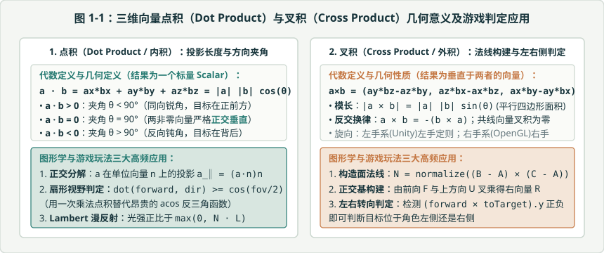
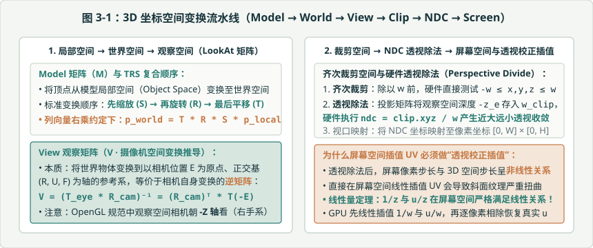

本文按三维图形渲染与物理引擎的数学基础，分为五个章节：**向量代数、坐标系旋向与几何运算**、**线性变换、4D 齐次矩阵与法线逆转置推导**、**3D 坐标空间变换流水线与透视深度精度（Reversed-Z）**、**三维旋转表示：欧拉角万向节死锁、旋转矩阵与单位四元数**、**几何图元方程、空间射线求交与视锥体平面裁剪**。

---

## 第 1 章：向量代数、坐标系旋向与几何运算

在三维图形学与物理仿真中，标量（Scalar）仅具有大小，而**向量（Vector）**同时具备大小（模长 Magnitude）与方向，代表空间中的**位移（Displacement）**或方向，不具有固定起点；**点（Point）**则代表相对于坐标系原点的确定空间位置。

### 1.1 左手坐标系 vs 右手坐标系与线性空间基底

三维笛卡尔坐标系由三条两两正交的单位基向量 $\mathbf{i} = (1,0,0)$、$\mathbf{j} = (0,1,0)$、$\mathbf{k} = (0,0,1)$ 张成。当固定 $+X$ 轴朝右、$+Y$ 轴朝上时，$+Z$ 轴的朝向决定了坐标系的**旋向（Handedness）**：

| 坐标系类型 | $+X$ / $+Y$ / $+Z$ 朝向约定 | 正旋转方向判别法则 | 叉积方向判别法则 | 典型引擎与图形 API |
| :--- | :--- | :--- | :--- | :--- |
| **左手坐标系（Left-Handed）** | $+X$ 右、$+Y$ 上、**$+Z$ 朝屏幕内（前方）** | 左手拇指指向旋转轴正向，四指弯曲方向为正旋转（顺时针 CW） | 左手四指从 $\mathbf{a}$ 弯向 $\mathbf{b}$，拇指指向 $\mathbf{a} \times \mathbf{b}$ | **Unity（世界/局部空间）、DirectX、Unreal（Z 朝上左手系）** |
| **右手坐标系（Right-Handed）** | $+X$ 右、$+Y$ 上、**$+Z$ 朝屏幕外（观察者）** | 右手拇指指向旋转轴正向，四指弯曲方向为正旋转（逆时针 CCW） | 右手四指从 $\mathbf{a}$ 弯向 $\mathbf{b}$，拇指指向 $\mathbf{a} \times \mathbf{b}$ | **OpenGL、Vulkan、Maya、Blender、Unity 观察空间（View Space）** |

- **重要性质**：左手坐标系与右手坐标系之间**不存在纯旋转变换**，二者必须通过**翻转任意单个坐标轴符号**（即乘以行列式 $\det(\mathbf{M}) = -1$ 的镜像反射矩阵）才能互相转换。

---

### 1.2 点积（Dot Product）与正交投影

设三维向量 $\mathbf{a} = (a_x, a_y, a_z)$、$\mathbf{b} = (b_x, b_y, b_z)$，二者夹角为 $\theta \in [0, \pi]$，其**点积（内积）**结果为一个标量：

$$
\mathbf{a} \cdot \mathbf{b} = \mathbf{a}^T \mathbf{b} = a_x b_x + a_y b_y + a_z b_z = \|\mathbf{a}\| \|\mathbf{b}\| \cos\theta
$$

- **核心代数性质**：满足交换律 $\mathbf{a} \cdot \mathbf{b} = \mathbf{b} \cdot \mathbf{a}$、分配律 $\mathbf{a} \cdot (\mathbf{b} + \mathbf{c}) = \mathbf{a} \cdot \mathbf{b} + \mathbf{a} \cdot \mathbf{c}$；向量与自身点积等于模长平方 $\mathbf{a} \cdot \mathbf{a} = \|\mathbf{a}\|^2$。
- **正交投影与正交分解**：若 $\mathbf{n}$ 为单位向量（$\|\mathbf{n}\| = 1$），则标量 $\mathbf{a} \cdot \mathbf{n}$ 即为向量 $\mathbf{a}$ 在 $\mathbf{n}$ 方向上的**有符号投影长度**。由此可将任意向量 $\mathbf{a}$ 唯一正交分解为平行于 $\mathbf{n}$ 的分量 $\mathbf{a}_{\parallel}$ 与垂直于 $\mathbf{n}$ 的分量 $\mathbf{a}_{\perp}$（**Gram-Schmidt 正交化**与绕任意轴旋转推导的基础）：

$$
\mathbf{a}_{\parallel} = (\mathbf{a} \cdot \mathbf{n})\,\mathbf{n}, \qquad \mathbf{a}_{\perp} = \mathbf{a} - \mathbf{a}_{\parallel} = \mathbf{a} - (\mathbf{a} \cdot \mathbf{n})\,\mathbf{n}
$$

---

### 1.3 叉积（Cross Product）与正交基构建

两个三维向量的**叉积（外积）**结果为一个同时垂直于 $\mathbf{a}$ 和 $\mathbf{b}$ 所在平面的新三维向量：

$$
\mathbf{a} \times \mathbf{b} = (a_y b_z - a_z b_y,\; a_z b_x - a_x b_z,\; a_x b_y - a_y b_x), \qquad \|\mathbf{a} \times \mathbf{b}\| = \|\mathbf{a}\| \|\mathbf{b}\| \sin\theta
$$

- **核心代数性质**：
  1. **反交换律（Anti-commutativity）**：$\mathbf{a} \times \mathbf{b} = -(\mathbf{b} \times \mathbf{a})$；任意向量与自身（或共线向量）的叉积为零向量 $\mathbf{a} \times \mathbf{a} = \mathbf{0}$。
  2. **叉积等价反对称矩阵乘法**：向量 $\mathbf{a}$ 与 $\mathbf{b}$ 的叉积可写为反对称矩阵 $[\mathbf{a}]_{\times}$ 左乘列向量 $\mathbf{b}$：
     $$
     \mathbf{a} \times \mathbf{b} = [\mathbf{a}]_{\times} \mathbf{b} = \begin{bmatrix} 0 & -a_z & a_y \\ a_z & 0 & -a_x \\ -a_y & a_x & 0 \end{bmatrix} \begin{bmatrix} b_x \\ b_y \\ b_z \end{bmatrix}
     $$
- **由前向向量构建相机/角色正交基（Orthonormal Basis）**：已知角色归一化前向向量 $\mathbf{F}$ 与世界空间参考上向量 $\mathbf{U}_{\text{world}} = (0, 1, 0)$（假设二者不共线），在左手坐标系（Unity）下构造标准正交基 $(\mathbf{R}, \mathbf{U}, \mathbf{F})$ 的两步公式为：
  $$
  \mathbf{R} = \operatorname{normalize}(\mathbf{U}_{\text{world}} \times \mathbf{F}), \qquad \mathbf{U} = \mathbf{F} \times \mathbf{R}
  $$
  （由于 $\mathbf{F}$ 与 $\mathbf{R}$ 已单位正交，其叉积模长必为 $1$，计算 $\mathbf{U}$ 时无需再次归一化。）

---

## 第 2 章：线性变换、4D 齐次矩阵与法线逆转置推导

### 2.1 矩阵乘法的几何本质与行/列主序约定

线性变换 $T(\mathbf{v})$ 满足加法保持与标量乘法保持（$T(\mathbf{u} + \mathbf{v}) = T(\mathbf{u}) + T(\mathbf{v})$，$T(k\mathbf{v}) = k T(\mathbf{v})$）。在选定基向量 $(\mathbf{i}, \mathbf{j}, \mathbf{k})$ 后，任意三维线性变换唯一对应一个 $3 \times 3$ 矩阵 $\mathbf{M}$：
- **几何意义**：在**列向量右乘约定（$\mathbf{v}' = \mathbf{M}\mathbf{v}$，OpenGL / Unity Shader `mul(M, v)` 标准）**下，$3 \times 3$ 矩阵 $\mathbf{M}$ 的**第 1 列、第 2 列、第 3 列，分别为原基向量 $\mathbf{i}(1,0,0)$、$\mathbf{j}(0,1,0)$、$\mathbf{k}(0,0,1)$ 变换后的新坐标**：
  $$
  \mathbf{v}' = \mathbf{M} \begin{bmatrix} x \\ y \\ z \end{bmatrix} = x \cdot \operatorname{Col}_1(\mathbf{M}) + y \cdot \operatorname{Col}_2(\mathbf{M}) + z \cdot \operatorname{Col}_3(\mathbf{M})
  $$
- **三种基础 3D 线性变换矩阵**：
  1. **缩放矩阵 $\mathbf{S}(s_x, s_y, s_z)$**：对角矩阵 $\operatorname{diag}(s_x, s_y, s_z)$，非对角元素全为 $0$。
  2. **绕坐标轴旋转矩阵（右手系逆时针正角 $\theta$）**：
     $$
     \mathbf{R}_x(\theta) = \begin{bmatrix} 1 & 0 & 0 \\ 0 & \cos\theta & -\sin\theta \\ 0 & \sin\theta & \cos\theta \end{bmatrix}, \quad \mathbf{R}_y(\theta) = \begin{bmatrix} \cos\theta & 0 & \sin\theta \\ 0 & 1 & 0 \\ -\sin\theta & 0 & \cos\theta \end{bmatrix}, \quad \mathbf{R}_z(\theta) = \begin{bmatrix} \cos\theta & -\sin\theta & 0 \\ \sin\theta & \cos\theta & 0 \\ 0 & 0 & 1 \end{bmatrix}
     $$
     （注：在三维循环顺序 $X \to Y \to Z \to X$ 中，绕 $Y$ 轴正方向旋转是从 $Z$ 轴转向 $X$ 轴，因此 $\mathbf{R}_y(\theta)$ 中 $\sin\theta$ 的正负号位置与 $\mathbf{R}_x, \mathbf{R}_z$ 相反。）
  3. **正交矩阵（Orthogonal Matrix）核心性质**：纯旋转矩阵 $\mathbf{R}$ 的列向量是两两正交的单位向量，满足 **$\mathbf{R}^T \mathbf{R} = \mathbf{I}$**，即**旋转矩阵的逆矩阵严格等于其转置矩阵（$\mathbf{R}^{-1} = \mathbf{R}^T$）**，且行列式 $\det(\mathbf{R}) = +1$。在代码中对纯旋转矩阵求逆只需直接转置，无需执行高开销的高斯消元。

---

### 2.2 为什么必须引入 4D 齐次坐标（Homogeneous Coordinates）

- **引入原因**：任何 $3 \times 3$ 线性变换矩阵乘以零向量恒等于零向量（$\mathbf{M}\mathbf{0} = \mathbf{0}$），即三维线性变换无法移动坐标原点。三维平移 $\mathbf{p}' = \mathbf{R}\mathbf{p} + \mathbf{t}$ 属于**仿射变换（Affine Transformation）**，无法用单一 $3 \times 3$ 矩阵乘法表示。
- **升维剪切原理**：将三维坐标 $(x, y, z)$ 扩充第 4 个分量 $w$，升维至四维齐次空间 $(x, y, z, w)$。三维空间中的仿射平移，等价于四维空间中沿 $w$ 轴的**高维线性剪切变换（Shear）**在超平面 $w = 1$ 上的截面：

$$
\begin{bmatrix} x' \\ y' \\ z' \\ w' \end{bmatrix} = \begin{bmatrix} R_{xx} & R_{xy} & R_{xz} & t_x \\ R_{yx} & R_{yy} & R_{yz} & t_y \\ R_{zx} & R_{zy} & R_{zz} & t_z \\ 0 & 0 & 0 & 1 \end{bmatrix} \begin{bmatrix} x \\ y \\ z \\ w \end{bmatrix} = \begin{bmatrix} \mathbf{R}_x \cdot \mathbf{p} + t_x w \\ \mathbf{R}_y \cdot \mathbf{p} + t_y w \\ \mathbf{R}_z \cdot \mathbf{p} + t_z w \\ w \end{bmatrix}
$$

- **$w = 1$ 与 $w = 0$ 的严格区分**：
  - **空间点（Point，$w = 1$）**：代入上式得 $\mathbf{p}' = \mathbf{R}\mathbf{p} + \mathbf{t}$，同时受旋转、缩放与平移作用。
  - **方向向量（Vector，$w = 0$）**：代入上式得 $\mathbf{v}' = \mathbf{R}\mathbf{v} + \mathbf{t} \cdot 0 = \mathbf{R}\mathbf{v}$，**自动屏蔽平移项**（因为方向与位移没有固定位置，平移不改变方向向量）。
  - **点与向量的加减闭合性**：两个位置点相减 $P_2(w=1) - P_1(w=1)$ 得到 $w = 0$ 的位移向量；位置点加上位移向量 $P_1(w=1) + \mathbf{v}(w=0)$ 仍得到 $w = 1$ 的新位置点；两个位置点直接相加（$w = 2$）在仿射几何中无意义（除非除以 2 求中点，即重心坐标线性组合 $\alpha P_1 + \beta P_2$ 且 $\alpha + \beta = 1$）。

---

### 2.3 为什么法线向量变换必须乘以逆转置矩阵 $(M^{-1})^T$

在顶点着色器中，顶点坐标 $\mathbf{p}$ 与表面切线向量 $\mathbf{t} = P_2 - P_1$ 均直接左乘模型矩阵 $\mathbf{M}$（即 $\mathbf{t}' = \mathbf{M}\mathbf{t}$）。但如果模型经历了**非均匀缩放（Non-Uniform Scale，例如 $X$ 轴缩放 $0.5$ 倍、$Y$ 轴缩放 $2$ 倍）**，把表面法线 $\mathbf{n}$ 也直接左乘 $\mathbf{M}$ 会导致变换后的向量 $\mathbf{M}\mathbf{n}$ **不再垂直于变换后的表面切线 $\mathbf{t}'$**。

- **代数严格证明**：
  设法线应当左乘某个待求的 $3 \times 3$ 线性变换矩阵 $\mathbf{G}$（即 $\mathbf{n}' = \mathbf{G}\mathbf{n}$）。已知变换前表面切线 $\mathbf{t}$ 与法线 $\mathbf{n}$ 正交（内积写成矩阵乘法为 $\mathbf{t}^T \mathbf{n} = 0$）。为保证变换后 $\mathbf{t}'$ 与 $\mathbf{n}'$ 依然严格正交，必须对任意切线 $\mathbf{t}$ 满足：
  $$
  (\mathbf{t}')^T \mathbf{n}' = (\mathbf{M}\mathbf{t})^T (\mathbf{G}\mathbf{n}) = \mathbf{t}^T (\mathbf{M}^T \mathbf{G}) \mathbf{n} = 0
  $$
  欲使上式恒等于变换前的 $\mathbf{t}^T \mathbf{I} \mathbf{n} = 0$，只需令中间矩阵乘积为单位矩阵 $\mathbf{I}$：
  $$
  \mathbf{M}^T \mathbf{G} = \mathbf{I} \implies \mathbf{G} = (\mathbf{M}^T)^{-1} = (\mathbf{M}^{-1})^T
  $$
  因此，**法线变换矩阵必然等于顶点模型矩阵左上角 $3 \times 3$ 子矩阵的逆转置矩阵 $(\mathbf{M}^{-1})^T$**（在 Unity URP 中即 `TransformObjectToWorldNormal` 内部使用的 `unity_WorldToObject` 转置乘法）。
- **两类特殊情况简化**：
  1. 若 $\mathbf{M}$ **仅含旋转**（正交矩阵 $\mathbf{M}^{-1} = \mathbf{M}^T$），则 $(\mathbf{M}^{-1})^T = (\mathbf{M}^T)^T = \mathbf{M}$，此时法线可直接乘原矩阵 $\mathbf{M}$。
  2. 若 $\mathbf{M}$ **仅含旋转与统一缩放（Uniform Scale，缩放因子为 $k$）**，则 $(\mathbf{M}^{-1})^T = \frac{1}{k}\mathbf{R}$，方向与直接乘 $\mathbf{M} = k\mathbf{R}$ 完全一致，仅需在变换后执行一次 `normalize()` 即可省去求逆运算。

---

## 第 3 章：3D 坐标空间变换流水线与透视深度精度（Reversed-Z）

一个三维模型顶点从局部建模坐标最终变成屏幕上的二维像素并写入深度缓冲（Z-Buffer），必须依次经历五次坐标空间变换。

### 3.1 局部空间 → 世界空间 → 观察空间（LookAt 矩阵推导）

1. **模型变换（Model Transform，局部空间 → 世界空间）**：
   - 将模型顶点乘以复合矩阵 $\mathbf{M} = \mathbf{T} \cdot \mathbf{R} \cdot \mathbf{S}$（列向量右乘下，必须严格遵循 **先缩放 $\mathbf{S}$ → 再旋转 $\mathbf{R}$ → 最后平移 $\mathbf{T}$** 的顺序；若先平移再缩放，物体距离世界原点的位移也会被一并放大；若先旋转再非均匀缩放，则会沿着旋转后的斜轴拉伸从而引入剪切畸变）。
2. **观察变换（View Transform，世界空间 → 观察/摄像机空间）**：
   - 设摄像机在世界空间中的位置为 $\mathbf{E} = (e_x, e_y, e_z)$，通过叉积构造出摄像机在世界空间中的三个单位正交基向量：右向量 $\mathbf{R}$、上向量 $\mathbf{U}$、观察朝向 $\mathbf{F}$。
   - 将一个点从摄像机局部空间变换到世界空间的矩阵为 $\mathbf{M}_{\text{cam}} = \mathbf{T}(\mathbf{E}) \cdot \mathbf{R}_{\text{cam}}$（其中 $\mathbf{R}_{\text{cam}}$ 的三列分别为 $[\mathbf{R}, \mathbf{U}, -\mathbf{F}]$）。
   - 而观察变换是将世界空间中的所有物体反过来变换到以摄像机为原点的参考系中，因此 **View 矩阵 $\mathbf{V}$ 恰好等于 $\mathbf{M}_{\text{cam}}$ 的逆矩阵**：
     $$
     \mathbf{V} = (\mathbf{M}_{\text{cam}})^{-1} = \mathbf{R}_{\text{cam}}^T \cdot \mathbf{T}(-\mathbf{E}) = \begin{bmatrix} R_x & R_y & R_z & -(\mathbf{R} \cdot \mathbf{E}) \\ U_x & U_y & U_z & -(\mathbf{U} \cdot \mathbf{E}) \\ -F_x & -F_y & -F_z & (\mathbf{F} \cdot \mathbf{E}) \\ 0 & 0 & 0 & 1 \end{bmatrix}
     $$
     （注意：在 OpenGL 与 Unity 的约定中，尽管世界空间是左手系，**观察空间 View Space 统一采用右手系，即摄像机正前方朝向 $-Z$ 轴**，因此摄像机前方的物体在观察空间中的坐标恒满足 $z_e < 0$。）

---

### 3.2 正交投影与透视投影矩阵（Perspective Projection）推导

投影变换（Projection Transform）将观察空间中的三维视锥体（View Frustum，由近裁剪面 $n$ 与远裁剪面 $f$ 截断）映射为裁剪空间（Clip Space），并准备执行透视除法。

#### 1. 正交投影矩阵（Orthographic Projection）
视景体为轴对齐长方体 $[l, r] \times [b, t] \times [-n, -f]$，光线平行投射，无近大远小效果（常用于 2D 游戏、UI、工程制图与平行光阴影贴图 Shadow Map）。只需依次执行**中心平移至原点**与**三轴线性缩放至标准立方体**（以 OpenGL $[-1, 1]^3$ 为例）：

$$
\mathbf{P}_{\text{ortho}} = \begin{bmatrix} \dfrac{2}{r-l} & 0 & 0 & -\dfrac{r+l}{r-l} \\[8pt] 0 & \dfrac{2}{t-b} & 0 & -\dfrac{t+b}{t-b} \\[8pt] 0 & 0 & -\dfrac{2}{f-n} & -\dfrac{f+n}{f-n} \\[6pt] 0 & 0 & 0 & 1 \end{bmatrix}
$$

正交投影矩阵第 4 行为 $[0, 0, 0, 1]$，变换后裁剪坐标恒保持 **$w_{\text{clip}} = 1$**。

#### 2. 透视投影矩阵（Perspective Projection）
设垂直视场角为 $\text{fovY}$，屏幕宽高比为 $a = W / H$，近平面与远平面距离分别为 $n$ 和 $f$（均取正数，对应观察空间平面 $z_e = -n$ 与 $z_e = -f$）。
- **第一步（相似三角形近平面投射）**：根据相似三角形比例，观察空间点 $(x_e, y_e, z_e)$ 投射到近平面 $z = -n$ 上的坐标为：
  $$
  x_p = \frac{n \cdot x_e}{-z_e}, \qquad y_p = \frac{n \cdot y_e}{-z_e}
  $$
- **第二步（利用齐次坐标 $w_{\text{clip}}$ 实现除以 $-z_e$）**：$4 \times 4$ 矩阵乘法仅能做线性组合，无法直接除以变量 $-z_e$；但硬件在顶点着色器之后会自动执行**透视除法（Perspective Divide，将 $x_{\text{clip}}, y_{\text{clip}}, z_{\text{clip}}$ 同除以 $w_{\text{clip}}$）**。因此将透视投影矩阵第 4 行设为 **$[0, 0, -1, 0]$**，即可使 **$w_{\text{clip}} = -z_e$**。
- **第三步（归一化横纵坐标与求解深度系数 $A, B$）**：近平面半高为 $t = n \tan(\text{fovY} / 2)$，半宽为 $r = a \cdot t$。将 $x_p \in [-r, r]$、$y_p \in [-t, t]$ 线性映射到 $[-1, 1]$，并设 $z_{\text{clip}} = A z_e + B$（除以 $w_{\text{clip}} = -z_e$ 后 $z_{\text{ndc}} = -A - B / z_e$），代入近远平面边界条件即可解出标准透视投影矩阵：

$$
\mathbf{P}_{\text{persp}} = \begin{bmatrix} \dfrac{\cot(\text{fovY}/2)}{a} & 0 & 0 & 0 \\[8pt] 0 & \cot(\text{fovY}/2) & 0 & 0 \\[8pt] 0 & 0 & -\dfrac{f+n}{f-n} & -\dfrac{2fn}{f-n} \\[6pt] 0 & 0 & -1 & 0 \end{bmatrix}
$$

---

### 3.3 深度缓冲非线性精度（Z-Fighting）、Reversed-Z 与透视校正插值

#### 1. 为什么传统深度缓冲会发生远景闪烁（Z-Fighting）与 Reversed-Z 解决方案
由透视投影矩阵与透视除法可知，NDC 深度 $z_{\text{ndc}}$ 与观察空间真实深度 $-z_e$ 之间并非线性关系，而是关于 $1 / (-z_e)$ 的**双曲线反比例函数**（以 $[0, 1]$ 标准深度范围为例）：

$$
z_{\text{ndc}}(z_e) = \frac{f}{f - n} - \frac{f \cdot n}{(f - n)(-z_e)}
$$

- **精度分布不均**：当近平面 $n = 0.1$、远平面 $f = 1000$ 时，距离摄像机 $1\text{ m}$ 处的点对应的 $z_{\text{ndc}}$ 已达 $0.90009$。即 **$[0, 0.9]$ 共 90% 的深度值区间集中在摄像机前 $0.1\text{ m} \sim 1\text{ m}$ 范围内**，而 $1\text{ m} \sim 1000\text{ m}$ 的远景仅分布在 $[0.9, 1.0]$ 区间内。同时，IEEE 754 浮点数在接近 $1.0$ 处的指数固定为 $0$，尾数精度有限，导致远距离相近表面量化出相同的深度值，引发**深度冲突闪烁（Z-Fighting）**。
- **解决方案**：
  1. **严禁把近裁剪面 $n$ 设得过小**（将 $n$ 从 $0.01$ 调大到 $0.3$，远景深度精度立即可提升 30 倍）。
  2. **Reversed-Z（反向深度缓冲，DX12 / Vulkan / Unity URP 标准）**：直接将深度映射反转为 **近裁剪面映射为 $1.0$、远裁剪面映射为 $0.0$**（深度测试改为 `GREATER` 或 `GREATER_EQUAL`），并使用 32 位浮点深度缓冲（`D32_FLOAT`）。因为 IEEE 754 浮点数在**越靠近 $0.0$ 的地方指数阶码越小（可低至 $2^{-126}$），可表示的数值密度呈指数级加密**，恰好完美抵消了 $1/z$ 双曲线在远距离处的斜率衰减，使整个视锥体从近到远获得近似均匀的对数级深度精度。

#### 2. 为什么光栅化插值顶点属性必须采用“透视校正插值”
三角形经过透视除法投影到二维屏幕后，屏幕像素坐标 $(x_s, y_s)$ 的均匀步进**并不对应三维空间中的均匀步进**。若光栅化器直接在屏幕空间对纹理坐标 $u$ 执行普通线性插值 $u_{\text{lerp}} = (1 - t) u_0 + t u_1$，贴在透视斜面上的棋盘格纹理会在对角线处发生明显的折断扭曲。
- **透视校正插值公式（Perspective-Correct Interpolation）**：数学证明表明，虽然属性 $u$ 和深度 $z$ 在屏幕空间都是非线性的，但 **$1 / z$（即 $1 / w_{\text{clip}}$）以及任意顶点属性除以 $z$ 的商 $u / z$（即 $u / w_{\text{clip}}$）在二维屏幕空间上严格满足线性关系**。因此 GPU 光栅化硬件对每个片元（屏幕重心坐标为 $(\alpha, \beta, \gamma)$）执行如下三步插值：
  $$
  \frac{1}{w} = \frac{\alpha}{w_0} + \frac{\beta}{w_1} + \frac{\gamma}{w_2}, \qquad \frac{u}{w} = \alpha \frac{u_0}{w_0} + \beta \frac{u_1}{w_1} + \gamma \frac{u_2}{w_2}, \qquad u_{\text{correct}} = \frac{u / w}{1 / w}
  $$

---

## 第 4 章：三维旋转表示：欧拉角万向节死锁、旋转矩阵与单位四元数

### 4.1 欧拉角顺规与万向节死锁（Gimbal Lock）代数证明

欧拉角将一次三维旋转拆解为绕三个坐标轴的连续三次旋转角 $(\text{Pitch 俯仰角绕 } X,\; \text{Yaw 偏航角绕 } Y,\; \text{Roll 翻滚角绕 } Z)$。

- **内旋（Intrinsic，绕物体自身旋转后的局部轴）与外旋（Extrinsic，绕固定世界轴）等价定理**：按 $Z \to X \to Y$ 顺序绕局部动态轴旋转（内旋），在数学上完全等价于按相反顺序 $Y \to X \to Z$ 绕固定世界轴旋转（外旋）。
- **为什么会发生万向节死锁（Gimbal Lock）**：
  以旋转复合矩阵 $\mathbf{R} = \mathbf{R}_y(y)\,\mathbf{R}_x(x)\,\mathbf{R}_z(z)$（先 Roll $z$，再 Pitch $x$，最后 Yaw $y$）为例，当中间那次旋转（俯仰角 Pitch $x$，即抬头或低头）恰好转到 **$x = +90^\circ$**（此时 $\sin 90^\circ = 1,\; \cos 90^\circ = 0$）时，将三个旋转矩阵相乘展开并利用三角和角公式化简可得：
  $$
  \begin{aligned}
  \mathbf{R}_y(y)\,\mathbf{R}_x(90^\circ)\,\mathbf{R}_z(z) &= \begin{bmatrix} \cos y & 0 & \sin y \\ 0 & 1 & 0 \\ -\sin y & 0 & \cos y \end{bmatrix} \begin{bmatrix} 1 & 0 & 0 \\ 0 & 0 & -1 \\ 0 & 1 & 0 \end{bmatrix} \begin{bmatrix} \cos z & -\sin z & 0 \\ \sin z & \cos z & 0 \\ 0 & 0 & 1 \end{bmatrix} \\[8pt]
  &= \begin{bmatrix} \cos(y - z) & -\sin(y - z) & 0 \\ 0 & 0 & -1 \\ -\sin(y - z) & -\cos(y - z) & 0 \end{bmatrix} = \mathbf{R}_y(y - z)\,\mathbf{R}_x(90^\circ)
  \end{aligned}
  $$
  由结果矩阵可见：角度 $y$（Yaw）和 $z$（Roll）合并为单一差值项 **$(y - z)$**。这表明第一次绕局部 $Z$ 轴旋转与第三次绕世界 $Y$ 轴旋转的**旋转轴共线重合**，旋转自由度由 3 退化为 2，导致相机或骨骼在插值经过 $\pm 90^\circ$ 时发生翻转。

---

### 4.2 轴角表示法与罗德里格斯（Rodrigues）旋转公式

根据欧拉旋转定理，三维空间中任意一次刚体旋转，都等价于绕某条穿过原点的**单位旋转轴 $\mathbf{u} = (u_x, u_y, u_z)$** 旋转一个角度 $\theta$。将待旋转向量 $\mathbf{v}$ 正交分解为平行于轴 $\mathbf{u}$ 的分量 $\mathbf{v}_{\parallel} = (\mathbf{v} \cdot \mathbf{u})\mathbf{u}$（旋转中保持不变）与垂直于轴 $\mathbf{u}$ 的分量 $\mathbf{v}_{\perp} = \mathbf{v} - (\mathbf{v} \cdot \mathbf{u})\mathbf{u}$（在垂直平面内旋转 $\theta$ 角），即可直接导出**罗德里格斯旋转公式（Rodrigues' Rotation Formula）**：

$$
\mathbf{v}' = \mathbf{v}_{\parallel} + \cos\theta\,\mathbf{v}_{\perp} + \sin\theta\,(\mathbf{u} \times \mathbf{v}) = \cos\theta\,\mathbf{v} + (1 - \cos\theta)(\mathbf{u} \cdot \mathbf{v})\mathbf{u} + \sin\theta\,(\mathbf{u} \times \mathbf{v})
$$

---

### 4.3 单位四元数（Unit Quaternion）代数结构、双侧旋转与插值

#### 1. 四元数定义与 Hamilton 乘法法则
四元数 $\mathbf{q}$ 是复数向四维超复数空间的扩张，由 1 个实部标量 $w$ 与 3 个虚部向量 $\mathbf{v} = (x, y, z)$ 组成：

$$
\mathbf{q} = w + x\mathbf{i} + y\mathbf{j} + z\mathbf{k} = [w, \mathbf{v}], \qquad \mathbf{i}^2 = \mathbf{j}^2 = \mathbf{k}^2 = \mathbf{i}\mathbf{j}\mathbf{k} = -1
$$

（由此导出反交换循环律：$\mathbf{i}\mathbf{j} = -\mathbf{j}\mathbf{i} = \mathbf{k},\; \mathbf{j}\mathbf{k} = -\mathbf{k}\mathbf{j} = \mathbf{i},\; \mathbf{k}\mathbf{i} = -\mathbf{i}\mathbf{k} = \mathbf{j}$。）利用点积与叉积，两个四元数 $\mathbf{q}_1 = [w_1, \mathbf{v}_1]$ 与 $\mathbf{q}_2 = [w_2, \mathbf{v}_2]$ 的 **Graßmann 乘积公式**可紧凑写为：

$$
\mathbf{q}_1 \otimes \mathbf{q}_2 = \bigl[\, w_1 w_2 - (\mathbf{v}_1 \cdot \mathbf{v}_2),\;\; w_1 \mathbf{v}_2 + w_2 \mathbf{v}_1 + (\mathbf{v}_1 \times \mathbf{v}_2) \,\bigr]
$$

- **共轭（Conjugate）与逆（Inverse）**：定义共轭四元数为虚部取反 $\mathbf{q}^* = [w, -\mathbf{v}]$，模长平方为 $\|\mathbf{q}\|^2 = w^2 + x^2 + y^2 + z^2 = \mathbf{q} \otimes \mathbf{q}^*$。四元数的逆为 $\mathbf{q}^{-1} = \mathbf{q}^* / \|\mathbf{q}\|^2$。
- **单位四元数性质**：当 $\|\mathbf{q}\| = 1$ 时，**单位四元数的逆等于其共轭（$\mathbf{q}^{-1} = \mathbf{q}^*$）**，求逆仅需将虚部取反。

#### 2. 单位四元数双侧旋转公式与半角 $\theta/2$ 原理
绕单位向量 $\mathbf{u}$ 旋转 $\theta$ 角的单位四元数定义为：

$$
\mathbf{q} = \left[\, \cos\frac{\theta}{2},\;\; \sin\frac{\theta}{2}\,\mathbf{u} \,\right], \qquad \cos^2\frac{\theta}{2} + \sin^2\frac{\theta}{2}\|\mathbf{u}\|^2 = 1
$$

将三维向量 $\mathbf{p}$ 表示为实部为 $0$ 的**纯四元数 $\mathbf{p} = [0, \mathbf{p}]$**，旋转后的新向量 $\mathbf{p}'$ 通过**双侧共轭乘法**计算：

$$
\mathbf{p}' = \mathbf{q} \otimes \mathbf{p} \otimes \mathbf{q}^{-1} = \mathbf{q} \otimes \mathbf{p} \otimes \mathbf{q}^*
$$

- **采用双侧乘法与半角 $\theta/2$ 的原因**：
  - 若仅单侧左乘 $\mathbf{q} \otimes \mathbf{p}$，根据 Graßmann 乘法公式，结果实部为 $-\sin(\theta/2)(\mathbf{u} \cdot \mathbf{p})$；当 $\mathbf{p}$ 与旋转轴 $\mathbf{u}$ 不垂直时，结果实部不为 $0$，不再是三维纯向量。
  - 左乘 $\mathbf{q}$ 使平行于 $\mathbf{u}$ 的分量向实轴旋转 $+\theta/2$，同时使垂直于 $\mathbf{u}$ 的分量在垂直平面内旋转 $+\theta/2$；右乘共轭 $\mathbf{q}^*$ 使平行于 $\mathbf{u}$ 的分量反向旋转 $-\theta/2$（实部抵消归零），而垂直于 $\mathbf{u}$ 的分量**继续同向旋转 $+\theta/2$**。两次半角旋转叠加为 $\theta$ 角，展开 $\mathbf{q} \otimes \mathbf{p} \otimes \mathbf{q}^*$ 即等价于罗德里格斯公式。
- **双重覆盖性质（Double Cover，$\mathbf{q}$ 与 $-\mathbf{q}$ 等价）**：将四元数全部取反 $-\mathbf{q} = [-\cos(\theta/2), -\sin(\theta/2)\mathbf{u}]$，等价于绕相反轴 $-\mathbf{u}$ 旋转 $2\pi - \theta$ 角（或者代入 $(-\mathbf{q}) \otimes \mathbf{p} \otimes (-\mathbf{q})^*$ 负负得正等于 $\mathbf{q} \otimes \mathbf{p} \otimes \mathbf{q}^*$）。因此三维旋转群 $SO(3)$ 中的每一个三维朝向，在四维单位超球面 $S^3$ 上都对应着**一对对跖点 $\mathbf{q}$ 与 $-\mathbf{q}$**。

#### 3. 四元数插值：Lerp、NLerp 与 Slerp（球面线性插值）
在骨骼动画关键帧融合与相机平滑跟随中，需要在起始旋转 $\mathbf{q}_1$ 与终止旋转 $\mathbf{q}_2$ 之间按比例 $t \in [0, 1]$ 插值：

| 插值算法 | 计算公式（设 $\cos\Omega = \mathbf{q}_1 \cdot \mathbf{q}_2$） | 单位模长保持 | 角速度均匀性 | 工程开销与适用场景 |
| :--- | :--- | :--- | :--- | :--- |
| **线性插值（Lerp）** | $\mathbf{q}(t) = (1 - t)\mathbf{q}_1 + t\mathbf{q}_2$ | 否（走球面弦线，中点模长小于 1） | 否（中间快、两端慢） | 不可直接用于旋转（未归一化会引入缩放畸变） |
| **归一化线性插值（NLerp）** | $\mathbf{q}(t) = \operatorname{normalize}\bigl((1 - t)\mathbf{q}_1 + t\mathbf{q}_2\bigr)$ | 是（将弦线投影回单位超球面） | 夹角较小时近似均匀 | **极快（无三角函数，且满足多骨骼混合交换律）**，引擎动画混合主流 |
| **球面线性插值（Slerp）** | $\mathbf{q}(t) = \dfrac{\sin((1-t)\Omega)}{\sin\Omega}\mathbf{q}_1 + \dfrac{\sin(t\Omega)}{\sin\Omega}\mathbf{q}_2$ | 是（沿四维球面大圆弧测地线运动） | **严格恒定角速度** | 含 3 次 $\sin$ 与 1 次 $\arccos$，用于大角度旋转或高精度相机轨迹 |

- **插值工程必做两项保护**：
  1. **最短弧修正（Shortest Path）**：由于 $\mathbf{q}_2$ 与 $-\mathbf{q}_2$ 代表同一朝向，插值前必须先计算四维点积 $d = \mathbf{q}_1 \cdot \mathbf{q}_2$；若 **$d < 0$**（说明四维夹角大于 $90^\circ$，对应三维旋转大于 $180^\circ$ 绕远路），必须先将 **$\mathbf{q}_2 = -\mathbf{q}_2$ 且 $d = -d$**，确保始终沿最短圆弧插值。
  2. **小角度除零保护**：当 $d > 0.9995$（$\Omega \to 0$）时，Slerp 分母 $\sin\Omega \to 0$ 会引发浮点除零不稳定，此时必须直接退化分支调用 `NLerp(q1, q2, t)`。

---

## 第 5 章：几何图元方程、空间射线求交与视锥体平面裁剪

在物理碰撞检测（Raycast）、鼠标屏幕拾取（Picking）与渲染视锥剔除（Frustum Culling）中，核心数学运算是几何图元的参数方程联立求交。

### 5.1 射线与平面、球体及 AABB 包围盒求交（Slab 算法）

设三维**射线（Ray）**的参数方程为 $\mathbf{R}(t) = \mathbf{O} + t\mathbf{D}$（其中 $\mathbf{O}$ 为射线起点，$\mathbf{D}$ 为方向向量，参数范围 $t \ge 0$）。

1. **射线与平面求交**：
   - 设平面方程为 $\mathbf{n} \cdot \mathbf{P} + d = 0$（其中 $\mathbf{n}$ 为平面单位法向量，$d = -(\mathbf{n} \cdot \mathbf{P}_0)$ 为原点到平面的有符号距离）。
   - 将 $\mathbf{P} = \mathbf{O} + t\mathbf{D}$ 代入平面方程 $\mathbf{n} \cdot (\mathbf{O} + t\mathbf{D}) + d = 0$，直接解出交点参数 $t$：
     $$
     t = -\frac{\mathbf{n} \cdot \mathbf{O} + d}{\mathbf{n} \cdot \mathbf{D}}
     $$
     若分母 $\mathbf{n} \cdot \mathbf{D} = 0$，说明射线与平面平行；若解出 $t \ge 0$，则交点坐标为 $\mathbf{O} + t\mathbf{D}$。
2. **射线与球体求交**：
   - 设球心为 $\mathbf{C}$、半径为 $r$，球面方程为 $\|\mathbf{P} - \mathbf{C}\|^2 = r^2$。令位移向量 $\mathbf{m} = \mathbf{O} - \mathbf{C}$ 且 $\|\mathbf{D}\| = 1$，代入得关于 $t$ 的一元二次方程：
     $$
     t^2 + 2(\mathbf{m} \cdot \mathbf{D})t + (\|\mathbf{m}\|^2 - r^2) = 0, \qquad \frac{\Delta}{4} = (\mathbf{m} \cdot \mathbf{D})^2 - (\|\mathbf{m}\|^2 - r^2)
     $$
     当 $\Delta < 0$ 时未命中；当 $\Delta \ge 0$ 时，最小非负实根 $t = -(\mathbf{m} \cdot \mathbf{D}) - \sqrt{\Delta / 4}$ 即为首次入射点。
3. **射线与轴对齐包围盒（AABB）求交：Kay-Kajiya Slab 算法**：
   - 轴对齐包围盒 `AABB` 由最小角点 $(x_{\min}, y_{\min}, z_{\min})$ 与最大角点 $(x_{\max}, y_{\max}, z_{\max})$ 定义，几何上等价于 **$X, Y, Z$ 三对平行平面夹层（Slab）的交集**。
   - 分别计算射线穿过三对平行平面的进入参数与离开参数（若方向分量 $D_x < 0$，则进入点与离开点需交换取 $\min/\max$）：
     $$
     t_{x1} = \frac{x_{\min} - O_x}{D_x}, \quad t_{x2} = \frac{x_{\max} - O_x}{D_x}, \quad t_{x,\min} = \min(t_{x1}, t_{x2}), \quad t_{x,\max} = \max(t_{x1}, t_{x2})
     $$
   - 求三个一维区间 $[t_{x,\min}, t_{x,\max}]$、$[t_{y,\min}, t_{y,\max}]$、$[t_{z,\min}, t_{z,\max}]$ 的公共交集 $[t_{\text{enter}}, t_{\text{exit}}]$：
     $$
     t_{\text{enter}} = \max(t_{x,\min},\; t_{y,\min},\; t_{z,\min}), \qquad t_{\text{exit}} = \min(t_{x,\max},\; t_{y,\max},\; t_{z,\max})
     $$
   - **相交充要条件**：当且仅当 **$t_{\text{enter}} \le t_{\text{exit}}$ 且 $t_{\text{exit}} \ge 0$** 时，射线与 AABB 相交。

---

### 5.2 Möller-Trumbore 快速射线-三角形求交算法

判断射线是否命中网格模型（Mesh Collider）中的三角形 $(V_0, V_1, V_2)$ 时，传统做法是先求射线与三角形所在平面的交点，再判断交点是否在三角形内部。**Möller-Trumbore 算法**通过将三角形写成**重心坐标（Barycentric Coordinates）**形式，一步直接联立解出距离参数 $t$ 与重心坐标 $(u, v)$，无需预存三角形平面方程：

- **线性方程组构建**：三角形内任意一点可表示为 $\mathbf{P}(u, v) = (1 - u - v)V_0 + uV_1 + vV_2$（满足 $u \ge 0,\; v \ge 0,\; u + v \le 1$）。令其等于射线方程 $\mathbf{O} + t\mathbf{D}$ 并移项整理，设两条边向量 $\mathbf{E}_1 = V_1 - V_0$、$\mathbf{E}_2 = V_2 - V_0$，起点偏移 $\mathbf{T} = \mathbf{O} - V_0$，则得到三元一次线性方程组：
  $$
  \begin{bmatrix} -\mathbf{D} & \mathbf{E}_1 & \mathbf{E}_2 \end{bmatrix} \begin{bmatrix} t \\ u \\ v \end{bmatrix} = \mathbf{T}
  $$
- **克莱姆法则（Cramer's Rule）标量三重积求解**：
  利用行列式等于混合积的性质 $\det([\mathbf{a}, \mathbf{b}, \mathbf{c}]) = (\mathbf{a} \times \mathbf{b}) \cdot \mathbf{c} = -(\mathbf{a} \times \mathbf{c}) \cdot \mathbf{b}$，设辅助叉积向量 **$\mathbf{P} = \mathbf{D} \times \mathbf{E}_2$** 与 **$\mathbf{Q} = \mathbf{T} \times \mathbf{E}_1$**，只需 2 次叉积与 4 次点积即可直接算出 $[t, u, v]$：
  $$
  \det = \mathbf{P} \cdot \mathbf{E}_1, \qquad u = \frac{\mathbf{P} \cdot \mathbf{T}}{\det}, \qquad v = \frac{\mathbf{Q} \cdot \mathbf{D}}{\det}, \qquad t = \frac{\mathbf{Q} \cdot \mathbf{E}_2}{\det}
  $$
  在工程实现中，一旦算出 $u < 0$ 或 $u > 1$，即可立即提前终止（Early-Out）返回未命中，无需继续计算 $\mathbf{Q}$、$v$ 和 $t$。

---

### 5.3 Gribb-Hartmann 视锥体 6 平面提取与视锥裁剪（Frustum Culling）

在每帧提交 DrawCall 前，渲染引擎需要在 CPU 端或 Compute Shader 中快速剔除完全位于摄像机视锥体外部的物体包围盒。**Gribb-Hartmann 算法**无需通过视场角和相机姿态做复杂的几何三角运算，而是**直接从复合矩阵 $\mathbf{M} = \mathbf{P} \cdot \mathbf{V}$ 的四个行向量中通过一次加减法提取出世界空间下的视锥体 6 个裁剪平面方程**：

- **代数推导**：
  设复合矩阵 $\mathbf{M} = \mathbf{P} \cdot \mathbf{V}$ 的四行向量分别为 $\mathbf{R}_0, \mathbf{R}_1, \mathbf{R}_2, \mathbf{R}_3$（每个 $\mathbf{R}_i$ 为 $1 \times 4$ 行向量）。对于世界空间任意齐次点 $\mathbf{X} = [x, y, z, 1]^T$，其裁剪空间坐标的四个分量正是行向量与 $\mathbf{X}$ 的内积：
  $$
  x_{\text{clip}} = \mathbf{R}_0 \cdot \mathbf{X}, \quad y_{\text{clip}} = \mathbf{R}_1 \cdot \mathbf{X}, \quad z_{\text{clip}} = \mathbf{R}_2 \cdot \mathbf{X}, \quad w_{\text{clip}} = \mathbf{R}_3 \cdot \mathbf{X}
  $$
  点 $\mathbf{X}$ 位于视锥体内部的充要条件是满足齐次裁剪不等式 $-w_{\text{clip}} \le x_{\text{clip}}, y_{\text{clip}}, z_{\text{clip}} \le w_{\text{clip}}$。以左裁剪面 $-w_{\text{clip}} \le x_{\text{clip}}$ 为例，移项即得：
  $$
  x_{\text{clip}} + w_{\text{clip}} \ge 0 \implies (\mathbf{R}_3 + \mathbf{R}_0) \cdot \mathbf{X} \ge 0
  $$
  因此行向量之和 **$\mathbf{R}_3 + \mathbf{R}_0$ 的前三个分量 $(a, b, c)$ 即为左裁剪平面在世界空间中朝向视锥体内部的法向量，第 4 个分量 $d$ 为平面常数项**。
- **六个视锥裁剪平面行向量提取全表**（归一化时将四元组 $[a, b, c, d]$ 同除以法线模长 $\sqrt{a^2 + b^2 + c^2}$ 即可）：
  - **左平面（Left）**：$\mathbf{R}_3 + \mathbf{R}_0$
  - **右平面（Right）**：$\mathbf{R}_3 - \mathbf{R}_0$
  - **下平面（Bottom）**：$\mathbf{R}_3 + \mathbf{R}_1$
  - **上平面（Top）**：$\mathbf{R}_3 - \mathbf{R}_1$
  - **近平面（Near）**：OpenGL $[-1, 1]$ 下为 $\mathbf{R}_3 + \mathbf{R}_2$；DirectX / Vulkan $[0, 1]$ 下直接为 $\mathbf{R}_2$
  - **远平面（Far）**：$\mathbf{R}_3 - \mathbf{R}_2$
