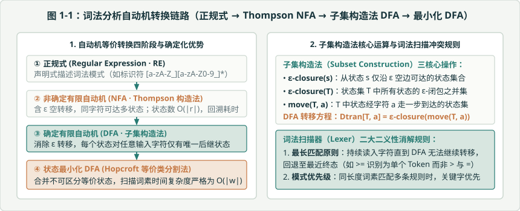
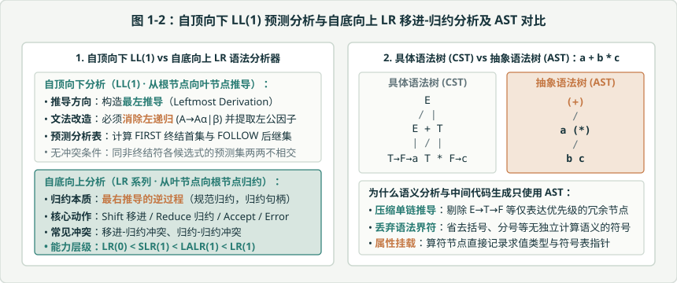
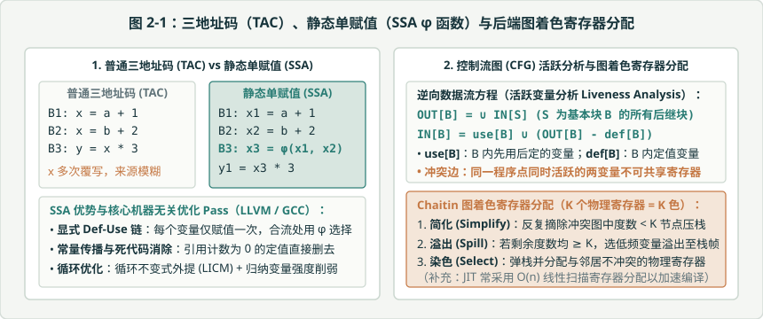
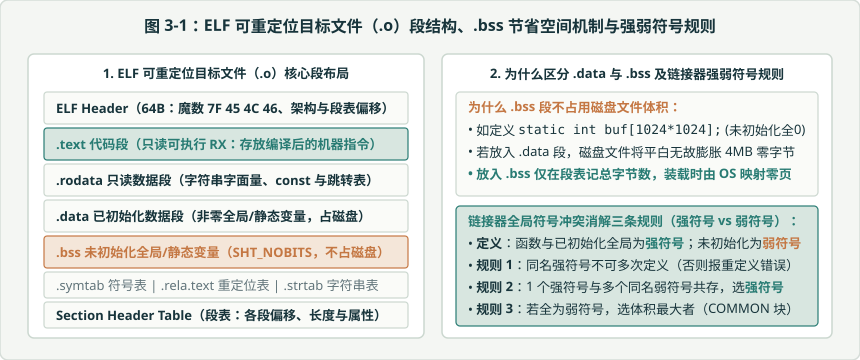
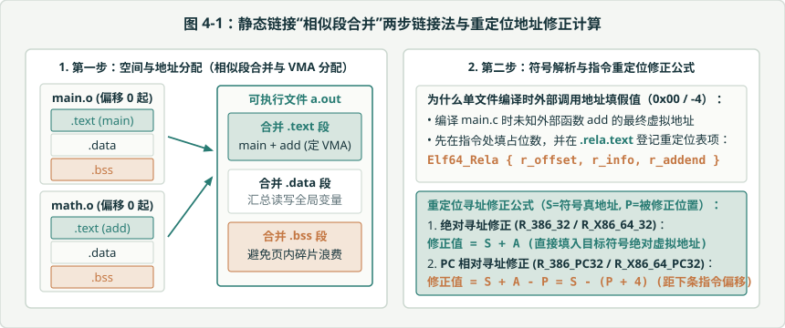
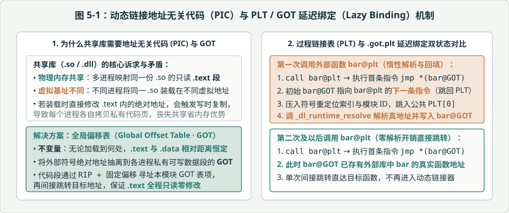
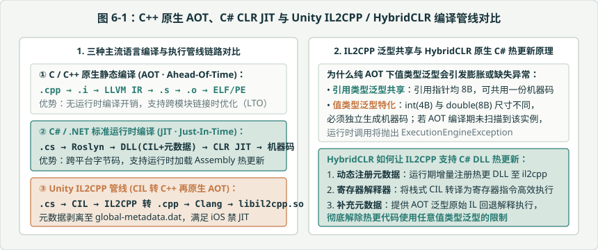

本文按源代码到可执行进程的构建流程，分为六个章节：**编译前端（词法、语法与语义分析）**、**中间表示（IR）、代码优化与目标代码生成**、**目标文件格式与符号表（ELF / PE）**、**静态链接：空间分配、符号解析与重定位**、**动态链接与装载（PIC、GOT / PLT 与运行时绑定）**、**现代语言编译管线对比（C++ AOT、C# CLR JIT 与 Unity IL2CPP / HybridCLR）**。

---

## 第 1 章：编译前端：词法分析、语法分析与语义分析

编译器前端的核心职责是将平坦的源代码字符流转化为带有类型与作用域语义信息的**抽象语法树（Abstract Syntax Tree, AST）**，并在进入后端代码生成前完成全部语法与静态语义合法性检查。

### 1.1 词法分析（Lexical Analysis）与有限自动机

词法分析器（Lexer / Scanner）逐字符读取源程序，过滤空白符与注释，按照词法规则将字符流切分为**词素（Lexeme）**，并映射为标准**词法记号（Token，形如 `<种别码, 属性值>`）**。

- **五类标准 Token**：关键字（`if`、`while`、`struct`）、标识符（变量名、函数名）、字面量常量（整型、浮点、字符串字面量）、运算符（`+`、`>=`、`->`）、界符（`;`、`{`、`}`）。
- **正规式到最小化 DFA 的四步等价转换**：
  1. **正规式（Regular Expression, RE）**：使用连接（`rs`）、或（`r | s`）、克林闭包（`r*`，0 次或多次）声明式定义词法规则。
  2. **Thompson 构造法（RE → NFA）**：将正规式递归拆解并拼装为含 `ε`（空字符）转移边的**非确定有限自动机（NFA）**。NFA 状态数至多为正规式长度的 2 倍，但同一状态面对同一输入可能转移到多个状态集合，直接回溯模拟的最坏时间复杂度高达 `O(|r| * |w|)`。
  3. **子集构造法（Subset Construction，NFA → DFA）**：通过计算状态集合的 `ε-closure(T)`（仅沿 `ε` 边可达的所有状态集合）与 `move(T, a)`（沿字符 `a` 转换一步到达的状态集），将 NFA 的一个“状态子集”合并映射为**确定有限自动机（DFA）**的单个状态：
     ```text
     Dtran[T, a] = ε-closure(move(T, a))
     ```
     转换后的 DFA 不含任何 `ε` 边，且每个状态对任意输入字符至多只有一条出边。
  4. **Hopcroft 等价类分割法（DFA 状态最小化）**：初始将 DFA 状态划分为“终态集”与“非终态集”两个等价类，反复检查同一等价类内的状态在任意输入字符下是否跳往不同等价类；若是则将其分裂，直至无法继续分裂。最小化 DFA 在单次扫描长度为 `|w|` 的源码时，时间复杂度严格为 `O(|w|)`，与自动机规模无关。



- **词法扫描二义性消解规则**：
  - **最长匹配原则（Maximal Munch）**：词法分析器尽可能多地吞入字符，直到 DFA 进入死状态无法继续转移为止，随后回退到最近一次经过的终态切出 Token（例如 `>=` 必须识别为单个关系运算符，而非 `>` 与 `=` 两个 Token；`floatValue` 识别为单个标识符而非关键字 `float` 加 `Value`）。
  - **模式优先级规则**：当同一最长前缀同时匹配多个终态模式时，声明顺序靠前的模式优先（所有关键字规则优先于通用标识符规则）。

---

### 1.2 语法分析（Syntax Analysis）：LL(1) 与 LR 分析器

正则语言无法表达任意深度的嵌套结构（如括号配对 `((a+b))` 或嵌套代码块），因此语法分析采用表达能力更强的**上下文无关文法（Context-Free Grammar, CFG，四元组 `(V_T, V_N, P, S)`）**描述程序层次结构。

#### 1. 自顶向下分析（Top-Down Parsing）与 LL(1) 文法
从开始符号 `S` 出发，尝试通过**最左推导（Leftmost Derivation）**匹配输入 Token 串（常用手工编写的**递归下降分析器**或表驱动的 **LL(1) 预测分析器**）：
- **为什么必须消除左递归**：若文法含有直接左递归 `A -> A α | β`，自顶向下展开 `A` 时会无限循环调用 `A` 而无法消耗任何输入符号。必须改写为等价的右递归形式：
  ```text
  A  -> β A'
  A' -> α A' | ε
  ```
- **为什么必须提取左公因子**：若产生式为 `A -> α β1 | α β2`，仅向前看 1 个 Token 无法决定选用哪条分支，必须提取左公因子改写为 `A -> α A'`、`A' -> β1 | β2`。
- **FIRST 集与 FOLLOW 集定义**：
  - `FIRST(α)`：从符号串 `α` 可推导出的所有首终结符集合（若 `α =>* ε`，则 `ε ∈ FIRST(α)`）。
  - `FOLLOW(A)`：在所有句型中紧跟在非终结符 `A` 右侧出现的终结符集合（若 `A` 可处于句尾，则输入结束符 `$ ∈ FOLLOW(A)`）。
- **LL(1) 预测分析表构造与无冲突充要条件**：对产生式 `A -> α`，将其填入预测表 `M[A, a]`（其中 `a ∈ FIRST(α)`；若 `ε ∈ FIRST(α)`，则对所有 `b ∈ FOLLOW(A)` 将 `A -> α` 填入 `M[A, b]`）。一个文法是 LL(1) 文法的充要条件是：预测表每个单元格至多只有一个产生式。

#### 2. 自底向上分析（Bottom-Up Parsing）与 LR 分析器
从输入 Token 串出发，通过**移进-归约（Shift-Reduce）**逐步将子串归约为非终结符，直至归约为开始符号 `S`。其本质是**最右推导（规范推导）的逆过程**，每步归约的当前最左直接短语称为**句柄（Handle）**。



| 分析器类型 | 项目集构造方式 | 归约展望符依据 | 状态数与工程特点 |
| :--- | :--- | :--- | :--- |
| **LR(0)** | 仅含活前缀项目 `A -> α · β`，不看展望符 | 只要到达含 `A -> α ·` 的状态即无条件归约 | 极易发生移进-归约冲突，仅适用于极简文法 |
| **SLR(1)** | 与 LR(0) 共享相同状态机 | 仅当下一个输入符号 `a ∈ FOLLOW(A)` 时才按 `A -> α` 归约 | 状态少，但 `FOLLOW(A)` 汇总了全局后继，仍可能误判冲突 |
| **LR(1)** | 项目携带精确展望符 `[A -> α · β, a]` | 仅当下一个输入符号等于项目自带的精确展望符 `a` 时归约 | 表达能力最强，但同心状态分裂导致状态表膨胀数倍 |
| **LALR(1)** | 合并 LR(1) 中核心相同（仅展望符不同）的同心项目集 | 使用合并后的展望符集合决策归约 | 状态数与 SLR(1) 相同，能力接近 LR(1)（Yacc / Bison 标准） |

---

### 1.3 语义分析（Semantic Analysis）、属性文法与符号表

上下文无关文法只能验证“结构形状合法”，无法表达“变量必须先声明后使用”“赋值号两侧类型必须兼容”“函数实参个数必须匹配形参”等**上下文相关约束**。语义分析阶段遍历 AST 完成以下两项核心任务：

1. **作用域管理与嵌套符号表（Symbol Table）**：
   - 每个词法作用域（全局、类、函数、块级 `{...}`）对应一张哈希表，通过 `parent` 指针串联成**作用域树（或符号表栈）**。
   - 声明语句向当前层符号表插入条目（记录标识符名称、类型描述符、内存偏移量、可见性）；引用变量时从当前层向外层逐级查找（实现内层同名变量对外部变量的**遮蔽 Shadowing**）。
2. **属性文法（Attribute Grammar）与类型检查（Type Checking）**：
   - **综合属性（Synthesized Attribute）**：自底向上由子节点属性计算父节点属性（如算术表达式 `E1 + E2` 的结果类型由左右子树类型综合推导，若一方为 `float` 另一方为 `int`，则在整数子节点上方插入 `IntToFloat` 隐式转换 AST 节点）。
   - **继承属性（Inherited Attribute）**：自顶向下或自左向右由父/兄节点传递给子节点（如变量声明 `int a, b, c;` 将类型 `int` 向下传递给各个变量节点）。

---

## 第 2 章：中间表示（IR）、代码优化与目标代码生成

现代编译器（GCC、Clang/LLVM、MSVC）不在 AST 上直接生成目标机器码，而是引入**中间表示（Intermediate Representation, IR）**。若支持 `M` 种源语言与 `N` 种目标 CPU 架构，直接翻译需实现 `M × N` 个编译器；引入统一 IR 后只需 `M` 个前端与 `N` 个后端（共 `M + N` 个模块），且与硬件无关的通用优化均可集中在 IR 层完成。

### 2.1 三地址码（TAC）、控制流图（CFG）与静态单赋值（SSA）

1. **三地址码（Three-Address Code, TAC）**：每条指令右侧至多含一个运算符，涉及至多三个地址（两个源操作数、一个目的操作数），将复杂嵌套表达式拆平为线性序列：
   ```text
   t1 = b * c
   t2 = a + t1
   ```
2. **基本块（Basic Block）与控制流图（Control Flow Graph, CFG）**：
   - **基本块定义**：一段连续的三地址指令序列，满足**单入口（仅首指令可作为跳转目标）**与**单出口（仅尾指令可包含分支或跳转）**。
   - **CFG 构建**：以基本块为有向图顶点，以分支跳转关系为有向边，构成函数级控制流图。
3. **静态单赋值形式（Static Single Assignment, SSA）**：
   - **核心规则**：在 IR 中，**每个变量名在程序文本中只能被赋值（定值）唯一一次**。对原程序中同一变量的多次赋值，依次重命名为 `x1, x2, x3...`。
   - **为什么需要 `φ`（Phi）函数**：当两个控制流分支（如 `if` 分支定值 `x1`、`else` 分支定值 `x2`）在汇合基本块 `B3` 合流时，编译器静态时刻无法预知运行时走哪条分支，因此在 `B3` 开头插入虚拟选择指令 `x3 = φ(x1, x2)`（若从 `B1` 跳来则取 `x1`，从 `B2` 跳来则取 `x2`）。
   - **SSA 的工程价值**：将隐式的“定值-使用链（Def-Use Chain）”直接编码进变量名中，使常量传播、死代码消除等优化算法的复杂度从图迭代下降为近似线性。



---

### 2.2 机器无关代码优化 Pass

| 优化 Pass 名称 | 核心原理与触发条件 | 变换前示例 | 变换后示例 |
| :--- | :--- | :--- | :--- |
| **常量折叠（Constant Folding）** | 编译期直接计算操作数全为常量的表达式 | `x = 1024 * 64` | `x = 65536` |
| **常量传播（Constant Propagation）** | 将已知为常量的变量引用直接替换为字面量 | `a = 4; b = a + 2;` | `a = 4; b = 6;` |
| **公共子表达式消除（CSE）** | 若表达式 `x op y` 已计算过且操作数未改变，直接复用结果 | `t1 = a * b; ... t2 = a * b;` | `t1 = a * b; ... t2 = t1;` |
| **死代码消除（Dead Code Elimination）** | 删除永远不可达的分支，或定值后从未被读取的无副作用指令 | `x1 = a + 1; (后续无 x1 引用)` | 直接删除该条指令 |
| **函数内联（Function Inlining）** | 将小函数体直接展开替换到调用点，消除调用栈帧开销并打通跨函数优化 | `y = square(x)` | `y = x * x` |
| **循环不变式外提（LICM）** | 将循环体内每次迭代值均不变的计算移至循环前置首块（Preheader） | `for(i=0;i<n;++i) a[i] = b*c + i;` | `t = b*c; for(i=0;i<n;++i) a[i] = t + i;` |
| **归纳变量强度削弱（Strength Reduction）** | 将循环归纳变量的昂贵乘法替换为步进加法，乘除 `2^k` 替换为移位 | `for(i=0;i<n;++i) p = base + i*4;` | `p = base; for(i=0;i<n;++i) { ... p += 4; }` |

---

### 2.3 目标代码生成：指令选择、寄存器分配与指令调度

编译器后端将优化后的 IR 转化为特定架构（x86-64 / ARM64）的汇编代码，核心包含三个阶段：

1. **指令选择（Instruction Selection）**：采用树覆盖模式匹配（Maximal Munch 或动态规划代价树匹配），将多条简单 IR 指令融合为目标 CPU 的复杂寻址或复合指令（例如将 `t1 = i * 4; t2 = base + t1; v = *t2` 合并为单条 x86 指令 `mov eax, [rbx + rcx*4]`，或将乘加融合为单条 `FMA` 指令）。
2. **活跃变量分析与寄存器分配（Register Allocation）**：
   - IR 使用无限多个虚拟寄存器，而 CPU 物理寄存器数量极少（如 x86-64 通用寄存器仅 16 个）。寄存器访问延迟为 `0.3 ns`，而溢出到栈内存（L1 Cache）延迟约为 `1 ns` 且增加访存指令。
   - **逆向数据流方程（Liveness Analysis）**：定义 `use[B]` 为基本块 `B` 中先于定值被使用的变量集，`def[B]` 为 `B` 中被定值的变量集，迭代求解不动点：
     ```text
     OUT[B] = ∪ (S 为 B 的后继) IN[S]
     IN[B]  = use[B] ∪ (OUT[B] - def[B])
     ```
   - **Chaitin 图着色算法**：将每个虚拟寄存器视为无向图顶点，若两个变量在同一程序点同时活跃（生命周期重叠），则在二者间连一条**冲突边（Interference Edge）**。将分配 `K` 个物理寄存器转化为无向图的 **K-着色问题**（通过 `Simplify 摘除度数 < K 节点 → Spill 溢出度数 ≥ K 节点至栈帧 → Select 弹栈染色` 三步完成）。对于追求编译速度的 JIT 编译器，则采用按活跃区间排序的 **线性扫描寄存器分配（Linear Scan，时间复杂度 `O(n)`）**。
3. **指令调度（Instruction Scheduling）**：在不改变数据依赖（RAW 真相关）的前提下，重排汇编指令顺序，用无关计算指令填充 `Load-Use` 访存延迟槽或长延迟乘除指令空隙，减少硬件流水线停顿（Stall）。

---

## 第 3 章：目标文件格式与符号表（ELF / PE）

汇编器（Assembler）将编译器输出的汇编代码（`.s`）翻译为机器指令字节码，打包生成**可重定位目标文件（Relocatable Object File，Linux 下为 `.o` / ELF 格式，Windows 下为 `.obj` / COFF-PE 格式）**。目标文件虽然已包含机器指令，但尚未确定全局变量的最终虚拟地址与外部函数的跳转入口，因此不能直接运行。

### 3.1 ELF 目标文件分段结构与为什么区分代码段和数据段

ELF（Executable and Linkable Format）文件由文件头（ELF Header）、各功能段（Sections）以及文件尾部的**段表（Section Header Table，描述每个段的名称、文件偏移、字节大小与读写执行属性）**组成。



| 核心段名 | 存储内容 | 页面权限 | 是否占磁盘空间 | 核心设计原因 |
| :--- | :--- | :--- | :--- | :--- |
| **`.text`（代码段）** | 编译生成的函数机器指令字节码 | 只读 + 可执行（`R-X`） | 是 | 防止程序意外篡改指令；多进程可共享同一物理内存页 |
| **`.rodata`（只读数据段）** | 字符串字面量（`"hello"`）、`const` 修饰常量、`switch` 跳转表 | 只读（`R--`） | 是 | 硬件级写保护，任何写入尝试立即触发段错误（SIGSEGV） |
| **`.data`（已初始化数据段）** | 具有**非零初值**的全局变量与局部静态变量（`static`） | 读写（`RW-`） | 是 | 必须在磁盘文件中保存具体的非零初始数值供装载时读取 |
| **`.bss`（未初始化数据段）** | **未初始化**或**初值为 0** 的全局变量与局部静态变量 | 读写（`RW-`） | **否（`SHT_NOBITS`）** | 初始值全为 0，无需在磁盘中存储成片零字节，仅在段表记录总字节长度，装载时由操作系统映射零页 |
| **`.symtab` / `.strtab`** | 符号表（记录函数与全局变量名、段索引、段内偏移）与字符串表 | 不装载（链接期使用） | 是 | 供链接器在多模块合并时进行跨文件符号解析 |
| **`.rela.text` / `.rela.data`** | 代码段与数据段的重定位表（记录哪些指令或数据指针待修正） | 不装载（链接期使用） | 是 | 告知链接器在确定虚拟地址后需要回填修正的具体偏移位置 |

- **为什么将指令（`.text`）与数据（`.data/.bss`）分离存放**：
  1. **硬件权限隔离**：装载后 `.text` 映射为只读可执行页，`.data` 映射为可读写不可执行页（NX 防护，阻止栈/数据区注入 Shellcode 执行）。
  2. **CPU 缓存局部性**：现代 CPU 采用哈佛结构 L1 Cache（分离的指令缓存 `I-Cache` 与数据缓存 `D-Cache`），指令与数据分立存放可避免互相冲刷缓存行。
  3. **多进程物理内存共享**：同一程序的多个实例或共享库只需在物理内存中保留唯一一份只读 `.text` 页，而可写 `.data` 页由各进程独立映射私有副本。

---

### 3.2 符号表（`.symtab`）、强弱符号规则与 C++ Name Mangling

在链接器的视角中，模块间通信的唯一纽带是**符号（Symbol）**。所有函数名与全局变量名均为全局符号（`STB_GLOBAL`），而文件内 `static` 修饰的变量与函数则为局部符号（`STB_LOCAL`，对其他编译单元不可见）。

#### 1. 强符号（Strong Symbol）与弱符号（Weak Symbol）
为处理多个目标文件中存在同名全局变量的历史兼容问题（如 C 语言中未加 `extern` 的未初始化全局声明），编译器与链接器将全局符号划分为强弱两类：
- **强符号**：所有**函数定义**、以及**已显式初始化**的全局变量（哪怕初始化为 0，只要写了 `int g = 0;` 即由编译器放入 `.bss` 或 `.data` 并标记为强符号）。
- **弱符号**：**未初始化**的全局变量（如 `int g;`），或通过 `__attribute__((weak))` 显式声明的符号。
- **链接器处理同名全局符号的三条规则**：
  1. **强符号不可重定义**：不允许存在两个或以上同名的强符号，否则链接器立即报错 `multiple definition of 'xxx'`。
  2. **强弱共存选强符号**：若存在一个强符号与若干个同名弱符号，链接器选择强符号的定义。
  3. **全弱符号选最大体积（COMMON 块机制）**：若所有同名符号均为弱符号（编译期暂存于伪段 `COMMON` 中，因为编译器尚不确定其他模块是否有更大尺寸的同名定义），链接器选择占用字节数最大的一个分配在最终可执行文件的 `.bss` 段中。

#### 2. 符号修饰（Name Mangling）与 `extern "C"`
C 语言不支持函数重载，函数 `int func(int, double)` 编译后的符号名直接为 `func`（或 `_func`）。而 C++ 支持函数重载、命名空间与类成员函数，为防止同名重载函数在符号表中冲突，C++ 编译器会将**命名空间、类名、函数名与参数类型列表**编码压平为唯一修饰名（如 GCC 下 `N::C::func(int, double)` 被修饰为 `_ZN1N1C4funcEid`）。
- **为什么 C++ 与 C 混合编译必须使用 `extern "C"`**：若 C++ 代码调用 C 语言编译的静态库函数 `memset`，C++ 编译器默认会去寻找修饰后的符号 `_Z6memsetPvii`，而 C 库符号表中只有未修饰的 `memset`，从而引发 `undefined reference` 链接错误。使用 `extern "C"` 即指示 C++ 编译器对该符号关闭 Name Mangling，按 C 语言规则生成平铺符号名。

---

## 第 4 章：静态链接：空间分配、符号解析与重定位

当多个目标文件（`main.o`、`math.o`）与静态库（`libc.a`）交由静态链接器（`ld`）生成可执行文件时，现代链接器普遍采用**两步链接法（Two-Pass Linking）**。



### 4.1 第一步：空间与地址分配（相似段合并）

链接器不将 `main.o` 与 `math.o` 直接首尾拼接，而是将所有输入目标文件的同名段分别合并为一个总 `.text` 段与总 `.data` 段，原因如下：
- **原因**：操作系统装载可执行文件时，是以 **虚拟内存页（通常 4KB）** 为最小单位设置页面读写执行权限的。若不合并同类段，一个仅有几十字节的 `.text` 段或 `.data` 段在内存中也必须独占一个 4KB 页面，导致严重的**页内碎片浪费**。
- **两阶段地址映射**：
  1. 链接器扫描全部输入 `.o` 文件的段表，汇总计算合并后总 `.text`、`.data`、`.bss` 段的长度与文件偏移，并为合并后的每个段分配**运行期虚拟内存起始地址（VMA，如 x86-64 Linux 下代码段通常从 `0x400000` 附近开始）**。
  2. 根据每个输入 `.o` 的子段在合并大段中的相对偏移量，将各 `.o` 符号表（`.symtab`）中的“段内相对偏移”统一换算为**最终全局虚拟内存地址**。至此，程序中每一个全局函数与全局变量都拥有了唯一确定的虚拟地址 `S`。

---

### 4.2 静态库（`.a` / `.lib`）的按需提取机制

静态库（Linux `.a` / Windows `.lib`）在物理格式上就是将成百上千个独立的 `.o` 目标文件通过 `ar` 归档打包并在头部附加一张全局符号索引表。

- **为什么标准库要把每个函数拆成独立的 `.o` 再打包成 `.a`，而不是合并成一个巨大的 `.o`**：
  - 静态链接器在链接目标文件时，是以 **单个 `.o` 文件** 为最小抽取粒度的。若整个 `libc` 是一个巨大的 `libc.o`，哪怕用户程序只调用了一个 `printf`，链接器也必须把整个 `libc.o`（数 MB 的无关函数）全部塞进可执行文件。
  - 拆分为 `printf.o`、`malloc.o`、`strlen.o` 后，链接器维护一个**未决议符号集合 `U`**，仅从静态库 `.a` 中**按需抽取**定义了集合 `U` 中缺失符号的那些 `.o` 参与合并，未用到的 `.o` 完全丢弃。
- **为什么静态库链接顺序敏感（被依赖的基础库必须放在命令行右侧）**：因为链接器默认从左到右单遍扫描输入文件；若静态库 `libA.a` 内部调用了 `libB.a` 的函数，命令行必须写成 `gcc main.o -lA -lB`（先扫描 `libA.a` 将缺失符号加入未决议集合 `U`，随后扫描 `libB.a` 时才能触发提取）。

---

### 4.3 第二步：符号解析与指令重定位（Relocation）

编译器在单独编译 `main.c` 时，对于外部函数调用 `call add` 或外部全局变量访问 `mov eax, [global_var]`，完全不知道 `add` 与 `global_var` 在其他模块合并后的虚拟地址。因此编译器先在机器指令的地址字段填入临时占位数（如全 `0`），同时在重定位表 `.rela.text` 中追加一条重定位记录 `Elf64_Rela`：

```text
typedef struct {
    Elf64_Addr   r_offset; // 需要被修正的指令操作数在段内的字节偏移
    Elf64_Xword  r_info;   // 高 32 位为符号表索引，低 32 位为重定位类型
    Elf64_Sxword r_addend; // 显式加数常数 A（如 PC 相对寻址需减去当前操作数宽度 -4）
} Elf64_Rela;
```

在第一步完成所有符号虚拟地址分配后，链接器遍历每一条重定位记录，设：
- **`S`（Symbol Value）**：目标符号在第一步确定下来的**最终真实虚拟地址**。
- **`P`（Place）**：被修正位置（即指令操作数字段本身）在合并后的**最终虚拟地址**（`P = 段起始虚拟地址 + r_offset`）。
- **`A`（Addend）**：重定位表项自带的加数（或原指令中预留的占位数）。

链接器根据重定位类型执行以下两类核心算术回填：

1. **绝对寻址修正（`R_386_32` / `R_X86_64_32`）**：指令直接按绝对虚拟地址访问内存，修正后填入该 4 字节的值为：
   ```text
   修正值 = S + A
   ```
2. **PC 相对寻址修正（`R_386_PC32` / `R_X86_64_PC32`，如 `call` / `jmp` 近跳转指令）**：CPU 执行 `call` 指令时，硬件早已将程序计数器 `PC`（`EIP/RIP`）推进指向**下一条指令开头**（即 `P + 4`），随后执行 `PC = PC + 指令中的32位相对偏移量`。因此指令操作数中应填入的是**目标地址 `S` 相对于下一条指令 `P + 4` 的距离**（其中 `A = -4`）：
   ```text
   修正值 = S + A - P = S - (P + 4)
   ```

---

## 第 5 章：动态链接与装载（PIC、GOT / PLT 与运行时绑定）

静态链接虽简单直接，但存在两大工程缺陷：① **磁盘与物理内存空间冗余**（若系统同时运行 100 个包含静态 `libc.a` 的进程，物理内存中将驻留 100 份完全相同的 `printf` 代码副本）；② **更新发布困难**（任何一个基础库修复 Bug，整个程序必须重新静态链接并全量下发）。**动态链接（Dynamic Linking）**将链接过程从编译期推迟到**程序装载期或运行期**，完美解决了上述问题。

### 5.1 可执行文件装载视图（Segment 合并与按需分页）

操作系统执行 `execve` 装载 ELF 可执行文件时，并不关心编译链接期的数十个细分 Section（`.text`、`.rodata`、`.data`、`.bss`），而是读取 **程序头表（Program Header Table）**，将权限属性相同的多个 Section 合并映射为少数几个**进程虚拟内存段（Segment，装载视图）**：
- **只读可执行 Segment（`LOAD R-X`）**：合并 `.init`、`.text`、`.rodata` 等只读节，映射为共享只读物理页。
- **可读写数据 Segment（`LOAD RW-`）**：合并 `.data`、`.got`、`.bss` 等可写节，映射为私有写时复制（COW）页。
- **按需分页装载（Demand Paging）**：`execve` 仅建立虚拟内存区域（`vm_area_struct`）与磁盘 ELF 文件偏移的映射关系并设置页表项为未命中，并未立即把几十 MB 的文件读入物理内存；直到 CPU 真正取指执行触发**缺页异常（Page Fault）**时，内核才按 4KB 页粒度从磁盘调入。

---

### 5.2 地址无关代码（PIC）与全局偏移表（GOT）

动态链接共享库（Linux `.so` / Windows `.dll`）面临一个核心矛盾：
- 为了让多个进程在物理内存中**共享唯一一份 `.so` 代码段（`.text`）**，`.text` 中的机器指令字节码必须**完全只读且不可在装载时被修改**（一旦装载时针对进程虚拟基址修改 `.text` 中的绝对地址，就会触发操作系统写时复制 COW，导致每个进程各自复制私有代码页，彻底退化为静态链接的内存开销）。
- 但同一个 `libfoo.so` 在进程 A 的虚拟地址空间可能被加载到 `0x7f001000`，而在进程 B 中因为地址空间随机化（ASLR）或已被其他库占用，被加载到了 `0x7f805000`。

**为什么引入全局偏移表（Global Offset Table, GOT）能实现地址无关代码（Position-Independent Code, PIC，编译选项 `-fPIC`）**：
1. **模块内相对访问（无需重定位）**：同一 `.so` 内部的函数调用或静态变量访问，与加载基址无关，直接使用 **PC 相对寻址（`RIP + 固定偏移`）** 即可定位。
2. **跨模块全局变量与外部函数访问（通过 GOT 间接寻址）**：
   - 虽然 `.so` 加载的虚拟基址在运行前不确定，但**同一个 `.so` 内部的代码段（`.text`）与它自己的数据段（`.data`）之间的相对字节距离在编译链接完该 `.so` 时就是恒定不变的**。
   - 编译器在该 `.so` 的可写 `.data` 段中开辟一张指针数组——**全局偏移表（GOT）**，每个被外部引用的全局变量或函数在 GOT 中占一个 8 字节指针槽位。
   - `.text` 代码段只通过固定的 `RIP + 偏移量` 读取本模块 `.data` 段中的 GOT 槽位，再对槽位里的指针解引用。动态链接器在装载 `.so` 时，只需修改每个进程私有的 `.data` 段中的 **GOT 表项值**，而 `.text` 代码段只读且一字不改，实现全系统多进程 100% 物理共享代码段。



---

### 5.3 延迟绑定（Lazy Binding）：PLT 与 `.got.plt` 二次跳转链路

一个大型程序往往依赖数十个 `.so` 动态库、包含成千上万个外部函数符号，但程序单次运行通常只会执行其中不到 20% 的函数分支。若程序启动时由动态链接器（`ld-linux.so`）一次性解析并重定位全部数万个函数符号，会造成显著的启动卡顿。为此，ELF 引入了**过程链接表（Procedure Linkage Table, PLT）**与 `.got.plt` 配合实现**延迟绑定（仅在函数第一次被调用时才执行符号查找）**：

1. **PLT 桩代码结构（位于只读 `.plt` 代码段）**：每个外部函数 `bar` 在 PLT 中有一小段三指令跳板 `bar@plt`：
   ```text
   bar@plt:
       jmp  *(bar@got.plt)   # 1. 间接跳转到 .got.plt 表中记录的地址
       push n                # 2. 压入符号 bar 在重定位表 .rela.plt 中的索引号 n
       jmp  PLT[0]           # 3. 跳转到公共表头 PLT[0]，压入模块 ID 并调用 _dl_runtime_resolve
   ```
2. **第一次调用 `bar@plt`（触发解析与回填）**：
   - 链接器初始化时，将可写表项 `bar@got.plt` 的初始值填为 **`bar@plt` 的第二条指令 `push n` 的地址**。
   - 因此首次执行 `jmp *(bar@got.plt)` 会原地跳回下一行 `push n`，随后进入 `PLT[0]` 调用动态链接器的 `_dl_runtime_resolve(module_id, reloc_index)`。
   - 动态链接器查出 `bar` 在 `libc.so` 中的真实虚拟地址 `0x7f123456`，将其**覆写回填到 `bar@got.plt` 槽位中**，最后跳转执行 `bar`。
3. **第二次及后续调用 `bar@plt`（零解析开销）**：
   - 再次执行首条指令 `jmp *(bar@got.plt)` 时，由于 `bar@got.plt` 中已经保存了真实入口地址 `0x7f123456`，CPU 单次间接跳转直接进入目标函数，不再触发动态链接器解析。

---

## 第 6 章：现代语言编译管线对比（C++ AOT / C# JIT / Unity IL2CPP & HybridCLR）

在游戏客户端与高性能服务端工程中，原生 C++ 与托管语言 C# 分别代表了 **AOT（Ahead-Of-Time，事前静态编译）** 与 **JIT（Just-In-Time，运行时即时编译）** 两条技术路线，而 Unity 的 **IL2CPP** 与开源热更新方案 **HybridCLR** 则是将两条路线融合的典型工程实践。



### 6.1 C/C++ 原生 AOT 管线与 LTO（链接时优化）

C/C++ 标准编译流程由四个独立阶段组成：
1. **预处理（Preprocessing，`clang -E` → `.i`）**：展开 `#include` 头文件、替换 `#define` 宏、根据 `#ifdef` 裁剪条件编译块、删除注释。
2. **编译（Compilation，`clang -S` → `.s`）**：经过词法/语法/语义分析生成 AST，转化为 LLVM IR，执行全部机器无关优化与后端寄存器分配，生成目标架构汇编代码。
3. **汇编（Assembly，`clang -c` → `.o`）**：将助记符翻译为机器指令字节码，生成含重定位表的 ELF/COFF 目标文件。
4. **链接（Linking，`ld` / `lld` → 可执行文件）**：合并各段并完成重定位。
- **为什么需要链接时优化（Link-Time Optimization, LTO）**：在传统单编译单元（Translation Unit）模式下，`a.cpp` 在编译时看不到 `b.cpp` 中函数的具体实现，因此无法跨 `.cpp` 文件执行**函数内联（Inlining）**、死代码消除或常量传播。开启 `-flto` 后，编译器在生成 `.o` 时不直接输出机器码，而是将 **LLVM IR 位码（Bitcode）** 存入 `.o` 文件；直到最终链接阶段，链接器将所有模块的 IR 合并为全局单张控制流图，执行跨模块全程序内联与优化后再生成最终机器码。

---

### 6.2 C# / .NET CLR JIT 管线与分层编译（Tiered Compilation）

C# 采用两阶段编译架构以兼顾跨平台分发与原生执行效率：
1. **编译期（`.cs` → CIL 程序集 `.dll`）**：Roslyn 编译器（`csc`）对 C# 源码完成前端语法与类型检查，生成与硬件指令集无关的**通用中间语言（Common Intermediate Language, CIL，一种基于求值栈的字节码）**与完整的**类型元数据表（Metadata Tables，供反射与动态绑定使用）**，打包为 PE 格式的托管 `.dll`。
2. **运行期（CLR JIT 即时编译）**：程序运行时，CLR（或 Mono）虚拟机加载 `.dll`；当某个方法首次被调用时，JIT 编译器将该方法的栈式 CIL 字节码实时转化为 SSA IR，针对当前宿主 CPU 的具体微架构（如自动启用当前机器支持的 `AVX2` 指令集）编译为原生机器码缓存于内存中，并将方法表入口重定向至该机器码地址。
- **分层编译（Tiered Compilation）**：为解决首次调用时重度优化编译耗时长导致的启动抖动，现代 .NET CLR 采用两级 JIT：首次调用时使用 **Tier-0 快速 JIT**（几乎不做耗时的循环与图着色优化，极速生成机器码以降低启动延迟）；当运行时监测到该方法被调用超过阈值（如 30 次）成为热点函数时，后台线程自动触发 **Tier-1 优化 JIT** 重新编译出高度优化的机器码并热替换入口。

---

### 6.3 Unity IL2CPP 原理、泛型共享与 HybridCLR 热更新机制

#### 1. 为什么 Unity 引入 IL2CPP（Intermediate Language To C++）
iOS、主机平台（PS5 / Switch）与部分小游戏环境出于内核安全机制（W^X：内存页不可同时具备可写与可执行权限），**严禁运行时动态生成可执行机器码（禁止 JIT）**。为此，Unity 设计了 **IL2CPP AOT 管线**：
- 打包时先由 Roslyn 将 C# 编译为标准 CIL `.dll`，并运行 `UnityLinker` 执行静态可达性分析裁剪未使用的代码（Managed Bytecode Stripping）。
- `il2cpp.exe` 将裁剪后的 CIL 字节码**逐函数转译为等价的标准 C++ 源码（`.cpp`）**，随后调用目标平台的原生 C++ 编译器（Clang / MSVC）开启 `-O2/-O3` 静态编译链接为原生动态库（如 Android 下的 `libil2cpp.so`）。
- 原 `.dll` 中的类名、字段名、方法签名等反射信息被剥离压缩至单独的数据文件 `global-metadata.dat`，运行时由 `libil2cpp` 按需内存映射读取。

#### 2. AOT 下的泛型共享（Generic Sharing）与值类型泛型陷阱
在支持 JIT 的环境中，当运行期遇到 `List<MyStruct>` 时，JIT 可以现场为其生成专属机器码；但在纯 AOT 的 IL2CPP 下，所有机器码必须在打包时静态生成完毕：
- **引用类型泛型可完全共享机器码**：在 64 位系统上，无论 `T` 是 `string`、`GameObject` 还是任意自定义 `class`，它们在栈与数组中的存储尺寸均为 **8 字节引用指针**。因此 `List<string>` 与 `List<object>` 在底层完全共用同一份 `List<RuntimeObject*>` 的 C++ 机器码，不会造成代码体积膨胀。
- **值类型泛型必须独立特化**：`List<int>`（元素占 4B）、`List<double>`（元素占 8B）与 `List<Vector3>`（元素占 12B）的内存步长、栈帧布局与寄存器传参指令完全不同，AOT 编译器必须为每一种被使用到的值类型组合单独生成一份 C++ 函数。若热更新脚本（如 Lua 或反射）在运行期尝试实例化一个主包编译期未曾静态扫描到的值类型泛型（如 `Dictionary<int, MyNewStruct>`），由于 `libil2cpp.so` 中根本不存在该特化机器码，运行时将直接抛出 `ExecutionEngineException: Attempting to call method ... for which no ahead of time (AOT) code was generated`。

#### 3. HybridCLR 原生 C# 热更新原理
由于 iOS 禁止动态 JIT 加载新 C# `.dll`，早期方案多引入 Lua（xLua / ToLua）或外置解释器（ILRuntime），存在跨语言调用开销。**HybridCLR** 通过扩展 `libil2cpp` 运行时源码，将运行时由纯 AOT 改造为“AOT + 解释器”混合架构：
1. **运行时动态元数据注册**：扩充 `libil2cpp` 的元数据管理模块，使其除启动时读取 `global-metadata.dat` 外，允许在运行期调用 `Assembly.Load(byte[])` 动态解析并注册热更 `.dll` 的完整类型与方法表，使热更类型与主包 AOT 类型在运行时处于同一类型系统内（零跨域交互开销）。
2. **栈式 CIL 转寄存器字节码解释器**：由于 iOS 禁止将热更 `.dll` 的 CIL 编译为机器码，HybridCLR 在 `libil2cpp` 内部实现了一个高效的**基于寄存器的字节码解释器**——在加载热更方法时，先将其基于求值栈的 CIL 指令流转译为紧凑的寄存器指令集（大幅减少出入栈指令分派次数），使解释执行性能相比传统栈式解释器提升数倍，构成 **“主包 AOT 原生机器码 + 热更包寄存器解释执行”** 的混合运行架构。
3. **补充元数据（Supplemental Metadata）解决 AOT 泛型缺失**：针对主包 AOT 泛型函数因未特化某值类型而无法在热更中调用的问题，HybridCLR 支持在运行期把主包裁剪前的原始 `.dll` 作为“补充元数据”喂给运行时；当热更代码实例化一个未曾在 AOT 编译期生成机器码的 `List<HotfixStruct>` 时，运行时自动从补充元数据中提取 `List<T>` 的原始 CIL 字节码，交由解释器动态解释执行，从而彻底解除 AOT 泛型限制。

