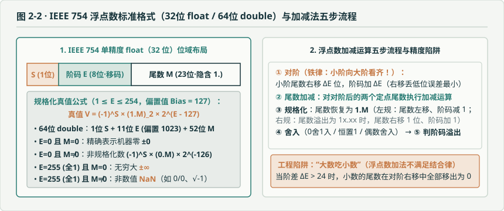

## 第一章 计算机系统概论与性能指标

### 1.1 冯·诺依曼体系结构与硬件五大部件

1. **冯·诺依曼计算机的五大核心特征**
   1. 计算机硬件系统由**运算器、控制器、存储器、输入设备、输出设备**五大部件组成；
   2. 核心思想是**“存储程序（Stored-Program）”**：将事先编制好的**指令和数据以同等地位存放在同一个主存储器中**，两者在形式上均为二进制代码（CPU 完全根据**访问主存所处的指令周期阶段**来区分取出的是指令还是数据：**取指周期**取出的必为指令送入 `IR`，**执行周期**取出的必为数据送入运算器）；
   3. 指令由**操作码（指明操作性质）**和**地址码（指明操作数位置）**两部分组成；
   4. 指令在主存中按顺序存放，默认按 `PC + "1"` 顺序执行，遇到转移指令时改变 `PC` 值；
   5. 早期冯·诺依曼机以**运算器**为中心（I/O 与主存交换数据必须经过运算器中转），**现代计算机已演进为以“存储器”为中心**（运算器与控制器集成为 **CPU**，I/O 设备尽可能绕过 CPU 直接与主存交换数据，如 DMA）。
2. **CPU 与主存储器内部的六大关键寄存器**
   - **主存接口寄存器（现多集成于 CPU 内部存储控制器中，对汇编程序员完全透明不可见）**：
     - **MAR（Memory Address Register，存储器地址寄存器）**：存放欲访问的主存单元地址。**`MAR` 的位数严格等于地址码长度，直接决定了主存最大可寻址的存储单元个数（`2^MAR`）**。
     - **MDR（Memory Data Register，存储器数据寄存器）**：暂存要从主存读出或向主存写入的一条指令或一个数据字。**`MDR` 的位数严格等于存储字长**。
   - **控制器核心寄存器**：
     - **PC（Program Counter，程序计数器，对汇编程序员可见）**：存放**下一条欲执行指令的主存地址**，具有自动加 `"1"`（严格来说是加上一条指令占用的字节数）的计数功能，其位数与 `MAR` 相等。
     - **IR（Instruction Register，指令寄存器，对程序员完全透明不可见）**：存放**当前正在执行的那条指令**，其操作码字段送往译码器（ID）生成控制信号。
   - **运算器核心部件**：
     - **ALU（算术逻辑单元，组合逻辑电路）**、**ACC（累加器）**、**MQ（乘商寄存器）**、**X（通用操作数寄存器）**与**PSW（程序状态字 / 标志寄存器，对程序员可见）**。

---

### 1.2 计算机系统的多级层次结构与定量性能指标

1. **计算机系统的五级层次结构（自底向上）**
   - **M0 微程序机器级**（硬件直接执行微指令）→ **M1 传统机器语言级**（由微程序解释执行二进制机器指令）→ **M2 操作系统机器级**（向上提供系统调用与虚拟内存）→ **M3 汇编语言机器级**（由汇编器翻译为机器语言）→ **M4 高级语言机器级**（由编译器翻译为汇编或机器码）。
   - **软硬件逻辑等价的分界线**：在 M1 与 M2 之间，定义为**指令集体系结构（ISA，Instruction Set Architecture）**——它是软件与硬件之间唯一的契约接口（规定了指令格式、寻址方式、数据类型以及**对程序员可见的寄存器集合**）。
2. **字长与存储容量概念辨析**
   - **机器字长**：CPU 内部整数运算器（ALU）和通用寄存器**一次能处理的二进制数据位数**（如 32 位或 64 位，决定了整数表示范围与运算精度）。
   - **指令字长**：一条机器指令所包含的二进制代码位数。
   - **存储字长**：一个主存存储单元所包含的二进制位数（现代计算机通常**按字节 `1B = 8 bit` 编址**，存储字长常为字节的整数倍）。
3. **CPU 核心性能定量计算公式（408 必考公式）**
   - **时钟周期 `T` 与主频（CPU 时钟频率）`f` 互为倒数**：
     **`T = 1 / f`**（例如主频 `f = 2 GHz = 2 × 10^9 Hz`，则时钟周期 `T = 0.5 ns`；注意计算机性能领域的 **`G / M / K` 在表示频率和速率时均为 `10^9 / 10^6 / 10^3`**，在表示存储容量时为 **`2^30 / 2^20 / 2^10`**）。
   - **CPI（Clock Cycles Per Instruction，执行一条指令所需的平均时钟周期数）**：
     若某程序共包含 `n` 类指令，第 `i` 类指令的 `CPI` 为 `CPI_i`、占总指令条数的比例为 `Pi`，则加权平均 `CPI` 为：
     **`CPI = Σ (CPI_i × Pi) = 程序总时钟周期数 / 指令总条数 I`**
   - **CPU 执行时间（CPU Time，衡量性能的最根本指标）**：
     **`CPU 执行时间 = 指令总条数 I × CPI × 时钟周期 T = (I × CPI) / f`**
     （铁律：程序的 CPU 执行时间由**指令条数 `I`、每条指令平均周期数 `CPI`、时钟周期 `T`** 三者共同乘积决定；单看主频 `f` 高低或 MIPS 高低均不能片面判定两台不同架构计算机的快慢）。
   - **MIPS（Million Instructions Per Second，每秒执行百万条指令数）与 FLOPS（每秒浮点运算次数）**：
     **`MIPS = 指令总条数 I / (CPU 执行时间 × 10^6) = f / (CPI × 10^6)`**

---

## 第二章 数据的机器表示与运算器（ALU）

### 2.1 定点数的编码表示（原码、反码、补码、移码）

设机器字长为 `n` 位（含 1 位最高符号位 + `n - 1` 位数值位，以下以 **8 位定点整数**为例）：

1. **四种机器码的定义、范围与零的表示对比**

| 编码类型 | 正数（`X ≥ 0`）规则 | 负数（`X < 0`）规则 | 8 位定点整数表示范围 | 机器零 `0` 的编码唯一性 |
| :--- | :--- | :--- | :---: | :--- |
| **1. 原码** | 符号位为 `0`，数值位照抄 | 符号位为 `1`，数值位取绝对值 `\|X\|` | `-127 ～ +127` `-(2^7 - 1) ～ +(2^7 - 1)` | **不唯一**（有两个零：`[+0]_原 = 0000 0000`，`[-0]_原 = 1000 0000`） |
| **2. 反码** | 与原码完全相同 | 符号位为 `1`，其余**数值位在原码基础上按位取反** | `-127 ～ +127` | **不唯一**（`[+0]_反 = 0000 0000`，`[-0]_反 = 1111 1111`） |
| **3. 补码** | 与原码完全相同 | 符号位为 `1`，**数值位在原码基础上按位取反、末位加 1**（模 `2^n`） | **`-128 ～ +127`** **`-2^7 ～ +(2^7 - 1)`** | **唯一**（`[+0]_补 = [-0]_补 = 0000 0000`；原 `[-0]_原` 的编码 **`1000 0000` 被规定用来表示最小负数 `-128`**） |
| **4. 移码** （偏置码） | 真值 `X` 加上偏置常数 `2^(n-1)`（即 **`[X]_移 = 2^(n-1) + X`**） | **将补码的最高符号位取反（0 变 1、1 变 0），其余数值位与补码完全一致** | **`-128 ～ +127`** （仅用于定点整数阶码） | **唯一**（`[0]_移 = 1000 0000`；最小真值 `-128` 对应全 0 `0000 0000`，最大真值 `+127` 对应全 1 `1111 1111`） |

2. **为什么现代计算机整数全部采用补码，而浮点数阶码采用移码**
   - **采用补码的两大原因**：
     1. **使符号位能与数值位一起直接参与加减运算，并将减法彻底转化为加法**（`[A - B]_补 = [A]_补 + [-B]_补`），使 CPU 内部**无需专门设计减法器电路**，仅靠一个加法器即可完成所有有符号/无符号加减法；
     2. 消除了 `+0` 和 `-0` 的重复编码，比原码多表示一个最小负数 **`-2^(n-1)`**（8 位为 `-128`，补码 `1000 0000B`；32 位 `int` 为 `-2147483648`，十六进制 **`0x80000000`**，注意对最小负数取绝对值或取负 `-(-2147483648)` 会因超出最大正数 `+2147483647` 而直接溢出变回它自己）。
   - **手算原码 ⇔ 补码及求 `[-X]_补` 的秒杀捷径**：
     - **负数原码 ⇔ 负数补码**：保持最高符号位 `1` 不变，从最右边（最低位）往左扫描找到**第一个 `1`**——**这个 `1` 及其右边的所有 `0` 原样保持不变，这个 `1` 左边的所有数值位（不含符号位）全部按位取反**。
     - **已知 `[X]_补` 求 `[-X]_补`（补码求相反数）**：**连同最高符号位在内，全体按位取反，末位加 1**（或从右往左找到第一个 `1`，该 `1` 及其右侧不变，**该 `1` 左侧连同符号位在内全部按位取反**）。
   - **浮点数阶码采用移码的原因**：移码将真值区间整体平移映射为非负无符号数，**真值越大其移码的二进制无符号值就严格越大**，因此硬件在对两个浮点数比较大小或对阶时，只需直接按无符号数比较两个阶码的二进制位即可。

---

### 2.2 定点数的移位、扩展、加减运算与溢出判定

1. **算术移位（有符号数）与逻辑移位（无符号数）**
   - **逻辑移位（针对无符号数 `unsigned`）**：无论左移还是右移，移出位丢弃，**空出的位一律补 `0`**。
   - **算术移位（针对有符号补码数 `int`，左移 1 位相当于乘 2，右移 1 位相当于除以 2 向下取整）**：
     - **补码算术左移**：低位**补 `0`**（若移出的最高数值位不等于原符号位，则发生左移溢出）；
     - **补码算术右移**：高位**补符号位（正数补 `0`，负数补 `1`）**，以保持负数右移后符号不变。
2. **数据位宽扩展：零扩展（Zero Extension）与符号扩展（Sign Extension）**
   当把短字长数据（如 8 位 `char`）赋值给长字长变量（如 32 位 `int`）时：
   - **无符号数采用“零扩展”**：高 24 位**全部填 `0`**；
   - **有符号补码数采用“符号扩展”**：高 24 位**全部填充原数的符号位**（正数全填 `0`，负数全填 `1` / `0xFF`；例如 8 位 `-1` 的补码 `0xFF` 符号扩展为 32 位后为 `0xFFFFFFFF`）。
   - **C 语言有符号与无符号混合运算陷阱（必考）**：在 C/C++ 中，当同一表达式里同时包含**有符号数（`int`）和无符号数（`unsigned int`）**时，编译器会**隐式将有符号数强制转换为无符号数**（底层二进制位完全不变，仅改变解释方式）。例如比较 `-1 < 0U` 时，`-1`（`0xFFFFFFFF`）被当成无符号最大值 `4294967295U`，导致 **`-1 < 0U` 结果为假（`false`）**！
3. **补码加减运算与溢出判定（Overflow）的三种硬件方法**
   - **补码加减法公式**：
     `[A + B]_补 = [A]_补 + [B]_补 (mod 2^n)`
     `[A - B]_补 = [A]_补 + [-B]_补 (mod 2^n)`
   - **有符号补码溢出的三种等价判定法则（仅同号相加或异号相减才可能溢出）**：
     1. **一位符号位判别法**：设两操作数符号位为 `As, Bs`，运算结果符号位为 `Ss`，当“**两个正数相加结果为负**”或“**两个负数相加结果为正**”时溢出：
        **`V = As · Bs · (~Ss) + (~As) · (~Bs) · Ss`**
     2. **双符号位判别法（变形补码 / 模 4 补码）**：用两位符号位 `S1 S2` 参与运算（正数为 `00`，负数为 `11`），运算结果的**最高位 `S1` 永远代表真正的正确符号**：
        - `S1 S2 == 00`：结果为正，无溢出；
        - `S1 S2 == 11`：结果为负，无溢出；
        - **`S1 S2 == 01`**：**正溢出（上溢）**；
        - **`S1 S2 == 10`**：**负溢出（下溢）**（即 **`V = S1 ⊕ S2 == 1`** 时发生溢出）。
     3. **进位位异或判别法（硬件 ALU 直接采用）**：设符号位产生的进位为 `Cn`，最高数值位向符号位产生的进位为 `Cn-1`，当两者不一致（一个有进位、另一个无进位）时必发生有符号溢出：
        **`OF = Cn ⊕ Cn-1`**

---

### 2.3 IEEE 754 浮点数标准与运算精度陷阱

1. **IEEE 754 浮点数的位域格式与真值转换（必考手算）**
   浮点数由**数符 `S`（1 位）**、**阶码 `E`（移码表示）**、**尾数 `M`（原码表示，规格化时最高有效位 `1.` 默认隐含不存，以多赚 1 位精度）**三部分组成：

| 类型 | 总位数 | 符号位 `S` | 阶码 `E` 位数与偏置值 `Bias` | 尾数 `M` 位数 | 规格化数（`1 ≤ E ≤ 全1-1`）的真值计算公式 |
| :--- | :---: | :---: | :---: | :---: | :--- |
| **单精度 `float`** | 32 位 | 1 位 | **8 位**（偏置值 **`Bias = 127`**，注意非标准移码 128） | **23 位**（实际精度 24 位） | **`(-1)^S × (1.M)_2 × 2^(E - 127)`** |
| **双精度 `double`** | 64 位 | 1 位 | **11 位**（偏置值 **`Bias = 1023`**） | **52 位**（实际精度 53 位） | **`(-1)^S × (1.M)_2 × 2^(E - 1023)`** |

   - **IEEE 754 的四类特殊阶码状态（以 32 位 `float` 为例）**：
     1. **`1 ≤ E ≤ 254`（正常规格化数）**：阶码真值范围 `-126 ～ +127`，尾数隐含整数位 `1.`（最小正规格化数为 `1.0 × 2^-126`，最大正规格化数为 `1.11...1 × 2^127 ≈ 3.4 × 10^38`）。
     2. **`E == 0` 且 `M == 0`**：精确表示**机器零 `±0`**。
     3. **`E == 0` 且 `M ≠ 0`（非规格化数）**：用于平滑逼近 0（逐渐下溢），此时**阶码真值固定为 `-126`（而非 `-127`），且尾数隐含整数位变为 `0.`**，真值为 **`(-1)^S × (0.M)_2 × 2^-126`**。
     4. **`E == 255`（阶码全 1）**：若 **`M == 0`** 表示**正负无穷大 `±∞`**（如浮点数除以 `0.0` 不会崩溃，而是产生 `±Infinity`）；若 **`M ≠ 0`** 表示**非数值 `NaN`（Not a Number，如 `0.0 / 0.0` 或负数开平方，且 `NaN != NaN` 恒成立）**。
2. **浮点数加减法运算的五步标准流程**
   1. **对阶（Align Exponents）**：求两数阶差 `ΔE = Ex - Ey`。**铁律：必须“小阶向大阶看齐”**——将阶码较小的那个数的尾数**向右移 `|ΔE|` 位**，每右移 1 位其阶码加 1，直到两数阶码相等（若反过来大阶向小阶左移，会把尾数最高有效位 `1` 直接移丢导致灾难性数量级错误）。
   2. **尾数加减**：对对阶后的两个定点尾数（记得补回隐含的最高位 `1.`）执行定点加减运算。
   3. **规格化（Normalization）**：
      - **右规**：若尾数相加后绝对值出现 `10.xxx` 或 `11.xxx`（即尾数溢出 > 1），则需将**尾数右移 1 位、阶码加 1**（右规最多只需 1 次）；
      - **左规**：若尾数相减后出现 `0.00...1xx`（最高有效位不是 1），则需将**尾数连续左移 `k` 位、阶码减 `k`**，直至恢复为 `1.M` 形式。
   4. **舍入（Rounding）**：为减少对阶右移和右规时低位移出造成的精度损失，在尾数末端设置保护位/附加位，常用舍入策略包括：**就近舍入（0 舍 1 入 / 偶数舍入，IEEE 754 默认）**、恒置 1 法、截断法（注意舍入加 1 后可能导致尾数再次溢出，需补做一次右规）。
   5. **判溢出（仅看阶码！）**：**浮点数的溢出完全由“阶码”是否超出最大/最小范围决定**——若**阶码上溢（> 最大阶码 +127）**，则发生浮点正/负**溢出异常（记为 `±∞`）**；若**阶码下溢（< 最小阶码 -126）**，则按**机器零 `0`** 处理，不报错。
3. **游戏与工程开发中的三大浮点数陷阱**
   - **为什么 `0.1 + 0.2 != 0.3`**：十进制的 `0.1` 转换为二进制小数是无限循环小数 `0.0001100110011...B`，受限于 23/52 位尾数必须截断舍入，因此绝不能直接用 `a == b` 判断两个浮点数相等，必须用 **`fabs(a - b) < EPSILON`**。
   - **大数吃小数（浮点加法不满足结合律 `(a + b) + c != a + (b + c)`）**：当一个极大的浮点数（如 `10^8`）加上一个极小的浮点数（如 `1.0`）时，两数阶差超过 24 位，小数的尾数在第一步“对阶右移”中全部移出有效位变成 `0`，导致连加几百万次 `1.0` 结果依然卡在原地（解决方案：**Kahan 求和算法**或用双精度 `double` / 定点数累加）。
   - **类型强制转换精度损失（`int` ↔ `float` ↔ `double`）**：
     - `int`（32 位有效位）转 `float`（仅 24 位有效尾数）：**不会溢出，但当 `int` 绝对值 `> 2^24 (16,777,216)` 时会丢失低位有效数字精度**；
     - `int` 或 `float` 转 `double`（53 位有效尾数，阶码 11 位）：**既不会溢出，也绝对不会丢失任何精度**。

---

### 2.4 算术逻辑单元（ALU）：先行进位加法器与四大标志位

1. **一位全加器（FA）与串行 / 先行进位加法器**
   - **一位全加器（Full Adder）**：输入本位加数 `Ai`、`Bi` 与低位进位 `Ci-1`，输出本位和 `Si` 与向高位的进位 `Ci`：
     - **和表达式**：**`Si = Ai ⊕ Bi ⊕ Ci-1`**
     - **进位表达式**：**`Ci = Ai · Bi + (Ai ⊕ Bi) · Ci-1`**
   - **定义两个辅助逻辑函数**：
     - **进位生成函数（本地进位）`Gi = Ai · Bi`**（只要 `Ai` 和 `Bi` 同为 1，无论低位有无进位，本位必产生进位）；
     - **进位传递函数 `Pi = Ai ⊕ Bi`**（当 `Ai` 和 `Bi` 中恰有一个为 1 时，可将低位进位 `Ci-1` 传递到高位），则进位公式简化为：**`Ci = Gi + Pi · Ci-1`**。
   - **串行进位（行波进位）vs 先行进位（超前进位 CLA）**：
     - **串行进位加法器**：高位的进位必须苦等低位一级一级逐位算出传递上来，总延迟与位数 `n` 成正比（`2n` 级门延迟），速度极慢。
     - **先行进位加法器（Carry-Lookahead Adder，CLA）**：将 `Ci = Gi + Pi · Ci-1` 递归展开，使每一位进位 `C1, C2, C3, C4` **仅由各输入位 `Ai, Bi`（即 `Gi, Pi`）和初始进位 `C0` 直接并行算出**，无需等待低位进位逐级传递，大幅缩短加法器门延迟（4 位 CLA 组内并行，多组间可采用组内先行、组间先行两级 CLA）。
2. **ALU 状态标志寄存器的四大标志位（`OF / CF / ZF / SF` 必背区分）**
   ALU 硬件在执行一次加/减法（设执行 `A - B`，减法控制信号 `Sub = 1`，加法 `Sub = 0`，最高位进位输出为 `Cout`）时，**并不知道操作数是有符号数还是无符号数**，而是**同时生成全部四个标志位**，交给后续的条件跳转指令（如无符号跳转 `JA/JB` 或有符号跳转 `JG/JL`）按需读取：
   1. **`OF`（Overflow Flag，溢出标志）**：**仅对“有符号数（补码）”运算有意义**！`OF = Cn ⊕ Cn-1`（`OF = 1` 表示有符号运算结果超出 `[-2^(n-1), 2^(n-1)-1]` 范围溢出；无符号运算完全忽略 `OF`）。
   2. **`CF`（Carry/Borrow Flag，进位/借位标志）**：**仅对“无符号数”运算有意义**！硬件公式为 **`CF = Sub ⊕ Cout`**（加法时 `Sub = 0`，`CF = Cout == 1` 表示无符号加法进位溢出；减法时 `Sub = 1`，`CF = ~Cout == 1` 表示无符号减法不够减产生**借位**，即无符号 `A < B`）。
   3. **`ZF`（Zero Flag，零标志）**：当运算结果的**所有二进制位全为 `0`** 时，`ZF = 1`；否则 `ZF = 0`（对有符号和无符号数均适用）。
   4. **`SF`（Sign Flag，符号标志）**：**仅对“有符号数”有意义**！直接等于运算结果的**最高位（符号位）**（`SF = 1` 表示结果为负，`SF = 0` 表示结果为非负）。
   - **有符号数 `A` 与 `B` 比较大小（执行 `CMP A, B`，即计算 `A - B`）的硬件判定逻辑**：
     - 若无溢出（`OF == 0`），则 `SF == 1`（结果为负）说明 `A < B`；
     - 若发生了溢出（`OF == 1`），则结果的符号位被翻转，此时 `SF == 0`（正数减负数正溢出得负数的反面：负数减正数负溢出得正数）反而说明 `A < B`；
     - 综上所述，**有符号数 `A < B` 的充要条件是：`SF ⊕ OF == 1`**（而**无符号数 `A < B` 的充要条件直接是：`CF == 1`**）。

---

## 第三章 存储系统（主存与高速缓冲存储器 Cache）（待更新）

- **3.1 半导体主存（SRAM vs DRAM）、容量扩展与大小端字节序**：DRAM 三种刷新、字位扩展、多体低位交叉、大端/小端与结构体内存对齐。
- **3.2 高速缓冲存储器（Cache）与三种地址映射**：直接映射、全相联映射、组相联映射的主存物理地址拆分与 Cache 总容量计算。
- **3.3 Cache 替换算法、写策略与伪共享（False Sharing）**：LRU、全写法（Write-Through）vs 写回法（Write-Back）、Cache Line 伪共享。

---

## 第四章 指令系统（ISA）（待更新）

- **4.1 指令格式、扩展操作码与数据寻址方式**：定长/变长扩展操作码、立即/直接/间接/寄存器/基址/变址/相对寻址 `EA = (PC) + A`。
- **4.2 CISC（复杂指令集）与 RISC（精简指令集）对比**：x86 vs ARM/RISC-V 核心架构特征对照。

---

## 第五章 中央处理器（CPU）与指令流水线（待更新）

- **5.1 CPU 数据通路与控制器设计**：指令周期四阶段、硬布线控制器 vs 微程序控制器（水平型/垂直型微指令与字段直接编码）。
- **5.2 经典五段指令流水线与三大冒险（Hazards）**：IF/ID/EX/MEM/WB、结构冒险、数据冒险（旁路转发 Forwarding 与 Load-Use 停顿）、控制冒险（分支预测）。

---

## 第六章 总线与输入/输出（I/O）系统硬件（待更新）

- **6.1 总线分类、带宽计算与定时通信**：系统三总线、总线带宽公式、同步定时 vs 异步定时（不互锁/半互锁/全互锁）。
- **6.2 I/O 接口编址、多重中断屏蔽字与 DMA 访存冲突**：统一编址 vs 独立编址、中断屏蔽字优先级修改、DMA 周期挪用（窃取）。
