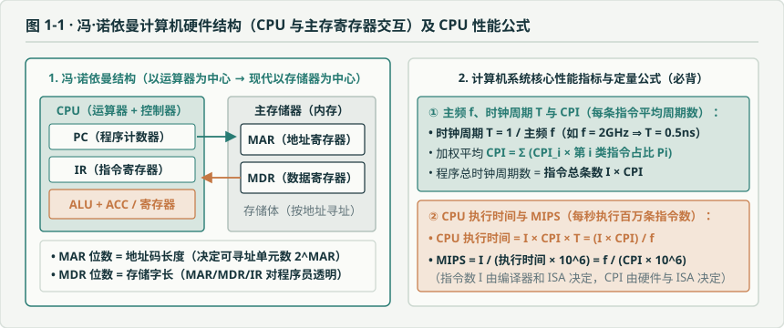
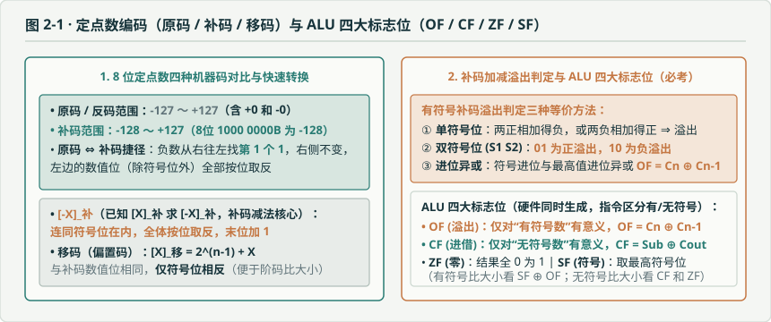
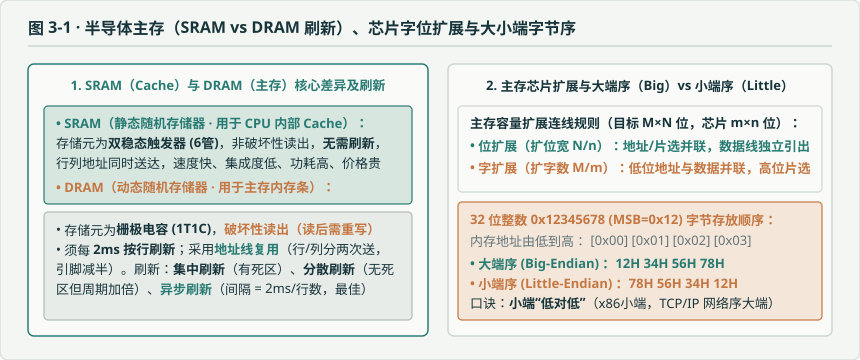
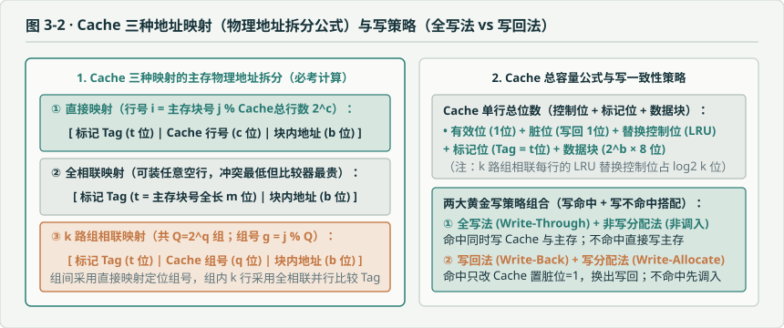
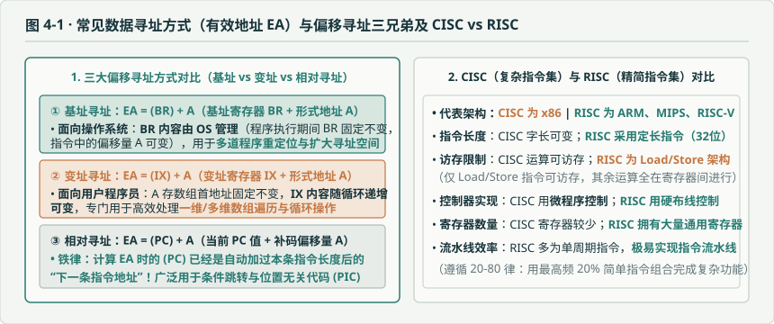
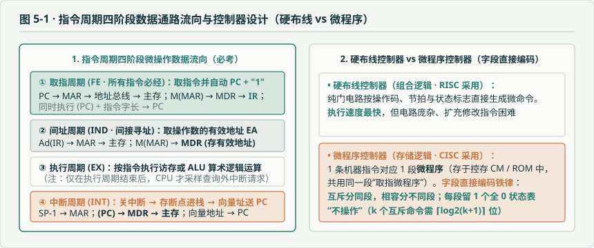
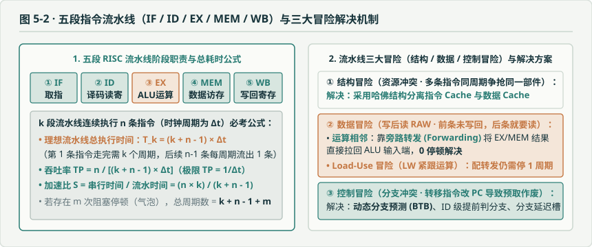
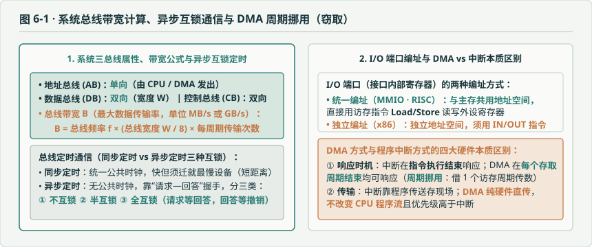

## 第一章 计算机系统概论与性能指标

### 1.1 冯·诺依曼体系结构与硬件五大部件

1. **冯·诺依曼计算机的五大核心特征**
   1. 计算机硬件系统由**运算器、控制器、存储器、输入设备、输出设备**五大部件组成；
   2. 核心思想是**“存储程序（Stored-Program）”**：将事先编制好的**指令和数据以同等地位存放在同一个主存储器中**，两者在形式上均为二进制代码（CPU 完全根据**访问主存所处的指令周期阶段**来区分取出的是指令还是数据：**取指周期**取出的必为指令送入 `IR`，**执行周期**取出的必为数据送入运算器）；
   3. 指令由**操作码（指明操作性质）**和**地址码（指明操作数位置）**两部分组成；
   4. 指令在主存中按顺序存放，默认按 `PC + "1"` 顺序执行，遇到转移指令时改变 `PC` 值；
   5. 早期冯·诺依曼机以**运算器**为中心（I/O 与主存交换数据必须经过运算器中转），**现代计算机已演进为以“存储器”为中心**（运算器与控制器集成为 **CPU**，I/O 设备尽可能绕过 CPU 直接与主存交换数据，如 DMA）。
2. **CPU 与主存储器内部的六大关键寄存器**
   - **主存接口寄存器（现多集成于 CPU 内部存储控制器中，对汇编程序员完全透明不可见）**：
     - **MAR（Memory Address Register，存储器地址寄存器）**：存放欲访问的主存单元地址。**`MAR` 的位数严格等于地址码长度，直接决定了主存最大可寻址的存储单元个数（`2^MAR`）**。
     - **MDR（Memory Data Register，存储器数据寄存器）**：暂存要从主存读出或向主存写入的一条指令或一个数据字。**`MDR` 的位数严格等于存储字长**。
   - **控制器核心寄存器**：
     - **PC（Program Counter，程序计数器，对汇编程序员可见）**：存放**下一条欲执行指令的主存地址**，具有自动加 `"1"`（严格来说是加上一条指令占用的字节数）的计数功能，其位数与 `MAR` 相等。
     - **IR（Instruction Register，指令寄存器，对程序员完全透明不可见）**：存放**当前正在执行的那条指令**，其操作码字段送往译码器（ID）生成控制信号。
   - **运算器核心部件**：
     - **ALU（算术逻辑单元，组合逻辑电路）**、**ACC（累加器）**、**MQ（乘商寄存器）**、**X（通用操作数寄存器）**与**PSW（程序状态字 / 标志寄存器，对程序员可见）**。

---

### 1.2 计算机系统的多级层次结构与定量性能指标

1. **计算机系统的五级层次结构（自底向上）**
   - **M0 微程序机器级**（硬件直接执行微指令）→ **M1 传统机器语言级**（由微程序解释执行二进制机器指令）→ **M2 操作系统机器级**（向上提供系统调用与虚拟内存）→ **M3 汇编语言机器级**（由汇编器翻译为机器语言）→ **M4 高级语言机器级**（由编译器翻译为汇编或机器码）。
   - **软硬件逻辑等价的分界线**：在 M1 与 M2 之间，定义为**指令集体系结构（ISA，Instruction Set Architecture）**——它是软件与硬件之间唯一的契约接口（规定了指令格式、寻址方式、数据类型以及**对程序员可见的寄存器集合**）。
2. **字长与存储容量概念辨析**
   - **机器字长**：CPU 内部整数运算器（ALU）和通用寄存器**一次能处理的二进制数据位数**（如 32 位或 64 位，决定了整数表示范围与运算精度）。
   - **指令字长**：一条机器指令所包含的二进制代码位数。
   - **存储字长**：一个主存存储单元所包含的二进制位数（现代计算机通常**按字节 `1B = 8 bit` 编址**，存储字长常为字节的整数倍）。
3. **CPU 核心性能定量计算公式**
   - **时钟周期 `T` 与主频（CPU 时钟频率）`f` 互为倒数**：
     **`T = 1 / f`**（例如主频 `f = 2 GHz = 2 × 10^9 Hz`，则时钟周期 `T = 0.5 ns`；注意计算机性能领域的 **`G / M / K` 在表示频率和速率时均为 `10^9 / 10^6 / 10^3`**，在表示存储容量时为 **`2^30 / 2^20 / 2^10`**）。
   - **CPI（Clock Cycles Per Instruction，执行一条指令所需的平均时钟周期数）**：
     若某程序共包含 `n` 类指令，第 `i` 类指令的 `CPI` 为 `CPI_i`、占总指令条数的比例为 `Pi`，则加权平均 `CPI` 为：
     **`CPI = Σ (CPI_i × Pi) = 程序总时钟周期数 / 指令总条数 I`**
   - **CPU 执行时间（CPU Time，衡量性能的最根本指标）**：
     **`CPU 执行时间 = 指令总条数 I × CPI × 时钟周期 T = (I × CPI) / f`**
     （程序的 CPU 执行时间由**指令条数 `I`、每条指令平均周期数 `CPI`、时钟周期 `T`** 三者乘积决定；单看主频 `f` 或 MIPS 均不能单独判定不同架构计算机的性能）。
   - **MIPS（Million Instructions Per Second，每秒执行百万条指令数）与 FLOPS（每秒浮点运算次数）**：
     **`MIPS = 指令总条数 I / (CPU 执行时间 × 10^6) = f / (CPI × 10^6)`**

---

## 第二章 数据的机器表示与运算器（ALU）

### 2.1 定点数的编码表示（原码、反码、补码、移码）

设机器字长为 `n` 位（含 1 位最高符号位 + `n - 1` 位数值位，以下以 **8 位定点整数**为例）：

1. **四种机器码的定义、范围与零的表示对比**

| 编码类型 | 正数（`X ≥ 0`）规则 | 负数（`X < 0`）规则 | 8 位定点整数表示范围 | 机器零 `0` 的编码唯一性 |
| :--- | :--- | :--- | :---: | :--- |
| **1. 原码** | 符号位为 `0`，数值位照抄 | 符号位为 `1`，数值位取绝对值 `\|X\|` | `-127 ～ +127` `-(2^7 - 1) ～ +(2^7 - 1)` | **不唯一**（有两个零：`[+0]_原 = 0000 0000`，`[-0]_原 = 1000 0000`） |
| **2. 反码** | 与原码完全相同 | 符号位为 `1`，其余**数值位在原码基础上按位取反** | `-127 ～ +127` | **不唯一**（`[+0]_反 = 0000 0000`，`[-0]_反 = 1111 1111`） |
| **3. 补码** | 与原码完全相同 | 符号位为 `1`，**数值位在原码基础上按位取反、末位加 1**（模 `2^n`） | **`-128 ～ +127`** **`-2^7 ～ +(2^7 - 1)`** | **唯一**（`[+0]_补 = [-0]_补 = 0000 0000`；原 `[-0]_原` 的编码 **`1000 0000` 被规定用来表示最小负数 `-128`**） |
| **4. 移码** （偏置码） | 真值 `X` 加上偏置常数 `2^(n-1)`（即 **`[X]_移 = 2^(n-1) + X`**） | **将补码的最高符号位取反（0 变 1、1 变 0），其余数值位与补码完全一致** | **`-128 ～ +127`** （仅用于定点整数阶码） | **唯一**（`[0]_移 = 1000 0000`；最小真值 `-128` 对应全 0 `0000 0000`，最大真值 `+127` 对应全 1 `1111 1111`） |

2. **为什么现代计算机整数全部采用补码，而浮点数阶码采用移码**
   - **采用补码的两大原因**：
     1. **使符号位能与数值位一起直接参与加减运算，并将减法转化为加法**（`[A - B]_补 = [A]_补 + [-B]_补`），使 CPU 内部**无需专门设计减法器电路**，仅靠一个加法器即可完成所有有符号/无符号加减法；
     2. 消除了 `+0` 和 `-0` 的重复编码，比原码多表示一个最小负数 **`-2^(n-1)`**（8 位为 `-128`，补码 `1000 0000B`；32 位 `int` 为 `-2147483648`，十六进制 **`0x80000000`**，注意对最小负数取绝对值或取负 `-(-2147483648)` 会因超出最大正数 `+2147483647` 而直接溢出变回它自己）。
   - **手算原码 ⇔ 补码及求 `[-X]_补` 的秒杀捷径**：
     - **负数原码 ⇔ 负数补码**：保持最高符号位 `1` 不变，从最右边（最低位）往左扫描找到**第一个 `1`**——**这个 `1` 及其右边的所有 `0` 原样保持不变，这个 `1` 左边的所有数值位（不含符号位）全部按位取反**。
     - **已知 `[X]_补` 求 `[-X]_补`（补码求相反数）**：**连同最高符号位在内，全体按位取反，末位加 1**（或从右往左找到第一个 `1`，该 `1` 及其右侧不变，**该 `1` 左侧连同符号位在内全部按位取反**）。
   - **浮点数阶码采用移码的原因**：移码将真值区间整体平移映射为非负无符号数，**真值越大其移码的二进制无符号值就严格越大**，因此硬件在对两个浮点数比较大小或对阶时，只需直接按无符号数比较两个阶码的二进制位即可。

---

### 2.2 定点数的移位、扩展、加减运算与溢出判定

1. **算术移位（有符号数）与逻辑移位（无符号数）**
   - **逻辑移位（针对无符号数 `unsigned`）**：无论左移还是右移，移出位丢弃，**空出的位一律补 `0`**。
   - **算术移位（针对有符号补码数 `int`，左移 1 位相当于乘 2，右移 1 位相当于除以 2 向下取整）**：
     - **补码算术左移**：低位**补 `0`**（若移出的最高数值位不等于原符号位，则发生左移溢出）；
     - **补码算术右移**：高位**补符号位（正数补 `0`，负数补 `1`）**，以保持负数右移后符号不变。
2. **数据位宽扩展：零扩展（Zero Extension）与符号扩展（Sign Extension）**
   当把短字长数据（如 8 位 `char`）赋值给长字长变量（如 32 位 `int`）时：
   - **无符号数采用“零扩展”**：高 24 位**全部填 `0`**；
   - **有符号补码数采用“符号扩展”**：高 24 位**全部填充原数的符号位**（正数全填 `0`，负数全填 `1` / `0xFF`；例如 8 位 `-1` 的补码 `0xFF` 符号扩展为 32 位后为 `0xFFFFFFFF`）。
   - **C 语言有符号与无符号混合运算陷阱**：在 C/C++ 中，当同一表达式里同时包含**有符号数（`int`）和无符号数（`unsigned int`）**时，编译器会**隐式将有符号数强制转换为无符号数**（底层二进制位完全不变，仅改变解释方式）。例如比较 `-1 < 0U` 时，`-1`（`0xFFFFFFFF`）被当成无符号最大值 `4294967295U`，导致 **`-1 < 0U` 结果为假（`false`）**。
3. **补码加减运算与溢出判定（Overflow）的三种硬件方法**
   - **补码加减法公式**：
     `[A + B]_补 = [A]_补 + [B]_补 (mod 2^n)`
     `[A - B]_补 = [A]_补 + [-B]_补 (mod 2^n)`
   - **有符号补码溢出的三种等价判定法则（仅同号相加或异号相减才可能溢出）**：
     1. **一位符号位判别法**：设两操作数符号位为 `As, Bs`，运算结果符号位为 `Ss`，当“**两个正数相加结果为负**”或“**两个负数相加结果为正**”时溢出：
        **`V = As · Bs · (~Ss) + (~As) · (~Bs) · Ss`**
     2. **双符号位判别法（变形补码 / 模 4 补码）**：用两位符号位 `S1 S2` 参与运算（正数为 `00`，负数为 `11`），运算结果的**最高位 `S1` 永远代表真正的正确符号**：
        - `S1 S2 == 00`：结果为正，无溢出；
        - `S1 S2 == 11`：结果为负，无溢出；
        - **`S1 S2 == 01`**：**正溢出（上溢）**；
        - **`S1 S2 == 10`**：**负溢出（下溢）**（即 **`V = S1 ⊕ S2 == 1`** 时发生溢出）。
     3. **进位位异或判别法（硬件 ALU 直接采用）**：设符号位产生的进位为 `Cn`，最高数值位向符号位产生的进位为 `Cn-1`，当两者不一致（一个有进位、另一个无进位）时必发生有符号溢出：
        **`OF = Cn ⊕ Cn-1`**

---

### 2.3 IEEE 754 浮点数标准与运算精度陷阱

1. **IEEE 754 浮点数的位域格式与真值转换**
   浮点数由**数符 `S`（1 位）**、**阶码 `E`（移码表示）**、**尾数 `M`（原码表示，规格化时最高有效位 `1.` 默认隐含不存，以多赚 1 位精度）**三部分组成：

| 类型 | 总位数 | 符号位 `S` | 阶码 `E` 位数与偏置值 `Bias` | 尾数 `M` 位数 | 规格化数（`1 ≤ E ≤ 全1-1`）的真值计算公式 |
| :--- | :---: | :---: | :---: | :---: | :--- |
| **单精度 `float`** | 32 位 | 1 位 | **8 位**（偏置值 **`Bias = 127`**，注意非标准移码 128） | **23 位**（实际精度 24 位） | **`(-1)^S × (1.M)_2 × 2^(E - 127)`** |
| **双精度 `double`** | 64 位 | 1 位 | **11 位**（偏置值 **`Bias = 1023`**） | **52 位**（实际精度 53 位） | **`(-1)^S × (1.M)_2 × 2^(E - 1023)`** |

   - **IEEE 754 的四类特殊阶码状态（以 32 位 `float` 为例）**：
     1. **`1 ≤ E ≤ 254`（正常规格化数）**：阶码真值范围 `-126 ～ +127`，尾数隐含整数位 `1.`（最小正规格化数为 `1.0 × 2^-126`，最大正规格化数为 `1.11...1 × 2^127 ≈ 3.4 × 10^38`）。
     2. **`E == 0` 且 `M == 0`**：精确表示**机器零 `±0`**。
     3. **`E == 0` 且 `M ≠ 0`（非规格化数）**：用于平滑逼近 0（逐渐下溢），此时**阶码真值固定为 `-126`（而非 `-127`），且尾数隐含整数位变为 `0.`**，真值为 **`(-1)^S × (0.M)_2 × 2^-126`**。
     4. **`E == 255`（阶码全 1）**：若 **`M == 0`** 表示**正负无穷大 `±∞`**（如浮点数除以 `0.0` 不会崩溃，而是产生 `±Infinity`）；若 **`M ≠ 0`** 表示**非数值 `NaN`（Not a Number，如 `0.0 / 0.0` 或负数开平方，且 `NaN != NaN` 恒成立）**。
2. **浮点数加减法运算的五步标准流程**
   1. **对阶（Align Exponents）**：求两数阶差 `ΔE = Ex - Ey`。**规则：小阶向大阶对齐**——将阶码较小的数的尾数**向右移 `|ΔE|` 位**，每右移 1 位其阶码加 1，直至两数阶码相等（若大阶向小阶左移，会将尾数最高有效位移出丢失）。
   2. **尾数加减**：对对阶后的两个定点尾数（记得补回隐含的最高位 `1.`）执行定点加减运算。
   3. **规格化（Normalization）**：
      - **右规**：若尾数相加后绝对值出现 `10.xxx` 或 `11.xxx`（即尾数溢出 > 1），则需将**尾数右移 1 位、阶码加 1**（右规最多只需 1 次）；
      - **左规**：若尾数相减后出现 `0.00...1xx`（最高有效位不是 1），则需将**尾数连续左移 `k` 位、阶码减 `k`**，直至恢复为 `1.M` 形式。
   4. **舍入（Rounding）**：为减少对阶右移和右规时低位移出造成的精度损失，在尾数末端设置保护位/附加位，常用舍入策略包括：**就近舍入（0 舍 1 入 / 偶数舍入，IEEE 754 默认）**、恒置 1 法、截断法（注意舍入加 1 后可能导致尾数再次溢出，需补做一次右规）。
   5. **判溢出（依据阶码）**：**浮点数的溢出由阶码是否超出表示范围决定**——若**阶码上溢（> 最大阶码 +127）**，则产生**溢出异常（记为 `±∞`）**；若**阶码下溢（< 最小阶码 -126）**，则按**机器零 `0`** 处理。
3. **游戏与工程开发中的三大浮点数陷阱**
   - **为什么 `0.1 + 0.2 != 0.3`**：十进制的 `0.1` 转换为二进制小数是无限循环小数 `0.0001100110011...B`，受限于 23/52 位尾数必须截断舍入，因此绝不能直接用 `a == b` 判断两个浮点数相等，必须用 **`fabs(a - b) < EPSILON`**。
   - **大数吃小数（浮点加法不满足结合律 `(a + b) + c != a + (b + c)`）**：当一个极大的浮点数（如 `10^8`）加上一个极小的浮点数（如 `1.0`）时，两数阶差超过 24 位，小数的尾数在第一步“对阶右移”中全部移出有效位变成 `0`，导致连加几百万次 `1.0` 结果依然卡在原地（解决方案：**Kahan 求和算法**或用双精度 `double` / 定点数累加）。
   - **类型强制转换精度损失（`int` ↔ `float` ↔ `double`）**：
     - `int`（32 位有效位）转 `float`（仅 24 位有效尾数）：**不会溢出，但当 `int` 绝对值 `> 2^24 (16,777,216)` 时会丢失低位有效数字精度**；
     - `int` 或 `float` 转 `double`（53 位有效尾数，阶码 11 位）：**既不会溢出，也绝对不会丢失任何精度**。

---

### 2.4 算术逻辑单元（ALU）：先行进位加法器与四大标志位

1. **一位全加器（FA）与串行 / 先行进位加法器**
   - **一位全加器（Full Adder）**：输入本位加数 `Ai`、`Bi` 与低位进位 `Ci-1`，输出本位和 `Si` 与向高位的进位 `Ci`：
     - **和表达式**：**`Si = Ai ⊕ Bi ⊕ Ci-1`**
     - **进位表达式**：**`Ci = Ai · Bi + (Ai ⊕ Bi) · Ci-1`**
   - **定义两个辅助逻辑函数**：
     - **进位生成函数（本地进位）`Gi = Ai · Bi`**（只要 `Ai` 和 `Bi` 同为 1，无论低位有无进位，本位必产生进位）；
     - **进位传递函数 `Pi = Ai ⊕ Bi`**（当 `Ai` 和 `Bi` 中恰有一个为 1 时，可将低位进位 `Ci-1` 传递到高位），则进位公式简化为：**`Ci = Gi + Pi · Ci-1`**。
   - **串行进位（行波进位）vs 先行进位（超前进位 CLA）**：
     - **串行进位加法器**：高位的进位必须苦等低位一级一级逐位算出传递上来，总延迟与位数 `n` 成正比（`2n` 级门延迟），速度极慢。
     - **先行进位加法器（Carry-Lookahead Adder，CLA）**：将 `Ci = Gi + Pi · Ci-1` 递归展开，使每一位进位 `C1, C2, C3, C4` **仅由各输入位 `Ai, Bi`（即 `Gi, Pi`）和初始进位 `C0` 直接并行算出**，无需等待低位进位逐级传递，大幅缩短加法器门延迟（4 位 CLA 组内并行，多组间可采用组内先行、组间先行两级 CLA）。
2. **ALU 状态标志寄存器的四大标志位（`OF / CF / ZF / SF` 必背区分）**
   ALU 硬件在执行一次加/减法（设执行 `A - B`，减法控制信号 `Sub = 1`，加法 `Sub = 0`，最高位进位输出为 `Cout`）时，**并不知道操作数是有符号数还是无符号数**，而是**同时生成全部四个标志位**，交给后续的条件跳转指令（如无符号跳转 `JA/JB` 或有符号跳转 `JG/JL`）按需读取：
   1. **`OF`（Overflow Flag，溢出标志）**：**仅对“有符号数（补码）”运算有意义**。`OF = Cn ⊕ Cn-1`（`OF = 1` 表示有符号运算结果超出 `[-2^(n-1), 2^(n-1)-1]` 范围溢出；无符号运算完全忽略 `OF`）。
   2. **`CF`（Carry/Borrow Flag，进位/借位标志）**：**仅对“无符号数”运算有意义**。硬件公式为 **`CF = Sub ⊕ Cout`**（加法时 `Sub = 0`，`CF = Cout == 1` 表示无符号加法进位溢出；减法时 `Sub = 1`，`CF = ~Cout == 1` 表示无符号减法不够减产生**借位**，即无符号 `A < B`）。
   3. **`ZF`（Zero Flag，零标志）**：当运算结果的**所有二进制位全为 `0`** 时，`ZF = 1`；否则 `ZF = 0`（对有符号和无符号数均适用）。
   4. **`SF`（Sign Flag，符号标志）**：**仅对“有符号数”有意义**。直接等于运算结果的**最高位（符号位）**（`SF = 1` 表示结果为负，`SF = 0` 表示结果为非负）。
   - **有符号数 `A` 与 `B` 比较大小（执行 `CMP A, B`，即计算 `A - B`）的硬件判定逻辑**：
     - 若无溢出（`OF == 0`），则 `SF == 1`（结果为负）说明 `A < B`；
     - 若发生了溢出（`OF == 1`），则结果的符号位被翻转，此时 `SF == 0`（正数减负数正溢出得负数的反面：负数减正数负溢出得正数）反而说明 `A < B`；
     - 综上所述，**有符号数 `A < B` 的充要条件是：`SF ⊕ OF == 1`**（而**无符号数 `A < B` 的充要条件直接是：`CF == 1`**）。

---

## 第三章 存储系统（主存与高速缓冲存储器 Cache）

### 3.1 半导体主存（SRAM vs DRAM）、容量扩展与大小端字节序

1. **三级存储体系层次结构**
   - 现代计算机为兼顾**容量、速度与成本**，基于局部性原理构建了多级存储层次结构：
     1. **`Cache — 主存` 层次**：主要解决 **CPU 与主存速度不匹配**的问题。数据调度完全由**硬件（Cache 控制器）**自动完成，**对系统程序员和应用程序员均完全透明**。
     2. **`主存 — 辅存（磁盘/SSD）` 层次**：主要解决**存储系统容量不足**的问题（构成虚拟存储器）。数据调页由**硬件（MMU 缺页异常）与操作系统软件**共同完成，**对应用程序员透明，但对系统（OS）程序员可见**。
2. **SRAM（静态随机存储器）与 DRAM（动态随机存储器）核心对比**

| 对比维度 | SRAM（静态 RAM） | DRAM（动态 RAM，DDR 内存条） |
| :--- | :--- | :--- |
| **存储元物理原理** | **双稳态触发器**（6 个 MOS 晶体管构成） | **栅极电容上的电荷**（1 个晶体管 + 1 个电容 `1T1C`） |
| **读出是否破坏原值** | **非破坏性读出**（读出后无需重写） | **破坏性读出**（读出时电容放电，**读后必须立即执行再生重写**） |
| **是否需要定期刷新** | **不需要刷新**（只要不断电数据永不丢失） | **必须定期刷新**（电容漏电，通常在 **`2ms` 刷新周期**内按**行**刷新全部行） |
| **送行列地址方式** | 行、列地址**同时送达**（地址引脚多） | 采用**地址线复用技术**，行地址和列地址**分两次先后送入同一组引脚**（地址引脚数直接减半） |
| **速度、密度与用途** | 速度极快、集成度低、功耗大、价格昂贵 → **用作 CPU 内部 Cache** | 速度较慢、集成度极高、功耗低、价格便宜 → **用作主存储器（内存条）** |

   - **DRAM 的三种刷新方式（设存储矩阵为 `128 × 128`，读写周期 `0.5μs`，刷新周期 `2ms = 2000μs`；注意 DRAM 刷新以“行”为单位且刷新过程占用的时间等于 1 个读写周期）**：
     1. **集中刷新**：在 `2ms` 内的最后一段时间集中对全部 `128` 行逐行刷新。缺点：集中刷新的这 `128 × 0.5μs = 64μs` 期间 CPU 和 DMA 完全无法访问主存，形成长达 `64μs` 的**访存“死区（死时间）”**。
     2. **分散刷新**：将每行的刷新插入到每个正常的读写周期之后（把机器存取周期从 `0.5μs` 延长一倍至 `1.0μs`：前 `0.5μs` 正常读写，后 `0.5μs` 刷新某一行）。优点：消除死区；缺点：每隔 `128μs` 就把全片刷新了一遍，**过度刷新导致整机主存性能降低一半**。
     3. **异步刷新（工程最佳折中）**：用刷新周期除以总行数（**`刷新间隔 = 2000μs / 128 ≈ 15.6μs`**），每隔 `15.6μs` 仅发出一次刷新请求刷新 1 行。既避免了长死区（死时间缩短为单个周期 `0.5μs`，且可安排在 CPU 指令译码不访存阶段），又不会无谓延长存取周期。
3. **主存芯片容量扩展（位扩展、字扩展、字位同时扩展）与多体交叉存储器**
   - 设目标主存容量为 `M × N` 位，单颗存储芯片容量为 `m × n` 位，则所需芯片总数为 **`(M / m) × (N / n)`**：
     - **位扩展（仅扩充数据位宽 `k = N / n` 颗）**：各芯片的**地址线、片选线 `CS`、读写控制线 `WE` 全部并联**，而各芯片的**数据线各自独立引出**共同拼成 `N` 位数据总线（所有芯片同时工作）。
     - **字扩展（仅扩充存储字数 `k = M / m` 颗）**：各芯片的**低位地址线、数据线、读写线全部并联**，由**高位地址线经过译码器（如 3-8 译码器 `74LS138`）产生独立的片选信号 `CS`**，同一时刻仅有 1 颗芯片被选中工作。
   - **多体并行交叉存储器（高位交叉 vs 低位交叉）**：
     - **高位交叉编址（顺序方式：`体号 | 体内地址`）**：仅相当于单纯扩容，连续访问相邻地址时全部落在同一个存储体内，必发生访存冲突，无法并行提速。
     - **低位交叉编址（交叉方式：`体内地址 | 体号`，连续地址轮流分布在 `m` 个不同存储体中，块号 `k = 地址 % m`）**：契合程序局部性原理，支持**流水线式并行存取**。设单个存储体的存取周期为 `T`，总线传输周期为 `τ`（满足 `m ≥ T / τ`），则**连续读取 `n` 个字所需的总时间**为：
       **`t_总 = T + (n - 1) × τ`**（宏观上每个周期 `τ` 都能吐出 1 个字）。
4. **数据的字节排列（大端序 vs 小端序）与结构体内存对齐**
   - **大端模式（Big-Endian）与小端模式（Little-Endian）**：
     以 32 位四字节整数 `0x12345678`（其中最高有效字节 `MSB = 0x12`，最低有效字节 `LSB = 0x78`）存放在起始地址 `0x1000` 为例：
     - **大端序（高对低）**：将数据的**最高有效字节（`0x12`）存放在最低内存地址（`0x1000`）**，符合人类从左到右阅读习惯（**TCP/IP 网络字节序**、Java 虚拟机、PowerPC 采用）。
     - **小端序（低对低，口诀必记）**：将数据的**最低有效字节（`0x78`）存放在最低内存地址（`0x1000`）**，便于硬件 ALU 从低位字节开始做加法和强制类型截断（**x86/x64、ARM 默认采用**）。
   - **C/C++ 结构体字节对齐（Memory Alignment）的两大黄金法则**：
     - **为什么硬件要求内存对齐**：CPU 并非按单字节读写内存，而是按 `4B / 8B` 字块或 `64B` Cache Line 读写；若一个 4 字节 `int` 跨在两个字块边界上，CPU 必须发 **2 次访存周期**再做高低位拼接，甚至在某些 RISC 架构上直接触发硬件对齐异常。
     - **编译器对齐规则**：① 每个成员变量的**起始偏移量（Offset）必须是该成员自身大小（与 `#pragma pack(n)` 较小者）的整数倍**，不足则填充空白字节（Padding）；② **整个结构体的总大小必须是其内部最大基本成员对齐数的整数倍**。

---

### 3.2 高速缓冲存储器（Cache）与三种地址映射

1. **Cache 工作原理与命中率、平均访问时间**
   - Cache 与主存被划分为大小完全相等的块：**Cache 块又称为 Cache 行（Cache Line / Slot，现代 CPU 通常为 `64B`）**。
   - 设 CPU 命中 Cache 的总次数为 `Nc`，访问主存的总次数为 `Nm`，则**命中率 `H = Nc / (Nc + Nm)`**。设访问 Cache 耗时为 `tc`，访问主存耗时为 `tm`：
     - **先访 Cache，未命中再访主存**：平均访问时间 **`Ta = H × tc + (1 - H) × (tc + tm) = tc + (1 - H) × tm`**；
     - **同时访问 Cache 与主存**：平均访问时间 **`Ta = H × tc + (1 - H) × tm`**。
2. **Cache — 主存的三种地址映射方式与物理地址拆分**
   设主存物理地址总长度为 `A` 位，每个主存块（= Cache 行数据块）大小为 **`B = 2^b` 字节**，则物理地址的最低 **`b` 位固定为“块内地址（字节偏移量）”**，高 `m = A - b` 位为主存块号 `j`：

| 映射方式 | 映射规则与查找机制 | 主存物理地址拆分格式 | 优缺点对比 |
| :--- | :--- | :--- | :--- |
| **1. 直接映射** (Direct Mapped) | 主存第 `j` 块**只能唯一固定映射**到 Cache 的第 **`i = j % C`** 行（设 Cache 总行数为 `C = 2^c`） | **`[ 标记 Tag (t位) \| Cache行号 (c位) \| 块内地址 (b位) ]`** （其中 `t = A - c - b`） | 硬件实现最简单（根据中间 `c` 位直接找到唯一行，仅需 1 个比较器比对 Tag）；**缺点：块冲突率极高**，空间利用率最低 |
| **2. 全相联映射** (Fully Associative) | 主存中任意一块可以装入 Cache 中的**任意一个空闲行** | **`[ 标记 Tag (t = A - b 位) \| 块内地址 (b位) ]`** | **块冲突率最低、空间利用率和命中率最高**；缺点：标记位 `Tag` 最长，且每次必须用相联存储器与**所有行的 Tag 并行比较**，硬件成本和功耗高昂 |
| **3. k 路组相联映射** (k-Way Set Associative) | 将 Cache 分为 `Q = C / k = 2^q` 个组（每组含 `k` 行）：**组间采用直接映射**定位组号 **`g = j % Q`**，**组内 `k` 行采用全相联映射** | **`[ 标记 Tag (t位) \| Cache组号 (q位) \| 块内地址 (b位) ]`** （其中 `q = log2 Q`，`t = A - q - b`） | **现代 CPU 标准方案**（如 8 路组相联）：兼顾了直接映射硬件简单与全相联低冲突率的优点（仅需 `k` 个并行比较器） |

3. **Cache 总容量（存储体总位数）精确计算公式**
   **注意**：计算 **Cache 的总容量（总位数）** 时，除数据区容量外，**必须加上每一行的控制位（有效位、脏位、替换算法位）和标记位 `Tag`**。
   设 Cache 共有 `C` 行，每行数据块大小为 `B = 2^b` 字节，则**单行 Cache 的总位数**为：
   **`单行总位数 = 有效位 (1 bit) + [写回法脏位 (1 bit)] + [k路组相联 LRU 替换位 (log2 k bit)] + 标记位 Tag (t bit) + 数据块位数 (B × 8 bit)`**
   **`Cache 总容量 = Cache 总行数 C × 单行总位数`**

---

### 3.3 Cache 替换算法、写策略与伪共享（False Sharing）

1. **Cache 替换算法（仅全相联和组相联需要；直接映射位置唯一，无须替换算法直接覆盖）**
   - **随机算法（RAND）**、**先进先出算法（FIFO）**、**近期最少使用算法（LRU，命中率最高，最常用；注意抖动情况：当循环访问的数组块数恰好大于组内行数或总行数时，LRU 命中率会跌至 0）**、**最不经常使用算法（LFU）**。
2. **Cache 写策略（维护 Cache 与主存数据一致性的两套标准组合）**
   - **组合一：全写法（写直达，Write-Through）+ 非写分配法（Not-Write-Allocate）**
     - **写命中时（全写法）**：CPU **同时把数据写入 Cache 和主存**（为避免 CPU 苦等慢速主存，在 Cache 与主存之间增设一个 FIFO **写缓冲 Write Buffer**）。**无需设置脏位（修改位）**。
     - **写不命中时（非写分配法）**：直接将数据写入主存，**不把该块调入 Cache**（通常用于 L2/L3 或无脏位简单设计）。
   - **组合二：写回法（Write-Back）+ 写分配法（Write-Allocate，现代 L1 Cache 标准）**
     - **写命中时（写回法）**：CPU **只修改 Cache 行中的数据，而不立即写入主存**，仅将该 Cache 行的**修改位（脏位 Dirty Bit）置为 `1`**；直到该 Cache 行将来被替换换出时，若脏位为 `1` 才一次性写回主存（大幅减少访存带宽占用，但**每行必须增加 1 bit 脏位**）。
     - **写不命中时（写分配法）**：先把主存中对应的块**调入 Cache**，然后在 Cache 中修改它并置脏位为 `1`。
3. **多线程性能隐形杀手：Cache Line 伪共享（False Sharing）**
   - **成因**：现代多核 CPU 通过 **MESI 缓存一致性协议**以 **Cache Line（通常 64 字节）为最小单位**维护各核 L1 Cache 的一致性。如果两个毫无关系的独立变量 `int a` 和 `int b` 恰好紧挨着定义在同一个结构体或数组中，它们会被同时加载进**同一个 64B 的 Cache Line**。当核心 0 频繁修改 `a`、同时核心 1 频繁修改 `b` 时，两个核心会反复通过总线互相将对方的整条 Cache Line 置为**无效（Invalid）**，导致 L1 Cache 频繁失效、总线被一致性流量打满，导致访问性能显著下降。
   - **工程解决方案**：使用 **`alignas(64)`**（C++11）或手动填充 Padding 字节，将多线程高频独立写入的变量隔离到不同的 64B Cache Line 中。

---

## 第四章 指令系统（ISA）

### 4.1 指令格式、扩展操作码与数据寻址方式

1. **指令的基本格式与扩展操作码技术**
   - **按地址码个数分类**：零地址指令（栈式运算 `ADD` 或 `NOP / RET`）、一地址指令（单操作数如 `INC R1` 或隐含 `ACC` 的双操作数运算）、二地址指令（`OP dst, src`）、三地址指令（`OP dst, src1, src2`，RISC 标准）。
   - **定长操作码 vs 扩展操作码（可变长操作码，必考计算）**：
     - 在**指令总字长固定**的前提下，为支持更多指令类型，使地址码个数少的指令拥有更长的操作码（**规则：短操作码不能作为长操作码的前缀，需预留至少 1 个编码状态作为向下一级扩展的入口**）。
     - **扩展操作码条数计算公式**：设某级地址字段为 `k` 位，若本级共需留出 `m` 个编码状态给下一级扩展，则本级最多只能定义 **`2^k - m` 条指令**，而下一级将获得 **`m × 2^k` 个可用编码状态**。
2. **十种常见数据寻址方式与有效地址（EA）计算汇总**
   指令中的地址码字段记为**形式地址 `A`**，操作数在主存中的真实物理/逻辑地址记为**有效地址 `EA`（Effective Address）**，`(X)` 表示寄存器或主存地址 `X` 中存放的内容：

| 寻址方式 | 有效地址 `EA` 及操作数获取公式 | 完整执行阶段的访存次数 （不含取指周期的 1 次访存） | 核心特征与典型应用场景 |
| :--- | :--- | :---: | :--- |
| **1. 隐含寻址** | 操作数默认隐含在特定寄存器（如累加器 `ACC` 或栈顶 `SP`）中 | **0 次** | 缩短指令地址码长度 |
| **2. 立即寻址** | **形式地址 `A` 本身就是操作数（立即数 `#A`）**（补码表示） | **0 次** | 执行阶段最快；缺点是数值大小受限于字段 `A` 的位数 |
| **3. 直接寻址** | **`EA = A`**，操作数 `= (A)` | **1 次** | 简单直观；缺点是寻址空间受限于 `A` 的位数，且地址写死不便重定位 |
| **4. 间接寻址** | **`EA = (A)`**（一次间址，主存单元 `A` 中存放的是操作数的真正地址） | **2 次**（1 次取有效地址 + 1 次取操作数） | 扩大寻址范围，便于编制子程序返回与指针跳转；缺点是多次访存慢 |
| **5. 寄存器寻址** | `EA = Ri`，操作数 `= (Ri)`（`A` 给出了寄存器编号） | **0 次** | 无需访存、速度极快，且寄存器编号位数极短（如 16 个寄存器仅需 4 位） |
| **6. 寄存器间接寻址** | **`EA = (Ri)`**，操作数 `= ((Ri))`（寄存器 `Ri` 存放操作数的主存地址） | **1 次** | 比主存间接寻址少 1 次访存，广泛用于 C/C++ 指针解引用 `*p` |
| **7. 基址寻址** | **`EA = (BR) + A`**（基址寄存器 `BR` 内容 + 形式地址偏移量 `A`） | **1 次** | **面向操作系统**：程序运行期间 **`BR` 固定不变，`A` 可变**，用于**多道程序动态重定位** |
| **8. 变址寻址** | **`EA = (IX) + A`**（变址寄存器 `IX` 内容 + 形式地址首址 `A`） | **1 次** | **面向用户程序员**：**`A` 存数组首址固定不变，`IX` 随循环下标递增可变**，用于**数组遍历** |
| **9. 相对寻址** | **`EA = (PC) + A`**（当前程序计数器 `PC` + 补码偏移量 `A`） | **1 次** | **用于转移指令与位置无关代码（PIC）**；注意此时 `(PC)` 已等于**下一条指令地址** |
| **10. 堆栈寻址** | 通过栈顶指针寄存器 `SP` 自动增减读写内存栈区 | 软堆栈 **1 次** | 用于函数调用参数传递、中断现场保护与恢复 |

   - **相对寻址跳转目标地址计算规则**：
     假设当前跳转指令存放在主存地址 `X` 处，该指令本身长度为 `L` 字节（如 `2B` 或 `4B`），指令中给出的相对偏移量为补码 `A`。由于 CPU 在取指周期刚取出该指令后，**硬件 `PC` 已经自动完成了 `PC = X + L`（指向下一条指令的起始地址）**，因此在执行阶段计算跳转目标有效地址时，公式永远是：
     **`跳转目标地址 EA = (当前指令起始地址 X + 本条指令长度 L) + 偏移量 A`**

---

### 4.2 CISC（复杂指令集）与 RISC（精简指令集）

| 对比维度 | CISC（复杂指令集计算机 · 如 x86） | RISC（精简指令集计算机 · 如 ARM / MIPS / RISC-V） |
| :--- | :--- | :--- |
| **设计哲学** | 试图用一条复杂的机器指令直接完成高级语言的一整句功能，指令系统庞大至数千条 | **遵循 20-80 律**：只保留使用频率最高的 20% 简单指令，复杂操作由简单指令组合完成 |
| **指令字长与格式** | **指令字长可变**（1B ～ 15B 不等），格式与寻址方式较为繁杂 | **指令字长固定（通常定长 32 位）**，指令格式与寻址方式种类极少，译码硬件极简 |
| **访存指令限制** | 不加限制，算术逻辑运算指令可以直接访问主存操作数 | **严格的 `Load / Store` 架构**：**只有 `Load`（取数）和 `Store`（存数）两条指令能访问主存**，其余所有算术逻辑运算指令的操作数**必须全部来自通用寄存器** |
| **通用寄存器数量** | 较少（早期 x86 仅 8 个，x64 扩至 16 个） | **极多**（通常 ≥ 32 个通用寄存器，减少访存次数） |
| **控制器实现方式** | 绝大多数采用**微程序控制器**（存储逻辑） | 绝大多数采用**硬布线控制器**（纯组合逻辑硬件门电路，执行极快） |
| **指令流水线契合度** | 指令长度与执行周期悬殊，硬件直接流水线化困难（现代 x86 在前端将复杂指令拆解为类 RISC 的微操作 `μops` 后再送入流水线） | 绝大多数指令均在 **1 个时钟周期**内完成（`CPI ≈ 1`），**天然契合超标量指令流水线**与编译优化 |

---

## 第五章 中央处理器（CPU）与指令流水线

### 5.1 CPU 内部寄存器、指令周期四阶段与数据通路

1. **CPU 的两大核心组件（运算器 + 控制器）与寄存器可见性再梳理**
   - **运算器**：算术逻辑单元 `ALU`、累加器 `ACC`、乘商寄存器 `MQ`、通用寄存器组 `GPRs`、程序状态字寄存器 `PSW`（标志寄存器 `EFLAGS`）、暂存寄存器 `DR`。
   - **控制器**：程序计数器 `PC`、指令寄存器 `IR`、存储器地址寄存器 `MAR`、存储器数据寄存器 `MDR`、指令译码器 `ID`、时序系统与微操作信号发生器。
   - **汇编程序员可见 vs 透明**：
     - **用户/汇编程序员可见（可通过指令编程直接读写或分支测试）**：**通用寄存器组（`R0～Rn`）、程序计数器 `PC`、程序状态字 `PSW`、基址/变址/栈顶指针寄存器（`BR / IX / SP`）**。
     - **对所有程序员完全透明（仅硬件微命令内部使用，汇编指令无法直接寻址）**：**`MAR`、`MDR`、`IR`、微指令寄存器 `μIR`、微地址寄存器 `μPC`、ALU 端的暂存器 `Z / Y` 及流水线段间锁存器（`IF/ID`、`ID/EX` 等）**。
2. **指令周期、机器周期（CPU 周期）与时钟周期（节拍 `T`）三级时序**
   - `1 个指令周期` = 取出并执行完一条指令所需的全部时间 = 包含 `1 ～ 4 个机器周期`（取指周期、间址周期、执行周期、中断周期）；
   - `1 个机器周期` = 通常以完成一次主存读写所需的时间为基准 = 包含若干个**时钟周期（节拍 `T = 1 / f`，CPU 操作的最基本时间单位）**。
3. **指令周期四个阶段的微操作数据流向（408 大题核心考点）**

   - **① 取指周期（FE，所有指令必经阶段）**：根据 `PC` 取出指令送入 `IR`，并同步让 `PC` 指向下一条指令：
     `PC → MAR → 地址总线 → 主存`；控制器发读命令 `1 → R`；`M(MAR) → 数据总线 → MDR → IR`；同时执行 **`(PC) + 指令字长 → PC`**。
   - **② 间址周期（IND，仅间接寻址指令需要）**：将指令形式地址送主存读出真正的有效地址 `EA`：
     `Ad(IR)（或 MDR）→ MAR → 地址总线 → 主存`；发读命令；**`M(MAR) → 数据总线 → MDR`（此时 `MDR` 中存放的就是有效地址 `EA`）**。
   - **③ 执行周期（EX）**：不同指令微操作序列各不相同（如加法指令取数送 ALU 相加送 `ACC`，无条件跳转指令直接执行 `Ad(IR) → PC`）。**注意：CPU 仅在每条指令执行周期结束的最后一个节拍采样查询是否有外中断请求。**
   - **④ 中断周期（INT，仅当执行周期末检测到允许响应的外中断请求时进入）**：硬件自动完成**关中断 → 保存断点（当前 `PC`）进栈 → 引出中断服务程序入口地址送 `PC`**：
     `0 → EINT`（关中断允许触发器）；`(SP) - 1 → SP → MAR`；**`(PC) → MDR → M(MAR)`**（注意：保存进栈的断点是**下一条指令的地址 `PC`**，绝不是 `IR`。）；**`向量地址（或中断入口地址）→ PC`**。

---

### 5.2 硬布线控制器 vs 微程序控制器

1. **两大控制器设计思想与优缺点对比**
   - **硬布线控制器（组合逻辑控制器，RISC 架构采用）**：根据指令操作码、当前机器周期、节拍信号和状态条件标志，直接用纯硬件门电路（与非门阵列 `C_i = Σ(...)`）产生微操作控制信号。**优点：执行速度极快**；缺点：设计繁琐、电路结构庞杂不规整、一旦设计完成极难修改或扩充新指令。
   - **微程序控制器（存储逻辑控制器，CISC 架构采用）**：借用软件程序设计的思想，将每条机器指令的微操作序列编写成一段**微程序**，预先固化在 CPU 内部高速只读的**控制存储器（CM，Control Memory，由 ROM 实现）**中。执行一条机器指令就是从控存 CM 中逐条读出**微指令**并执行的过程。**优点：设计规整、极易修改和扩充指令系统**；缺点：每条微指令都要访问控存 CM，速度比硬布线慢。
   - **机器指令与微程序的数量关系**：
     **若某计算机共有 `n` 条机器指令，则控制存储器 CM 中至少包含 `n + 1` 段微程序**——因为 `n` 条机器指令各自对应 `1` 段独立的“执行微程序”，而**所有机器指令共用同 `1` 段公共的“取指微程序”**（若还支持间址周期和中断周期，则再加上公共的间址微程序和中断微程序，共 `n + 3` 段）。
2. **微指令格式与字段直接编码法**
   一条微指令由两部分组成：**`[ 操作控制字段 (微命令字段) | 顺序控制字段 (下地址字段) ]`**。
   微命令字段的三种编码方式：
   - **① 直接编码（水平型）**：微命令字段中的**每一位独立代表 1 个微命令**（置 `1` 有效）。无需译码最快，但微指令字长极长（如有 40 个微命令就需 40 位）。
   - **② 字段直接编码（显式编码，408 高频计算题）**：将微命令字段分成若干个小段，每段经独立译码器译码后发出一组互斥微命令。分段必须严格遵守三大原则：
     1. **互斥性微命令**（绝不可能在同一个节拍同时出现的微命令）**必须分在同一段内**；
     2. **相容性微命令**（可以在同一个节拍同时发出的微命令）**必须分在不同段内**；
     3. **规则：每个小段除编码该段的 `k` 个互斥微命令外，还需预留 `1` 个全 `0` 状态表示“本段不发出任何微命令”**。因此，**包含 `k` 个互斥微命令的字段，其二进制位数至少为 `⌈log2(k + 1)⌉` 位**（例如 7 个互斥微命令需 `⌈log2(8)⌉ = 3` 位；8 个互斥微命令需 `⌈log2(9)⌉ = 4` 位）。

---

### 5.3 五段指令流水线（`IF / ID / EX / MEM / WB`）与三大冒险

1. **经典五段 RISC 指令流水线各阶段职责与锁存器**
   为使流水线各阶段时钟周期对齐（取最慢阶段的耗时为流水线公共时钟周期 `Δt`），相邻两段之间必须设置高速**流水线段间锁存器（`IF/ID`、`ID/EX`、`EX/MEM`、`MEM/WB`）**暂存中间结果与控制信号：
   - **`① IF（取指，Instruction Fetch）`**：以 `PC` 访问**指令 Cache** 取出指令送入 `IF/ID` 锁存器，同时 `PC + 4 → PC`。
   - **`② ID（译码与读寄存器，Instruction Decode）`**：控制器对指令操作码译码，同时从**通用寄存器堆（Register File）读取两个源操作数 `Rs1`、`Rs2`** 并对立即数做符号扩展，一并锁存进 `ID/EX`。
   - **`③ EX（执行/计算有效地址，Execute）`**：`ALU` 对算术逻辑指令执行运算；对 `Load / Store` 访存指令计算访存有效地址 `EA = (Rs1) + Offset`；对分支指令计算跳转条件与目标地址。
   - **`④ MEM（存储器访问，Memory Access）`**：仅有 **`Load`（读数据 Cache）和 `Store`（写数据 Cache）** 指令在本阶段真正访问数据存储器，其余指令在此阶段空转直通。
   - **`⑤ WB（写回，Write Back）`**：将 `ALU` 运算结果或 `Load` 从内存读出的数据写回目标通用寄存器 `Rd`。
2. **流水线性能指标定量公式（吞吐率、加速比、效率）**
   设流水线共划分为 `k` 个阶段（如 `k = 5`），公共时钟周期为 `Δt`，连续输入 `n` 条指令：
   - **理想无阻塞流水线总执行时间**：**`T_k = (k + n - 1) × Δt`**（第 1 条指令走完 `k` 段耗时 `k × Δt`，随后剩余 `n - 1` 条指令每个周期 `Δt` 流出 1 条；若流水线因冲突插入了 `m` 个停顿周期/气泡 Stall，则总时间为 **`(k + n - 1 + m) × Δt`**）。
   - **流水线吞吐率 `TP`**（单位时间内完成的指令条数）：**`TP = n / [(k + n - 1) × Δt]`**；当 `n → ∞` 时，**最大极限吞吐率 `TP_max = 1 / Δt`**（即每时钟周期完成 1 条指令，`CPI = 1`）。
   - **流水线加速比 `S`**（不使用流水线的串行总耗时 `T_0 = n × k × Δt` 与流水线耗时 `T_k` 之比）：
     **`S = (n × k) / (k + n - 1)`**（当 `n → ∞` 时，最大极限加速比 **`S_max = k`**）。

3. **指令流水线的三大冒险（Hazards / 冲突）与软硬件解决机制**

| 冒险类型 | 产生根源与典型场景 | 硬件与编译器解决方案 |
| :--- | :--- | :--- |
| **1. 结构冒险** (Structural Hazard · 资源冲突) | 多条不同指令在同一时钟周期争抢**同一个硬件物理部件**： • 场景 A：第 `i` 条 `Load` 指令在 `MEM` 阶段访存，同时第 `i+3` 条指令在 `IF` 阶段也要访存（共用单一存储器端口）； • 场景 B：第 `i` 条指令在 `WB` 阶段写寄存器，第 `i+3` 条指令在 `ID` 阶段读寄存器。 | • **哈佛结构分离 L1 Cache**：将 L1 Cache 拆分为独立的**指令 Cache（I-Cache）**与**数据 Cache（D-Cache）**； • **双端口寄存器堆 + 先写后读（前半周期 WB 写回，后半周期 ID 读出）**，使同周期读写同一寄存器互不冲突。 |
| **2. 数据冒险** (Data Hazard · 数据相关冲突) | 后续指令需使用前序指令尚未写回寄存器堆的计算结果。在**按序执行（In-Order）**的五段流水线中，**仅会发生 `RAW`（Read After Write，写后读 / 真数据相关）**（`WAR` 读后写与 `WAW` 写后写属于名相关，仅在**乱序执行 Out-of-Order** 流水线中出现，通过**寄存器重命名**消除）。 | • **软件插入 `NOP` 空指令或编译指令重排**； • **硬件阻塞（Stall）**； • **硬件数据旁路 / 定向转发（Forwarding / Bypassing）**：将 `EX/MEM` 或 `MEM/WB` 段间锁存器的结果直接旁路送回 `ALU` 输入端多路选择器； • **`Load-Use` 数据冒险**（前一条为 `LW R1, 0(R2)` 访存读数，下一条立即使用 `R1` 执行 `ADD R3, R1, R4`）：由于 `LW` 需在 **`MEM` 阶段结束**才能读出数据，而下一条 `ADD` 在**同一周期的 `EX` 阶段开头**即需使用该数据，**因此即使具有数据转发硬件，`Load-Use` 冒险仍需硬件阻塞（Stall）`1` 个时钟周期（或由编译器插入 1 条无关指令）**。 |
| **3. 控制冒险** (Control Hazard · 分支冲突) | 遇到条件转移指令（`BEQ / BNE`）、无条件跳转（`JMP / CALL`）或中断返回时，在分支目标地址与跳转条件算出来之前，流水线已经按顺序 `PC + 4` 预取了后面的指令，一旦发生跳转，已进入流水线的预取指令必须**全部冲刷作废（Flush）**，造成周期损失（Branch Penalty）。 | • **将分支条件判断和目标地址计算从 `EX` 阶段提前到 `ID`（译码）阶段完成**（将冲刷惩罚缩减为 1 个周期）； • **静态分支预测**（永远预测不跳转，或向后循环分支预测跳转）； • **动态分支预测**：硬件设置**分支历史表（BHT，2 位饱和计数器状态机）**与**分支目标缓冲器（BTB）**； • **编译分支延迟槽（Branch Delay Slot）**：将分支前 1 条无论跳不跳都必须执行的独立指令移到分支指令正后方执行。 |

4. **高级流水线技术：超标量（Superscalar）、超流水线与超长指令字（VLIW）**
   - **基本五段流水线**：`CPI ≥ 1`（理想 `CPI = 1`）。
   - **超标量流水线（多发射 Multiple Issue，现代 CPU 标配）**：在芯片内配置**多套并行的取指、译码、ALU 执行部件**，每个时钟周期同时发射 `m` 条独立指令（**空间并行**），使 **`CPI < 1`（即 `IPC > 1`）**，常配合**动态乱序执行（Out-of-Order Execution，Tomasulo 算法）与寄存器重命名**。
   - **超流水线技术（Superpipelining）**：将每个流水段进一步细分为更小的子阶段（如 14 级、20 级流水线），通过提高时钟主频 `f` 加速（**时间并行**，但单周期发射数仍为 1，`CPI ≈ 1`，且分支预测失败的冲刷代价极大）。

---

## 第六章 总线与输入/输出（I/O）系统硬件

### 6.1 系统总线分类、带宽指标与定时通信

1. **总线的分类与系统三总线结构**
   - 按连接位置分为：**片内总线**（CPU 芯片内部寄存器与 ALU 之间的连线）、**系统总线**（连接 CPU、主存、I/O 接口板卡的计算机内部主干总线）、**通信总线（外部总线）**（计算机之间或主机与外部设备通信，如 USB、以太网）。
   - **系统总线按传输信息分为三类**：
     1. **地址总线（AB，Address Bus）**：**单向传输**（由 CPU 或接管总线的 DMA 控制器发出，指定主存单元或 I/O 端口地址；地址总线位数决定最大可寻址空间）。
     2. **数据总线（DB，Data Bus）**：**双向传输**（位数等于**总线宽度 `W`**，决定单次总线传输能并行传送的二进制位数）。
     3. **控制总线（CB，Control Bus）**：单根控制线单向，但**整体上属于双向传输**（包括输出控制命令如读写信号 `R/W`、以及输入状态反馈如中断请求 `INTR`、总线请求 `BR`）。
2. **总线性能核心定量公式：总线带宽（Bus Bandwidth）**
   **总线带宽 `B`（最大数据传输率，单位 `B/s`、`MB/s` 或 `GB/s`）**指单位时间内总线上最多可传输的字节数。设总线工作时钟频率为 `f`，总线宽度为 `W` 位（即每次传输 `W / 8` 字节），若完成 1 次数据传输需要 `N` 个时钟周期（即总线传输周期 `T_bus = N / f`；若采用 DDR 双倍数据率在时钟上升沿和下降沿均传输数据，则 1 个时钟周期传输 2 次，相当于 `N = 0.5`）：
   **`总线带宽 B = (总线宽度 W / 8) × (总线工作频率 f / N) = (W / 8) × f × 每时钟周期传输次数`**

3. **总线定时控制（总线通信协议：同步定时 vs 异步定时三种互锁）**
   - **① 同步定时方式**：系统采用一根**公共的时钟信号线**，所有主从模块的操作都在公共时钟的固定节拍内完成。**优点**：传输速度快、控制逻辑极简单；**缺点**：所有设备必须强制迁就总线上**速度最慢**的那个设备，且因时钟偏移（Clock Skew）**不能用于长距离传输**。
   - **② 异步定时方式**：**没有公共时钟**，完全依靠主模块（CPU）与从模块（外设）双方发送**“请求（Request）”与“回答（Acknowledge）”握手信号**来协调传输，允许快慢悬殊的设备挂在同一总线上。按握手信号的撤销是否相互依赖，分为**三种互锁方式**：
     1. **不互锁方式**：主模块发出“请求”信号后，**不必等待从模块的“回答”**，隔一段固定时间便自行撤销“请求”；从模块发出“回答”后也隔一段时间自行撤销。速度最快但**通信可靠性最差**。
     2. **半互锁方式**：主模块发出“请求”后，**必须收到从模块的“回答”信号后才能撤销“请求”**（有互锁）；但从模块发出“回答”后不必等“请求”撤销就自行撤销（易导致主模块没采到回答而无限死等）。
     3. **全互锁方式（最可靠，TCP 三次握手/异步总线标准）**：
        **主模块发“请求” → 从模块收到后发“回答” → 主模块收到“回答”后才撤销“请求” → 从模块检测到“请求”已撤销后，才撤销自己的“回答”信号**。双方边沿严格闭环互锁，可靠性最高，但通信耗时最长。

---

### 6.2 I/O 接口、端口编址、多重中断屏蔽字与 DMA 周期挪用

1. **I/O 接口（设备控制器）的内部结构与“端口 vs 接口”概念辨析**
   - **I/O 端口（Port） vs I/O 接口（Interface）**：**I/O 端口是指 I/O 接口电路中可以被 CPU 直接编址并进行读写的内部寄存器**（包括**数据端口**、**状态端口**、**控制命令端口**）；而 **I/O 接口**是由若干个 I/O 端口加上地址译码逻辑、控制逻辑组成的完整硬件电路。
   - **I/O 端口的两种编址方式**：

| 对比维度 | 统一编址（存储器映射方式 MMIO · RISC / ARM 采用） | 独立编址（I/O 映射方式 · x86 采用） |
| :--- | :--- | :--- |
| **地址空间划分** | 将 I/O 端口当作主存单元看待，与主存**共用同一个统一的地址空间**（划出一小段地址范围分给外设端口） | I/O 端口拥有**完全独立于主存之外的单独 I/O 地址空间**（与主存地址码可重叠） |
| **访问指令** | **无需专用 I/O 指令**，直接使用普通的**访存指令（如 `Load / Store`、`MOV`）**即可读写外设寄存器，寻址方式丰富灵活 | **必须使用专用的 I/O 指令（如 x86 的 `IN`、`OUT` 指令）**才能访问端口，程序可读性强但指令功能单一 |
| **控制线区分** | 仅靠**地址码范围**区分访问的是主存还是 I/O 端口 | 靠 CPU 发出的**不同控制信号（如 `M/IO#` 引脚高低电平）**区分访问主存还是访问 I/O 端口 |
| **主存容量影响** | **占用了部分主存地址空间**，使可用主存空间略微减小 | **完全不占用主存地址空间** |

2. **程序中断硬件机制：中断判优、中断隐指令与多重中断屏蔽字**
   - **CPU 响应中断的三个必要条件**：① 中断源有中断请求发出；② CPU 处于**开中断状态（允许中断触发器 `EINT / IF = 1`）**；③ **一条指令已经执行完毕**，且没有更紧迫的 DMA 请求。
   - **中断隐指令（完全由 CPU 硬件自动完成的操作，并非指令系统中的真实机器指令）**：
     一旦 CPU 决定响应某个中断，进入中断周期时硬件自动执行**三大动作**：**① 关中断（`0 → EINT`，防止保护现场过程被再次打断）；② 保存断点（将当前 `PC` 压栈或存入特定单元）；③ 引出中断服务程序（通过硬件向量法或软件查询法将中断服务程序入口地址装入 `PC`）**。
   - **多重中断（中断嵌套）与中断屏蔽字修改处理优先级**：
     - **硬件响应优先级（由硬件排队器电路固定决定，不可动态改变）** vs **实际处理优先级（可通过在每个中断服务程序开头动态设置“中断屏蔽寄存器 MASK”中的屏蔽字来灵活改变。）**。
     - **中断屏蔽字填写规则（设屏蔽位 `1` 表示屏蔽/禁止打断，`0` 表示开放/允许打断）**：
       1. 任何中断源在执行自己的服务程序时，**绝对不能被自己再次打断，且不能被处理优先级比自己低的中断源打断** → 因此**对自身及所有处理优先级低于自己的中断源，屏蔽位必须全部填 `1`**（结果：**屏蔽字中 `1` 的个数越少，说明能打断它的高级中断越多，该中断自身原本的处理优先级就越低；处理优先级最高的中断源其屏蔽字为全 `1`**。）。
       2. 对所有**处理优先级高于自己的中断源，屏蔽位填 `0`**（允许它们嵌套打断自己）。
   - **单重中断 vs 多重中断（中断嵌套）的执行流程顺序差异**：
     - **单重中断**（全程不允许嵌套）：`关中断 → 保存断点 → 引出服务程序 → 保护现场 → 执行中断服务主体 → 恢复现场 → 开中断 → 中断返回`（注意：**最后 `开中断` 与 `中断返回` 紧挨着在最末尾执行**）。
     - **多重中断**（允许高级中断嵌套打断）：`关中断 → 保存断点 → 引出服务程序 → 保护现场和旧屏蔽字 → 设置新屏蔽字 →` **`开中断`** `→ 执行中断服务主体 →` **`关中断`** `→ 恢复现场和旧屏蔽字 → 开中断 → 中断返回`（注意：保护完现场和屏蔽字后**必须立即开中断**以允许高级中断打断；而在恢复现场前**必须先关中断**防止恢复一半被破坏。）。
3. **DMA 控制器、周期挪用（窃取）与 DMA vs 中断四大硬件本质区别**
   - **DMA 与主存交换数据的三种方式（解决 DMA 与 CPU 同时访存冲突）**：
     1. **停止 CPU 访问主存**：DMA 传送一整块数据期间完全剥夺 CPU 的总线控制权，CPU 处于停机等待状态，控制简单但 CPU 利用率低。
     2. **DMA 与 CPU 交替访存**：将每个 CPU 工作周期固定拆成两个分时时间片（`C1` 专供 DMA 访存，`C2` 专供 CPU 访存），无需申请建立归还总线，但硬件代价高。
     3. **周期挪用（周期窃取 Cycle Stealing，最广泛采用）**：当 I/O 设备凑齐一个字请求 DMA 传送时，若此时 CPU 不访存则无冲突；**若此时 CPU 恰好也要访存，则由于 DMA 优先级高于 CPU，CPU 暂时让出 `1` 个主存存取周期（约几百纳秒）给 DMA 传送完这 `1` 个字，随后 CPU 立即继续运行**。
   - **DMA 方式与程序中断方式的四大本质区别总结**：
     1. **数据传送方式不同**：中断方式下数据传送是在**中断服务程序（软件）**控制下由 CPU 执行指令完成的；而 DMA 方式下数据块传送**完全由 DMA 控制器（纯硬件电路）直接在设备与主存之间完成**，无需 CPU 软件干预（CPU 仅在整块传输开始前做预处理、整块传输结束后处理一次 DMA 结束中断）。
     2. **响应请求的时机不同**：中断请求只能在**每条机器指令的执行周期结束后**才能被 CPU 响应；而 DMA 请求可以在**每个机器周期（主存存取周期）结束时**立即响应（一条指令执行期间可有多个存取周期被 DMA 挪用）。
     3. **是否切换 CPU 程序流与保护现场**：中断方式必须打断 CPU 现行程序、保存断点并保护通用寄存器现场；而 **DMA 周期挪用仅让 CPU 暂停访存 1 个周期，CPU 现行程序流完全不发生跳转，无需保存任何现场**。
     4. **优先级高低不同**：**DMA 请求的响应优先级总是高于程序中断请求**（防止高速外设数据缓冲区溢出丢失）。
