## 第一章 概述

### 1.1 三种数据交换方式

计算机网络的核心作用是实现主机之间的数据交换，交换方式经历了以下演进：

1. **电路交换（Circuit Switching）**
   - **原理**：通信前必须先拨号建立端到端的物理通路（建立连接 → 通话 → 释放连接），通信期间双方始终独占该物理链路。
   - **局限**：计算机数据具有突发性（传输一阵、静默一阵），静默期间物理线路仍被独占，信道利用率极低。
2. **报文交换（Message Switching）**
   - **原理**：无需预先建立连接，采用**存储转发**机制，以完整的应用层报文为单位在交换节点间逐跳完整接收、查表并转发。
   - **局限**：单个报文长度不限，大报文会长时间占用节点缓存与链路，转发时延大。
3. **分组交换（Packet Switching）**
   - **原理**：同样采用存储转发，但发送前先将长报文切分为固定上限的较小数据块，在每块前加上含地址等控制信息的**首部（Header）**构成**分组（Packet）**。各分组独立选路、在多跳节点间流水线并发转发，到达目的端后去首部重组。
   - **代价**：每个分组携带首部产生额外开销；分组在路由器等待转发会产生**排队时延**与**丢包**；各分组独立寻路可能导致乱序到达。

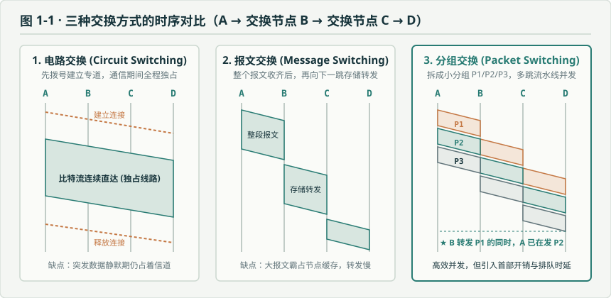

| 交换方式 | 核心机制 | 优点 | 缺点 |
| :--- | :--- | :--- | :--- |
| **电路交换** | 建立端到端物理专道，比特流直达 | 实时性强、无排队时延、按序到达 | 建立连接慢，突发数据下信道利用率极低 |
| **报文交换** | 整个报文收齐后逐跳存储转发 | 无需建立连接，动态占用链路 | 报文过长时转发时延大，占用大量节点缓存 |
| **分组交换** | 拆分为短分组，多跳流水线并发转发 | 信道利用率高、转发时延小、单点故障可自动绕行 | 首部开销、路由器排队时延、可能丢包或乱序 |

---

### 1.2 网络性能指标与四类时延

1. **速率、带宽与吞吐量**
   - **速率**：每秒传送的比特数，单位为 bit/s（bps）。通信速率中的千/兆/吉按十进制换算：1 kb/s = 10^3 bit/s，1 Mb/s = 10^6 bit/s，1 Gb/s = 10^9 bit/s。
   - **带宽**：数字信道所能传送的最高数据率（单位 bit/s）。
   - **吞吐量**：单位时间内通过某个网络或接口的实际数据量。
2. **四类时延（总时延 = 发送时延 + 传播时延 + 处理时延 + 排队时延）**
   - **发送时延（传输时延）**：主机或路由器将分组的全部比特推向通信链路所需的时间，发生在网卡发送器出口。
     `发送时延 = 数据帧长度 (bit) / 发送速率 (bit/s)`
   - **传播时延**：电磁波在信道中传播一定物理距离所需的时间，发生在物理传输媒体上（铜线约 2.3 × 10^8 m/s，光纤约 2.0 × 10^8 m/s）。提高带宽只会减小发送时延，不会改变传播时延。
     `传播时延 = 信道长度 (m) / 电磁波传播速率 (m/s)`
   - **处理时延**：主机或路由器收到分组后分析首部、检验差错、查找转发表所需的时间。
   - **排队时延**：分组在路由器输入/输出队列中等待处理和转发的时间，取决于当时的网络拥塞程度。
3. **时延带宽积与往返时间（RTT）**
   - **时延带宽积**：`时延带宽积 = 传播时延 × 带宽`，表示链路管道中正在传输的比特总量。
   - **往返时间（RTT）**：从发送方发送数据开始，到发送方收到接收方确认报文（ACK）为止所经历的总时间。

---

### 1.3 网络体系结构与五层模型

为了降低网络设计的复杂度，计算机网络采用**分层体系结构**：每一层只负责解决一类独立问题，在下一层提供服务的基础上实现本层功能，并向上一层提供服务接口。

- **OSI 七层模型**：理论参考模型（物理层、数据链路层、网络层、运输层、会话层、表示层、应用层）。
- **TCP/IP 四层模型**：工业界实际标准（网络接口层、网际层、运输层、应用层）。
- **五层协议体系结构**：综合 OSI 与 TCP/IP 的教学模型，自顶向下依次为应用层、运输层、网络层、数据链路层、物理层。

| 五层体系结构 | OSI 七层 | TCP/IP 四层 | 协议数据单元 (PDU) | 核心协议与设备 | 核心职责 |
| :--- | :--- | :--- | :--- | :--- | :--- |
| **5. 应用层** | 应用层 / 表示层 / 会话层 | 应用层 | 报文 (Message) | HTTP, DNS, DHCP | 定义应用进程交互的报文格式与规则 |
| **4. 运输层** | 运输层 | 运输层 | 报文段 (TCP) / 用户数据报 (UDP) | TCP, UDP | 通过端口号定位应用进程，提供端到端传输与可靠控制 |
| **3. 网络层** | 网络层 | 网际层 | IP 数据报 / 分组 (Packet) | IP, ICMP, ARP, OSPF（路由器） | 通过 IP 地址实现跨网段主机寻址与路由转发 |
| **2. 数据链路层** | 数据链路层 | 网络接口层 | 帧 (Frame) | Ethernet, PPP, VLAN（交换机） | 同一链路相邻节点间的帧定界、差错检测与 MAC 寻址 |
| **1. 物理层** | 物理层 | 网络接口层 | 比特 (Bit) | 双绞线, 光纤（集线器） | 屏蔽物理媒体差异，透明传输原始比特流 0 和 1 |

**数据的封装与解封装**：发送方自顶向下逐层附加本层首部（数据链路层还需附加尾部 FCS），最终转为比特流发送；接收方自底向上逐层剥离首部与尾部，还原数据交付应用进程。

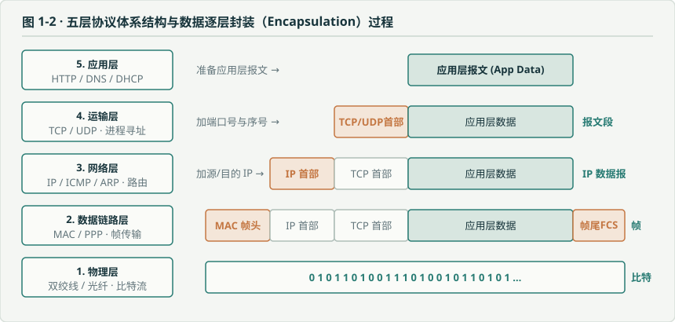

---

## 第二章 物理层

### 2.1 物理层的职责与四大特性

物理层用于屏蔽底层传输媒体（双绞线、光纤、无线信道）和通信手段的差异，使上面的数据链路层只需考虑如何传输比特流。物理层接口规程包含四个特性：

1. **机械特性**：接线器的形状、尺寸、引脚数目与排列。
2. **电气特性**：接口电缆各条线上出现的电压范围。
3. **功能特性**：某条线上出现的某一电平电压所表示的意义。
4. **过程特性**：不同功能的各种可能事件的出现顺序。

---

### 2.2 交互方式、数字编码与带通调制

1. **三种通信交互方式**
   - **单工通信**：只能单向传输，无反向交互（如广播）。
   - **半双工通信**：双方均可收发，但不能同时发送（如对讲机、传统集线器共享以太网）。
   - **全双工通信**：双方可以同时发送和接收（如电话、交换式以太网）。
2. **基带数字信号编码**
   - **不归零制（NRZ）**：正电平表示 1，负电平表示 0。缺点是传输连续的 1 或 0 时无电平跳变，接收端无法提取时钟同步信号。
   - **归零制（RZ）**：每个码元中间均归回零电平，占用过多带宽。
   - **曼彻斯特编码**：将每个码元周期等分为两半，**码元中心必发生一次电平跳变**（中心向下跳变表示 1，向上跳变表示 0，或反之）。中心跳变既表示数据，又直接提供自同步时钟信号（传统 10 Mbps 以太网采用）。
   - **差分曼彻斯特编码**：码元中心同样必跳变以提供时钟同步；**码元开始边界处有跳变表示 0，无跳变表示 1**，抗干扰性更强。

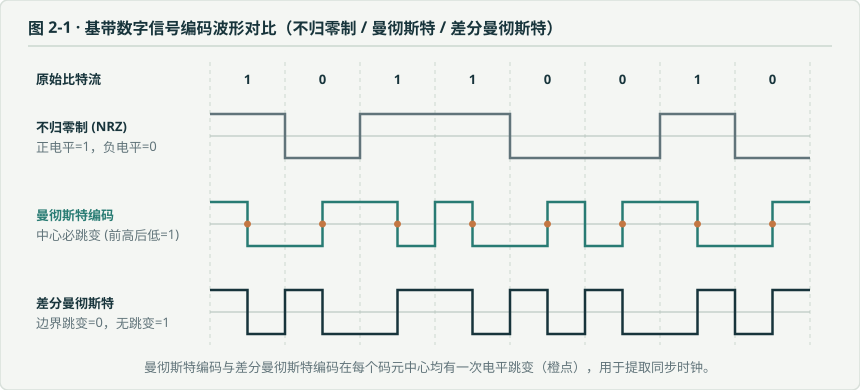

3. **带通调制（数字信号转模拟载波）**
   - **调幅（ASK）**：载波振幅随基带数字信号变化。
   - **调频（FSK）**：载波频率随基带数字信号变化。
   - **调相（PSK）**：载波初始相位随基带数字信号变化。
   - **正交振幅调制（QAM）**：结合振幅（ASK）与相位（PSK）共同调制。例如 16-QAM 共有 16 种相位与振幅组合状态，每个码元可携带 `log2(16) = 4 bit` 信息。

---

### 2.3 信道极限容量：奈氏准则与香农公式

1. **奈氏准则（限制码元传输速率，防止码间串扰）**
   - 高频分量衰减会导致脉冲展宽并相互重叠，产生**码间串扰**。在带宽为 W (Hz) 的理想低通信道中，无码间串扰的最高码元传输速率为：
     `最高码元传输速率 = 2W (Baud, 码元/秒)`
   - 若每个码元有 V 种离散状态（携带 `log2(V)` 比特），则理想低通信道下的极限数据传输率为 `2W × log2(V) (bit/s)`。
2. **香农公式（受限于热噪声的信息速率绝对上限）**
   - 当信道存在随机高斯白噪声时，码元状态数 V 无法无限细分。带宽为 W (Hz)、信噪比为 S/N 的信道，其无差错极限信息传输速率 C 为：
     `C = W × log2(1 + S / N) (bit/s)`
   - **信噪比分贝（dB）换算**：`信噪比 (dB) = 10 × log10(S / N)`。例如信噪比为 30 dB 时，`S/N = 10^(30/10) = 1000`。
   - **结论**：信道带宽 W 或信噪比 S/N 越大，极限速率 C 越高；只要实际传输速率低于 C，就一定存在实现无差错传输的编码方法。

---

### 2.4 传输媒体与信道复用技术

1. **导引型传输媒体**
   - **双绞线**：两根绝缘铜线相互绞合，利用差分信号抵消外部电磁干扰并减少自身电磁辐射。
   - **光纤**：利用光脉冲在纤芯内壁发生全反射传输。**多模光纤**纤芯粗，多条光线反射前进易产生色散，适于近距离；**单模光纤**纤芯极细，光线沿直线传播无多次反射，衰减小，适于长途干线。
2. **信道复用技术**
   - **频分复用（FDM）**：将总频带划分为多个子频带，所有用户在相同时间占用不同频率带宽。
   - **波分复用（WDM）**：光的频分复用，在一根光纤上同时传输多路不同波长（频率）的光载波。
   - **时分复用（TDM）**：将时间划分为等长帧，所有用户在固定的不同时间片占用相同频带。缺点是用户无数据时对应时隙依然空置，信道利用率低。
   - **统计时分复用（STDM）**：使用集中器按需动态分配时隙（有数据才分配，时隙内附带用户地址），消除了空闲时隙。

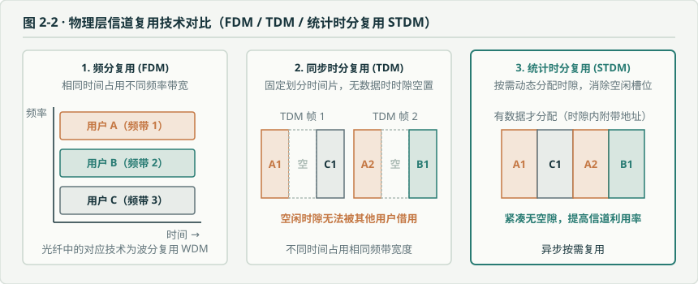

3. **码分复用（CDM / CDMA）与正交码片计算**
   - 各用户在相同时间、使用相同频带通信，每个站点分配一个唯一的 m 位**码片序列**（将 0 记为 -1，1 记为 +1）。
   - **发送规则**：发送比特 1 时发出原码片向量 S；发送比特 0 时发出反码向量 -S。
   - **正交约束**：任意两个不同站点的码片向量 S 与 T 正交，规格化内积为 0；自身规格化内积为 +1：
     `S · T = (1 / m) × Σ(Si × Ti) = 0` ， `S · S = +1` ， `S · (-S) = -1`
   - **接收端分离计算**：设信道总叠加信号为 X，接收端想提取 S 站的数据，只需计算规格化内积 `S · X`：
     - 结果为 **+1** → S 站发送了比特 **1**；
     - 结果为 **-1** → S 站发送了比特 **0**；
     - 结果为 **0** → S 站未发送数据。

---

## 第三章 数据链路层

### 3.1 数据链路层的三个基本问题

数据链路层在物理层提供的比特流服务基础上，通过规程控制将有差错的物理线路改造为对网络层无差错的数据链路。其核心任务是将网络层交下来的 IP 数据报组装成**帧（Frame）**，并在同一链路的相邻节点之间传输。所有数据链路层协议都必须解决以下三个基本问题：

1. **封装成帧（Framing）**
   - 在一段数据的前后分别添加**首部（Header）**和**尾部（Trailer）**，构成一个帧。首部和尾部包含帧定界符（如控制字符 SOH 表示帧首，EOT 表示帧尾），用于让接收端从连续的比特流中识别出帧的开始与结束位置。
   - **最大传送单元（MTU）**：规定帧的数据部分长度上限（以太网 MTU 默认为 **1500 字节**）。
2. **透明传输（Transparent Transmission）**
   - 如果数据部分恰好出现了与帧定界符相同的二进制编码，接收端会误认为帧已提前结束而截断丢弃。**透明传输**即无论数据中出现何种比特组合，都必须能原封不动地在链路上传输：
   - **字节填充（字符填充）**：面向字节的链路使用。发送端扫描数据部分，若数据中出现控制字符 SOH 或 EOT，则在其前面插入一个转义字符 ESC；若数据中本身出现了 ESC，同样在前面插入一个 ESC。接收端收到连续两个 ESC 时删除前一个，收到 ESC + EOT 时删除 ESC 并将其视为普通数据。
   - **零比特填充**：面向比特的链路（如 HDLC、同步 PPP）使用，以 `01111110`（连续 6 个 1）作为帧定界标志。发送端扫描数据比特流，**每当发现连续 5 个 1 时，立即在后面强制插入一个 0**，从而保证数据部分绝对不会出现连续 6 个 1；接收端收到连续 5 个 1 后自动删除紧跟的 0。
3. **差错检测（Error Detection）**
   - 广泛采用**循环冗余检验（CRC）**计算帧检验序列（FCS）：
   - **发送端计算**：设待发数据为 k 位，收发双方事先约定一个 (n + 1) 位的除数多项式 P。在数据后面补 n 个 0，然后用模 2 除法（按位异或，不进位不借位）除以 P，得到的 **n 位余数即为冗余码 FCS**，将其拼接到原始数据末尾发出。
   - **接收端检验**：将收到的整帧（含 FCS）用相同的除数 P 做模 2 除法。若余数为 0，判定该帧无差错并接受；若余数不为 0，判定该帧出错并**直接静默丢弃**。
   - **注意**：数据链路层的 CRC 仅实现**无比特差错接受**（检错丢弃），不包含重传机制；帧丢失、帧重复、帧失序属于可靠传输范畴，由上层（如 TCP）负责。

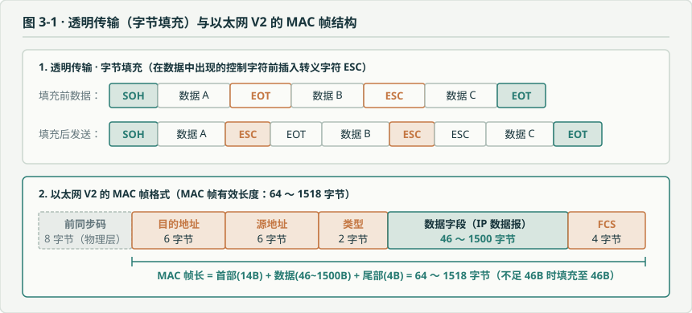

---

### 3.2 点对点协议 PPP

用户计算机拨号接入 ISP 或路由器间点对点专线直连时，数据链路层通常使用 **PPP（Point-to-Point Protocol）**。

1. **PPP 的组成**：
   - 一个将 IP 数据报封装到串行链路的方法；
   - **链路控制协议（LCP）**：用于建立、配置和测试数据链路连接；
   - **网络控制协议（NCP）**：用于协商网络层不同协议的参数。
2. **PPP 的设计特点**：因为点对点链路不存在多点竞争碰撞，PPP **不需要 MAC 地址**（地址字段固定填充 `0xFF`），也**不提供序号与确认重传机制**，仅通过尾部 2 字节 FCS 做 CRC 差错检验；异步传输时使用字节填充，同步 SONET/SDH 链路传输时使用零比特填充。

---

### 3.3 广播信道与 CSMA/CD 协议

早期的传统以太网将多台主机连接在同一根共享总线上（广播信道）。当多台主机同时发送帧时，信号会在总线上叠加产生**碰撞（冲突）**，导致数据全部损坏。为此传统半双工以太网采用 **CSMA/CD（载波监听多点接入 / 碰撞检测）** 协议：

1. **CSMA/CD 四大工作要点**
   - **多点接入**：多台计算机以多点接入方式连接在一根总线上（总线型网络）。
   - **载波监听（先听后发）**：发送数据前先检测总线上是否有其他计算机正在发送信号；若有则暂时等待，直到信道空闲满帧间最小间隔（9.6 μs）后再发送。
   - **碰撞检测（边发边听）**：发送过程中适配器边发送边检测信道上的信号电压摆动值。若摆动值超过门限，说明总线上至少有两台主机同时在发，发生了碰撞。
   - **强化碰撞与二进制指数退避（冲突停发、随机重传）**：一旦检测到碰撞，立即停止发送数据，并发出人为干扰信号通知所有站点；随后执行**截断二进制指数退避算法**——在第 k 次重传失败后（k = min(重传次数, 10)），从离散集合 [0, 1, ..., 2^k - 1] 中随机取一个数 r，等待 r × 争用期的时间后再重新尝试；若连续重传 16 次仍失败则丢弃该帧并向高层报错。
2. **争用期与最短有效帧长（64 字节）**
   - **争用期（碰撞窗口）**：设信号在总线最远两端之间的单程传播时延为 τ，则发送站发出帧后，最迟需要经过 **2τ**（信号传到最远端发生碰撞、碰撞信号再传回发送端）才能得知是否发生碰撞。这 2τ 即为争用期（10 Mbps 以太网规定争用期 2τ = 51.2 μs）。
   - **最短有效帧长推导**：CSMA/CD 必须在整帧发送完毕之前检测到可能发生的碰撞；若帧过短，在碰撞信号传回前（< 2τ）发送端已发完该帧并停止检测，将无法获知碰撞发生。因此**帧的发送时延必须不小于争用期 2τ**。在 10 Mbps 以太网中，51.2 μs 可发送 10 × 10^6 bit/s × 51.2 × 10^-6 s = 512 bit = **64 字节**。
   - **规定**：以太网最短有效帧长为 **64 字节**。若数据加上 18 字节帧首尾不足 64 字节，必须在数据字段后填充字节补足至 64 字节；任何长度小于 64 字节的帧均视为冲突碎片帧直接丢弃。

---

### 3.4 以太网 MAC 层、交换机与 VLAN

1. **MAC 地址（硬件地址 / 物理地址）**
   - 固化在网卡 ROM 中的 48 位（6 字节）全球唯一标识符（前 24 位为组织唯一标识符 OUI，后 24 位由厂家指派），用于在局域网（数据链路层）内标识收发节点。
2. **以太网 V2 的 MAC 帧格式**
   - 组成：**目的地址（6B）+ 源地址（6B）+ 类型（2B，指明上层协议，如 0x0800 为 IP 数据报）+ 数据（46～1500B）+ FCS（4B）**。
   - 帧首部（14B）与帧尾部（4B）合计 **18 字节**。由于最短有效帧长为 64 字节，数据字段最短为 64 - 18 = **46 字节**；物理层在帧前额外插入 8 字节前同步码以实现位同步。
3. **以太网交换机（Switch）与自学习算法**
   - 传统**集线器（Hub）**工作在物理层，只做信号放大转发，所有接口处于同一个**冲突域**，同一时刻只能有一台主机发送。
   - **以太网交换机**工作在数据链路层（多接口网桥），每个接口与所连主机形成独立的冲突域，支持**全双工无碰撞传输**（不再需要 CSMA/CD）。
   - **交换机自学习过程**：交换机内部维护一张空的 **MAC 地址表（转发表）**。每当从某个接口收到一个帧：
     1. **登记源地址**：读取帧的**源 MAC 地址**和进入接口号，写入或更新转发表（附带有效时间戳，超时自动删除以适应拓扑变化）；
     2. **查找目的地址**：读取帧的**目的 MAC 地址**查询转发表——若表中找到对应接口，则直接从该接口**单播转发**（若对应接口就是进入接口则直接丢弃）；若表中找不到，则向除进入接口外的所有其他接口**广播（泛洪）**。
   - **生成树协议（STP）**：当多台交换机互连存在物理环路以提供冗余时，广播帧会在环路中无限循环引发**广播风暴**。STP 通过逻辑阻塞部分冗余端口，将物理有环网路修剪成无环的树状拓扑。

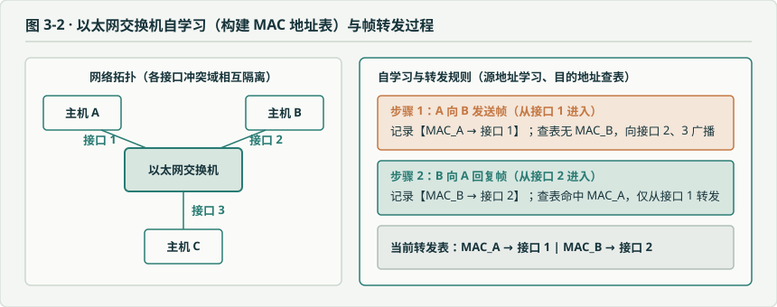

4. **虚拟局域网（VLAN）**
   - 交换机隔离了冲突域，但整个二层交换网络仍然属于同一个**广播域**（一旦发送 ARP 广播或未知目的 MAC 帧，全网主机都会收到）。
   - **VLAN（IEEE 802.1Q）**通过在标准以太网帧的源 MAC 地址与类型字段之间插入 **4 字节的 VLAN 标记（其中含 12 位 VLAN 标识符 VID）**，将一台或多台物理交换机上的端口在逻辑上划分为多个互不相通的独立广播域，限制广播风暴范围并提高安全性。

---

## 第四章 网络层

### 4.1 网络层的设计思路：虚电路 vs 数据报

数据链路层只解决同一个局域网内部的帧传输，而**网络层**负责在不同网段（异构网络）之间通过路由器实现主机到主机的分组转发。网络层向上提供何种服务曾有两种设计路线：

| 对比维度 | 虚电路服务（Virtual Circuit，电信网思路） | 数据报服务（Datagram，因特网 IP 采用） |
| :--- | :--- | :--- |
| **设计理念** | 可靠传输由**网络核心（交换节点）**负责 | 网络核心保持简单，可靠传输由**端系统（主机运输层）**负责 |
| **连接建立** | 通信前必须先建立逻辑连接（虚电路 VC），沿途路由器预留资源 | **无连接**，随时可直接发送分组 |
| **寻址与路由** | 仅在建立连接时寻路，后续分组只携带简短的虚电路号，按固定路径转发 | 每个分组必须携带完整的**源 IP 与目的 IP 地址**，路由器对每个分组独立查表选路 |
| **服务质量** | 保证按序、可靠交付；但路由器一旦故障，经过它的所有虚电路全部中断 | **尽最大努力交付（Best-Effort）**，不保证不丢失、不乱序；但某台路由器故障时后续分组可自动绕行其他路径 |

---

### 4.2 IPv4 地址演进：分类编址 → 子网划分 → 无分类编址 CIDR

IPv4 地址是由 **32 位二进制数**（4 字节，通常写成点分十进制如 `192.168.1.1`）组成的全网唯一逻辑地址，其结构始终遵循 `<网络号, 主机号>` 的两级或三级层次，经历了三个发展阶段：

1. **第一阶段：分类的 IP 地址**
   - **A 类**：前 8 位为网络号（首位固定为 0），网络号范围 1 ～ 126（0 表示本网络，127 用于本地环回测试 `127.0.0.1`），每个网络可容纳 2^24 - 2 台主机。
   - **B 类**：前 16 位为网络号（前 2 位固定为 10），首字节范围 128 ～ 191，每个网络可容纳 2^16 - 2 = 65534 台主机。
   - **C 类**：前 24 位为网络号（前 3 位固定为 110），首字节范围 192 ～ 223，每个网络可容纳 2^8 - 2 = 254 台主机。
   - **特殊地址**：主机号**全 0** 代表本网络的网络地址，主机号**全 1** 代表本网络的直接广播地址，因此可用主机数均需减 2。
   - **局限**：地址块粒度固定，B 类地址过大易造成大量 IP 闲置浪费，C 类地址过小不够中型机构使用。
2. **第二阶段：划分子网（Subnetting）与子网掩码**
   - **原理**：从原本的主机号字段中借用若干位作为**子网号**，使 IP 地址变为 `<网络号, 子网号, 主机号>` 三级结构。
   - **子网掩码**：32 位二进制数，对应网络号与子网号的位置全部填 **1**，对应主机号的位置全部填 **0**。
   - **子网地址计算**：将 **IP 地址** 与 **子网掩码** 做**逐位逻辑与（AND）运算**，即可得出该主机所在的子网网络地址。
3. **第三阶段：无分类编址 CIDR（构造超网）与路由聚合**
   - **原理**：取消 A/B/C 分类，采用**斜线记法**（如 `128.14.32.0/20`），表示前 20 位为**网络前缀**（对应掩码 `255.255.240.0`），后 12 位为主机号。
   - **路由聚合**：将多个连续子网合并为一个更大的 CIDR 地址块，在路由表中用一条汇总记录代替多条子网记录，缩减路由表规模。
   - **最长前缀匹配原则**：使用 CIDR 后，若路由表中存在多条匹配目的 IP 的记录，路由器必须选择**网络前缀最长（最具体）**的那条路由进行转发。

---

### 4.3 ARP 地址解析协议与跨网段转发过程

网络层使用 32 位 IP 地址寻路，而在局域网链路上发送帧时必须填写下一跳的 48 位 MAC 地址。**ARP（Address Resolution Protocol）** 用于**根据已知的 IP 地址解析出对应的 MAC 地址**。

1. **ARP 工作原理（同网段内）**
   - 每台主机维护一张 **ARP 高速缓存表**（记录本网段 `<IP 地址, MAC 地址>` 映射）。
   - 主机 A 向本网段主机 B 发送数据时，先查 ARP 缓存；若命中则直接填入 B 的 MAC 地址封装成帧。
   - 若未命中，主机 A 发送 **ARP 请求广播帧**（目的 MAC 为全 1 广播地址 `FF-FF-FF-FF-FF-FF`），询问目标 IP 对应的 MAC 地址；本网段只有目标主机 B 识别出该 IP，记录 A 的映射关系后，向 A 单播返回 **ARP 响应帧**告知自己的 MAC 地址。
2. **跨网段转发时的地址变化规律**
   - 若目的 IP 与源 IP 不在同一网段，源主机先通过 ARP 解析出本网段**默认网关（路由器接口）**的 MAC 地址，将帧发送给默认网关。
   - **核心规律**：在跨越多个路由器的整个转发过程中，IP 数据报首部中的**源 IP 地址和目的 IP 地址全程保持不变**（未启用 NAT 时）；而 MAC 帧首部中的**源 MAC 地址和目的 MAC 地址在每经过一台路由器时都会被剥离，并替换为当前跳发送接口 MAC 与下一跳接收接口 MAC**。

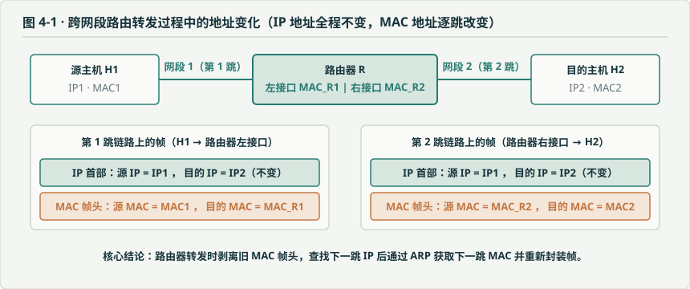

---

### 4.4 IP 数据报首部格式与分片计算

IPv4 数据报由**首部**和**数据**两部分组成，首部固定部分为 **20 字节**。

1. **20 字节固定首部关键字段**
   - **版本（4 位）**：IPv4 固定为 4。
   - **首部长度（4 位）**：以 **4 字节**为单位，最小值为 5（即 20 字节），最大值为 15（即 60 字节）。
   - **总长度（16 位）**：首部加数据的总长度，以**字节**为单位（最大 65535 字节）。
   - **标识（16 位）、标志（3 位）、片偏移（13 位）**：用于数据报分片与重组。
   - **生存时间 TTL（8 位）**：数据报可经过的路由器跳数上限。每经过一台路由器 TTL 减 1；减至 0 时路由器丢弃该包并返回 ICMP 超时差错报文，防止路由环路导致数据包无限循环。
   - **协议（8 位）**：指明数据部分交付给哪个运输层协议（6 为 TCP，17 为 UDP，1 为 ICMP）。
   - **首部检验和（16 位）**：**仅检验 IP 数据报首部，不检验数据部分**，每经过一台路由器需重新计算。
   - **源地址（32 位）与目的地址（32 位）**：发送方与接收方的 IPv4 地址。
2. **IP 数据报分片与片偏移计算**
   - 当 IP 数据报总长度超过下一段链路的 **MTU** 时，需切分为多个分片独立转发，到达**最终目的主机**后才重组。
   - **标识**：同一原始数据报的所有分片具有相同的标识值。
   - **标志（低 2 位）**：DF = 0 表示允许分片；**MF = 1 表示后面还有分片，MF = 0 表示这是最后一个分片**。
   - **片偏移（13 位）**：表示本分片数据在原始数据报数据区中的相对起始位置，**以 8 字节为偏移单位**（因此除最后一个分片外，每个分片的数据长度必须是 8 字节的整数倍）：

```text
片偏移值 = 当前分片数据在原始数据区中的起始字节号 / 8
```

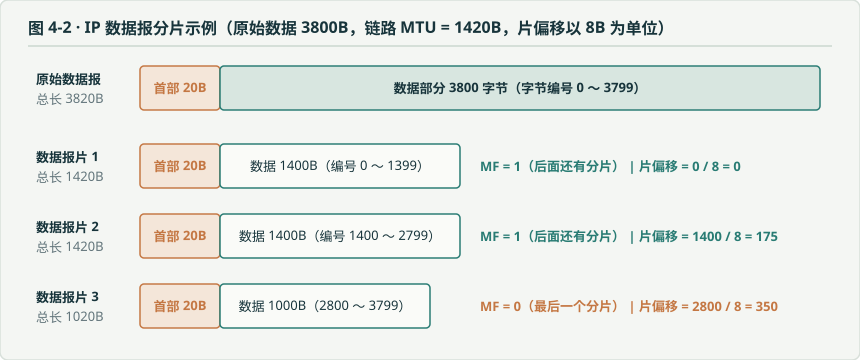

---

### 4.5 ICMP 协议、路由选择协议与 NAT

1. **网际控制报文协议 ICMP**
   - 封装在 IP 数据报内部传输（网络层协议），用于报告差错情况和探测网络状态。
   - **分类**：**ICMP 差错报告报文**（终点不可达、时间超过、参数问题、改变路由）与 **ICMP 询问报文**（回送请求和回答、时间戳请求和回答）。
   - **典型应用**：
     - **`ping`**：直接发送 ICMP 回送请求与回送回答报文测试连通性，不经过 TCP/UDP。
     - **`traceroute`**：先后发送 TTL = 1, 2, 3... 的探测包，利用沿途路由器丢包发回的 **ICMP 时间超过** 报文逐跳获取路径上各路由器的 IP 地址。
2. **路由选择协议（IGP 与 EGP）**
   - 因特网划分为多个**自治系统（AS）**，分为自治系统内部的**内部网关协议（IGP，如 RIP、OSPF）**和自治系统之间的**外部网关协议（EGP，如 BGP-4）**：

| 对比维度 | RIP（路由信息协议） | OSPF（开放最短路径优先） |
| :--- | :--- | :--- |
| **核心算法** | 距离向量算法（Bellman-Ford） | 链路状态算法（Dijkstra 最短路径） |
| **度量标准** | 跳数（最大 15 跳，**16 表示不可达**，仅适于小型网络） | 带宽、时延等综合费用（Cost），适用于大型网络 |
| **交换内容** | 当前已知的**整张路由表** | 本路由器相邻的所有**链路状态** |
| **交换对象与时机** | 仅与**相邻路由器**按 30 秒固定周期交换 | 用**洪泛法**向本 AS 内**所有路由器**发送；链路变化时触发 |
| **传输封装** | 使用 **UDP**（端口 520）封装 | 直接使用 **IP 数据报**（协议号 89）封装 |
| **收敛特性** | 收敛慢，存在“坏消息传得慢”（无穷计数路由环路问题） | 全网拓扑一致，收敛快、无路由环路 |

   - **外部网关协议 BGP-4**：在不同 AS 的边界路由器之间使用 **TCP**（端口 179）交换网络可达性信息和自治系统路径向量（AS-PATH），目标是寻找一条无环且符合策略的可达路由。
3. **专用地址与网络地址转换 NAT**
   - **专用地址（私有 IP，公网不予路由）**：`10.0.0.0/8`、`172.16.0.0/12`（172.16.0.0 ～ 172.31.255.255）、`192.168.0.0/16`。
   - **NAPT（网络地址与端口号转换）原理**：NAT 路由器将内网外出数据报的 `<源内网 IP : 源端口>` 替换为 `<路由器公网 IP : 新分配端口号>` 并记录转换表；外网响应返回时查表还原为 `<内网 IP : 源端口>` 转发，使多台内网主机共享一个公网 IP 通信。

---

## 第五章 运输层

### 5.1 运输层职责、端口号与 UDP/TCP 对比

网络层虽然能把分组送到目的主机（按 IP 地址寻址），但真正进行通信的实体是位于两台主机中的**应用程序进程**。**运输层（Transport Layer）**负责向应用层提供**端到端的进程间逻辑通信**。

1. **复用、分用与端口号（Port，16 位，范围 0 ～ 65535）**
   - **复用**：发送方不同的应用进程都可以使用同一个运输层协议传送数据。
   - **分用**：接收方的运输层剥去报文首部后，根据**目的端口号**将数据正确交付给对应的目的应用进程。
   - **端口分类**：
     - **熟知端口号（0 ～ 1023）**：指派给最重要应用协议（如 FTP: 21、SSH: 22、DNS: 53、HTTP: 80、HTTPS: 443）。
     - **登记端口号（1024 ～ 49151）**：供没有熟知端口的应用程序使用。
     - **短暂端口号（49152 ～ 65535）**：客户进程运行时由操作系统动态分配，通信结束后回收。
2. **UDP 与 TCP 核心特性对比**

| 对比维度 | UDP（用户数据报协议） | TCP（传输控制协议） |
| :--- | :--- | :--- |
| **是否建立连接** | **无连接**，发送数据前无需握手 | **面向连接**，通信前必须经过三次握手建立连接 |
| **可靠性保证** | **尽最大努力交付**，无确认、无重传、不保证按序到达 | **可靠交付**，通过确认、超时重传、序号机制保证无差错、不丢失、不重复且按序到达 |
| **数据传输单位** | **面向报文**，对应用层交下来的报文既不合并也不拆分，保留报文边界 | **面向字节流**，将应用层数据看作无结构的连续字节流，按窗口与 MSS 自行切分报文段 |
| **拥塞与流量控制** | **无拥塞控制**，网络拥塞时发送速率不变（实时性好） | **有流量控制与拥塞控制** |
| **通信端点关系** | 支持一对一、一对多、多对一和多对多（支持广播/多播） | 仅支持**点对点一对一**通信（每条 TCP 连接唯一由套接字四元组 `<源IP, 源端口, 目的IP, 目的端口>` 标识） |
| **首部开销** | 固定 **8 字节**（源端口 2B + 目的端口 2B + 长度 2B + 检验和 2B） | 最小 **20 字节**，最大 60 字节 |
| **典型应用场景** | DNS、DHCP、实时音视频、多人实时动作游戏状态同步 | HTTP/HTTPS、FTP、文件传输、金融交易、游戏登录与结算 |

---

### 5.2 可靠传输原理与 TCP 报文段首部

1. **可靠传输的演进：停止等待协议 → 连续 ARQ 与滑动窗口**
   - **停止等待协议**：每发送完一个分组就停止发送，等待对方确认（ACK），收到确认后再发下一个分组；若超时未收到确认则重传（超时重传时间 RTO 略大于往返时间 RTT）。缺点是等待期间信道完全闲置，信道利用率极低。
   - **连续 ARQ（自动重传请求）与滑动窗口**：发送方维持一个**发送窗口**，位于发送窗口内的多个分组无需等待确认即可**连续流水线发出**；接收方采用**累积确认**方式——不必对收到的每个分组逐一确认，而是对**按序到达的最后一个分组**发送确认，表示到这个分组为止的所有数据均已正确收齐。
2. **TCP 报文段 20 字节固定首部的关键字段**
   - **源端口（2B）与目的端口（2B）**：标识发送端与接收端的应用进程。
   - **序号 seq（4B，Sequence Number）**：TCP 是面向字节流的，连接传送的每一个字节都按顺序编号。首部中的序号字段值是**本报文段所发送数据的第一个字节的序号**。
   - **确认号 ack（4B，Acknowledgment Number）**：**期望收到对方下一个报文段的第一个数据字节的序号**。若确认号 ack = N，则表明到序号 N - 1 为止的所有字节都已正确收到（累积确认）。
   - **数据偏移（4 位）**：即 TCP 首部长度，以 **4 字节**为单位（最小为 5 即 20 字节，最大为 15 即 60 字节）。
   - **6 个控制标志位**：
     - **ACK**：ACK = 1 时确认号字段才有效（连接建立后所有传送的报文段都必须把 ACK 置 1）。
     - **SYN**：在连接建立时用来同步序号（SYN = 1, ACK = 0 为连接请求，SYN = 1, ACK = 1 为连接接受）。
     - **FIN**：FIN = 1 表示发送方数据已发完，要求释放单向连接。
     - **RST**：RST = 1 表示连接出现严重差错，必须强制释放重连。
     - **PSH**：提示接收端尽快将数据交付应用进程，不必等缓存填满。
     - **URG**：紧急指针有效。
   - **窗口 rwnd（2B）**：填写**接收方自己当前接收缓存还能容纳的字节数**（接收窗口），用于通知发送方控制发送速率。

---

### 5.3 TCP 滑动窗口与流量控制

1. **以字节为单位的滑动窗口**
   - 发送方的发送窗口由三个指针（P1、P2、P3）将字节序列划分为四部分：
     - **P1 之前**：已发送并已收到确认的字节（已从发送缓存移除）；
     - **P1 到 P2**：已发送但尚未收到确认的字节（暂存在发送缓存中，等待 ACK 或超时重传）；
     - **P2 到 P3**：允许立即发送但尚未发送的字节（称为**可用窗口**）；
     - **P3 之后**：超出发送窗口范围，暂不允许发送。
   - 当发送方收到接收方发来的确认号 ack 时，窗口后沿 P1 向右移动到 ack 位置；同时根据报文中的窗口值重新确定窗口前沿 P3。
   - **选择确认（SACK，Selective ACK）**：若中间某个报文段丢失，但后续报文段已乱序到达接收缓存，接收方可通过 TCP 首部选项中的 SACK 告知发送方哪些不连续字节块已经收妥，使发送方**只重传真正丢失的空缺字节块**，而不必重传后面已经正确到达的数据。

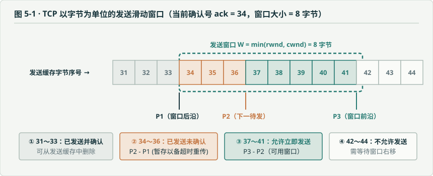

2. **TCP 流量控制（Flow Control）**
   - **目的**：让发送方的发送速率不要太快，防止接收方来不及读取而导致**接收方缓存溢出丢包**（属于端到端的速率匹配）。
   - **实现机制**：接收方在每次返回的确认报文段首部中，将**窗口字段（rwnd）**设为当前自身接收缓存的剩余空闲字节数，动态调整发送方的发送窗口上限。
   - **零窗口死锁与持续计时器（Persistence Timer）**：当接收方缓存已满，返回 rwnd = 0 的零窗口通知后，发送方暂停发送；之后若接收方腾出空间发出的非零窗口通知报文在网络中丢失，双方会陷入互相等待的死锁。为此，发送方收到零窗口通知时必须启动**持续计时器**，到期后发送一个仅含 1 字节数据的**零窗口探测报文段**，使接收方在回应中重新通告当前窗口大小。

---

### 5.4 TCP 拥塞控制（四大算法）

- **拥塞控制与流量控制的区别**：流量控制解决点对点接收端缓存不足问题；**拥塞控制（Congestion Control）**防止过多数据注入网络导致互联网中的路由器队列与链路过载。
- **发送窗口上限**：发送方维护一个状态变量**拥塞窗口（cwnd）**，发送窗口上限同时受接收方窗口和网络拥塞程度制约：

```text
真正的发送窗口上限 = min(接收方窗口 rwnd, 拥塞窗口 cwnd)
```

TCP 拥塞控制由以下四个核心算法组成（常以最大报文段长度 MSS 的个数为单位描述 cwnd）：

1. **慢开始（Slow Start）**
   - **触发条件**：连接刚建立或发生超时重传后，当 cwnd < ssthresh（慢开始门限）时使用。
   - **增长规律**：初始设 cwnd = 1；每收到一个对新报文段的确认，cwnd 加 1。因此**每经过一个传输轮次（一个 RTT），拥塞窗口 cwnd 翻倍（指数增长：1 → 2 → 4 → 8 → 16...）**。
2. **拥塞避免（Congestion Avoidance）**
   - **触发条件**：当 cwnd >= ssthresh 时切换为拥塞避免算法。
   - **增长规律**：**加法增大**——**每经过一个传输轮次（RTT），拥塞窗口 cwnd 仅线性加 1**，使窗口缓慢增长。
3. **发生超时（Timeout）时的处理**
   - 重传计时器超时说明网络已发生严重拥塞：
     1. 将慢开始门限更新为当前拥塞窗口的一半：`ssthresh = max(cwnd / 2, 2)`（**乘法减小**）；
     2. 将拥塞窗口直接重置为 **cwnd = 1**；
     3. 重新执行**慢开始**算法。
4. **快重传（Fast Retransmit）与快恢复（Fast Recovery）**
   - **快重传**：接收方每收到一个失序报文段，立即发出对已按序收到的最后一个字节的**重复确认（Duplicate ACK）**。一旦发送方**连续收到 3 个重复确认**，不必等待重传计时器超时，**立即重传对方尚未收到的报文段**。
   - **快恢复**：连续收到 3 个重复 ACK 说明网络仍有一定传输能力，因此不将 cwnd 降为 1，而是：
     1. 将慢开始门限减半：`ssthresh = cwnd / 2`；
     2. 将拥塞窗口设为减半后的新门限：**cwnd = ssthresh**；
     3. 直接执行**拥塞避免**算法（每轮线性加 1）。

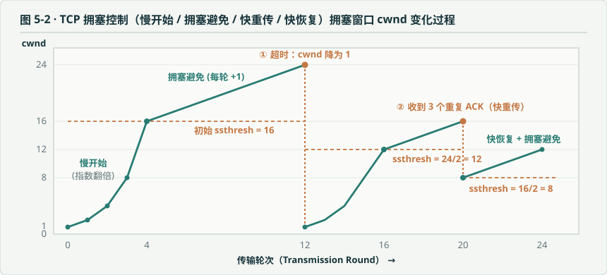

---

### 5.5 TCP 连接管理：三次握手与四次挥手

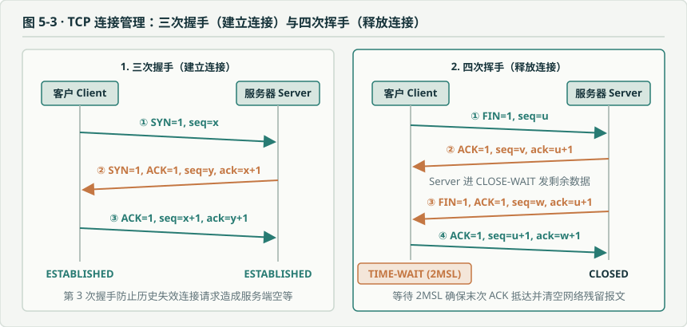

1. **三次握手建立连接**
   - **第 1 次握手**：客户端发送连接请求报文段（`SYN = 1, seq = x`），不携带数据但**消耗一个序号**，进入 `SYN-SENT` 状态。
   - **第 2 次握手**：服务器若同意连接，发回确认报文段（`SYN = 1, ACK = 1, seq = y, ack = x + 1`），不携带数据但**消耗一个序号**，进入 `SYN-RCVD` 状态。
   - **第 3 次握手**：客户端发回确认报文段（`ACK = 1, seq = x + 1, ack = y + 1`），不携带数据时不消耗序号；双方进入 `ESTABLISHED` 状态。
   - **三次握手的原因**：**防止已失效的历史连接请求报文段突然传送到服务器而产生错误**。若采用两次握手，滞留在网络中的历史连接请求到达服务器后，服务器发出确认即进入已建立连接状态并一直空等客户端数据，浪费服务器资源；三次握手下客户端不会对历史报文的确认发出第三次握手，服务器便不会建立无效连接。
2. **四次挥手释放连接**
   - **第 1 次挥手**：客户端发送连接释放报文段（`FIN = 1, seq = u`），停止发送数据，进入 `FIN-WAIT-1` 状态。
   - **第 2 次挥手**：服务器发回确认（`ACK = 1, seq = v, ack = u + 1`），进入 `CLOSE-WAIT`（半关闭）状态；客户端收到后进入 `FIN-WAIT-2` 状态。
     - **需要四次挥手的原因**：TCP 是全双工通道，客户端发 `FIN` 仅代表客户端不再发送数据，但此时**服务器可能还有剩余数据未发送完毕**，因此服务器需先回 `ACK`，待剩余数据全部发完后再单独发送 `FIN`。
   - **第 3 次挥手**：服务器数据发送完毕，发出连接释放报文段（`FIN = 1, ACK = 1, seq = w, ack = u + 1`），进入 `LAST-ACK` 状态。
   - **第 4 次挥手**：客户端发回最后一次确认（`ACK = 1, seq = u + 1, ack = w + 1`），进入 **`TIME-WAIT` 状态**；服务器收到后立即关闭，客户端则必须等待 **2MSL（两倍最长报文段寿命）** 后才进入 `CLOSED` 状态。
   - **等待 2MSL 的原因**：
     1. **保证客户端发送的最后一个 ACK 能到达服务器**：若该 ACK 丢失，服务器会超时重传 `FIN + ACK`，客户端可在 2MSL 内收到并重传 ACK。
     2. **消除本连接的残留报文**：经过 2MSL 后，本次连接产生的所有报文段均已在网络中彻底消失，不会干扰后续复用相同端口的新连接。

---

## 第六章 应用层

### 6.1 域名系统 DNS（Domain Name System）

应用层定义了应用进程间通信的报文规范。互联网核心采用 IP 地址寻址，但数字难以记忆，**DNS** 负责将人类易读的**域名（如 `www.example.com`）解析转换为机器使用的 IP 地址**，使用运输层 **UDP 协议（端口 53）** 传输以降低握手时延。

1. **层次树状域名空间与四类域名服务器**
   - 域名结构**由右向左级别递减**：`... . 三级域名 . 二级域名 . 顶级域名`（如 `.com`、`.cn` 为顶级域名）。
   - 四类域名服务器：**根域名服务器**（全球共 13 套逻辑根集群，知道所有顶级域名服务器的地址）→ **顶级域名服务器（TLD）** → **权限域名服务器**（负责某个具体区如 `example.com` 的最终解析）+ **本地域名服务器（Local DNS，ISP 提供）**。
2. **递归查询与迭代查询（常考区分）**
   - **主机向本地域名服务器的查询**：一般采用**递归查询（Recursive Query）**——主机只发一次请求给本地域名服务器；若本地域名服务器没有缓存，就以 DNS 客户的身份替主机去查，直到拿到最终 IP 再返回给主机。
   - **本地域名服务器向根/顶级/权限域名服务器的查询**：通常采用**迭代查询（Iterative Query）**——根域名服务器收到请求后，不替它往下查，而是直接告诉本地域名服务器：“下一步你应该去问哪个顶级域名服务器”；本地域名服务器再自己依次去问顶级域名服务器和权限域名服务器，最终查出目标 IP。

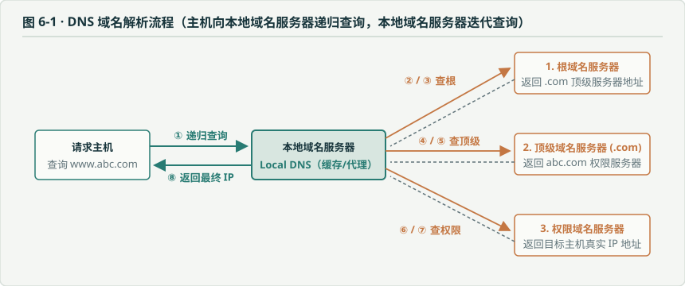

---

### 6.2 万维网、HTTP 与 HTTPS

1. **HTTP（超文本传输协议，基于 TCP 端口 80）**
   - **无状态性（Stateless）**：HTTP 服务器默认不记录哪个客户端曾访问过它。为了在电商购物车、登录态中跟踪用户状态，引入了 **Cookie**（保存在客户端浏览器的小文本，每次请求自动在首部携带）与 **Session**（保存在服务端内存/数据库中的会话记录，通过 Cookie 中的 Session ID 关联）。
   - **连接方式演进**：
     - **HTTP/1.0（非持续连接）**：每请求一个文档或图片都要重新建立一次 TCP 连接（耗费 `2 × RTT`：1 个 RTT 用于 TCP 三次握手，1 个 RTT 用于 HTTP 请求与响应），开销极大。
     - **HTTP/1.1（持续连接 Persistent Connection）**：默认开启 `Connection: keep-alive`，服务器发送响应后保持该 TCP 连接一段时间，后续多个页面元素可在同一条连接上连续传输（支持流水线方式）。
     - **HTTP/2**：引入二进制分帧、多路复用、首部压缩，解决应用层队头阻塞。
   - **HTTP 报文结构与状态码**：
     - 请求方法：`GET`（请求读取资源）、`POST`（向服务器提交表单数据）、`HEAD`、`PUT`、`DELETE`。
     - 常见状态码：**`1xx`**（通知信息）、**`2xx`**（成功，如 `200 OK`）、**`3xx`**（重定向，如 `301` 永久移动、`302` 临时移动、`304` 未修改走本地缓存）、**`4xx`**（客户端差错，如 `403` 禁止访问、`404 Not Found`）、**`5xx`**（服务器差错，如 `500` 内部错误、`502` 网关错误）。
2. **HTTPS（HTTP over TLS/SSL，基于 TCP 端口 443）**
   - HTTP 明文传输易遭受窃听、篡改和伪装。HTTPS 在 HTTP 与 TCP 之间加入了 **TLS/SSL 安全层**，采用**非对称加密与对称加密相结合的混合加密机制**：
     1. **非对称加密（公钥 + 私钥）**：安全性高但加解密计算极慢，因此**仅在 TLS 握手阶段用于验证数字证书（CA 签发，防中间人伪造公钥）并安全协商出一个临时的“对称会话密钥”**。
     2. **对称加密（双方共用同一个会话密钥）**：握手完成后，后续所有 HTTP 报文正文均使用刚才协商出的**对称会话密钥**进行高速加密传输，并通过消息认证码校验完整性。

---

### 6.3 动态主机配置协议 DHCP

一台新接入局域网的主机最初没有 IP 地址、子网掩码、默认网关和本地 DNS 服务器地址。**DHCP（Dynamic Host Configuration Protocol）** 提供即插即用联网机制，使用 **UDP 协议**（客户端端口 **68**，服务器端口 **67**）。因为客户端此时还没有 IP 地址，全程需借助 **UDP 广播**完成四步交互：

1. **DHCP 发现报文（DHCP DISCOVER）**：客户端广播发送（源 IP 填 `0.0.0.0`，目的 IP 填广播地址 `255.255.255.255`），寻找局域网内的 DHCP 服务器。
2. **DHCP 提供报文（DHCP OFFER）**：DHCP 服务器收到后，从地址池中挑出一个待租用 IP 地址，广播返回提供报文。
3. **DHCP 请求报文（DHCP REQUEST）**：客户端若收到多个服务器的提供，从中选择最先到达的一个，广播发送请求报文正式申请租用该 IP。
4. **DHCP 确认报文（DHCP ACK）**：被选中的 DHCP 服务器广播返回确认报文，客户端拿到 IP、子网掩码、默认网关、DNS 地址并进入已绑定状态（租期过半 `50%` 时客户端单播向服务器请求续租）。

---

### 6.4 全书总结：在浏览器输入 URL 到页面显示的完整五层流转过程

将前六章所有协议串联起来，当用户在刚开机的电脑浏览器中输入 `https://www.example.com/index.html` 并按下回车时，五层协议栈按以下顺序依次协作：

1. **主机自动获取网络配置（应用层 DHCP → 运输层 UDP → 网络层 IP 广播 → 链路层以太网广播）**
   - 若本机刚接入网络尚未配置 IP，先通过 **DHCP 四步广播（Discover → Offer → Request → ACK）** 获取本机 IP、子网掩码、默认网关 IP 以及本地 DNS 服务器 IP。
2. **解析默认网关的 MAC 地址（网络层 ARP → 链路层广播）**
   - 本机要向外网发送任何数据包，都必须先经过默认网关（路由器）。本机将默认网关 IP 与子网掩码做 AND 确认同网段后，发送 **ARP 请求广播帧**，获得默认网关接口的 **MAC 地址**。
3. **域名解析获取目标服务器 IP（应用层 DNS → 运输层 UDP 53 端口）**
   - 浏览器先查自身缓存、操作系统缓存与本地 `hosts` 文件；若均未命中，向本地 DNS 服务器发送 **DNS 查询报文**（UDP 53 端口），经递归与迭代查询（根 → `.com` 顶级 → `example.com` 权限域名服务器），获得 `www.example.com` 对应的**目标服务器 IP 地址**。
4. **建立 TCP 可靠连接（运输层 TCP 三次握手 → 网络层 IP 路由 → 链路层逐跳 MAC 转发）**
   - 浏览器拿到目标 IP 和端口（443），向服务器发起 **TCP 三次握手**（`SYN` → `SYN+ACK` → `ACK`）。
   - 每个握手报文段向下封装为 **IP 数据报**（源 IP 为本机，目的 IP 为目标服务器；若经过家庭路由器 NAT，源 IP 会被替换为公网 IP），再封装为 **MAC 帧**；沿途每台路由器根据 **OSPF/BGP 路由表**按**最长前缀匹配**查找下一跳，逐跳剥离并替换源/目的 MAC 地址，最终抵达目标服务器完成三次握手。
5. **TLS 安全握手与 HTTP 请求/响应（应用层 HTTPS / HTTP + 运输层滑动窗口与拥塞控制）**
   - TCP 连接建立后，双方先完成 **TLS 握手**：服务器下发 CA 数字证书，客户端验证证书合法性后，通过非对称加密协商出对称会话密钥。
   - 浏览器发送加密后的 **`HTTP GET /index.html` 请求报文**；服务器处理后返回 `200 OK` 及 HTML 正文。传输过程中，TCP 通过**滑动窗口、确认重传、流量控制（`rwnd`）与拥塞控制（慢开始/拥塞避免/快重传/快恢复）**保证网页字节流无差错按序到达。
6. **浏览器渲染与连接释放（TCP 四次挥手）**
   - 浏览器解析 HTML/CSS/JS 并渲染出页面；当持续连接空闲超时或关闭页面后，双方通过 **TCP 四次挥手**（客户端历经 `2MSL` 的 `TIME-WAIT` 状态）安全释放连接。
